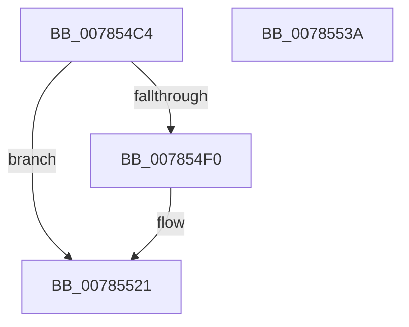

# PspSetIoPriorityLimitJobTree

- RVA: `0x007854C4`–`0x0078553B` (길이 `119` bytes)
- VA: `0x00000001407854C4`
- 실행 섹션: `PAGE`
- PDB 이름 있음: `예`; PDB Function 태그: `아니요`
- unwind 정보 RVA: `0x0009A6A8`
- 디코드: `29`개 명령, `119/119` bytes 표시
- 미해석 바이트: `0` (있으면 어셈블리에 `.byte`로 보존)

> 이 문서는 커널 이미지의 기계어와 PDB 기호를 분석해 생성했습니다. 4번과 5번은 함수 원형과 자료형을 바이너리 사용 방식에서 추정한 C 해석이며 원본 소스 복구 결과는 아닙니다.

## 1. Dependencies

- 직접 호출 지점: **3**; 고유 호출 대상: **3**
- 직접 호출자로 확인된 함수: **1**
- RIP 상대 이미지 참조: **2**

### Outgoing calls
- `0x007854E3` → [ExAcquireResourceExclusiveLite](../../text/21/ExAcquireResourceExclusiveLite_function_00214E20.md) (function, `0x00214E20`)
- `0x0078551C` → [PspEnumJobsAndProcessesInJobHierarchy](../91/PspEnumJobsAndProcessesInJobHierarchy_function_0091A1EC.md) (function, `0x0091A1EC`)
- `0x00785525` → [ExReleaseResourceLite](../../text/25/ExReleaseResourceLite_function_0025FA10.md) (function, `0x0025FA10`)

### Direct callers
- [NtSetInformationJobObject](../9F/NtSetInformationJobObject_function_009F84C0.md) at `0x009FACCD`

### Static image references
- `0x007854FD` → RVA `0x00A7E330` (`PspSetProcessIoPriorityLimitCallback`; read)
- `0x00785512` → RVA `0x00785550` (`PspSetJobIoPriorityLimitPreCallback`; read)

## 2. Other-region calls and transfers

- 다른 실행 섹션으로 향하는 call: **2**
  - `0x007854E3` → [ExAcquireResourceExclusiveLite](../../text/21/ExAcquireResourceExclusiveLite_function_00214E20.md) (`PAGE` → `.text`)
  - `0x00785525` → [ExReleaseResourceLite](../../text/25/ExReleaseResourceLite_function_0025FA10.md) (`PAGE` → `.text`)
- 별도 외부 분기/꼬리 이동을 확인하지 못했습니다.

## 3. Assembly (complete function range)

```asm
007854C4  48 89 5C 24 08                  mov qword ptr [rsp + 8], rbx
007854C9  48 89 74 24 18                  mov qword ptr [rsp + 0x18], rsi
007854CE  57                              push rdi
007854CF  48 83 EC 30                     sub rsp, 0x30
007854D3  83 64 24 48 00                  and dword ptr [rsp + 0x48], 0
007854D8  8B F2                           mov esi, edx
007854DA  48 8B D9                        mov rbx, rcx
007854DD  B2 01                           mov dl, 1
007854DF  48 83 C1 38                     add rcx, 0x38
007854E3  E8 38 F9 A8 FF                  call 0x140214e20
007854E8  3B B3 40 04 00 00               cmp esi, dword ptr [rbx + 0x440]
007854EE  74 31                           je 0x140785521
007854F0  48 8D 44 24 48                  lea rax, [rsp + 0x48]
007854F5  C7 44 24 28 05 00 00 00         mov dword ptr [rsp + 0x28], 5
007854FD  4C 8D 0D 2C 8E 2F 00            lea r9, [rip + 0x2f8e2c]
00785504  48 89 44 24 20                  mov qword ptr [rsp + 0x20], rax
00785509  45 33 C0                        xor r8d, r8d
0078550C  89 B3 40 04 00 00               mov dword ptr [rbx + 0x440], esi
00785512  48 8D 15 37 00 00 00            lea rdx, [rip + 0x37]
00785519  48 8B CB                        mov rcx, rbx
0078551C  E8 CB 4C 19 00                  call 0x14091a1ec
00785521  48 8D 4B 38                     lea rcx, [rbx + 0x38]
00785525  E8 E6 A4 AD FF                  call 0x14025fa10
0078552A  48 8B 5C 24 40                  mov rbx, qword ptr [rsp + 0x40]
0078552F  48 8B 74 24 50                  mov rsi, qword ptr [rsp + 0x50]
00785534  48 83 C4 30                     add rsp, 0x30
00785538  5F                              pop rdi
00785539  C3                              ret
0078553A  CC                              int3
```

## 4. C-style interpretation (structured pseudocode)

```c
__int64 __fastcall PspSetIoPriorityLimitJobTree(__int64 a1, int a2, int a3)
{
    __int64 result;
    __int64 v_rsp;
    unsigned int v_stack_m10;
    unsigned __int64 v_stack_m18;
    unsigned int v_stack_p10;
    unsigned __int64 v_stack_p18;
    unsigned __int64 v_stack_p8;

    v_stack_p8 = v_rbx;
    v_stack_p18 = v_rsi;
    v_rsp = (v_rsp) - (48);
    a1 = (a1) + (56);
    result = ExAcquireResourceExclusiveLite(a1, 1, a3, a4);
    if (((unsigned int)((unsigned int)(a2))) != (*(unsigned int *)(a1 + 1088))) {
        result = v_stack_p10;
        v_stack_m10 = 5;
        a4 = v_rip + 3116588;
        v_stack_m18 = result;
        a3 = 0;
        *(unsigned int *)(a1 + 1088) = (unsigned int)((unsigned int)(a2));
        a2 = v_rip + 55;
        a1 = a1;
        result = PspEnumJobsAndProcessesInJobHierarchy(a1, a2, a3, a4);
    }
    result = ExReleaseResourceLite(a1 + 56, a2, a3, a4);
    v_rsp = (v_rsp) + (48);
    return result;
}
```

## 5. (Beta) C Style

```c
int64_t PspSetIoPriorityLimitJobTree(void *Arg1, int32_t Arg2, int32_t Arg3)
{
    uint8_t *arg1 = (uint8_t *)Arg1;

    int64_t result;
    int64_t local_rsp;
    uint32_t v_stack_m10;
    uint64_t v_stack_m18;
    uint32_t v_stack_p10;
    uint64_t v_stack_p18;
    uint64_t v_stack_p8;

    v_stack_p8 = local_rbx;
    v_stack_p18 = local_rsi;
    local_rsp = (local_rsp) - (48);
    Arg1 = (Arg1) + (56);
    result = ExAcquireResourceExclusiveLite(Arg1, 1, Arg3, a4);
    if (((uint32_t)((uint32_t)(Arg2))) != (*(uint32_t *)(arg1 + 0x440))) {
        result = v_stack_p10;
        v_stack_m10 = 5;
        a4 = v_rip + 3116588;
        v_stack_m18 = result;
        Arg3 = 0;
        *(uint32_t *)(arg1 + 0x440) = (uint32_t)((uint32_t)(Arg2));
        Arg2 = v_rip + 55;
        Arg1 = Arg1;
        result = PspEnumJobsAndProcessesInJobHierarchy(Arg1, Arg2, Arg3, a4);
    }
    result = ExReleaseResourceLite(Arg1 + 56, Arg2, Arg3, a4);
    local_rsp = (local_rsp) + (48);
    return result;
}
```

### 관측된 메모리 오프셋

구조체 형식이 확인되지 않은 접근은 인자 기준의 오프셋으로만 기록했습니다.

| 기준 인자 | 오프셋 표현 | 폭 (bit) | 접근 |
|---|---:|---:|---|
| `Arg1` | `+ 0x38` | `64` | `R` |
| `Arg1` | `+ 0x440` | `32` | `R` |
| `Arg1` | `+ 0x440` | `32` | `W` |

## 6. Execution-region graph

[열기: 2D/3D 그래프와 함수 탐색 컨트롤 패널](../../../control-panel.html?section=page&rva=0x007854C4&view=graph)

- 2D 그래프는 위에서 아래로 흐르고, 3D 그래프는 빈 공간을 드래그해 회전합니다. Shift+드래그는 이동, 휠은 확대·축소, 함수 노드 선택은 대상 보고서 이동입니다.

### Static fallback


