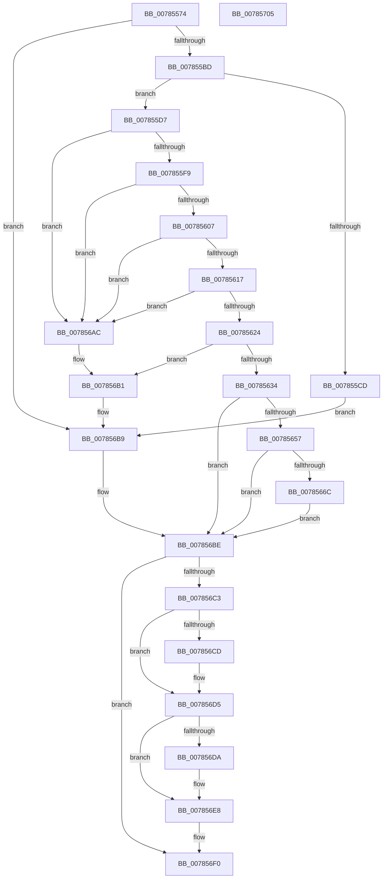

# PspSetJobMemoryPartition

- RVA: `0x00785574`–`0x00785706` (길이 `402` bytes)
- VA: `0x0000000140785574`
- 실행 섹션: `PAGE`
- PDB 이름 있음: `예`; PDB Function 태그: `아니요`
- unwind 정보 RVA: `0x000A2264`
- 디코드: `103`개 명령, `402/402` bytes 표시
- 미해석 바이트: `0` (있으면 어셈블리에 `.byte`로 보존)

> 이 문서는 커널 이미지의 기계어와 PDB 기호를 분석해 생성했습니다. 4번과 5번은 함수 원형과 자료형을 바이너리 사용 방식에서 추정한 C 해석이며 원본 소스 복구 결과는 아닙니다.

## 1. Dependencies

- 직접 호출 지점: **13**; 고유 호출 대상: **10**
- 직접 호출자로 확인된 함수: **1**
- RIP 상대 이미지 참조: **0**

### Outgoing calls
- `0x007855AE` → [PsReferencePartitionByHandle](../90/PsReferencePartitionByHandle_function_0090337C.md) (function, `0x0090337C`)
- `0x007855E4` → [ExAcquireResourceExclusiveLite](../../text/21/ExAcquireResourceExclusiveLite_function_00214E20.md) (function, `0x00214E20`)
- `0x007855EC` → [PsIsServerSilo](../../text/22/PsIsServerSilo_function_00225828.md) (function, `0x00225828`)
- `0x00785629` → [PspConvertJobToMixed](../70/PspConvertJobToMixed_function_0070449C.md) (function, `0x0070449C`)
- `0x0078563F` → [ExReleaseResourceLite](../../text/25/ExReleaseResourceLite_function_0025FA10.md) (function, `0x0025FA10`)
- `0x0078564C` → [SmCreatePartition](../A4/SmCreatePartition_function_00A4BC90.md) (function, `0x00A4BC90`)
- `0x00785661` → [PsAssignProcessToJobObject](../A2/PsAssignProcessToJobObject_function_00A23190.md) (function, `0x00A23190`)
- `0x00785674` → [ObfReferenceObjectWithTag](../../text/21/ObfReferenceObjectWithTag_function_00210710.md) (function, `0x00210710`)
- `0x0078567F` → [ExAcquireResourceExclusiveLite](../../text/21/ExAcquireResourceExclusiveLite_function_00214E20.md) (function, `0x00214E20`)
- `0x00785695` → [ExReleaseResourceLite](../../text/25/ExReleaseResourceLite_function_0025FA10.md) (function, `0x0025FA10`)
- `0x007856A0` → [SmPartitionJobPaired](../7A/SmPartitionJobPaired_function_007A5E34.md) (function, `0x007A5E34`)
- `0x007856B4` → [ExReleaseResourceLite](../../text/25/ExReleaseResourceLite_function_0025FA10.md) (function, `0x0025FA10`)
- `0x007856EB` → [PsDereferencePartition](../../text/34/PsDereferencePartition_function_00342E70.md) (function, `0x00342E70`)

### Direct callers
- [NtSetInformationJobObject](../9F/NtSetInformationJobObject_function_009F84C0.md) at `0x009FAFBB`

### Static image references
- 디코드된 RIP-relative 메모리 참조가 없습니다.

## 2. Other-region calls and transfers

- 다른 실행 섹션으로 향하는 call: **8**
  - `0x007855E4` → [ExAcquireResourceExclusiveLite](../../text/21/ExAcquireResourceExclusiveLite_function_00214E20.md) (`PAGE` → `.text`)
  - `0x007855EC` → [PsIsServerSilo](../../text/22/PsIsServerSilo_function_00225828.md) (`PAGE` → `.text`)
  - `0x0078563F` → [ExReleaseResourceLite](../../text/25/ExReleaseResourceLite_function_0025FA10.md) (`PAGE` → `.text`)
  - `0x00785674` → [ObfReferenceObjectWithTag](../../text/21/ObfReferenceObjectWithTag_function_00210710.md) (`PAGE` → `.text`)
  - `0x0078567F` → [ExAcquireResourceExclusiveLite](../../text/21/ExAcquireResourceExclusiveLite_function_00214E20.md) (`PAGE` → `.text`)
  - `0x00785695` → [ExReleaseResourceLite](../../text/25/ExReleaseResourceLite_function_0025FA10.md) (`PAGE` → `.text`)
  - `0x007856B4` → [ExReleaseResourceLite](../../text/25/ExReleaseResourceLite_function_0025FA10.md) (`PAGE` → `.text`)
  - `0x007856EB` → [PsDereferencePartition](../../text/34/PsDereferencePartition_function_00342E70.md) (`PAGE` → `.text`)
- 별도 외부 분기/꼬리 이동을 확인하지 못했습니다.

## 3. Assembly (complete function range)

```asm
00785574  4C 8B DC                        mov r11, rsp
00785577  49 89 5B 08                     mov qword ptr [r11 + 8], rbx
0078557B  49 89 6B 10                     mov qword ptr [r11 + 0x10], rbp
0078557F  56                              push rsi
00785580  57                              push rdi
00785581  41 56                           push r14
00785583  48 83 EC 30                     sub rsp, 0x30
00785587  49 83 63 20 00                  and qword ptr [r11 + 0x20], 0
0078558C  48 8B F1                        mov rsi, rcx
0078558F  49 8D 4B 20                     lea rcx, [r11 + 0x20]
00785593  49 8B C0                        mov rax, r8
00785596  49 89 4B D8                     mov qword ptr [r11 - 0x28], rcx
0078559A  44 8A C2                        mov r8b, dl
0078559D  48 8B C8                        mov rcx, rax
007855A0  41 B9 50 73 4A 62               mov r9d, 0x624a7350
007855A6  BA 01 00 00 00                  mov edx, 1
007855AB  45 32 F6                        xor r14b, r14b
007855AE  E8 C9 DD 17 00                  call 0x14090337c
007855B3  8B D8                           mov ebx, eax
007855B5  85 C0                           test eax, eax
007855B7  0F 88 FC 00 00 00               js 0x1407856b9
007855BD  48 8B 44 24 68                  mov rax, qword ptr [rsp + 0x68]
007855C2  F0 0F BA A8 88 00 00 00 00      lock bts dword ptr [rax + 0x88], 0
007855CB  73 0A                           jae 0x1407855d7
007855CD  BB BB 00 00 C0                  mov ebx, 0xc00000bb
007855D2  E9 E2 00 00 00                  jmp 0x1407856b9
007855D7  41 B6 01                        mov r14b, 1
007855DA  48 8D 6E 38                     lea rbp, [rsi + 0x38]
007855DE  41 8A D6                        mov dl, r14b
007855E1  48 8B CD                        mov rcx, rbp
007855E4  E8 37 F8 A8 FF                  call 0x140214e20
007855E9  48 8B CE                        mov rcx, rsi
007855EC  E8 37 02 AA FF                  call 0x140225828
007855F1  84 C0                           test al, al
007855F3  0F 85 B3 00 00 00               jne 0x1407856ac
007855F9  48 83 BE 00 07 00 00 00         cmp qword ptr [rsi + 0x700], 0
00785601  0F 85 A5 00 00 00               jne 0x1407856ac
00785607  48 8D 86 08 05 00 00            lea rax, [rsi + 0x508]
0078560E  48 39 00                        cmp qword ptr [rax], rax
00785611  0F 85 95 00 00 00               jne 0x1407856ac
00785617  83 BE D8 00 00 00 00            cmp dword ptr [rsi + 0xd8], 0
0078561E  0F 85 88 00 00 00               jne 0x1407856ac
00785624  BA 01 00 00 00                  mov edx, 1
00785629  E8 6E EE F7 FF                  call 0x14070449c
0078562E  8B D8                           mov ebx, eax
00785630  85 C0                           test eax, eax
00785632  78 7D                           js 0x1407856b1
00785634  48 83 8E 00 07 00 00 FF         or qword ptr [rsi + 0x700], 0xffffffffffffffff
0078563C  48 8B CD                        mov rcx, rbp
0078563F  E8 CC A3 AD FF                  call 0x14025fa10
00785644  48 8B 7C 24 68                  mov rdi, qword ptr [rsp + 0x68]
00785649  48 8B CF                        mov rcx, rdi
0078564C  E8 3F 66 2C 00                  call 0x140a4bc90
00785651  8B D8                           mov ebx, eax
00785653  85 C0                           test eax, eax
00785655  78 67                           js 0x1407856be
00785657  48 8B 57 78                     mov rdx, qword ptr [rdi + 0x78]
0078565B  45 33 C0                        xor r8d, r8d
0078565E  48 8B CE                        mov rcx, rsi
00785661  E8 2A DB 29 00                  call 0x140a23190
00785666  8B D8                           mov ebx, eax
00785668  85 C0                           test eax, eax
0078566A  78 52                           js 0x1407856be
0078566C  BA 50 73 4A 62                  mov edx, 0x624a7350
00785671  48 8B CF                        mov rcx, rdi
00785674  E8 97 B0 A8 FF                  call 0x140210710
00785679  41 8A D6                        mov dl, r14b
0078567C  48 8B CD                        mov rcx, rbp
0078567F  E8 9C F7 A8 FF                  call 0x140214e20
00785684  48 8B CD                        mov rcx, rbp
00785687  48 89 BE 00 07 00 00            mov qword ptr [rsi + 0x700], rdi
0078568E  48 89 B6 08 07 00 00            mov qword ptr [rsi + 0x708], rsi
00785695  E8 76 A3 AD FF                  call 0x14025fa10
0078569A  48 8B D6                        mov rdx, rsi
0078569D  48 8B CF                        mov rcx, rdi
007856A0  E8 8F 07 02 00                  call 0x1407a5e34
007856A5  45 32 F6                        xor r14b, r14b
007856A8  33 DB                           xor ebx, ebx
007856AA  EB 12                           jmp 0x1407856be
007856AC  BB BB 00 00 C0                  mov ebx, 0xc00000bb
007856B1  48 8B CD                        mov rcx, rbp
007856B4  E8 57 A3 AD FF                  call 0x14025fa10
007856B9  48 8B 7C 24 68                  mov rdi, qword ptr [rsp + 0x68]
007856BE  48 85 FF                        test rdi, rdi
007856C1  74 2D                           je 0x1407856f0
007856C3  48 83 BE 00 07 00 00 FF         cmp qword ptr [rsi + 0x700], -1
007856CB  75 08                           jne 0x1407856d5
007856CD  48 83 A6 00 07 00 00 00         and qword ptr [rsi + 0x700], 0
007856D5  45 84 F6                        test r14b, r14b
007856D8  74 0E                           je 0x1407856e8
007856DA  F0 0F BA B7 88 00 00 00 00      lock btr dword ptr [rdi + 0x88], 0
007856E3  48 8B 7C 24 68                  mov rdi, qword ptr [rsp + 0x68]
007856E8  48 8B CF                        mov rcx, rdi
007856EB  E8 80 D7 BB FF                  call 0x140342e70
007856F0  48 8B 6C 24 58                  mov rbp, qword ptr [rsp + 0x58]
007856F5  8B C3                           mov eax, ebx
007856F7  48 8B 5C 24 50                  mov rbx, qword ptr [rsp + 0x50]
007856FC  48 83 C4 30                     add rsp, 0x30
00785700  41 5E                           pop r14
00785702  5F                              pop rdi
00785703  5E                              pop rsi
00785704  C3                              ret
00785705  CC                              int3
```

## 4. C-style interpretation (structured pseudocode)

```c
__int64 __fastcall PspSetJobMemoryPartition(__int64 a1, unsigned __int8 a2, __int64 a3)
{
    __int64 result;
    __int64 v_r14;
    __int64 v_rbx;
    __int64 v_rdi;
    __int64 v_rsp;
    unsigned __int64 v_stack_p10;
    unsigned __int64 v_stack_p20;
    unsigned __int64 v_stack_p8;

    *(unsigned __int64 *)(v_rsp + 8) = v_rbx;
    *(unsigned __int64 *)(v_rsp + 16) = v_rbp;
    v_rsp = (v_rsp) - (48);
    *(unsigned __int64 *)(v_rsp - 40) = v_rsp + 32;
    v_r14 = 0;
    result = PsReferencePartitionByHandle(a3, 1, a2, (unsigned int)(0x624A7350ULL));
    if (sign_flag) goto loc_007856B9;
    if (condition_is_above_or_equal) goto loc_007855D7;
    goto loc_007856B9;
loc_007855D7:
    result = ExAcquireResourceExclusiveLite(a1 + 56, 1, a2, (unsigned int)(0x624A7350ULL));
    result = PsIsServerSilo(a1, 1, a2, (unsigned int)(0x624A7350ULL));
    if ((unsigned __int8)(result) != 0) goto loc_007856AC;
    if ((*(unsigned __int64 *)(a1 + 1792)) != 0) goto loc_007856AC;
    if ((*(unsigned __int64 *)(a1 + 1288)) != (a1 + 1288)) goto loc_007856AC;
    if ((*(unsigned int *)(a1 + 216)) != 0) goto loc_007856AC;
    result = PspConvertJobToMixed(a1, 1, a2, (unsigned int)(0x624A7350ULL));
    if (sign_flag) goto loc_007856B1;
    result = ExReleaseResourceLite(a1 + 56, 1, a2, (unsigned int)(0x624A7350ULL));
    result = SmCreatePartition(v_stack_p20, 1, a2, (unsigned int)(0x624A7350ULL));
    if (sign_flag) goto loc_007856BE;
    a3 = 0;
    result = PsAssignProcessToJobObject(a1, *(unsigned __int64 *)(v_stack_p20 + 120), a3, (unsigned int)(0x624A7350ULL));
    if (sign_flag) goto loc_007856BE;
    result = ObfReferenceObjectWithTag(v_stack_p20, (unsigned int)(0x624A7350ULL), a3, (unsigned int)(0x624A7350ULL));
    result = ExAcquireResourceExclusiveLite(a1 + 56, 1, a3, (unsigned int)(0x624A7350ULL));
    *(unsigned __int64 *)(a1 + 1792) = v_stack_p20;
    *(unsigned __int64 *)(a1 + 1800) = a1;
    result = ExReleaseResourceLite(a1 + 56, 1, a3, (unsigned int)(0x624A7350ULL));
    result = SmPartitionJobPaired(v_stack_p20, a1, a3, (unsigned int)(0x624A7350ULL));
    v_r14 = 0;
    v_rbx = 0;
    goto loc_007856BE;
loc_007856AC:
loc_007856B1:
    result = ExReleaseResourceLite(a1 + 56, a1, a3, (unsigned int)(0x624A7350ULL));
loc_007856B9:
loc_007856BE:
    if (v_stack_p20 == 0) goto loc_007856F0;
    if ((*(unsigned __int64 *)(a1 + 1792)) == -1) {
    }
    v_rdi = v_stack_p20;
    if (0 != 0) {
        v_rdi = v_stack_p20;
    }
    result = PsDereferencePartition(v_rdi, a1, a3, (unsigned int)(0x624A7350ULL));
loc_007856F0:
    v_rsp = (v_rsp) + (48);
    return (unsigned int)((unsigned int)((unsigned int)(0xC00000BBULL)));
}
```

## 5. (Beta) C Style

```c
int64_t PspSetJobMemoryPartition(void *Arg1, uint8_t Arg2, int64_t Arg3)
{
    uint8_t *arg1 = (uint8_t *)Arg1;

    int64_t result;
    int64_t local_r14;
    int64_t local_rbx;
    int64_t local_rdi;
    int64_t local_rsp;
    uint64_t v_stack_p10;
    uint64_t v_stack_p20;
    uint64_t v_stack_p8;

    *(uint64_t *)(local_rsp + 0x8) = local_rbx;
    *(uint64_t *)(local_rsp + 0x10) = local_rbp;
    local_rsp = (local_rsp) - (48);
    *(uint64_t *)(local_rsp - 0x28) = local_rsp + 32;
    local_r14 = 0;
    result = PsReferencePartitionByHandle(Arg3, 1, Arg2, (uint32_t)(0x624A7350ULL));
    if (sign_flag) goto loc_007856B9;
    if (condition_is_above_or_equal) goto loc_007855D7;
    goto loc_007856B9;
loc_007855D7:
    result = ExAcquireResourceExclusiveLite(Arg1 + 56, 1, Arg2, (uint32_t)(0x624A7350ULL));
    result = PsIsServerSilo(Arg1, 1, Arg2, (uint32_t)(0x624A7350ULL));
    if ((uint8_t)(result) != 0) goto loc_007856AC;
    if ((*(uint64_t *)(arg1 + 0x700)) != 0) goto loc_007856AC;
    if ((*(uint64_t *)(arg1 + 0x508)) != (Arg1 + 1288)) goto loc_007856AC;
    if ((*(uint32_t *)(arg1 + 0xD8)) != 0) goto loc_007856AC;
    result = PspConvertJobToMixed(Arg1, 1, Arg2, (uint32_t)(0x624A7350ULL));
    if (sign_flag) goto loc_007856B1;
    result = ExReleaseResourceLite(Arg1 + 56, 1, Arg2, (uint32_t)(0x624A7350ULL));
    result = SmCreatePartition(v_stack_p20, 1, Arg2, (uint32_t)(0x624A7350ULL));
    if (sign_flag) goto loc_007856BE;
    Arg3 = 0;
    result = PsAssignProcessToJobObject(Arg1, *(uint64_t *)(v_stack_p20 + 0x78), Arg3, (uint32_t)(0x624A7350ULL));
    if (sign_flag) goto loc_007856BE;
    result = ObfReferenceObjectWithTag(v_stack_p20, (uint32_t)(0x624A7350ULL), Arg3, (uint32_t)(0x624A7350ULL));
    result = ExAcquireResourceExclusiveLite(Arg1 + 56, 1, Arg3, (uint32_t)(0x624A7350ULL));
    *(uint64_t *)(arg1 + 0x700) = v_stack_p20;
    *(void **)(arg1 + 0x708) = Arg1;
    result = ExReleaseResourceLite(Arg1 + 56, 1, Arg3, (uint32_t)(0x624A7350ULL));
    result = SmPartitionJobPaired(v_stack_p20, Arg1, Arg3, (uint32_t)(0x624A7350ULL));
    local_r14 = 0;
    local_rbx = 0;
    goto loc_007856BE;
loc_007856AC:
loc_007856B1:
    result = ExReleaseResourceLite(Arg1 + 56, Arg1, Arg3, (uint32_t)(0x624A7350ULL));
loc_007856B9:
loc_007856BE:
    if (v_stack_p20 == 0) goto loc_007856F0;
    if ((*(uint64_t *)(arg1 + 0x700)) == -1) {
    }
    local_rdi = v_stack_p20;
    if (0 != 0) {
        local_rdi = v_stack_p20;
    }
    result = PsDereferencePartition(local_rdi, Arg1, Arg3, (uint32_t)(0x624A7350ULL));
loc_007856F0:
    local_rsp = (local_rsp) + (48);
    return (uint32_t)((uint32_t)((uint32_t)(0xC00000BBULL)));
}
```

### 관측된 메모리 오프셋

구조체 형식이 확인되지 않은 접근은 인자 기준의 오프셋으로만 기록했습니다.

| 기준 인자 | 오프셋 표현 | 폭 (bit) | 접근 |
|---|---:|---:|---|
| `Arg1` | `+ 0x0` | `64` | `R` |
| `Arg1` | `+ 0x38` | `64` | `R` |
| `Arg1` | `+ 0xD8` | `32` | `R` |
| `Arg1` | `+ 0x508` | `64` | `R` |
| `Arg1` | `+ 0x700` | `64` | `R` |
| `Arg1` | `+ 0x700` | `64` | `R/W` |
| `Arg1` | `+ 0x700` | `64` | `W` |
| `Arg1` | `+ 0x708` | `64` | `W` |

## 6. Execution-region graph

[열기: 2D/3D 그래프와 함수 탐색 컨트롤 패널](../../../control-panel.html?section=page&rva=0x00785574&view=graph)

- 2D 그래프는 위에서 아래로 흐르고, 3D 그래프는 빈 공간을 드래그해 회전합니다. Shift+드래그는 이동, 휠은 확대·축소, 함수 노드 선택은 대상 보고서 이동입니다.

### Static fallback


