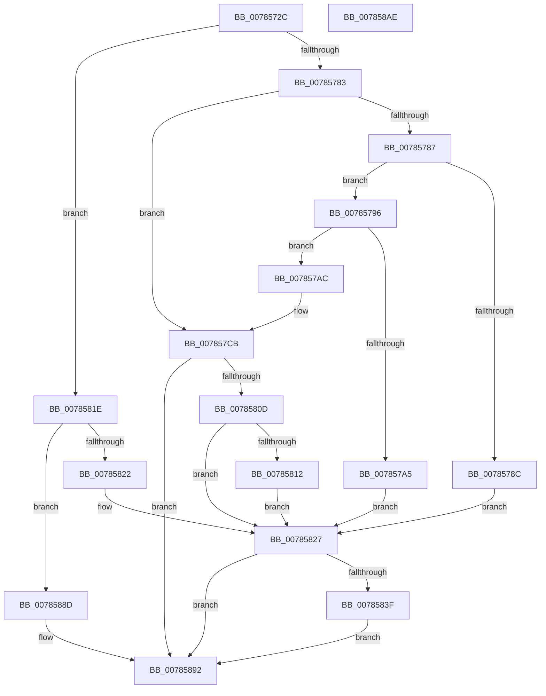

# PspSetJobRateControl

- RVA: `0x0078572C`–`0x007858AF` (길이 `387` bytes)
- VA: `0x000000014078572C`
- 실행 섹션: `PAGE`
- PDB 이름 있음: `예`; PDB Function 태그: `아니요`
- unwind 정보 RVA: `0x000991EC`
- 디코드: `99`개 명령, `387/387` bytes 표시
- 미해석 바이트: `0` (있으면 어셈블리에 `.byte`로 보존)

> 이 문서는 커널 이미지의 기계어와 PDB 기호를 분석해 생성했습니다. 4번과 5번은 함수 원형과 자료형을 바이너리 사용 방식에서 추정한 C 해석이며 원본 소스 복구 결과는 아닙니다.

## 1. Dependencies

- 직접 호출 지점: **7**; 고유 호출 대상: **5**
- 직접 호출자로 확인된 함수: **1**
- RIP 상대 이미지 참조: **2**

### Outgoing calls
- `0x00785798` → [PspAllocateRateControl](../99/PspAllocateRateControl_function_0099E208.md) (function, `0x0099E208`)
- `0x007857C6` → [PspModifyAncestorBits](PspModifyAncestorBits_function_0078508C.md) (function, `0x0078508C`)
- `0x007857FB` → [PspEnumJobsAndProcessesInJobHierarchy](../91/PspEnumJobsAndProcessesInJobHierarchy_function_0091A1EC.md) (function, `0x0091A1EC`)
- `0x00785817` → [PspFreeRateControl](../99/PspFreeRateControl_function_0099E1BC.md) (function, `0x0099E1BC`)
- `0x0078584A` → [PspModifyAncestorBits](PspModifyAncestorBits_function_0078508C.md) (function, `0x0078508C`)
- `0x00785886` → [PspEnumJobsAndProcessesInJobHierarchy](../91/PspEnumJobsAndProcessesInJobHierarchy_function_0091A1EC.md) (function, `0x0091A1EC`)
- `0x0078588D` → [PspRemoveRateControl](PspRemoveRateControl_function_00785318.md) (function, `0x00785318`)

### Direct callers
- [PspSetNetRateControl](PspSetNetRateControl_function_00785944.md) at `0x00785AAB`
- [PspSetNetRateControl](PspSetNetRateControl_function_00785944.md) at `0x00785AEF`
- [PspSetNetRateControl](PspSetNetRateControl_function_00785944.md) at `0x00785BC0`

### Static image references
- `0x007857DA` → RVA `0x00785CC0` (`PspSetRateControlProcessCallback`; read)
- `0x007857E9` → RVA `0x00785C80` (`PspSetRateControlJobPreCallback`; read)

## 2. Other-region calls and transfers

- 다른 실행 섹션으로 향하는 call: **0**
- 별도 외부 분기/꼬리 이동을 확인하지 못했습니다.

## 3. Assembly (complete function range)

```asm
0078572C  48 89 5C 24 08                  mov qword ptr [rsp + 8], rbx
00785731  48 89 74 24 10                  mov qword ptr [rsp + 0x10], rsi
00785736  48 89 7C 24 18                  mov qword ptr [rsp + 0x18], rdi
0078573B  55                              push rbp
0078573C  41 56                           push r14
0078573E  41 57                           push r15
00785740  48 8B EC                        mov rbp, rsp
00785743  48 83 EC 60                     sub rsp, 0x60
00785747  44 8B B9 10 06 00 00            mov r15d, dword ptr [rcx + 0x610]
0078574E  33 C0                           xor eax, eax
00785750  48 89 45 F0                     mov qword ptr [rbp - 0x10], rax
00785754  0F 57 C0                        xorps xmm0, xmm0
00785757  41 8B C7                        mov eax, r15d
0078575A  41 BE 00 00 00 04               mov r14d, 0x4000000
00785760  41 23 C6                        and eax, r14d
00785763  33 FF                           xor edi, edi
00785765  33 F6                           xor esi, esi
00785767  41 81 E7 00 00 00 02            and r15d, 0x2000000
0078576E  48 8B D9                        mov rbx, rcx
00785771  0F 11 45 D0                     movups xmmword ptr [rbp - 0x30], xmm0
00785775  0F 11 45 E0                     movups xmmword ptr [rbp - 0x20], xmm0
00785779  41 F6 C0 01                     test r8b, 1
0078577D  0F 84 9B 00 00 00               je 0x14078581e
00785783  85 C0                           test eax, eax
00785785  75 44                           jne 0x1407857cb
00785787  45 85 FF                        test r15d, r15d
0078578A  74 0A                           je 0x140785796
0078578C  BF BB 00 00 C0                  mov edi, 0xc00000bb
00785791  E9 91 00 00 00                  jmp 0x140785827
00785796  33 C9                           xor ecx, ecx
00785798  E8 6B 8A 21 00                  call 0x14099e208
0078579D  48 8B F0                        mov rsi, rax
007857A0  48 85 C0                        test rax, rax
007857A3  75 07                           jne 0x1407857ac
007857A5  BF 17 00 00 C0                  mov edi, 0xc0000017
007857AA  EB 7B                           jmp 0x140785827
007857AC  48 89 83 08 06 00 00            mov qword ptr [rbx + 0x608], rax
007857B3  F0 44 09 B3 10 06 00 00         lock or dword ptr [rbx + 0x610], r14d
007857BB  41 B0 01                        mov r8b, 1
007857BE  BA 00 00 00 02                  mov edx, 0x2000000
007857C3  48 8B CB                        mov rcx, rbx
007857C6  E8 C1 F8 FF FF                  call 0x14078508c
007857CB  21 7D F0                        and dword ptr [rbp - 0x10], edi
007857CE  48 8D 45 D0                     lea rax, [rbp - 0x30]
007857D2  C7 44 24 28 05 00 00 00         mov dword ptr [rsp + 0x28], 5
007857DA  4C 8D 0D DF 04 00 00            lea r9, [rip + 0x4df]
007857E1  45 33 C0                        xor r8d, r8d
007857E4  48 89 44 24 20                  mov qword ptr [rsp + 0x20], rax
007857E9  48 8D 15 90 04 00 00            lea rdx, [rip + 0x490]
007857F0  48 89 5D E8                     mov qword ptr [rbp - 0x18], rbx
007857F4  48 8B CB                        mov rcx, rbx
007857F7  C6 45 F4 01                     mov byte ptr [rbp - 0xc], 1
007857FB  E8 EC 49 19 00                  call 0x14091a1ec
00785800  8B F8                           mov edi, eax
00785802  44 8B F0                        mov r14d, eax
00785805  85 C0                           test eax, eax
00785807  0F 89 85 00 00 00               jns 0x140785892
0078580D  48 85 F6                        test rsi, rsi
00785810  74 15                           je 0x140785827
00785812  33 D2                           xor edx, edx
00785814  48 8B CE                        mov rcx, rsi
00785817  E8 A0 89 21 00                  call 0x14099e1bc
0078581C  EB 09                           jmp 0x140785827
0078581E  85 C0                           test eax, eax
00785820  75 6B                           jne 0x14078588d
00785822  BF 0D 00 00 C0                  mov edi, 0xc000000d
00785827  48 83 A3 08 06 00 00 00         and qword ptr [rbx + 0x608], 0
0078582F  F0 81 A3 10 06 00 00 FF FF FF FB  lock and dword ptr [rbx + 0x610], 0xfbffffff
0078583A  45 85 FF                        test r15d, r15d
0078583D  75 53                           jne 0x140785892
0078583F  45 33 C0                        xor r8d, r8d
00785842  BA 00 00 00 02                  mov edx, 0x2000000
00785847  48 8B CB                        mov rcx, rbx
0078584A  E8 3D F8 FF FF                  call 0x14078508c
0078584F  4C 21 45 D0                     and qword ptr [rbp - 0x30], r8
00785853  48 8D 45 D0                     lea rax, [rbp - 0x30]
00785857  4C 21 45 D8                     and qword ptr [rbp - 0x28], r8
0078585B  4C 8D 0D 5E 04 00 00            lea r9, [rip + 0x45e]
00785862  44 21 45 F0                     and dword ptr [rbp - 0x10], r8d
00785866  48 8D 15 13 04 00 00            lea rdx, [rip + 0x413]
0078586D  0F 57 C0                        xorps xmm0, xmm0
00785870  C7 44 24 28 05 00 00 00         mov dword ptr [rsp + 0x28], 5
00785878  48 89 44 24 20                  mov qword ptr [rsp + 0x20], rax
0078587D  44 88 45 F4                     mov byte ptr [rbp - 0xc], r8b
00785881  F3 0F 7F 45 E0                  movdqu xmmword ptr [rbp - 0x20], xmm0
00785886  E8 61 49 19 00                  call 0x14091a1ec
0078588B  EB 05                           jmp 0x140785892
0078588D  E8 86 FA FF FF                  call 0x140785318
00785892  4C 8D 5C 24 60                  lea r11, [rsp + 0x60]
00785897  8B C7                           mov eax, edi
00785899  49 8B 5B 20                     mov rbx, qword ptr [r11 + 0x20]
0078589D  49 8B 73 28                     mov rsi, qword ptr [r11 + 0x28]
007858A1  49 8B 7B 30                     mov rdi, qword ptr [r11 + 0x30]
007858A5  49 8B E3                        mov rsp, r11
007858A8  41 5F                           pop r15
007858AA  41 5E                           pop r14
007858AC  5D                              pop rbp
007858AD  C3                              ret
007858AE  CC                              int3
```

## 4. C-style interpretation (structured pseudocode)

```c
__int64 __fastcall PspSetJobRateControl(__int64 a1, __int64 a2, unsigned __int8 a3)
{
    __int64 result;
    __int64 v_r15;
    __int64 v_rdi;
    __int64 v_rsi;
    __int64 v_rsp;
    unsigned __int64 v_stack_m18;
    unsigned __int8 v_stack_m24;
    unsigned __int64 v_stack_m28;
    unsigned __int64 v_stack_m30;
    unsigned __int64 v_stack_m38;
    unsigned __int64 v_stack_m40;
    unsigned __int64 v_stack_m48;
    unsigned int v_stack_m50;
    unsigned __int64 v_stack_m58;
    unsigned __int64 v_stack_p10;
    unsigned __int64 v_stack_p18;
    unsigned __int64 v_stack_p8;

    v_stack_p8 = v_rbx;
    v_stack_p10 = v_rsi;
    v_stack_p18 = v_rdi;
    v_rsp = (v_rsp) - (96);
    result = 0;
    v_stack_m28 = 0;
    result = (unsigned int)(((unsigned int)((unsigned int)((unsigned int)(*(unsigned int *)(a1 + 1552))))) & ((unsigned int)((unsigned int)(0x4000000ULL))));
    v_rdi = 0;
    v_rsi = 0;
    v_r15 = (unsigned int)(((unsigned int)(*(unsigned int *)(a1 + 1552))) & (0x2000000ULL));
    v_stack_m48 = v_xmm0;
    v_stack_m38 = v_xmm0;
    if (((a3) & (1)) == 0) goto loc_0078581E;
    if ((unsigned int)(result) != 0) goto loc_007857CB;
    if ((unsigned int)(v_r15) == 0) goto loc_00785796;
    goto loc_00785827;
loc_00785796:
    a1 = 0;
    result = PspAllocateRateControl(a1, a2, a3, a4);
    if (result != 0) goto loc_007857AC;
    goto loc_00785827;
loc_007857AC:
    *(unsigned __int64 *)(a1 + 1544) = result;
    result = PspModifyAncestorBits(0, (unsigned int)(0x2000000ULL), 1, a4);
loc_007857CB:
    v_stack_m50 = 5;
    a3 = 0;
    v_stack_m58 = v_stack_m48;
    v_stack_m30 = 0;
    v_stack_m24 = 1;
    result = PspEnumJobsAndProcessesInJobHierarchy(0, v_rip + 1168, a3, v_rip + 1247);
    if (!sign_flag) goto loc_00785892;
    if (result == 0) goto loc_00785827;
    a2 = 0;
    result = PspFreeRateControl(result, a2, a3, v_rip + 1247);
    goto loc_00785827;
loc_0078581E:
    if ((unsigned int)(result) != 0) goto loc_0078588D;
loc_00785827:
    if ((unsigned int)(v_r15) != 0) goto loc_00785892;
    a3 = 0;
    result = PspModifyAncestorBits(0, (unsigned int)(0x2000000ULL), a3, v_rip + 1247);
    v_stack_m50 = 5;
    v_stack_m58 = v_stack_m48;
    v_stack_m24 = 0;
    v_stack_m38 = v_xmm0;
    result = PspEnumJobsAndProcessesInJobHierarchy(0, v_rip + 1043, a3, v_rip + 1118);
    goto loc_00785892;
loc_0078588D:
    result = PspRemoveRateControl(0, v_rip + 1043, a3, v_rip + 1118);
loc_00785892:
    return (unsigned int)((unsigned int)((unsigned int)(0xC000000DULL)));
}
```

## 5. (Beta) C Style

```c
int64_t PspSetJobRateControl(void *Arg1, int64_t Arg2, uint8_t Arg3)
{
    uint8_t *arg1 = (uint8_t *)Arg1;

    int64_t result;
    int64_t local_r15;
    int64_t local_rdi;
    int64_t local_rsi;
    int64_t local_rsp;
    uint64_t v_stack_m18;
    uint8_t v_stack_m24;
    uint64_t v_stack_m28;
    uint64_t v_stack_m30;
    uint64_t v_stack_m38;
    uint64_t v_stack_m40;
    uint64_t v_stack_m48;
    uint32_t v_stack_m50;
    uint64_t v_stack_m58;
    uint64_t v_stack_p10;
    uint64_t v_stack_p18;
    uint64_t v_stack_p8;

    v_stack_p8 = local_rbx;
    v_stack_p10 = local_rsi;
    v_stack_p18 = local_rdi;
    local_rsp = (local_rsp) - (96);
    result = 0;
    v_stack_m28 = 0;
    result = (uint32_t)(((uint32_t)((uint32_t)((uint32_t)(*(uint32_t *)(arg1 + 0x610))))) & ((uint32_t)((uint32_t)(0x4000000ULL))));
    local_rdi = 0;
    local_rsi = 0;
    local_r15 = (uint32_t)(((uint32_t)(*(uint32_t *)(arg1 + 0x610))) & (0x2000000ULL));
    v_stack_m48 = v_xmm0;
    v_stack_m38 = v_xmm0;
    if (((Arg3) & (1)) == 0) goto loc_0078581E;
    if ((uint32_t)(result) != 0) goto loc_007857CB;
    if ((uint32_t)(local_r15) == 0) goto loc_00785796;
    goto loc_00785827;
loc_00785796:
    Arg1 = 0;
    result = PspAllocateRateControl(Arg1, Arg2, Arg3, a4);
    if (result != 0) goto loc_007857AC;
    goto loc_00785827;
loc_007857AC:
    *(uint64_t *)(arg1 + 0x608) = result;
    result = PspModifyAncestorBits(0, (uint32_t)(0x2000000ULL), 1, a4);
loc_007857CB:
    v_stack_m50 = 5;
    Arg3 = 0;
    v_stack_m58 = v_stack_m48;
    v_stack_m30 = 0;
    v_stack_m24 = 1;
    result = PspEnumJobsAndProcessesInJobHierarchy(0, v_rip + 1168, Arg3, v_rip + 1247);
    if (!sign_flag) goto loc_00785892;
    if (result == 0) goto loc_00785827;
    Arg2 = 0;
    result = PspFreeRateControl(result, Arg2, Arg3, v_rip + 1247);
    goto loc_00785827;
loc_0078581E:
    if ((uint32_t)(result) != 0) goto loc_0078588D;
loc_00785827:
    if ((uint32_t)(local_r15) != 0) goto loc_00785892;
    Arg3 = 0;
    result = PspModifyAncestorBits(0, (uint32_t)(0x2000000ULL), Arg3, v_rip + 1247);
    v_stack_m50 = 5;
    v_stack_m58 = v_stack_m48;
    v_stack_m24 = 0;
    v_stack_m38 = v_xmm0;
    result = PspEnumJobsAndProcessesInJobHierarchy(0, v_rip + 1043, Arg3, v_rip + 1118);
    goto loc_00785892;
loc_0078588D:
    result = PspRemoveRateControl(0, v_rip + 1043, Arg3, v_rip + 1118);
loc_00785892:
    return (uint32_t)((uint32_t)((uint32_t)(0xC000000DULL)));
}
```

### 관측된 메모리 오프셋

구조체 형식이 확인되지 않은 접근은 인자 기준의 오프셋으로만 기록했습니다.

| 기준 인자 | 오프셋 표현 | 폭 (bit) | 접근 |
|---|---:|---:|---|
| `Arg1` | `+ 0x608` | `64` | `R/W` |
| `Arg1` | `+ 0x608` | `64` | `W` |
| `Arg1` | `+ 0x610` | `32` | `R` |
| `Arg1` | `+ 0x610` | `32` | `R/W` |

## 6. Execution-region graph

[열기: 2D/3D 그래프와 함수 탐색 컨트롤 패널](../../../control-panel.html?section=page&rva=0x0078572C&view=graph)

- 2D 그래프는 위에서 아래로 흐르고, 3D 그래프는 빈 공간을 드래그해 회전합니다. Shift+드래그는 이동, 휠은 확대·축소, 함수 노드 선택은 대상 보고서 이동입니다.

### Static fallback


