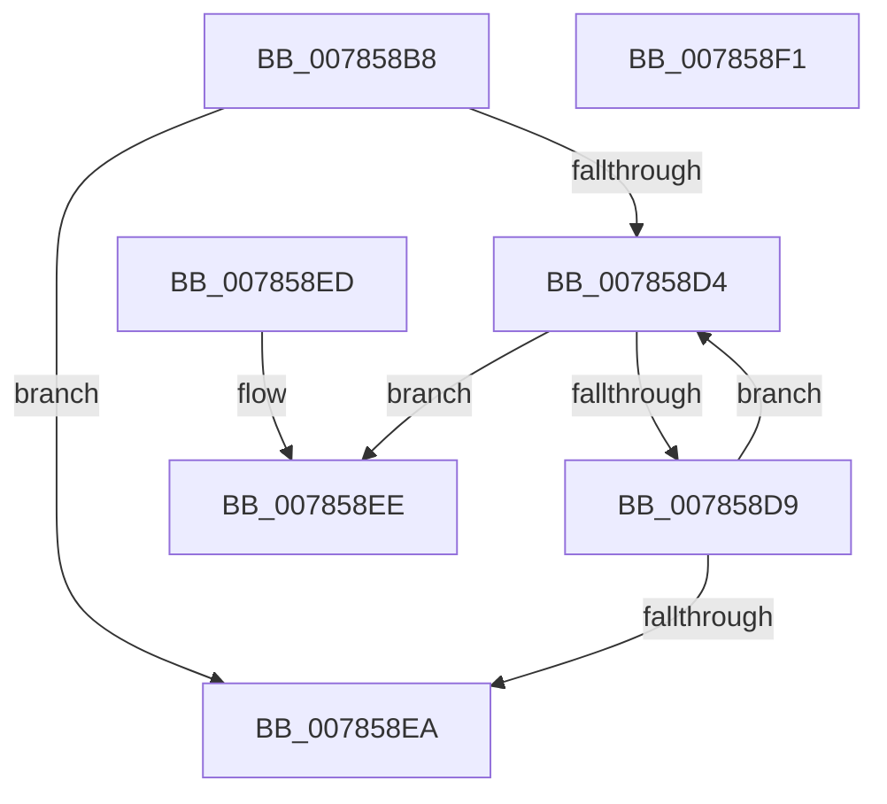

# PspSetJobSiloThreadImpersonationPolicy

- RVA: `0x007858B8`–`0x007858F2` (길이 `58` bytes)
- VA: `0x00000001407858B8`
- 실행 섹션: `PAGE`
- PDB 이름 있음: `예`; PDB Function 태그: `아니요`
- unwind 정보 RVA: `0x000DB714`
- 디코드: `21`개 명령, `58/58` bytes 표시
- 미해석 바이트: `0` (있으면 어셈블리에 `.byte`로 보존)

> 이 문서는 커널 이미지의 기계어와 PDB 기호를 분석해 생성했습니다. 4번과 5번은 함수 원형과 자료형을 바이너리 사용 방식에서 추정한 C 해석이며 원본 소스 복구 결과는 아닙니다.

## 1. Dependencies

- 직접 호출 지점: **0**; 고유 호출 대상: **0**
- 직접 호출자로 확인된 함수: **1**
- RIP 상대 이미지 참조: **0**

### Outgoing calls
- 직접 디코드된 call 명령이 없습니다.

### Direct callers
- [NtSetInformationJobObject](../9F/NtSetInformationJobObject_function_009F84C0.md) at `0x009FA279`
- [NtSetInformationJobObject](../9F/NtSetInformationJobObject_function_009F84C0.md) at `0x009FA306`
- [NtSetInformationJobObject](../9F/NtSetInformationJobObject_function_009F84C0.md) at `0x009FAD55`

### Static image references
- 디코드된 RIP-relative 메모리 참조가 없습니다.

## 2. Other-region calls and transfers

- 다른 실행 섹션으로 향하는 call: **0**
- 별도 외부 분기/꼬리 이동을 확인하지 못했습니다.

## 3. Assembly (complete function range)

```asm
007858B8  B8 02 00 00 00                  mov eax, 2
007858BD  4C 8B C9                        mov r9, rcx
007858C0  3B D0                           cmp edx, eax
007858C2  44 8D 40 02                     lea r8d, [rax + 2]
007858C6  44 0F 45 C0                     cmovne r8d, eax
007858CA  8B 81 14 06 00 00               mov eax, dword ptr [rcx + 0x614]
007858D0  85 C2                           test edx, eax
007858D2  75 16                           jne 0x1407858ea
007858D4  44 85 C0                        test eax, r8d
007858D7  75 15                           jne 0x1407858ee
007858D9  8B C8                           mov ecx, eax
007858DB  0B CA                           or ecx, edx
007858DD  F0 41 0F B1 89 14 06 00 00      lock cmpxchg dword ptr [r9 + 0x614], ecx
007858E6  3B C1                           cmp eax, ecx
007858E8  75 EA                           jne 0x1407858d4
007858EA  B0 01                           mov al, 1
007858EC  C3                              ret
007858ED  CC                              int3
007858EE  32 C0                           xor al, al
007858F0  C3                              ret
007858F1  CC                              int3
```

## 4. C-style interpretation (structured pseudocode)

```c
__int64 __fastcall PspSetJobSiloThreadImpersonationPolicy(__int64 a1, int a2)
{
    __int64 result;

    a3 = 2 + 2;
    if (a2 != 2) { a3 = 2; }
    if (((a2) & ((unsigned int)((unsigned int)(*(unsigned int *)(a1 + 1556))))) != 0) goto loc_007858EA;
loc_007858D4:
    if ((((unsigned int)((unsigned int)(*(unsigned int *)(a1 + 1556)))) & ((unsigned int)(a3))) != 0) goto loc_007858EE;
    a1 = (unsigned int)(((unsigned int)((unsigned int)((unsigned int)(*(unsigned int *)(a1 + 1556))))) | (a2));
    if (((unsigned int)((unsigned int)(*(unsigned int *)(a1 + 1556)))) != ((unsigned int)(a1))) goto loc_007858D4;
loc_007858EA:
    return 1;
loc_007858EE:
    result = 0;
    return result;
}
```

## 5. (Beta) C Style

```c
int64_t PspSetJobSiloThreadImpersonationPolicy(void *Arg1, int32_t Arg2)
{
    uint8_t *arg1 = (uint8_t *)Arg1;

    int64_t result;

    a3 = 2 + 2;
    if (Arg2 != 2) { a3 = 2; }
    if (((Arg2) & ((uint32_t)((uint32_t)(*(uint32_t *)(arg1 + 0x614))))) != 0) goto loc_007858EA;
loc_007858D4:
    if ((((uint32_t)((uint32_t)(*(uint32_t *)(arg1 + 0x614)))) & ((uint32_t)(a3))) != 0) goto loc_007858EE;
    Arg1 = (uint32_t)(((uint32_t)((uint32_t)((uint32_t)(*(uint32_t *)(arg1 + 0x614))))) | (Arg2));
    if (((uint32_t)((uint32_t)(*(uint32_t *)(arg1 + 0x614)))) != ((uint32_t)(Arg1))) goto loc_007858D4;
loc_007858EA:
    return 1;
loc_007858EE:
    result = 0;
    return result;
}
```

### 관측된 메모리 오프셋

구조체 형식이 확인되지 않은 접근은 인자 기준의 오프셋으로만 기록했습니다.

| 기준 인자 | 오프셋 표현 | 폭 (bit) | 접근 |
|---|---:|---:|---|
| `Arg1` | `+ 0x614` | `32` | `R` |

## 6. Execution-region graph

[열기: 2D/3D 그래프와 함수 탐색 컨트롤 패널](../../../control-panel.html?section=page&rva=0x007858B8&view=graph)

- 2D 그래프는 위에서 아래로 흐르고, 3D 그래프는 빈 공간을 드래그해 회전합니다. Shift+드래그는 이동, 휠은 확대·축소, 함수 노드 선택은 대상 보고서 이동입니다.

### Static fallback


