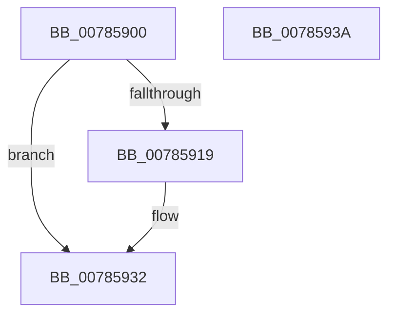

# PspSetJobTimeLimitCallback

- RVA: `0x00785900`–`0x0078593B` (길이 `59` bytes)
- VA: `0x0000000140785900`
- 실행 섹션: `PAGE`
- PDB 이름 있음: `예`; PDB Function 태그: `아니요`
- unwind 정보 RVA: `0x0005CF00`
- 디코드: `17`개 명령, `59/59` bytes 표시
- 미해석 바이트: `0` (있으면 어셈블리에 `.byte`로 보존)

> 이 문서는 커널 이미지의 기계어와 PDB 기호를 분석해 생성했습니다. 4번과 5번은 함수 원형과 자료형을 바이너리 사용 방식에서 추정한 C 해석이며 원본 소스 복구 결과는 아닙니다.

## 1. Dependencies

- 직접 호출 지점: **1**; 고유 호출 대상: **1**
- 직접 호출자로 확인된 함수: **0**
- RIP 상대 이미지 참조: **1**

### Outgoing calls
- `0x0078591E` → [PsQueryRuntimeProcess](../9D/PsQueryRuntimeProcess_function_009D6C10.md) (function, `0x009D6C10`)

### Direct callers
- 이 함수 시작 RVA로 연결되는 직접 call은 확인되지 않았습니다. 간접 호출은 완전히 역산할 수 없습니다.

### Static image references
- `0x00785923` → RVA `0x00FC6AA0` (`ALMOSTRO`; read)

## 2. Other-region calls and transfers

- 다른 실행 섹션으로 향하는 call: **0**
- 별도 외부 분기/꼬리 이동을 확인하지 못했습니다.

## 3. Assembly (complete function range)

```asm
00785900  40 53                           push rbx
00785902  48 83 EC 20                     sub rsp, 0x20
00785906  48 83 64 24 30 00               and qword ptr [rsp + 0x30], 0
0078590C  48 8B DA                        mov rbx, rdx
0078590F  8B 81 F0 01 00 00               mov eax, dword ptr [rcx + 0x1f0]
00785915  A8 02                           test al, 2
00785917  75 19                           jne 0x140785932
00785919  48 8D 54 24 30                  lea rdx, [rsp + 0x30]
0078591E  E8 ED 12 25 00                  call 0x1409d6c10
00785923  8B 05 77 11 84 00               mov eax, dword ptr [rip + 0x841177]
00785929  48 0F AF 44 24 30               imul rax, qword ptr [rsp + 0x30]
0078592F  48 01 03                        add qword ptr [rbx], rax
00785932  33 C0                           xor eax, eax
00785934  48 83 C4 20                     add rsp, 0x20
00785938  5B                              pop rbx
00785939  C3                              ret
0078593A  CC                              int3
```

## 4. C-style interpretation (structured pseudocode)

```c
__int64 __fastcall PspSetJobTimeLimitCallback(__int64 a1, __int64 a2)
{
    __int64 result;
    __int64 v_rsp;
    unsigned __int64 v_stack_p8;

    v_rsp = (v_rsp) - (32);
    result = (unsigned int)(*(unsigned int *)(a1 + 496));
    if ((((unsigned __int8)((unsigned int)(*(unsigned int *)(a1 + 496)))) & (2)) == 0) {
        a2 = v_stack_p8;
        result = PsQueryRuntimeProcess(a1, a2, a3, a4);
        result = *(unsigned int *)(v_rip + 8655223);
        result = (result) * (v_stack_p8);
    }
    result = 0;
    v_rsp = (v_rsp) + (32);
    return result;
}
```

## 5. (Beta) C Style

```c
int64_t PspSetJobTimeLimitCallback(void *Arg1, void *Arg2)
{
    uint8_t *arg1 = (uint8_t *)Arg1;
    uint8_t *arg2 = (uint8_t *)Arg2;

    int64_t result;
    int64_t local_rsp;
    uint64_t v_stack_p8;

    local_rsp = (local_rsp) - (32);
    result = (uint32_t)(*(uint32_t *)(arg1 + 0x1F0));
    if ((((uint8_t)((uint32_t)(*(uint32_t *)(arg1 + 0x1F0)))) & (2)) == 0) {
        Arg2 = v_stack_p8;
        result = PsQueryRuntimeProcess(Arg1, Arg2, a3, a4);
        result = *(uint32_t *)(v_rip + 0x841177);
        result = (result) * (v_stack_p8);
    }
    result = 0;
    local_rsp = (local_rsp) + (32);
    return result;
}
```

### 관측된 메모리 오프셋

구조체 형식이 확인되지 않은 접근은 인자 기준의 오프셋으로만 기록했습니다.

| 기준 인자 | 오프셋 표현 | 폭 (bit) | 접근 |
|---|---:|---:|---|
| `Arg1` | `+ 0x1F0` | `32` | `R` |
| `Arg2` | `+ 0x0` | `64` | `R/W` |

## 6. Execution-region graph

[열기: 2D/3D 그래프와 함수 탐색 컨트롤 패널](../../../control-panel.html?section=page&rva=0x00785900&view=graph)

- 2D 그래프는 위에서 아래로 흐르고, 3D 그래프는 빈 공간을 드래그해 회전합니다. Shift+드래그는 이동, 휠은 확대·축소, 함수 노드 선택은 대상 보고서 이동입니다.

### Static fallback


