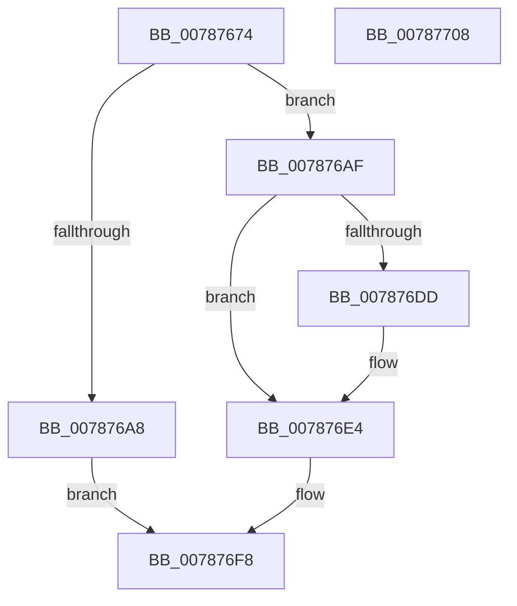

# PspSetMinimalProcessName

- RVA: `0x00787674`–`0x00787709` (길이 `149` bytes)
- VA: `0x0000000140787674`
- 실행 섹션: `PAGE`
- PDB 이름 있음: `예`; PDB Function 태그: `아니요`
- unwind 정보 RVA: `0x00060BC4`
- 디코드: `41`개 명령, `149/149` bytes 표시
- 미해석 바이트: `0` (있으면 어셈블리에 `.byte`로 보존)

> 이 문서는 커널 이미지의 기계어와 PDB 기호를 분석해 생성했습니다. 4번과 5번은 함수 원형과 자료형을 바이너리 사용 방식에서 추정한 C 해석이며 원본 소스 복구 결과는 아닙니다.

## 1. Dependencies

- 직접 호출 지점: **4**; 고유 호출 대상: **4**
- 직접 호출자로 확인된 함수: **1**
- RIP 상대 이미지 참조: **0**

### Outgoing calls
- `0x0078769B` → [ExAllocatePool2](../../poolcode/B8/ExAllocatePool2_function_00B820F0.md) (function, `0x00B820F0`)
- `0x007876CC` → [memcpy](../../text/6C/memcpy_function_006C6840.md) (function, `0x006C6840`)
- `0x007876DF` → [ExFreePoolWithTag](../../poolcode/B8/ExFreePoolWithTag_function_00B82870.md) (function, `0x00B82870`)
- `0x007876F1` → [PspSetProcessShortName](../A4/PspSetProcessShortName_function_00A43634.md) (function, `0x00A43634`)

### Direct callers
- [PsCreateMinimalProcess](PsCreateMinimalProcess_function_00786D14.md) at `0x00786FA8`

### Static image references
- 디코드된 RIP-relative 메모리 참조가 없습니다.

## 2. Other-region calls and transfers

- 다른 실행 섹션으로 향하는 call: **3**
  - `0x0078769B` → [ExAllocatePool2](../../poolcode/B8/ExAllocatePool2_function_00B820F0.md) (`PAGE` → `POOLCODE`)
  - `0x007876CC` → [memcpy](../../text/6C/memcpy_function_006C6840.md) (`PAGE` → `.text`)
  - `0x007876DF` → [ExFreePoolWithTag](../../poolcode/B8/ExFreePoolWithTag_function_00B82870.md) (`PAGE` → `POOLCODE`)
- 별도 외부 분기/꼬리 이동을 확인하지 못했습니다.

## 3. Assembly (complete function range)

```asm
00787674  48 89 5C 24 08                  mov qword ptr [rsp + 8], rbx
00787679  48 89 74 24 10                  mov qword ptr [rsp + 0x10], rsi
0078767E  57                              push rdi
0078767F  48 83 EC 20                     sub rsp, 0x20
00787683  48 8B DA                        mov rbx, rdx
00787686  48 8B F1                        mov rsi, rcx
00787689  0F B7 12                        movzx edx, word ptr [rdx]
0078768C  B9 40 00 00 00                  mov ecx, 0x40
00787691  48 83 C2 10                     add rdx, 0x10
00787695  41 B8 50 73 49 6E               mov r8d, 0x6e497350
0078769B  E8 50 AA 3F 00                  call 0x140b820f0
007876A0  48 8B F8                        mov rdi, rax
007876A3  48 85 C0                        test rax, rax
007876A6  75 07                           jne 0x1407876af
007876A8  B8 17 00 00 C0                  mov eax, 0xc0000017
007876AD  EB 49                           jmp 0x1407876f8
007876AF  48 8D 48 10                     lea rcx, [rax + 0x10]
007876B3  48 89 48 08                     mov qword ptr [rax + 8], rcx
007876B7  0F B7 03                        movzx eax, word ptr [rbx]
007876BA  66 89 07                        mov word ptr [rdi], ax
007876BD  0F B7 03                        movzx eax, word ptr [rbx]
007876C0  66 89 47 02                     mov word ptr [rdi + 2], ax
007876C4  44 0F B7 03                     movzx r8d, word ptr [rbx]
007876C8  48 8B 53 08                     mov rdx, qword ptr [rbx + 8]
007876CC  E8 6F F1 F3 FF                  call 0x1406c6840
007876D1  48 8B 8E 50 03 00 00            mov rcx, qword ptr [rsi + 0x350]
007876D8  48 85 C9                        test rcx, rcx
007876DB  74 07                           je 0x1407876e4
007876DD  33 D2                           xor edx, edx
007876DF  E8 8C B1 3F 00                  call 0x140b82870
007876E4  48 8B D3                        mov rdx, rbx
007876E7  48 89 BE 50 03 00 00            mov qword ptr [rsi + 0x350], rdi
007876EE  48 8B CE                        mov rcx, rsi
007876F1  E8 3E BF 2B 00                  call 0x140a43634
007876F6  33 C0                           xor eax, eax
007876F8  48 8B 5C 24 30                  mov rbx, qword ptr [rsp + 0x30]
007876FD  48 8B 74 24 38                  mov rsi, qword ptr [rsp + 0x38]
00787702  48 83 C4 20                     add rsp, 0x20
00787706  5F                              pop rdi
00787707  C3                              ret
00787708  CC                              int3
```

## 4. C-style interpretation (structured pseudocode)

```c
__int64 __fastcall PspSetMinimalProcessName(__int64 a1, __int64 a2)
{
    __int64 result;
    __int64 v_rsp;
    unsigned __int64 v_stack_p10;
    unsigned __int64 v_stack_p8;

    v_stack_p8 = v_rbx;
    v_stack_p10 = v_rsi;
    v_rsp = (v_rsp) - (32);
    a2 = (*(unsigned __int16 *)(a2)) + (16);
    result = ExAllocatePool2(64, a2, (unsigned int)(0x6E497350ULL), a4);
    if (result != 0) goto loc_007876AF;
    goto loc_007876F8;
loc_007876AF:
    *(unsigned __int64 *)((unsigned int)(0xC0000017ULL) + 8) = (unsigned int)(0xC0000017ULL) + 16;
    *(unsigned __int16 *)(result) = (unsigned __int16)(*(unsigned __int16 *)(a2));
    *(unsigned __int16 *)(result + 2) = (unsigned __int16)(*(unsigned __int16 *)(a2));
    result = memcpy((unsigned int)(0xC0000017ULL) + 16, *(unsigned __int64 *)(a2 + 8), *(unsigned __int16 *)(a2), a4);
    if (*(unsigned __int64 *)(a1 + 848) != 0) {
        a2 = 0;
        result = ExFreePoolWithTag(*(unsigned __int64 *)(a1 + 848), a2, *(unsigned __int16 *)(a2), a4);
    }
    *(unsigned __int64 *)(a1 + 848) = result;
    result = PspSetProcessShortName(a1, 0, *(unsigned __int16 *)(a2), a4);
    result = 0;
loc_007876F8:
    v_rsp = (v_rsp) + (32);
    return result;
}
```

## 5. (Beta) C Style

```c
int64_t PspSetMinimalProcessName(void *Arg1, void *Arg2)
{
    uint8_t *arg1 = (uint8_t *)Arg1;
    uint8_t *arg2 = (uint8_t *)Arg2;

    int64_t result;
    int64_t local_rsp;
    uint64_t v_stack_p10;
    uint64_t v_stack_p8;

    v_stack_p8 = local_rbx;
    v_stack_p10 = local_rsi;
    local_rsp = (local_rsp) - (32);
    Arg2 = (*(uint16_t *)(arg2)) + (16);
    result = ExAllocatePool2(64, Arg2, (uint32_t)(0x6E497350ULL), a4);
    if (result != 0) goto loc_007876AF;
    goto loc_007876F8;
loc_007876AF:
    *(uint64_t *)((uint32_t)(0xC0000017ULL) + 0x8) = (uint32_t)(0xC0000017ULL) + 16;
    *(uint16_t *)(result) = (uint16_t)(*(uint16_t *)(arg2));
    *(uint16_t *)(result + 0x2) = (uint16_t)(*(uint16_t *)(arg2));
    result = memcpy((uint32_t)(0xC0000017ULL) + 16, *(uint64_t *)(arg2 + 0x8), *(uint16_t *)(arg2), a4);
    if (*(uint64_t *)(arg1 + 0x350) != 0) {
        Arg2 = 0;
        result = ExFreePoolWithTag(*(uint64_t *)(arg1 + 0x350), Arg2, *(uint16_t *)(arg2), a4);
    }
    *(uint64_t *)(arg1 + 0x350) = result;
    result = PspSetProcessShortName(Arg1, 0, *(uint16_t *)(arg2), a4);
    result = 0;
loc_007876F8:
    local_rsp = (local_rsp) + (32);
    return result;
}
```

### 관측된 메모리 오프셋

구조체 형식이 확인되지 않은 접근은 인자 기준의 오프셋으로만 기록했습니다.

| 기준 인자 | 오프셋 표현 | 폭 (bit) | 접근 |
|---|---:|---:|---|
| `Arg1` | `+ 0x350` | `64` | `R` |
| `Arg1` | `+ 0x350` | `64` | `W` |
| `Arg2` | `+ 0x0` | `16` | `R` |
| `Arg2` | `+ 0x8` | `64` | `R` |

## 6. Execution-region graph

[열기: 2D/3D 그래프와 함수 탐색 컨트롤 패널](../../../control-panel.html?section=page&rva=0x00787674&view=graph)

- 2D 그래프는 위에서 아래로 흐르고, 3D 그래프는 빈 공간을 드래그해 회전합니다. Shift+드래그는 이동, 휠은 확대·축소, 함수 노드 선택은 대상 보고서 이동입니다.

### Static fallback


