# PspSetNetRateControl

- RVA: `0x00785944`–`0x00785C09` (길이 `709` bytes)
- VA: `0x0000000140785944`
- 실행 섹션: `PAGE`
- PDB 이름 있음: `예`; PDB Function 태그: `아니요`
- unwind 정보 RVA: `0x000CF1A0`
- 디코드: `189`개 명령, `709/709` bytes 표시
- 미해석 바이트: `0` (있으면 어셈블리에 `.byte`로 보존)

> 이 문서는 커널 이미지의 기계어와 PDB 기호를 분석해 생성했습니다. 4번과 5번은 함수 원형과 자료형을 바이너리 사용 방식에서 추정한 C 해석이며 원본 소스 복구 결과는 아닙니다.

## 1. Dependencies

- 직접 호출 지점: **12**; 고유 호출 대상: **9**
- 직접 호출자로 확인된 함수: **1**
- RIP 상대 이미지 참조: **2**

### Outgoing calls
- `0x00785995` → [memcpy](../../text/6C/memcpy_function_006C6840.md) (function, `0x006C6840`)
- `0x00785A2F` → [PspLockRootJobExclusive](../91/PspLockRootJobExclusive_function_00917D0C.md) (function, `0x00917D0C`)
- `0x00785A3C` → [PspLockJobConditionally](../9F/PspLockJobConditionally_function_009F7C20.md) (function, `0x009F7C20`)
- `0x00785AAB` → [PspSetJobRateControl](PspSetJobRateControl_function_0078572C.md) (function, `0x0078572C`)
- `0x00785AC2` → [PspNetRateControlDispatch](PspNetRateControlDispatch_function_007850C4.md) (function, `0x007850C4`)
- `0x00785AD5` → [PspNetRateControlDispatch](PspNetRateControlDispatch_function_007850C4.md) (function, `0x007850C4`)
- `0x00785AEF` → [PspSetJobRateControl](PspSetJobRateControl_function_0078572C.md) (function, `0x0078572C`)
- `0x00785BAC` → [EtwTraceJobSetQuery](../9F/EtwTraceJobSetQuery_function_009FB480.md) (function, `0x009FB480`)
- `0x00785BC0` → [PspSetJobRateControl](PspSetJobRateControl_function_0078572C.md) (function, `0x0078572C`)
- `0x00785BCD` → [PspUnlockJobConditionally](../A4/PspUnlockJobConditionally_function_00A454A4.md) (function, `0x00A454A4`)
- `0x00785BDA` → [PspUnlockJob](../91/PspUnlockJob_function_00919E00.md) (function, `0x00919E00`)
- `0x00785BF0` → [_security_check_cookie](../../text/6A/_security_check_cookie_function_006AC640.md) (function, `0x006AC640`)

### Direct callers
- [NtSetInformationJobObject](../9F/NtSetInformationJobObject_function_009F84C0.md) at `0x009FA87F`

### Static image references
- `0x00785959` → RVA `0x00E0A740` (`.data`; read)
- `0x00785B86` → RVA `0x00FC6B00` (`ALMOSTRO`; read)

## 2. Other-region calls and transfers

- 다른 실행 섹션으로 향하는 call: **2**
  - `0x00785995` → [memcpy](../../text/6C/memcpy_function_006C6840.md) (`PAGE` → `.text`)
  - `0x00785BF0` → [_security_check_cookie](../../text/6A/_security_check_cookie_function_006AC640.md) (`PAGE` → `.text`)
- 별도 외부 분기/꼬리 이동을 확인하지 못했습니다.

## 3. Assembly (complete function range)

```asm
00785944  4C 8B DC                        mov r11, rsp
00785947  53                              push rbx
00785948  56                              push rsi
00785949  57                              push rdi
0078594A  41 54                           push r12
0078594C  41 55                           push r13
0078594E  41 56                           push r14
00785950  41 57                           push r15
00785952  48 81 EC 90 00 00 00            sub rsp, 0x90
00785959  48 8B 05 E0 4D 68 00            mov rax, qword ptr [rip + 0x684de0]
00785960  48 33 C4                        xor rax, rsp
00785963  48 89 84 24 88 00 00 00         mov qword ptr [rsp + 0x88], rax
0078596B  49 8B F8                        mov rdi, r8
0078596E  33 C0                           xor eax, eax
00785970  0F 57 C0                        xorps xmm0, xmm0
00785973  0F 11 44 24 70                  movups xmmword ptr [rsp + 0x70], xmm0
00785978  41 89 43 B8                     mov dword ptr [r11 - 0x48], eax
0078597C  0F 11 44 24 60                  movups xmmword ptr [rsp + 0x60], xmm0
00785981  33 DB                           xor ebx, ebx
00785983  48 89 5C 24 30                  mov qword ptr [rsp + 0x30], rbx
00785988  44 8A EB                        mov r13b, bl
0078598B  44 8B C2                        mov r8d, edx
0078598E  48 8B D1                        mov rdx, rcx
00785991  49 8D 4B 98                     lea rcx, [r11 - 0x68]
00785995  E8 A6 0E F4 FF                  call 0x1406c6840
0078599A  90                              nop
0078599B  8B 74 24 68                     mov esi, dword ptr [rsp + 0x68]
0078599F  F7 C6 F8 FF FF FF               test esi, 0xfffffff8
007859A5  74 0A                           je 0x1407859b1
007859A7  BB 0D 00 00 C0                  mov ebx, 0xc000000d
007859AC  E9 32 02 00 00                  jmp 0x140785be3
007859B1  44 8B F6                        mov r14d, esi
007859B4  41 83 E6 01                     and r14d, 1
007859B8  8B CE                           mov ecx, esi
007859BA  74 14                           je 0x1407859d0
007859BC  83 E1 04                        and ecx, 4
007859BF  74 07                           je 0x1407859c8
007859C1  80 7C 24 6C 40                  cmp byte ptr [rsp + 0x6c], 0x40
007859C6  77 DF                           ja 0x1407859a7
007859C8  40 F6 C6 06                     test sil, 6
007859CC  75 05                           jne 0x1407859d3
007859CE  EB D7                           jmp 0x1407859a7
007859D0  83 E1 04                        and ecx, 4
007859D3  48 89 5C 24 38                  mov qword ptr [rsp + 0x38], rbx
007859D8  48 89 5C 24 44                  mov qword ptr [rsp + 0x44], rbx
007859DD  89 5C 24 4C                     mov dword ptr [rsp + 0x4c], ebx
007859E1  48 89 5C 24 58                  mov qword ptr [rsp + 0x58], rbx
007859E6  48 8D 87 C0 05 00 00            lea rax, [rdi + 0x5c0]
007859ED  48 89 44 24 50                  mov qword ptr [rsp + 0x50], rax
007859F2  89 5C 24 40                     mov dword ptr [rsp + 0x40], ebx
007859F6  83 E6 02                        and esi, 2
007859F9  74 0F                           je 0x140785a0a
007859FB  83 4C 24 58 10                  or dword ptr [rsp + 0x58], 0x10
00785A00  48 8B 44 24 60                  mov rax, qword ptr [rsp + 0x60]
00785A05  48 89 44 24 48                  mov qword ptr [rsp + 0x48], rax
00785A0A  85 C9                           test ecx, ecx
00785A0C  74 0D                           je 0x140785a1b
00785A0E  83 4C 24 58 08                  or dword ptr [rsp + 0x58], 8
00785A13  8A 44 24 6C                     mov al, byte ptr [rsp + 0x6c]
00785A17  88 44 24 5C                     mov byte ptr [rsp + 0x5c], al
00785A1B  65 4C 8B 24 25 88 01 00 00      mov r12, qword ptr gs:[0x188]
00785A24  4C 8D 44 24 30                  lea r8, [rsp + 0x30]
00785A29  49 8B D4                        mov rdx, r12
00785A2C  48 8B CF                        mov rcx, rdi
00785A2F  E8 D8 22 19 00                  call 0x140917d0c
00785A34  48 8D 54 24 30                  lea rdx, [rsp + 0x30]
00785A39  48 8B CF                        mov rcx, rdi
00785A3C  E8 DF 21 27 00                  call 0x1409f7c20
00785A41  44 8B 87 10 06 00 00            mov r8d, dword ptr [rdi + 0x610]
00785A48  41 8B D0                        mov edx, r8d
00785A4B  41 81 E0 00 00 00 02            and r8d, 0x2000000
00785A52  81 E2 00 00 00 04               and edx, 0x4000000
00785A58  74 10                           je 0x140785a6a
00785A5A  48 8B 87 08 06 00 00            mov rax, qword ptr [rdi + 0x608]
00785A61  48 8B 48 38                     mov rcx, qword ptr [rax + 0x38]
00785A65  48 89 4C 24 38                  mov qword ptr [rsp + 0x38], rcx
00785A6A  45 84 F6                        test r14b, r14b
00785A6D  75 10                           jne 0x140785a7f
00785A6F  85 D2                           test edx, edx
00785A71  74 07                           je 0x140785a7a
00785A73  83 4C 24 58 04                  or dword ptr [rsp + 0x58], 4
00785A78  EB 1F                           jmp 0x140785a99
00785A7A  45 84 F6                        test r14b, r14b
00785A7D  74 1A                           je 0x140785a99
00785A7F  45 85 C0                        test r8d, r8d
00785A82  75 07                           jne 0x140785a8b
00785A84  83 4C 24 58 01                  or dword ptr [rsp + 0x58], 1
00785A89  EB 0E                           jmp 0x140785a99
00785A8B  45 84 F6                        test r14b, r14b
00785A8E  74 09                           je 0x140785a99
00785A90  85 D2                           test edx, edx
00785A92  74 05                           je 0x140785a99
00785A94  83 4C 24 58 02                  or dword ptr [rsp + 0x58], 2
00785A99  F6 44 24 58 01                  test byte ptr [rsp + 0x58], 1
00785A9E  74 29                           je 0x140785ac9
00785AA0  44 8B 7C 24 68                  mov r15d, dword ptr [rsp + 0x68]
00785AA5  45 8B C7                        mov r8d, r15d
00785AA8  48 8B CF                        mov rcx, rdi
00785AAB  E8 7C FC FF FF                  call 0x14078572c
00785AB0  8B D8                           mov ebx, eax
00785AB2  85 C0                           test eax, eax
00785AB4  0F 88 F7 00 00 00               js 0x140785bb1
00785ABA  41 B5 01                        mov r13b, 1
00785ABD  48 8D 4C 24 38                  lea rcx, [rsp + 0x38]
00785AC2  E8 FD F5 FF FF                  call 0x1407850c4
00785AC7  EB 2B                           jmp 0x140785af4
00785AC9  F6 44 24 58 07                  test byte ptr [rsp + 0x58], 7
00785ACE  74 14                           je 0x140785ae4
00785AD0  48 8D 4C 24 38                  lea rcx, [rsp + 0x38]
00785AD5  E8 EA F5 FF FF                  call 0x1407850c4
00785ADA  8B D8                           mov ebx, eax
00785ADC  85 C0                           test eax, eax
00785ADE  0F 88 CD 00 00 00               js 0x140785bb1
00785AE4  44 8B 7C 24 68                  mov r15d, dword ptr [rsp + 0x68]
00785AE9  45 8B C7                        mov r8d, r15d
00785AEC  48 8B CF                        mov rcx, rdi
00785AEF  E8 38 FC FF FF                  call 0x14078572c
00785AF4  8B D8                           mov ebx, eax
00785AF6  85 C0                           test eax, eax
00785AF8  0F 88 B7 00 00 00               js 0x140785bb5
00785AFE  45 85 F6                        test r14d, r14d
00785B01  74 71                           je 0x140785b74
00785B03  85 F6                           test esi, esi
00785B05  74 1B                           je 0x140785b22
00785B07  48 8B 87 08 06 00 00            mov rax, qword ptr [rdi + 0x608]
00785B0E  83 48 30 01                     or dword ptr [rax + 0x30], 1
00785B12  48 8B 8F 08 06 00 00            mov rcx, qword ptr [rdi + 0x608]
00785B19  48 8B 44 24 48                  mov rax, qword ptr [rsp + 0x48]
00785B1E  48 89 41 28                     mov qword ptr [rcx + 0x28], rax
00785B22  41 F6 C7 04                     test r15b, 4
00785B26  74 19                           je 0x140785b41
00785B28  48 8B 87 08 06 00 00            mov rax, qword ptr [rdi + 0x608]
00785B2F  83 48 30 02                     or dword ptr [rax + 0x30], 2
00785B33  48 8B 8F 08 06 00 00            mov rcx, qword ptr [rdi + 0x608]
00785B3A  8A 44 24 5C                     mov al, byte ptr [rsp + 0x5c]
00785B3E  88 41 40                        mov byte ptr [rcx + 0x40], al
00785B41  48 8B 8F 08 06 00 00            mov rcx, qword ptr [rdi + 0x608]
00785B48  48 8B 44 24 38                  mov rax, qword ptr [rsp + 0x38]
00785B4D  48 89 41 38                     mov qword ptr [rcx + 0x38], rax
00785B51  48 8B 8F 08 06 00 00            mov rcx, qword ptr [rdi + 0x608]
00785B58  8B 41 30                        mov eax, dword ptr [rcx + 0x30]
00785B5B  89 44 24 70                     mov dword ptr [rsp + 0x70], eax
00785B5F  48 8B 41 28                     mov rax, qword ptr [rcx + 0x28]
00785B63  48 89 44 24 78                  mov qword ptr [rsp + 0x78], rax
00785B68  8A 41 40                        mov al, byte ptr [rcx + 0x40]
00785B6B  88 84 24 80 00 00 00            mov byte ptr [rsp + 0x80], al
00785B72  EB 12                           jmp 0x140785b86
00785B74  0F 57 C0                        xorps xmm0, xmm0
00785B77  33 C0                           xor eax, eax
00785B79  0F 11 44 24 70                  movups xmmword ptr [rsp + 0x70], xmm0
00785B7E  48 89 84 24 80 00 00 00         mov qword ptr [rsp + 0x80], rax
00785B86  F7 05 70 0F 84 00 00 00 08 00   test dword ptr [rip + 0x840f70], 0x80000
00785B90  74 1F                           je 0x140785bb1
00785B92  66 C7 44 24 28 25 07            mov word ptr [rsp + 0x28], 0x725
00785B99  89 5C 24 20                     mov dword ptr [rsp + 0x20], ebx
00785B9D  45 33 C9                        xor r9d, r9d
00785BA0  4C 8D 44 24 70                  lea r8, [rsp + 0x70]
00785BA5  41 8D 51 20                     lea edx, [r9 + 0x20]
00785BA9  48 8B CF                        mov rcx, rdi
00785BAC  E8 CF 58 27 00                  call 0x1409fb480
00785BB1  85 DB                           test ebx, ebx
00785BB3  79 10                           jns 0x140785bc5
00785BB5  45 84 ED                        test r13b, r13b
00785BB8  74 0B                           je 0x140785bc5
00785BBA  45 33 C0                        xor r8d, r8d
00785BBD  48 8B CF                        mov rcx, rdi
00785BC0  E8 67 FB FF FF                  call 0x14078572c
00785BC5  48 8D 54 24 30                  lea rdx, [rsp + 0x30]
00785BCA  48 8B CF                        mov rcx, rdi
00785BCD  E8 D2 F8 2B 00                  call 0x140a454a4
00785BD2  49 8B D4                        mov rdx, r12
00785BD5  48 8B 4C 24 30                  mov rcx, qword ptr [rsp + 0x30]
00785BDA  E8 21 42 19 00                  call 0x140919e00
00785BDF  EB 02                           jmp 0x140785be3
00785BE1  8B D8                           mov ebx, eax
00785BE3  8B C3                           mov eax, ebx
00785BE5  48 8B 8C 24 88 00 00 00         mov rcx, qword ptr [rsp + 0x88]
00785BED  48 33 CC                        xor rcx, rsp
00785BF0  E8 4B 6A F2 FF                  call 0x1406ac640
00785BF5  48 81 C4 90 00 00 00            add rsp, 0x90
00785BFC  41 5F                           pop r15
00785BFE  41 5E                           pop r14
00785C00  41 5D                           pop r13
00785C02  41 5C                           pop r12
00785C04  5F                              pop rdi
00785C05  5E                              pop rsi
00785C06  5B                              pop rbx
00785C07  C3                              ret
00785C08  CC                              int3
```

## 4. C-style interpretation (structured pseudocode)

```c
__int64 __fastcall PspSetNetRateControl(__int64 a1, int a2, __int64 a3, int a4)
{
    __int64 result;
    __int64 v_r14;
    __int64 v_rbx;
    __int64 v_rsi;
    __int64 v_rsp;
    unsigned __int64 v_stack_m40;
    unsigned __int8 v_stack_m48;
    unsigned __int64 v_stack_m50;
    unsigned __int64 v_stack_m58;
    unsigned __int8 v_stack_m5C;
    unsigned int v_stack_m60;
    unsigned __int64 v_stack_m68;
    unsigned __int8 v_stack_m6C;
    unsigned __int64 v_stack_m70;
    unsigned __int64 v_stack_m78;
    unsigned int v_stack_m7C;
    unsigned __int64 v_stack_m80;
    unsigned __int64 v_stack_m84;
    unsigned int v_stack_m88;
    unsigned __int64 v_stack_m90;
    unsigned __int64 v_stack_m98;
    unsigned __int16 v_stack_mA0;
    unsigned int v_stack_mA8;

    v_rsp = (v_rsp) - (144);
    result = (*(unsigned __int64 *)(v_rip + 6835680)) ^ (v_rsp);
    v_stack_m40 = result;
    result = 0;
    v_stack_m58 = v_xmm0;
    *(unsigned int *)(v_rsp - 72) = 0;
    v_stack_m68 = v_xmm0;
    v_rbx = 0;
    v_stack_m98 = 0;
    result = memcpy(v_rsp - 104, a1, (unsigned int)(a2), a4);
    if ((((unsigned int)((unsigned int)(v_stack_m60))) & (0xFFFFFFF8ULL)) == 0) goto loc_007859B1;
loc_007859A7:
    goto loc_00785BE3;
loc_007859B1:
    v_r14 = (unsigned int)(((unsigned int)((unsigned int)((unsigned int)(v_stack_m60)))) & (1));
    if (condition_is_equal) goto loc_007859D0;
    a1 = (unsigned int)(((unsigned int)((unsigned int)((unsigned int)(v_stack_m60)))) & (4));
    if (condition_is_equal) goto loc_007859C8;
    if (v_stack_m5C > 64) goto loc_007859A7;
loc_007859C8:
    if ((((unsigned __int8)((unsigned int)(v_stack_m60))) & (6)) != 0) goto loc_007859D3;
    goto loc_007859A7;
loc_007859D0:
    a1 = (unsigned int)((a1) & (4));
loc_007859D3:
    v_stack_m90 = (unsigned int)(0xC000000DULL);
    v_stack_m84 = (unsigned int)(0xC000000DULL);
    v_stack_m7C = (unsigned int)((unsigned int)(0xC000000DULL));
    v_stack_m70 = (unsigned int)(0xC000000DULL);
    v_stack_m78 = a3 + 1472;
    v_stack_m88 = (unsigned int)((unsigned int)(0xC000000DULL));
    v_rsi = (unsigned int)(((unsigned int)(v_stack_m60)) & (2));
    result = a3 + 1472;
    if (!(condition_is_equal)) {
        result = v_stack_m68;
        v_stack_m80 = result;
    }
    if ((unsigned int)(a1) != 0) {
        result = v_stack_m5C;
        v_stack_m6C = (unsigned __int8)(result);
    }
    result = PspLockRootJobExclusive(a3, *(unsigned __int64 *)(gs_base + (0 + 392)), v_stack_m98, a4);
    result = PspLockJobConditionally(a3, v_stack_m98, v_stack_m98, a4);
    a3 = (unsigned int)(((unsigned int)(*(unsigned int *)(a3 + 1552))) & (0x2000000ULL));
    a2 = (unsigned int)(((unsigned int)((unsigned int)((unsigned int)(*(unsigned int *)(a3 + 1552))))) & (0x4000000ULL));
    if (!(condition_is_equal)) {
        result = *(unsigned __int64 *)(a3 + 1544);
        a1 = *(unsigned __int64 *)(result + 56);
        v_stack_m90 = a1;
    }
    if ((unsigned __int8)(v_r14) != 0) goto loc_00785A7F;
    if (a2 == 0) goto loc_00785A7A;
    goto loc_00785A99;
loc_00785A7A:
    if ((unsigned __int8)(v_r14) == 0) goto loc_00785A99;
loc_00785A7F:
    if ((unsigned int)(a3) != 0) goto loc_00785A8B;
    goto loc_00785A99;
loc_00785A8B:
    if ((unsigned __int8)(v_r14) == 0) goto loc_00785A99;
    if (a2 != 0) {
    }
    if (((v_stack_m70) & (1)) == 0) goto loc_00785AC9;
    result = PspSetJobRateControl(a3, a2, (unsigned int)((unsigned int)((unsigned int)(v_stack_m60))), a4);
    if (sign_flag) goto loc_00785BB1;
    result = PspNetRateControlDispatch(v_stack_m90, a2, (unsigned int)((unsigned int)((unsigned int)(v_stack_m60))), a4);
    goto loc_00785AF4;
loc_00785AC9:
    if (((v_stack_m70) & (7)) == 0) goto loc_00785AE4;
    result = PspNetRateControlDispatch(v_stack_m90, a2, (unsigned int)((unsigned int)((unsigned int)(v_stack_m60))), a4);
    if (sign_flag) goto loc_00785BB1;
loc_00785AE4:
    result = PspSetJobRateControl(a3, a2, (unsigned int)((unsigned int)((unsigned int)(v_stack_m60))), a4);
loc_00785AF4:
    if (sign_flag) goto loc_00785BB5;
    if ((unsigned int)(v_r14) == 0) goto loc_00785B74;
    if ((unsigned int)(v_rsi) != 0) {
        result = *(unsigned __int64 *)(a3 + 1544);
        a1 = *(unsigned __int64 *)(a3 + 1544);
        result = v_stack_m80;
        *(unsigned __int64 *)(a1 + 40) = result;
    }
    if ((((unsigned __int8)((unsigned int)(v_stack_m60))) & (4)) != 0) {
        result = *(unsigned __int64 *)(a3 + 1544);
        a1 = *(unsigned __int64 *)(a3 + 1544);
        result = v_stack_m6C;
        *(unsigned __int8 *)(a1 + 64) = (unsigned __int8)(result);
    }
    *(unsigned __int64 *)(*(unsigned __int64 *)(a3 + 1544) + 56) = v_stack_m90;
    v_stack_m58 = (unsigned int)((unsigned int)(*(unsigned int *)(*(unsigned __int64 *)(a3 + 1544) + 48)));
    v_stack_m50 = *(unsigned __int64 *)(*(unsigned __int64 *)(a3 + 1544) + 40);
    v_stack_m48 = (unsigned __int8)(*(unsigned __int8 *)(*(unsigned __int64 *)(a3 + 1544) + 64));
    goto loc_00785B86;
loc_00785B74:
    result = 0;
    v_stack_m58 = v_xmm0;
    v_stack_m48 = 0;
loc_00785B86:
    if (((*(unsigned int *)(v_rip + 8654704)) & (0x80000ULL)) != 0) {
        v_stack_mA0 = 0x725ULL;
        v_stack_mA8 = (unsigned int)((unsigned int)((unsigned int)(result)));
        a4 = 0;
        a3 = v_stack_m58;
        a2 = a4 + 32;
        a1 = a3;
        result = EtwTraceJobSetQuery(a1, a2, a3, a4);
    }
    if (!sign_flag) goto loc_00785BC5;
loc_00785BB5:
    if (1 != 0) {
        a3 = 0;
        a1 = 0;
        result = PspSetJobRateControl(a1, a2, a3, a4);
    }
    result = PspUnlockJobConditionally(0, v_stack_m98, a3, a4);
    result = PspUnlockJob(v_stack_m98, *(unsigned __int64 *)(gs_base + (0 + 392)), a3, a4);
    goto loc_00785BE3;
loc_00785BE3:
    a1 = (v_stack_m40) ^ (v_rsp);
    result = _security_check_cookie(a1, *(unsigned __int64 *)(gs_base + (0 + 392)), a3, a4);
    v_rsp = (v_rsp) + (144);
    return result;
}
```

## 5. (Beta) C Style

```c
int64_t PspSetNetRateControl(int64_t Arg1, int32_t Arg2, void *Arg3, int32_t Arg4)
{
    uint8_t *arg3 = (uint8_t *)Arg3;

    int64_t result;
    int64_t local_r14;
    int64_t local_rbx;
    int64_t local_rsi;
    int64_t local_rsp;
    uint64_t v_stack_m40;
    uint8_t v_stack_m48;
    uint64_t v_stack_m50;
    uint64_t v_stack_m58;
    uint8_t v_stack_m5C;
    uint32_t v_stack_m60;
    uint64_t v_stack_m68;
    uint8_t v_stack_m6C;
    uint64_t v_stack_m70;
    uint64_t v_stack_m78;
    uint32_t v_stack_m7C;
    uint64_t v_stack_m80;
    uint64_t v_stack_m84;
    uint32_t v_stack_m88;
    uint64_t v_stack_m90;
    uint64_t v_stack_m98;
    uint16_t v_stack_mA0;
    uint32_t v_stack_mA8;

    local_rsp = (local_rsp) - (144);
    result = (*(uint64_t *)(v_rip + 0x684DE0)) ^ (local_rsp);
    v_stack_m40 = result;
    result = 0;
    v_stack_m58 = v_xmm0;
    *(uint32_t *)(local_rsp - 0x48) = 0;
    v_stack_m68 = v_xmm0;
    local_rbx = 0;
    v_stack_m98 = 0;
    result = memcpy(local_rsp - 104, Arg1, (uint32_t)(Arg2), Arg4);
    if ((((uint32_t)((uint32_t)(v_stack_m60))) & (0xFFFFFFF8ULL)) == 0) goto loc_007859B1;
loc_007859A7:
    goto loc_00785BE3;
loc_007859B1:
    local_r14 = (uint32_t)(((uint32_t)((uint32_t)((uint32_t)(v_stack_m60)))) & (1));
    if (condition_is_equal) goto loc_007859D0;
    Arg1 = (uint32_t)(((uint32_t)((uint32_t)((uint32_t)(v_stack_m60)))) & (4));
    if (condition_is_equal) goto loc_007859C8;
    if (v_stack_m5C > 64) goto loc_007859A7;
loc_007859C8:
    if ((((uint8_t)((uint32_t)(v_stack_m60))) & (6)) != 0) goto loc_007859D3;
    goto loc_007859A7;
loc_007859D0:
    Arg1 = (uint32_t)((Arg1) & (4));
loc_007859D3:
    v_stack_m90 = (uint32_t)(0xC000000DULL);
    v_stack_m84 = (uint32_t)(0xC000000DULL);
    v_stack_m7C = (uint32_t)((uint32_t)(0xC000000DULL));
    v_stack_m70 = (uint32_t)(0xC000000DULL);
    v_stack_m78 = Arg3 + 1472;
    v_stack_m88 = (uint32_t)((uint32_t)(0xC000000DULL));
    local_rsi = (uint32_t)(((uint32_t)(v_stack_m60)) & (2));
    result = Arg3 + 1472;
    if (!(condition_is_equal)) {
        result = v_stack_m68;
        v_stack_m80 = result;
    }
    if ((uint32_t)(Arg1) != 0) {
        result = v_stack_m5C;
        v_stack_m6C = (uint8_t)(result);
    }
    result = PspLockRootJobExclusive(Arg3, *(uint64_t *)(gs_base + (0 + 0x188)), v_stack_m98, Arg4);
    result = PspLockJobConditionally(Arg3, v_stack_m98, v_stack_m98, Arg4);
    Arg3 = (uint32_t)(((uint32_t)(*(uint32_t *)(arg3 + 0x610))) & (0x2000000ULL));
    Arg2 = (uint32_t)(((uint32_t)((uint32_t)((uint32_t)(*(uint32_t *)(arg3 + 0x610))))) & (0x4000000ULL));
    if (!(condition_is_equal)) {
        result = *(uint64_t *)(arg3 + 0x608);
        Arg1 = *(uint64_t *)(result + 0x38);
        v_stack_m90 = Arg1;
    }
    if ((uint8_t)(local_r14) != 0) goto loc_00785A7F;
    if (Arg2 == 0) goto loc_00785A7A;
    goto loc_00785A99;
loc_00785A7A:
    if ((uint8_t)(local_r14) == 0) goto loc_00785A99;
loc_00785A7F:
    if ((uint32_t)(Arg3) != 0) goto loc_00785A8B;
    goto loc_00785A99;
loc_00785A8B:
    if ((uint8_t)(local_r14) == 0) goto loc_00785A99;
    if (Arg2 != 0) {
    }
    if (((v_stack_m70) & (1)) == 0) goto loc_00785AC9;
    result = PspSetJobRateControl(Arg3, Arg2, (uint32_t)((uint32_t)((uint32_t)(v_stack_m60))), Arg4);
    if (sign_flag) goto loc_00785BB1;
    result = PspNetRateControlDispatch(v_stack_m90, Arg2, (uint32_t)((uint32_t)((uint32_t)(v_stack_m60))), Arg4);
    goto loc_00785AF4;
loc_00785AC9:
    if (((v_stack_m70) & (7)) == 0) goto loc_00785AE4;
    result = PspNetRateControlDispatch(v_stack_m90, Arg2, (uint32_t)((uint32_t)((uint32_t)(v_stack_m60))), Arg4);
    if (sign_flag) goto loc_00785BB1;
loc_00785AE4:
    result = PspSetJobRateControl(Arg3, Arg2, (uint32_t)((uint32_t)((uint32_t)(v_stack_m60))), Arg4);
loc_00785AF4:
    if (sign_flag) goto loc_00785BB5;
    if ((uint32_t)(local_r14) == 0) goto loc_00785B74;
    if ((uint32_t)(local_rsi) != 0) {
        result = *(uint64_t *)(arg3 + 0x608);
        Arg1 = *(uint64_t *)(arg3 + 0x608);
        result = v_stack_m80;
        *(uint64_t *)(Arg1 + 0x28) = result;
    }
    if ((((uint8_t)((uint32_t)(v_stack_m60))) & (4)) != 0) {
        result = *(uint64_t *)(arg3 + 0x608);
        Arg1 = *(uint64_t *)(arg3 + 0x608);
        result = v_stack_m6C;
        *(uint8_t *)(Arg1 + 0x40) = (uint8_t)(result);
    }
    *(uint64_t *)(*(uint64_t *)(arg3 + 0x608) + 0x38) = v_stack_m90;
    v_stack_m58 = (uint32_t)((uint32_t)(*(uint32_t *)(*(uint64_t *)(arg3 + 0x608) + 0x30)));
    v_stack_m50 = *(uint64_t *)(*(uint64_t *)(arg3 + 0x608) + 0x28);
    v_stack_m48 = (uint8_t)(*(uint8_t *)(*(uint64_t *)(arg3 + 0x608) + 0x40));
    goto loc_00785B86;
loc_00785B74:
    result = 0;
    v_stack_m58 = v_xmm0;
    v_stack_m48 = 0;
loc_00785B86:
    if (((*(uint32_t *)(v_rip + 0x840F70)) & (0x80000ULL)) != 0) {
        v_stack_mA0 = 0x725ULL;
        v_stack_mA8 = (uint32_t)((uint32_t)((uint32_t)(result)));
        Arg4 = 0;
        Arg3 = v_stack_m58;
        Arg2 = Arg4 + 32;
        Arg1 = Arg3;
        result = EtwTraceJobSetQuery(Arg1, Arg2, Arg3, Arg4);
    }
    if (!sign_flag) goto loc_00785BC5;
loc_00785BB5:
    if (1 != 0) {
        Arg3 = 0;
        Arg1 = 0;
        result = PspSetJobRateControl(Arg1, Arg2, Arg3, Arg4);
    }
    result = PspUnlockJobConditionally(0, v_stack_m98, Arg3, Arg4);
    result = PspUnlockJob(v_stack_m98, *(uint64_t *)(gs_base + (0 + 0x188)), Arg3, Arg4);
    goto loc_00785BE3;
loc_00785BE3:
    Arg1 = (v_stack_m40) ^ (local_rsp);
    result = _security_check_cookie(Arg1, *(uint64_t *)(gs_base + (0 + 0x188)), Arg3, Arg4);
    local_rsp = (local_rsp) + (144);
    return result;
}
```

### 관측된 메모리 오프셋

구조체 형식이 확인되지 않은 접근은 인자 기준의 오프셋으로만 기록했습니다.

| 기준 인자 | 오프셋 표현 | 폭 (bit) | 접근 |
|---|---:|---:|---|
| `Arg3` | `+ 0x5C0` | `64` | `R` |
| `Arg3` | `+ 0x608` | `64` | `R` |
| `Arg3` | `+ 0x610` | `32` | `R` |

## 6. Execution-region graph

[열기: 2D/3D 그래프와 함수 탐색 컨트롤 패널](../../../control-panel.html?section=page&rva=0x00785944&view=graph)

- 2D 그래프는 위에서 아래로 흐르고, 3D 그래프는 빈 공간을 드래그해 회전합니다. Shift+드래그는 이동, 휠은 확대·축소, 함수 노드 선택은 대상 보고서 이동입니다.

### Static fallback

```mermaid
flowchart TD
  bb_00785944[BB_00785944]
  bb_007859A7[BB_007859A7]
  bb_007859B1[BB_007859B1]
  bb_007859BC[BB_007859BC]
  bb_007859C1[BB_007859C1]
  bb_007859C8[BB_007859C8]
  bb_007859CE[BB_007859CE]
  bb_007859D0[BB_007859D0]
  bb_007859D3[BB_007859D3]
  bb_007859FB[BB_007859FB]
  bb_00785A0A[BB_00785A0A]
  bb_00785A0E[BB_00785A0E]
  bb_00785A1B[BB_00785A1B]
  bb_00785A5A[BB_00785A5A]
  bb_00785A6A[BB_00785A6A]
  bb_00785A6F[BB_00785A6F]
  bb_00785A73[BB_00785A73]
  bb_00785A7A[BB_00785A7A]
  bb_00785A7F[BB_00785A7F]
  bb_00785A84[BB_00785A84]
  bb_00785A8B[BB_00785A8B]
  bb_00785A90[BB_00785A90]
  bb_00785A94[BB_00785A94]
  bb_00785A99[BB_00785A99]
  bb_00785AA0[BB_00785AA0]
  bb_00785ABA[BB_00785ABA]
  bb_00785AC9[BB_00785AC9]
  bb_00785AD0[BB_00785AD0]
  bb_00785AE4[BB_00785AE4]
  bb_00785AF4[BB_00785AF4]
  bb_00785AFE[BB_00785AFE]
  bb_00785B03[BB_00785B03]
  bb_00785B07[BB_00785B07]
  bb_00785B22[BB_00785B22]
  bb_00785B28[BB_00785B28]
  bb_00785B41[BB_00785B41]
  bb_00785B74[BB_00785B74]
  bb_00785B86[BB_00785B86]
  bb_00785B92[BB_00785B92]
  bb_00785BB1[BB_00785BB1]
  bb_00785BB5[BB_00785BB5]
  bb_00785BBA[BB_00785BBA]
  bb_00785BC5[BB_00785BC5]
  bb_00785BE1[BB_00785BE1]
  bb_00785BE3[BB_00785BE3]
  bb_00785C08[BB_00785C08]
  bb_00785944 -->|branch| bb_007859B1
  bb_00785944 -->|fallthrough| bb_007859A7
  bb_007859A7 -->|branch| bb_00785BE3
  bb_007859B1 -->|branch| bb_007859D0
  bb_007859B1 -->|fallthrough| bb_007859BC
  bb_007859BC -->|branch| bb_007859C8
  bb_007859BC -->|fallthrough| bb_007859C1
  bb_007859C1 -->|branch| bb_007859A7
  bb_007859C1 -->|fallthrough| bb_007859C8
  bb_007859C8 -->|branch| bb_007859D3
  bb_007859C8 -->|fallthrough| bb_007859CE
  bb_007859CE -->|branch| bb_007859A7
  bb_007859D0 -->|flow| bb_007859D3
  bb_007859D3 -->|branch| bb_00785A0A
  bb_007859D3 -->|fallthrough| bb_007859FB
  bb_007859FB -->|flow| bb_00785A0A
  bb_00785A0A -->|branch| bb_00785A1B
  bb_00785A0A -->|fallthrough| bb_00785A0E
  bb_00785A0E -->|flow| bb_00785A1B
  bb_00785A1B -->|branch| bb_00785A6A
  bb_00785A1B -->|fallthrough| bb_00785A5A
  bb_00785A5A -->|flow| bb_00785A6A
  bb_00785A6A -->|branch| bb_00785A7F
  bb_00785A6A -->|fallthrough| bb_00785A6F
  bb_00785A6F -->|branch| bb_00785A7A
  bb_00785A6F -->|fallthrough| bb_00785A73
  bb_00785A73 -->|branch| bb_00785A99
  bb_00785A7A -->|branch| bb_00785A99
  bb_00785A7A -->|fallthrough| bb_00785A7F
  bb_00785A7F -->|branch| bb_00785A8B
  bb_00785A7F -->|fallthrough| bb_00785A84
  bb_00785A84 -->|branch| bb_00785A99
  bb_00785A8B -->|branch| bb_00785A99
  bb_00785A8B -->|fallthrough| bb_00785A90
  bb_00785A90 -->|branch| bb_00785A99
  bb_00785A90 -->|fallthrough| bb_00785A94
  bb_00785A94 -->|flow| bb_00785A99
  bb_00785A99 -->|branch| bb_00785AC9
  bb_00785A99 -->|fallthrough| bb_00785AA0
  bb_00785AA0 -->|branch| bb_00785BB1
  bb_00785AA0 -->|fallthrough| bb_00785ABA
  bb_00785ABA -->|branch| bb_00785AF4
  bb_00785AC9 -->|branch| bb_00785AE4
  bb_00785AC9 -->|fallthrough| bb_00785AD0
  bb_00785AD0 -->|branch| bb_00785BB1
  bb_00785AD0 -->|fallthrough| bb_00785AE4
  bb_00785AE4 -->|flow| bb_00785AF4
  bb_00785AF4 -->|branch| bb_00785BB5
  bb_00785AF4 -->|fallthrough| bb_00785AFE
  bb_00785AFE -->|branch| bb_00785B74
  bb_00785AFE -->|fallthrough| bb_00785B03
  bb_00785B03 -->|branch| bb_00785B22
  bb_00785B03 -->|fallthrough| bb_00785B07
  bb_00785B07 -->|flow| bb_00785B22
  bb_00785B22 -->|branch| bb_00785B41
  bb_00785B22 -->|fallthrough| bb_00785B28
  bb_00785B28 -->|flow| bb_00785B41
  bb_00785B41 -->|branch| bb_00785B86
  bb_00785B74 -->|flow| bb_00785B86
  bb_00785B86 -->|branch| bb_00785BB1
  bb_00785B86 -->|fallthrough| bb_00785B92
  bb_00785B92 -->|flow| bb_00785BB1
  bb_00785BB1 -->|branch| bb_00785BC5
  bb_00785BB1 -->|fallthrough| bb_00785BB5
  bb_00785BB5 -->|branch| bb_00785BC5
  bb_00785BB5 -->|fallthrough| bb_00785BBA
  bb_00785BBA -->|flow| bb_00785BC5
  bb_00785BC5 -->|branch| bb_00785BE3
  bb_00785BE1 -->|flow| bb_00785BE3
```


