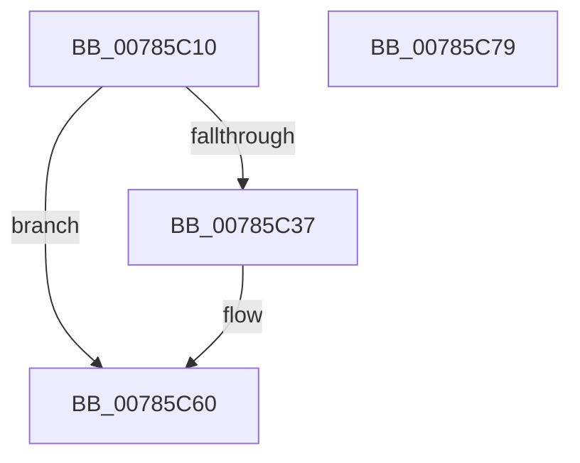

# PspSetPagePriorityLimitJobTree

- RVA: `0x00785C10`–`0x00785C7A` (길이 `106` bytes)
- VA: `0x0000000140785C10`
- 실행 섹션: `PAGE`
- PDB 이름 있음: `예`; PDB Function 태그: `아니요`
- unwind 정보 RVA: `0x000794E0`
- 디코드: `27`개 명령, `106/106` bytes 표시
- 미해석 바이트: `0` (있으면 어셈블리에 `.byte`로 보존)

> 이 문서는 커널 이미지의 기계어와 PDB 기호를 분석해 생성했습니다. 4번과 5번은 함수 원형과 자료형을 바이너리 사용 방식에서 추정한 C 해석이며 원본 소스 복구 결과는 아닙니다.

## 1. Dependencies

- 직접 호출 지점: **3**; 고유 호출 대상: **3**
- 직접 호출자로 확인된 함수: **1**
- RIP 상대 이미지 참조: **1**

### Outgoing calls
- `0x00785C2A` → [ExAcquireResourceExclusiveLite](../../text/21/ExAcquireResourceExclusiveLite_function_00214E20.md) (function, `0x00214E20`)
- `0x00785C5B` → [PspEnumJobsAndProcessesInJobHierarchy](../91/PspEnumJobsAndProcessesInJobHierarchy_function_0091A1EC.md) (function, `0x0091A1EC`)
- `0x00785C64` → [ExReleaseResourceLite](../../text/25/ExReleaseResourceLite_function_0025FA10.md) (function, `0x0025FA10`)

### Direct callers
- [NtSetInformationJobObject](../9F/NtSetInformationJobObject_function_009F84C0.md) at `0x009FAC71`

### Static image references
- `0x00785C3F` → RVA `0x00785710` (`PspSetJobPagePriorityLimitPreCallback`; read)

## 2. Other-region calls and transfers

- 다른 실행 섹션으로 향하는 call: **2**
  - `0x00785C2A` → [ExAcquireResourceExclusiveLite](../../text/21/ExAcquireResourceExclusiveLite_function_00214E20.md) (`PAGE` → `.text`)
  - `0x00785C64` → [ExReleaseResourceLite](../../text/25/ExReleaseResourceLite_function_0025FA10.md) (`PAGE` → `.text`)
- 별도 외부 분기/꼬리 이동을 확인하지 못했습니다.

## 3. Assembly (complete function range)

```asm
00785C10  48 89 5C 24 08                  mov qword ptr [rsp + 8], rbx
00785C15  48 89 74 24 10                  mov qword ptr [rsp + 0x10], rsi
00785C1A  57                              push rdi
00785C1B  48 83 EC 30                     sub rsp, 0x30
00785C1F  8B F2                           mov esi, edx
00785C21  48 8B D9                        mov rbx, rcx
00785C24  B2 01                           mov dl, 1
00785C26  48 83 C1 38                     add rcx, 0x38
00785C2A  E8 F1 F1 A8 FF                  call 0x140214e20
00785C2F  3B B3 48 04 00 00               cmp esi, dword ptr [rbx + 0x448]
00785C35  74 29                           je 0x140785c60
00785C37  C7 44 24 28 05 00 00 00         mov dword ptr [rsp + 0x28], 5
00785C3F  48 8D 15 CA FA FF FF            lea rdx, [rip - 0x536]
00785C46  48 83 64 24 20 00               and qword ptr [rsp + 0x20], 0
00785C4C  45 33 C9                        xor r9d, r9d
00785C4F  45 33 C0                        xor r8d, r8d
00785C52  89 B3 48 04 00 00               mov dword ptr [rbx + 0x448], esi
00785C58  48 8B CB                        mov rcx, rbx
00785C5B  E8 8C 45 19 00                  call 0x14091a1ec
00785C60  48 8D 4B 38                     lea rcx, [rbx + 0x38]
00785C64  E8 A7 9D AD FF                  call 0x14025fa10
00785C69  48 8B 5C 24 40                  mov rbx, qword ptr [rsp + 0x40]
00785C6E  48 8B 74 24 48                  mov rsi, qword ptr [rsp + 0x48]
00785C73  48 83 C4 30                     add rsp, 0x30
00785C77  5F                              pop rdi
00785C78  C3                              ret
00785C79  CC                              int3
```

## 4. C-style interpretation (structured pseudocode)

```c
__int64 __fastcall PspSetPagePriorityLimitJobTree(__int64 a1, int a2, int a3, int a4)
{
    __int64 result;
    __int64 v_rsp;
    unsigned int v_stack_m10;
    unsigned __int64 v_stack_m18;
    unsigned __int64 v_stack_p10;
    unsigned __int64 v_stack_p8;

    v_stack_p8 = v_rbx;
    v_stack_p10 = v_rsi;
    v_rsp = (v_rsp) - (48);
    a1 = (a1) + (56);
    result = ExAcquireResourceExclusiveLite(a1, 1, a3, a4);
    if (((unsigned int)((unsigned int)(a2))) != (*(unsigned int *)(a1 + 1096))) {
        v_stack_m10 = 5;
        a2 = v_rip - 1334;
        a4 = 0;
        a3 = 0;
        *(unsigned int *)(a1 + 1096) = (unsigned int)((unsigned int)(a2));
        a1 = a1;
        result = PspEnumJobsAndProcessesInJobHierarchy(a1, a2, a3, a4);
    }
    result = ExReleaseResourceLite(a1 + 56, a2, a3, a4);
    v_rsp = (v_rsp) + (48);
    return result;
}
```

## 5. (Beta) C Style

```c
int64_t PspSetPagePriorityLimitJobTree(void *Arg1, int32_t Arg2, int32_t Arg3, int32_t Arg4)
{
    uint8_t *arg1 = (uint8_t *)Arg1;

    int64_t result;
    int64_t local_rsp;
    uint32_t v_stack_m10;
    uint64_t v_stack_m18;
    uint64_t v_stack_p10;
    uint64_t v_stack_p8;

    v_stack_p8 = local_rbx;
    v_stack_p10 = local_rsi;
    local_rsp = (local_rsp) - (48);
    Arg1 = (Arg1) + (56);
    result = ExAcquireResourceExclusiveLite(Arg1, 1, Arg3, Arg4);
    if (((uint32_t)((uint32_t)(Arg2))) != (*(uint32_t *)(arg1 + 0x448))) {
        v_stack_m10 = 5;
        Arg2 = v_rip - 1334;
        Arg4 = 0;
        Arg3 = 0;
        *(uint32_t *)(arg1 + 0x448) = (uint32_t)((uint32_t)(Arg2));
        Arg1 = Arg1;
        result = PspEnumJobsAndProcessesInJobHierarchy(Arg1, Arg2, Arg3, Arg4);
    }
    result = ExReleaseResourceLite(Arg1 + 56, Arg2, Arg3, Arg4);
    local_rsp = (local_rsp) + (48);
    return result;
}
```

### 관측된 메모리 오프셋

구조체 형식이 확인되지 않은 접근은 인자 기준의 오프셋으로만 기록했습니다.

| 기준 인자 | 오프셋 표현 | 폭 (bit) | 접근 |
|---|---:|---:|---|
| `Arg1` | `+ 0x38` | `64` | `R` |
| `Arg1` | `+ 0x448` | `32` | `R` |
| `Arg1` | `+ 0x448` | `32` | `W` |

## 6. Execution-region graph

[열기: 2D/3D 그래프와 함수 탐색 컨트롤 패널](../../../control-panel.html?section=page&rva=0x00785C10&view=graph)

- 2D 그래프는 위에서 아래로 흐르고, 3D 그래프는 빈 공간을 드래그해 회전합니다. Shift+드래그는 이동, 휠은 확대·축소, 함수 노드 선택은 대상 보고서 이동입니다.

### Static fallback


