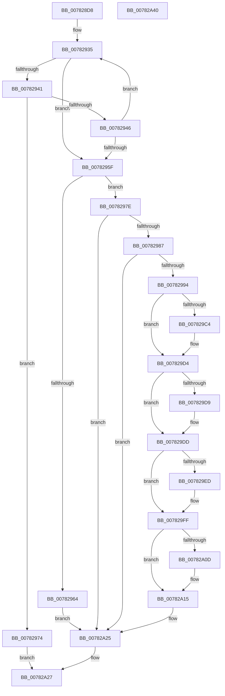

# PspSetProcessAffinityUpdateMode

- RVA: `0x007828D8`–`0x00782A41` (길이 `361` bytes)
- VA: `0x00000001407828D8`
- 실행 섹션: `PAGE`
- PDB 이름 있음: `예`; PDB Function 태그: `아니요`
- unwind 정보 RVA: `0x00095AD0`
- 디코드: `95`개 명령, `361/361` bytes 표시
- 미해석 바이트: `0` (있으면 어셈블리에 `.byte`로 보존)

> 이 문서는 커널 이미지의 기계어와 PDB 기호를 분석해 생성했습니다. 4번과 5번은 함수 원형과 자료형을 바이너리 사용 방식에서 추정한 C 해석이며 원본 소스 복구 결과는 아닙니다.

## 1. Dependencies

- 직접 호출 지점: **8**; 고유 호출 대상: **8**
- 직접 호출자로 확인된 함수: **1**
- RIP 상대 이미지 참조: **3**

### Outgoing calls
- `0x0078296A` → [PspLockUnlockProcessExclusive](../../text/41/PspLockUnlockProcessExclusive_function_00419B48.md) (function, `0x00419B48`)
- `0x007829AB` → [KeAbPreAcquire](../../text/21/KeAbPreAcquire_function_00210230.md) (function, `0x00210230`)
- `0x007829CF` → [ExfAcquirePushLockSharedEx](../../text/21/ExfAcquirePushLockSharedEx_function_0021044C.md) (function, `0x0021044C`)
- `0x007829E4` → [KeIsEmptyAffinityEx](../../text/2D/KeIsEmptyAffinityEx_function_002D1580.md) (function, `0x002D1580`)
- `0x007829FA` → [PspUpdateSingleProcessAffinity](PspUpdateSingleProcessAffinity_function_00782B00.md) (function, `0x00782B00`)
- `0x00782A10` → [ExfReleasePushLockShared](../../text/26/ExfReleasePushLockShared_function_00263440.md) (function, `0x00263440`)
- `0x00782A18` → [KeAbPostRelease](../../text/2E/KeAbPostRelease_function_002E1600.md) (function, `0x002E1600`)
- `0x00782A20` → [KiLeaveCriticalRegionUnsafe](../../text/25/KiLeaveCriticalRegionUnsafe_function_0025F010.md) (function, `0x0025F010`)

### Direct callers
- [NtSetInformationProcess](../AE/NtSetInformationProcess_function_00AE5370.md) at `0x00AE786E`

### Static image references
- `0x00782987` → RVA `0x00FC6AA4` (`ALMOSTRO`; read)
- `0x0078299B` → RVA `0x00FD9DB0` (`PAGEDATA`; read)
- `0x007829DD` → RVA `0x00E0C480` (`.data`; read)

## 2. Other-region calls and transfers

- 다른 실행 섹션으로 향하는 call: **7**
  - `0x0078296A` → [PspLockUnlockProcessExclusive](../../text/41/PspLockUnlockProcessExclusive_function_00419B48.md) (`PAGE` → `.text`)
  - `0x007829AB` → [KeAbPreAcquire](../../text/21/KeAbPreAcquire_function_00210230.md) (`PAGE` → `.text`)
  - `0x007829CF` → [ExfAcquirePushLockSharedEx](../../text/21/ExfAcquirePushLockSharedEx_function_0021044C.md) (`PAGE` → `.text`)
  - `0x007829E4` → [KeIsEmptyAffinityEx](../../text/2D/KeIsEmptyAffinityEx_function_002D1580.md) (`PAGE` → `.text`)
  - `0x00782A10` → [ExfReleasePushLockShared](../../text/26/ExfReleasePushLockShared_function_00263440.md) (`PAGE` → `.text`)
  - `0x00782A18` → [KeAbPostRelease](../../text/2E/KeAbPostRelease_function_002E1600.md) (`PAGE` → `.text`)
  - `0x00782A20` → [KiLeaveCriticalRegionUnsafe](../../text/25/KiLeaveCriticalRegionUnsafe_function_0025F010.md) (`PAGE` → `.text`)
- 별도 외부 분기/꼬리 이동을 확인하지 못했습니다.

## 3. Assembly (complete function range)

```asm
007828D8  48 89 5C 24 08                  mov qword ptr [rsp + 8], rbx
007828DD  48 89 6C 24 18                  mov qword ptr [rsp + 0x18], rbp
007828E2  48 89 74 24 20                  mov qword ptr [rsp + 0x20], rsi
007828E7  57                              push rdi
007828E8  41 56                           push r14
007828EA  41 57                           push r15
007828EC  48 83 EC 20                     sub rsp, 0x20
007828F0  65 48 8B 04 25 88 01 00 00      mov rax, qword ptr gs:[0x188]
007828F9  41 BA 00 00 08 00               mov r10d, 0x80000
007828FF  45 33 F6                        xor r14d, r14d
00782902  48 8B D9                        mov rbx, rcx
00782905  48 8B B0 B8 00 00 00            mov rsi, qword ptr [rax + 0xb8]
0078290C  8B 02                           mov eax, dword ptr [rdx]
0078290E  8B D0                           mov edx, eax
00782910  83 E2 02                        and edx, 2
00782913  C1 E2 11                        shl edx, 0x11
00782916  44 8B C2                        mov r8d, edx
00782919  45 0B C2                        or r8d, r10d
0078291C  A8 01                           test al, 1
0078291E  44 0F 44 C2                     cmove r8d, edx
00782922  0F 0D 8E F0 01 00 00            prefetchw byte ptr [rsi + 0x1f0]
00782929  8B 96 F0 01 00 00               mov edx, dword ptr [rsi + 0x1f0]
0078292F  41 B9 00 00 04 00               mov r9d, 0x40000
00782935  8B C2                           mov eax, edx
00782937  25 00 00 0C 00                  and eax, 0xc0000
0078293C  41 3B C0                        cmp eax, r8d
0078293F  74 1E                           je 0x14078295f
00782941  41 85 D1                        test r9d, edx
00782944  75 2E                           jne 0x140782974
00782946  8B CA                           mov ecx, edx
00782948  8B C2                           mov eax, edx
0078294A  81 E1 FF FF F3 FF               and ecx, 0xfff3ffff
00782950  41 0B C8                        or ecx, r8d
00782953  F0 0F B1 8E F0 01 00 00         lock cmpxchg dword ptr [rsi + 0x1f0], ecx
0078295B  8B D0                           mov edx, eax
0078295D  75 D6                           jne 0x140782935
0078295F  45 3B C1                        cmp r8d, r9d
00782962  75 1A                           jne 0x14078297e
00782964  48 8B D3                        mov rdx, rbx
00782967  48 8B CE                        mov rcx, rsi
0078296A  E8 D9 71 C9 FF                  call 0x140419b48
0078296F  E9 B1 00 00 00                  jmp 0x140782a25
00782974  B8 01 00 00 C0                  mov eax, 0xc0000001
00782979  E9 A9 00 00 00                  jmp 0x140782a27
0078297E  45 85 C2                        test r10d, r8d
00782981  0F 84 9E 00 00 00               je 0x140782a25
00782987  44 38 35 16 41 84 00            cmp byte ptr [rip + 0x844116], r14b
0078298E  0F 84 91 00 00 00               je 0x140782a25
00782994  66 FF 8B E4 01 00 00            dec word ptr [rbx + 0x1e4]
0078299B  48 8D 2D 0E 74 85 00            lea rbp, [rip + 0x85740e]
007829A2  48 8B CD                        mov rcx, rbp
007829A5  45 33 C0                        xor r8d, r8d
007829A8  33 D2                           xor edx, edx
007829AA  90                              nop
007829AB  E8 80 D8 A8 FF                  call 0x140210230
007829B0  48 8B F8                        mov rdi, rax
007829B3  33 C0                           xor eax, eax
007829B5  44 8D 78 11                     lea r15d, [rax + 0x11]
007829B9  F0 4C 0F B1 3D EE 73 85 00      lock cmpxchg qword ptr [rip + 0x8573ee], r15
007829C2  74 10                           je 0x1407829d4
007829C4  4C 8B CD                        mov r9, rbp
007829C7  4C 8B C7                        mov r8, rdi
007829CA  33 D2                           xor edx, edx
007829CC  48 8B CD                        mov rcx, rbp
007829CF  E8 78 DA A8 FF                  call 0x14021044c
007829D4  48 85 FF                        test rdi, rdi
007829D7  74 04                           je 0x1407829dd
007829D9  C6 47 0A 01                     mov byte ptr [rdi + 0xa], 1
007829DD  48 8D 0D 9C 9A 68 00            lea rcx, [rip + 0x689a9c]
007829E4  E8 97 EB B4 FF                  call 0x1402d1580
007829E9  85 C0                           test eax, eax
007829EB  75 12                           jne 0x1407829ff
007829ED  4C 8D 05 8C 9A 68 00            lea r8, [rip + 0x689a8c]
007829F4  48 8B D6                        mov rdx, rsi
007829F7  48 8B CB                        mov rcx, rbx
007829FA  E8 01 01 00 00                  call 0x140782b00
007829FF  49 8B C7                        mov rax, r15
00782A02  F0 4C 0F B1 35 A5 73 85 00      lock cmpxchg qword ptr [rip + 0x8573a5], r14
00782A0B  74 08                           je 0x140782a15
00782A0D  48 8B CD                        mov rcx, rbp
00782A10  E8 2B 0A AE FF                  call 0x140263440
00782A15  48 8B CD                        mov rcx, rbp
00782A18  E8 E3 EB B5 FF                  call 0x1402e1600
00782A1D  48 8B CB                        mov rcx, rbx
00782A20  E8 EB C5 AD FF                  call 0x14025f010
00782A25  33 C0                           xor eax, eax
00782A27  48 8B 5C 24 40                  mov rbx, qword ptr [rsp + 0x40]
00782A2C  48 8B 6C 24 50                  mov rbp, qword ptr [rsp + 0x50]
00782A31  48 8B 74 24 58                  mov rsi, qword ptr [rsp + 0x58]
00782A36  48 83 C4 20                     add rsp, 0x20
00782A3A  41 5F                           pop r15
00782A3C  41 5E                           pop r14
00782A3E  5F                              pop rdi
00782A3F  C3                              ret
00782A40  CC                              int3
```

## 4. C-style interpretation (structured pseudocode)

```c
__int64 __fastcall PspSetProcessAffinityUpdateMode(__int64 a1, __int64 a2)
{
    __int64 result;
    __int64 v_r14;
    __int64 v_rsp;
    unsigned __int64 v_stack_p18;
    unsigned __int64 v_stack_p20;
    unsigned __int64 v_stack_p8;

    v_stack_p8 = v_rbx;
    v_stack_p18 = v_rbp;
    v_stack_p20 = v_rsi;
    v_rsp = (v_rsp) - (32);
    v_r14 = 0;
    a2 = (unsigned int)(((unsigned int)((unsigned int)((unsigned int)(*(unsigned int *)(a2))))) & (2));
    a2 = (unsigned int)((a2) << (17));
    a3 = (unsigned int)(((unsigned int)((unsigned int)(a2))) | ((unsigned int)((unsigned int)(0x80000ULL))));
    if ((((unsigned __int8)((unsigned int)(*(unsigned int *)(a2)))) & (1)) == 0) { a3 = (unsigned int)(a2); }
loc_00782935:
    result = (unsigned int)(((unsigned int)((unsigned int)((unsigned int)(*(unsigned int *)(*(unsigned __int64 *)(*(unsigned __int64 *)(gs_base + (0 + 392)) + 184) + 496))))) & (0xC0000ULL));
    if (((unsigned int)(result)) == ((unsigned int)(a3))) goto loc_0078295F;
    if ((((unsigned int)((unsigned int)(0x40000ULL))) & ((unsigned int)((unsigned int)(*(unsigned int *)(*(unsigned __int64 *)(*(unsigned __int64 *)(gs_base + (0 + 392)) + 184) + 496))))) != 0) goto loc_00782974;
    a1 = (unsigned int)(((unsigned int)((unsigned int)((unsigned int)(*(unsigned int *)(*(unsigned __int64 *)(*(unsigned __int64 *)(gs_base + (0 + 392)) + 184) + 496))))) & (0xFFF3FFFFULL));
    a1 = (unsigned int)((a1) | ((unsigned int)(a3)));
    if (condition_is_not_equal) goto loc_00782935;
loc_0078295F:
    if (((unsigned int)(a3)) != ((unsigned int)((unsigned int)(0x40000ULL)))) goto loc_0078297E;
    result = PspLockUnlockProcessExclusive(*(unsigned __int64 *)(*(unsigned __int64 *)(gs_base + (0 + 392)) + 184), a1, a3, (unsigned int)(0x40000ULL));
    goto loc_00782A25;
loc_00782974:
    goto loc_00782A27;
loc_0078297E:
    if ((((unsigned int)((unsigned int)(0x80000ULL))) & ((unsigned int)(a3))) == 0) goto loc_00782A25;
    if ((*(unsigned __int8 *)(v_rip + 8667414)) == 0) goto loc_00782A25;
    a3 = 0;
    a2 = 0;
    result = KeAbPreAcquire(v_rip + 8745998, a2, a3, (unsigned int)(0x40000ULL));
    result = 0;
    if (!(condition_is_equal)) {
        a4 = v_rip + 8745998;
        a3 = 0;
        a2 = 0;
        a1 = v_rip + 8745998;
        result = ExfAcquirePushLockSharedEx(a1, a2, a3, a4);
    }
    if (result != 0) {
        *(unsigned __int8 *)(result + 10) = 1;
    }
    result = KeIsEmptyAffinityEx(v_rip + 6855324, a2, a3, a4);
    if ((unsigned int)(result) == 0) {
        a3 = v_rip + 6855308;
        a2 = *(unsigned __int64 *)(*(unsigned __int64 *)(gs_base + (0 + 392)) + 184);
        a1 = a1;
        result = PspUpdateSingleProcessAffinity(a1, a2, a3, a4);
    }
    result = result + 17;
    if ((unsigned int)(result) != 0) {
        a1 = v_rip + 8745998;
        result = ExfReleasePushLockShared(a1, a2, a3, a4);
    }
    result = KeAbPostRelease(v_rip + 8745998, a2, a3, a4);
    result = KiLeaveCriticalRegionUnsafe(a1, a2, a3, a4);
loc_00782A25:
    result = 0;
loc_00782A27:
    v_rsp = (v_rsp) + (32);
    return result;
}
```

## 5. (Beta) C Style

```c
int64_t PspSetProcessAffinityUpdateMode(void *Arg1, void *Arg2)
{
    uint8_t *arg1 = (uint8_t *)Arg1;
    uint8_t *arg2 = (uint8_t *)Arg2;

    int64_t result;
    int64_t local_r14;
    int64_t local_rsp;
    uint64_t v_stack_p18;
    uint64_t v_stack_p20;
    uint64_t v_stack_p8;

    v_stack_p8 = local_rbx;
    v_stack_p18 = local_rbp;
    v_stack_p20 = local_rsi;
    local_rsp = (local_rsp) - (32);
    local_r14 = 0;
    Arg2 = (uint32_t)(((uint32_t)((uint32_t)((uint32_t)(*(uint32_t *)(arg2))))) & (2));
    Arg2 = (uint32_t)((Arg2) << (17));
    a3 = (uint32_t)(((uint32_t)((uint32_t)(Arg2))) | ((uint32_t)((uint32_t)(0x80000ULL))));
    if ((((uint8_t)((uint32_t)(*(uint32_t *)(arg2)))) & (1)) == 0) { a3 = (uint32_t)(Arg2); }
loc_00782935:
    result = (uint32_t)(((uint32_t)((uint32_t)((uint32_t)(*(uint32_t *)(*(uint64_t *)(*(uint64_t *)(gs_base + (0 + 0x188)) + 0xB8) + 0x1F0))))) & (0xC0000ULL));
    if (((uint32_t)(result)) == ((uint32_t)(a3))) goto loc_0078295F;
    if ((((uint32_t)((uint32_t)(0x40000ULL))) & ((uint32_t)((uint32_t)(*(uint32_t *)(*(uint64_t *)(*(uint64_t *)(gs_base + (0 + 0x188)) + 0xB8) + 0x1F0))))) != 0) goto loc_00782974;
    Arg1 = (uint32_t)(((uint32_t)((uint32_t)((uint32_t)(*(uint32_t *)(*(uint64_t *)(*(uint64_t *)(gs_base + (0 + 0x188)) + 0xB8) + 0x1F0))))) & (0xFFF3FFFFULL));
    Arg1 = (uint32_t)((Arg1) | ((uint32_t)(a3)));
    if (condition_is_not_equal) goto loc_00782935;
loc_0078295F:
    if (((uint32_t)(a3)) != ((uint32_t)((uint32_t)(0x40000ULL)))) goto loc_0078297E;
    result = PspLockUnlockProcessExclusive(*(uint64_t *)(*(uint64_t *)(gs_base + (0 + 0x188)) + 0xB8), Arg1, a3, (uint32_t)(0x40000ULL));
    goto loc_00782A25;
loc_00782974:
    goto loc_00782A27;
loc_0078297E:
    if ((((uint32_t)((uint32_t)(0x80000ULL))) & ((uint32_t)(a3))) == 0) goto loc_00782A25;
    if ((*(uint8_t *)(v_rip + 0x844116)) == 0) goto loc_00782A25;
    a3 = 0;
    Arg2 = 0;
    result = KeAbPreAcquire(v_rip + 8745998, Arg2, a3, (uint32_t)(0x40000ULL));
    result = 0;
    if (!(condition_is_equal)) {
        a4 = v_rip + 8745998;
        a3 = 0;
        Arg2 = 0;
        Arg1 = v_rip + 8745998;
        result = ExfAcquirePushLockSharedEx(Arg1, Arg2, a3, a4);
    }
    if (result != 0) {
        *(uint8_t *)(result + 0xA) = 1;
    }
    result = KeIsEmptyAffinityEx(v_rip + 6855324, Arg2, a3, a4);
    if ((uint32_t)(result) == 0) {
        a3 = v_rip + 6855308;
        Arg2 = *(uint64_t *)(*(uint64_t *)(gs_base + (0 + 0x188)) + 0xB8);
        Arg1 = Arg1;
        result = PspUpdateSingleProcessAffinity(Arg1, Arg2, a3, a4);
    }
    result = result + 17;
    if ((uint32_t)(result) != 0) {
        Arg1 = v_rip + 8745998;
        result = ExfReleasePushLockShared(Arg1, Arg2, a3, a4);
    }
    result = KeAbPostRelease(v_rip + 8745998, Arg2, a3, a4);
    result = KiLeaveCriticalRegionUnsafe(Arg1, Arg2, a3, a4);
loc_00782A25:
    result = 0;
loc_00782A27:
    local_rsp = (local_rsp) + (32);
    return result;
}
```

### 관측된 메모리 오프셋

구조체 형식이 확인되지 않은 접근은 인자 기준의 오프셋으로만 기록했습니다.

| 기준 인자 | 오프셋 표현 | 폭 (bit) | 접근 |
|---|---:|---:|---|
| `Arg1` | `+ 0x1E4` | `16` | `R/W` |
| `Arg2` | `+ 0x0` | `32` | `R` |

## 6. Execution-region graph

[열기: 2D/3D 그래프와 함수 탐색 컨트롤 패널](../../../control-panel.html?section=page&rva=0x007828D8&view=graph)

- 2D 그래프는 위에서 아래로 흐르고, 3D 그래프는 빈 공간을 드래그해 회전합니다. Shift+드래그는 이동, 휠은 확대·축소, 함수 노드 선택은 대상 보고서 이동입니다.

### Static fallback


