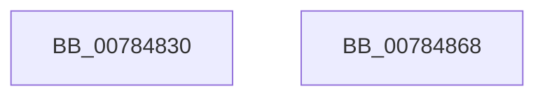

# PspSetVmProcessorHostProcessWorkerRoutine

- RVA: `0x00784830`–`0x00784869` (길이 `57` bytes)
- VA: `0x0000000140784830`
- 실행 섹션: `PAGE`
- PDB 이름 있음: `예`; PDB Function 태그: `아니요`
- unwind 정보 RVA: `0x0005CF00`
- 디코드: `16`개 명령, `57/57` bytes 표시
- 미해석 바이트: `0` (있으면 어셈블리에 `.byte`로 보존)

> 이 문서는 커널 이미지의 기계어와 PDB 기호를 분석해 생성했습니다. 4번과 5번은 함수 원형과 자료형을 바이너리 사용 방식에서 추정한 C 해석이며 원본 소스 복구 결과는 아닙니다.

## 1. Dependencies

- 직접 호출 지점: **2**; 고유 호출 대상: **2**
- 직접 호출자로 확인된 함수: **0**
- RIP 상대 이미지 참조: **2**

### Outgoing calls
- `0x00784850` → [KeGenericProcessorCallback](../../text/39/KeGenericProcessorCallback_function_00398C2C.md) (function, `0x00398C2C`)
- `0x0078485D` → [KeSetEvent](../../text/33/KeSetEvent_function_0033F310.md) (function, `0x0033F310`)

### Direct callers
- 이 함수 시작 RVA로 연결되는 직접 call은 확인되지 않았습니다. 간접 호출은 완전히 역산할 수 없습니다.

### Static image references
- `0x00784839` → RVA `0x0049E550` (`EmpCheckErrataList`; read)
- `0x00784840` → RVA `0x00FC7120` (`ALMOSTRO`; read)

## 2. Other-region calls and transfers

- 다른 실행 섹션으로 향하는 call: **2**
  - `0x00784850` → [KeGenericProcessorCallback](../../text/39/KeGenericProcessorCallback_function_00398C2C.md) (`PAGE` → `.text`)
  - `0x0078485D` → [KeSetEvent](../../text/33/KeSetEvent_function_0033F310.md) (`PAGE` → `.text`)
- 별도 외부 분기/꼬리 이동을 확인하지 못했습니다.

## 3. Assembly (complete function range)

```asm
00784830  40 53                           push rbx
00784832  48 83 EC 20                     sub rsp, 0x20
00784836  48 8B D9                        mov rbx, rcx
00784839  48 8D 15 10 9D D1 FF            lea rdx, [rip - 0x2e62f0]
00784840  48 8D 0D D9 28 84 00            lea rcx, [rip + 0x8428d9]
00784847  41 B9 02 00 00 00               mov r9d, 2
0078484D  45 33 C0                        xor r8d, r8d
00784850  E8 D7 43 C1 FF                  call 0x140398c2c
00784855  45 33 C0                        xor r8d, r8d
00784858  33 D2                           xor edx, edx
0078485A  48 8B CB                        mov rcx, rbx
0078485D  E8 AE AA BB FF                  call 0x14033f310
00784862  48 83 C4 20                     add rsp, 0x20
00784866  5B                              pop rbx
00784867  C3                              ret
00784868  CC                              int3
```

## 4. C-style interpretation (structured pseudocode)

```c
__int64 __fastcall PspSetVmProcessorHostProcessWorkerRoutine(__int64 a1, __int64 a2, int a3)
{
    __int64 result;
    __int64 v_rsp;

    v_rsp = (v_rsp) - (32);
    a3 = 0;
    result = KeGenericProcessorCallback(v_rip + 8661209, v_rip - 3039984, a3, 2);
    a3 = 0;
    a2 = 0;
    result = KeSetEvent(a1, a2, a3, 2);
    v_rsp = (v_rsp) + (32);
    return result;
}
```

## 5. (Beta) C Style

```c
int64_t PspSetVmProcessorHostProcessWorkerRoutine(int64_t Arg1, int64_t Arg2, int32_t Arg3)
{
    int64_t result;
    int64_t local_rsp;

    local_rsp = (local_rsp) - (32);
    Arg3 = 0;
    result = KeGenericProcessorCallback(v_rip + 8661209, v_rip - 3039984, Arg3, 2);
    Arg3 = 0;
    Arg2 = 0;
    result = KeSetEvent(Arg1, Arg2, Arg3, 2);
    local_rsp = (local_rsp) + (32);
    return result;
}
```

## 6. Execution-region graph

[열기: 2D/3D 그래프와 함수 탐색 컨트롤 패널](../../../control-panel.html?section=page&rva=0x00784830&view=graph)

- 2D 그래프는 위에서 아래로 흐르고, 3D 그래프는 빈 공간을 드래그해 회전합니다. Shift+드래그는 이동, 휠은 확대·축소, 함수 노드 선택은 대상 보고서 이동입니다.

### Static fallback


