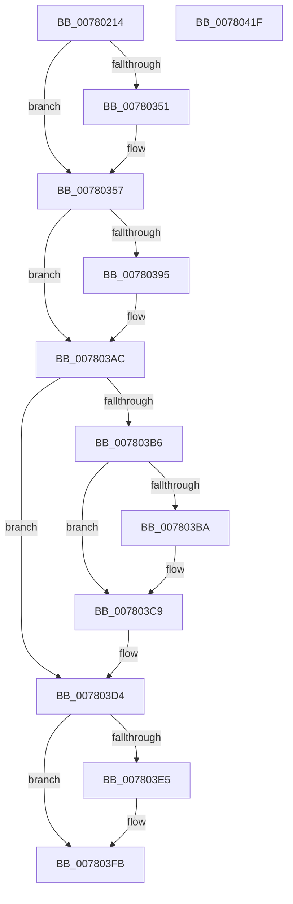

# PspShutdownCsrProcess

- RVA: `0x00780214`–`0x00780420` (길이 `524` bytes)
- VA: `0x0000000140780214`
- 실행 섹션: `PAGE`
- PDB 이름 있음: `예`; PDB Function 태그: `아니요`
- unwind 정보 RVA: `0x000CE0BC`
- 디코드: `120`개 명령, `524/524` bytes 표시
- 미해석 바이트: `0` (있으면 어셈블리에 `.byte`로 보존)

> 이 문서는 커널 이미지의 기계어와 PDB 기호를 분석해 생성했습니다. 4번과 5번은 함수 원형과 자료형을 바이너리 사용 방식에서 추정한 C 해석이며 원본 소스 복구 결과는 아닙니다.

## 1. Dependencies

- 직접 호출 지점: **18**; 고유 호출 대상: **15**
- 직접 호출자로 확인된 함수: **1**
- RIP 상대 이미지 참조: **3**

### Outgoing calls
- `0x00780273` → [PsAttachSiloToCurrentThread](../../text/44/PsAttachSiloToCurrentThread_function_004428C0.md) (function, `0x004428C0`)
- `0x00780290` → [RtlStringCchPrintfW](../../text/48/RtlStringCchPrintfW_function_00482D5C.md) (function, `0x00482D5C`)
- `0x0078029E` → [RtlInitUnicodeString](../../text/42/RtlInitUnicodeString_function_0042A780.md) (function, `0x0042A780`)
- `0x007802DB` → [ZwOpenEvent](../../text/6A/ZwOpenEvent_function_006AD8D0.md) (function, `0x006AD8D0`)
- `0x007802F5` → [RtlStringCchPrintfW](../../text/48/RtlStringCchPrintfW_function_00482D5C.md) (function, `0x00482D5C`)
- `0x00780303` → [RtlInitUnicodeString](../../text/42/RtlInitUnicodeString_function_0042A780.md) (function, `0x0042A780`)
- `0x00780348` → [ZwCreateEvent](../../text/6A/ZwCreateEvent_function_006AD9D0.md) (function, `0x006AD9D0`)
- `0x0078035A` → [PsDetachSiloFromCurrentThread](../../text/44/PsDetachSiloFromCurrentThread_function_00449AC0.md) (function, `0x00449AC0`)
- `0x00780366` → [KeStackAttachProcess](../../text/21/KeStackAttachProcess_function_00216800.md) (function, `0x00216800`)
- `0x00780379` → [PsInvokeWin32Callout](../91/PsInvokeWin32Callout_function_009133C0.md) (function, `0x009133C0`)
- `0x00780386` → [KiUnstackDetachProcess](../../text/21/KiUnstackDetachProcess_function_00217D30.md) (function, `0x00217D30`)
- `0x00780397` → [ZwSetEvent](../../text/6A/ZwSetEvent_function_006AD290.md) (function, `0x006AD290`)
- `0x007803A1` → [ZwClose](../../text/6A/ZwClose_function_006AD2B0.md) (function, `0x006AD2B0`)
- `0x007803BF` → [ZwWaitForSingleObject](../../text/6A/ZwWaitForSingleObject_function_006AD150.md) (function, `0x006AD150`)
- `0x007803C9` → [ZwClose](../../text/6A/ZwClose_function_006AD2B0.md) (function, `0x006AD2B0`)
- `0x007803DC` → [PsTerminateProcess](../90/PsTerminateProcess_function_00904C64.md) (function, `0x00904C64`)
- `0x007803F6` → [KeWaitForSingleObject](../../text/20/KeWaitForSingleObject_function_0020E6B0.md) (function, `0x0020E6B0`)
- `0x00780405` → [_security_check_cookie](../../text/6A/_security_check_cookie_function_006AC640.md) (function, `0x006AC640`)

### Direct callers
- [PspTerminateSiloSubsystemProcesses](PspTerminateSiloSubsystemProcesses_function_00780918.md) at `0x007809AA`
- [PspTerminateSiloSubsystemProcesses](PspTerminateSiloSubsystemProcesses_function_00780918.md) at `0x007809E7`

### Static image references
- `0x0078022E` → RVA `0x00E0A740` (`.data`; read)
- `0x0078027D` → RVA `0x00B04AB0` (` ?? ::NNGAKEGL::`string'`; read)
- `0x007802E5` → RVA `0x00B04A50` (` ?? ::NNGAKEGL::`string'`; read)

## 2. Other-region calls and transfers

- 다른 실행 섹션으로 향하는 call: **16**
  - `0x00780273` → [PsAttachSiloToCurrentThread](../../text/44/PsAttachSiloToCurrentThread_function_004428C0.md) (`PAGE` → `.text`)
  - `0x00780290` → [RtlStringCchPrintfW](../../text/48/RtlStringCchPrintfW_function_00482D5C.md) (`PAGE` → `.text`)
  - `0x0078029E` → [RtlInitUnicodeString](../../text/42/RtlInitUnicodeString_function_0042A780.md) (`PAGE` → `.text`)
  - `0x007802DB` → [ZwOpenEvent](../../text/6A/ZwOpenEvent_function_006AD8D0.md) (`PAGE` → `.text`)
  - `0x007802F5` → [RtlStringCchPrintfW](../../text/48/RtlStringCchPrintfW_function_00482D5C.md) (`PAGE` → `.text`)
  - `0x00780303` → [RtlInitUnicodeString](../../text/42/RtlInitUnicodeString_function_0042A780.md) (`PAGE` → `.text`)
  - `0x00780348` → [ZwCreateEvent](../../text/6A/ZwCreateEvent_function_006AD9D0.md) (`PAGE` → `.text`)
  - `0x0078035A` → [PsDetachSiloFromCurrentThread](../../text/44/PsDetachSiloFromCurrentThread_function_00449AC0.md) (`PAGE` → `.text`)
  - `0x00780366` → [KeStackAttachProcess](../../text/21/KeStackAttachProcess_function_00216800.md) (`PAGE` → `.text`)
  - `0x00780386` → [KiUnstackDetachProcess](../../text/21/KiUnstackDetachProcess_function_00217D30.md) (`PAGE` → `.text`)
  - `0x00780397` → [ZwSetEvent](../../text/6A/ZwSetEvent_function_006AD290.md) (`PAGE` → `.text`)
  - `0x007803A1` → [ZwClose](../../text/6A/ZwClose_function_006AD2B0.md) (`PAGE` → `.text`)
  - `0x007803BF` → [ZwWaitForSingleObject](../../text/6A/ZwWaitForSingleObject_function_006AD150.md) (`PAGE` → `.text`)
  - `0x007803C9` → [ZwClose](../../text/6A/ZwClose_function_006AD2B0.md) (`PAGE` → `.text`)
  - `0x007803F6` → [KeWaitForSingleObject](../../text/20/KeWaitForSingleObject_function_0020E6B0.md) (`PAGE` → `.text`)
  - `0x00780405` → [_security_check_cookie](../../text/6A/_security_check_cookie_function_006AC640.md) (`PAGE` → `.text`)
- 별도 외부 분기/꼬리 이동을 확인하지 못했습니다.

## 3. Assembly (complete function range)

```asm
00780214  48 89 5C 24 08                  mov qword ptr [rsp + 8], rbx
00780219  48 89 7C 24 20                  mov qword ptr [rsp + 0x20], rdi
0078021E  55                              push rbp
0078021F  48 8D AC 24 40 FF FF FF         lea rbp, [rsp - 0xc0]
00780227  48 81 EC C0 01 00 00            sub rsp, 0x1c0
0078022E  48 8B 05 0B A5 68 00            mov rax, qword ptr [rip + 0x68a50b]
00780235  48 33 C4                        xor rax, rsp
00780238  48 89 85 B0 00 00 00            mov qword ptr [rbp + 0xb0], rax
0078023F  48 83 64 24 38 00               and qword ptr [rsp + 0x38], 0
00780245  33 C0                           xor eax, eax
00780247  21 44 24 74                     and dword ptr [rsp + 0x74], eax
0078024B  0F 57 C0                        xorps xmm0, xmm0
0078024E  48 21 44 24 40                  and qword ptr [rsp + 0x40], rax
00780253  49 8B D8                        mov rbx, r8
00780256  89 44 24 5C                     mov dword ptr [rsp + 0x5c], eax
0078025A  21 44 24 5C                     and dword ptr [rsp + 0x5c], eax
0078025E  89 54 24 30                     mov dword ptr [rsp + 0x30], edx
00780262  0F 11 45 88                     movups xmmword ptr [rbp - 0x78], xmm0
00780266  0F 11 45 98                     movups xmmword ptr [rbp - 0x68], xmm0
0078026A  0F 11 45 A8                     movups xmmword ptr [rbp - 0x58], xmm0
0078026E  0F 11 44 24 48                  movups xmmword ptr [rsp + 0x48], xmm0
00780273  E8 48 26 CC FF                  call 0x1404428c0
00780278  44 8B 4C 24 30                  mov r9d, dword ptr [rsp + 0x30]
0078027D  4C 8D 05 2C 48 38 00            lea r8, [rip + 0x38482c]
00780284  BA 78 00 00 00                  mov edx, 0x78
00780289  48 8D 4D C0                     lea rcx, [rbp - 0x40]
0078028D  48 8B F8                        mov rdi, rax
00780290  E8 C7 2A D0 FF                  call 0x140482d5c
00780295  48 8D 55 C0                     lea rdx, [rbp - 0x40]
00780299  48 8D 4C 24 48                  lea rcx, [rsp + 0x48]
0078029E  E8 DD A4 CA FF                  call 0x14042a780
007802A3  48 83 64 24 60 00               and qword ptr [rsp + 0x60], 0
007802A9  48 8D 44 24 48                  lea rax, [rsp + 0x48]
007802AE  0F 57 C0                        xorps xmm0, xmm0
007802B1  48 89 44 24 68                  mov qword ptr [rsp + 0x68], rax
007802B6  4C 8D 44 24 58                  lea r8, [rsp + 0x58]
007802BB  C7 44 24 58 30 00 00 00         mov dword ptr [rsp + 0x58], 0x30
007802C3  BA 03 00 1F 00                  mov edx, 0x1f0003
007802C8  C7 44 24 70 40 02 00 00         mov dword ptr [rsp + 0x70], 0x240
007802D0  48 8D 4C 24 40                  lea rcx, [rsp + 0x40]
007802D5  F3 0F 7F 44 24 78               movdqu xmmword ptr [rsp + 0x78], xmm0
007802DB  E8 F0 D5 F2 FF                  call 0x1406ad8d0
007802E0  44 8B 4C 24 30                  mov r9d, dword ptr [rsp + 0x30]
007802E5  4C 8D 05 64 47 38 00            lea r8, [rip + 0x384764]
007802EC  BA 78 00 00 00                  mov edx, 0x78
007802F1  48 8D 4D C0                     lea rcx, [rbp - 0x40]
007802F5  E8 62 2A D0 FF                  call 0x140482d5c
007802FA  48 8D 55 C0                     lea rdx, [rbp - 0x40]
007802FE  48 8D 4C 24 48                  lea rcx, [rsp + 0x48]
00780303  E8 78 A4 CA FF                  call 0x14042a780
00780308  48 83 64 24 60 00               and qword ptr [rsp + 0x60], 0
0078030E  48 8D 44 24 48                  lea rax, [rsp + 0x48]
00780313  0F 57 C0                        xorps xmm0, xmm0
00780316  48 89 44 24 68                  mov qword ptr [rsp + 0x68], rax
0078031B  45 33 C9                        xor r9d, r9d
0078031E  C7 44 24 58 30 00 00 00         mov dword ptr [rsp + 0x58], 0x30
00780326  4C 8D 44 24 58                  lea r8, [rsp + 0x58]
0078032B  C7 44 24 70 C0 02 00 00         mov dword ptr [rsp + 0x70], 0x2c0
00780333  BA 03 00 1F 00                  mov edx, 0x1f0003
00780338  C6 44 24 20 00                  mov byte ptr [rsp + 0x20], 0
0078033D  48 8D 4C 24 38                  lea rcx, [rsp + 0x38]
00780342  F3 0F 7F 44 24 78               movdqu xmmword ptr [rsp + 0x78], xmm0
00780348  E8 83 D6 F2 FF                  call 0x1406ad9d0
0078034D  85 C0                           test eax, eax
0078034F  79 06                           jns 0x140780357
00780351  48 83 64 24 38 00               and qword ptr [rsp + 0x38], 0
00780357  48 8B CF                        mov rcx, rdi
0078035A  E8 61 97 CC FF                  call 0x140449ac0
0078035F  48 8D 55 88                     lea rdx, [rbp - 0x78]
00780363  48 8B CB                        mov rcx, rbx
00780366  E8 95 64 A9 FF                  call 0x140216800
0078036B  33 D2                           xor edx, edx
0078036D  4C 8D 4C 24 30                  lea r9, [rsp + 0x30]
00780372  8D 4A 1F                        lea ecx, [rdx + 0x1f]
00780375  44 8D 42 01                     lea r8d, [rdx + 1]
00780379  E8 42 30 19 00                  call 0x1409133c0
0078037E  33 D2                           xor edx, edx
00780380  48 8D 4D 88                     lea rcx, [rbp - 0x78]
00780384  8B F8                           mov edi, eax
00780386  E8 A5 79 A9 FF                  call 0x140217d30
0078038B  48 8B 4C 24 40                  mov rcx, qword ptr [rsp + 0x40]
00780390  48 85 C9                        test rcx, rcx
00780393  74 17                           je 0x1407803ac
00780395  33 D2                           xor edx, edx
00780397  E8 F4 CE F2 FF                  call 0x1406ad290
0078039C  48 8B 4C 24 40                  mov rcx, qword ptr [rsp + 0x40]
007803A1  E8 0A CF F2 FF                  call 0x1406ad2b0
007803A6  48 83 64 24 40 00               and qword ptr [rsp + 0x40], 0
007803AC  48 8B 4C 24 38                  mov rcx, qword ptr [rsp + 0x38]
007803B1  48 85 C9                        test rcx, rcx
007803B4  74 1E                           je 0x1407803d4
007803B6  85 FF                           test edi, edi
007803B8  78 0F                           js 0x1407803c9
007803BA  45 33 C0                        xor r8d, r8d
007803BD  33 D2                           xor edx, edx
007803BF  E8 8C CD F2 FF                  call 0x1406ad150
007803C4  48 8B 4C 24 38                  mov rcx, qword ptr [rsp + 0x38]
007803C9  E8 E2 CE F2 FF                  call 0x1406ad2b0
007803CE  48 83 64 24 38 00               and qword ptr [rsp + 0x38], 0
007803D4  BA EB 02 00 C0                  mov edx, 0xc00002eb
007803D9  48 8B CB                        mov rcx, rbx
007803DC  E8 83 48 18 00                  call 0x140904c64
007803E1  85 C0                           test eax, eax
007803E3  78 16                           js 0x1407803fb
007803E5  48 83 64 24 20 00               and qword ptr [rsp + 0x20], 0
007803EB  45 33 C9                        xor r9d, r9d
007803EE  45 33 C0                        xor r8d, r8d
007803F1  33 D2                           xor edx, edx
007803F3  48 8B CB                        mov rcx, rbx
007803F6  E8 B5 E2 A8 FF                  call 0x14020e6b0
007803FB  48 8B 8D B0 00 00 00            mov rcx, qword ptr [rbp + 0xb0]
00780402  48 33 CC                        xor rcx, rsp
00780405  E8 36 C2 F2 FF                  call 0x1406ac640
0078040A  4C 8D 9C 24 C0 01 00 00         lea r11, [rsp + 0x1c0]
00780412  49 8B 5B 10                     mov rbx, qword ptr [r11 + 0x10]
00780416  49 8B 7B 28                     mov rdi, qword ptr [r11 + 0x28]
0078041A  49 8B E3                        mov rsp, r11
0078041D  5D                              pop rbp
0078041E  C3                              ret
0078041F  CC                              int3
```

## 4. C-style interpretation (structured pseudocode)

```c
__int64 __fastcall PspShutdownCsrProcess(__int64 a1, int a2, __int64 a3)
{
    __int64 result;
    __int64 v_rsp;
    unsigned __int64 v_stack_m108;
    unsigned __int64 v_stack_m120;
    unsigned __int64 v_stack_m130;
    unsigned __int64 v_stack_m140;
    unsigned __int64 v_stack_m150;
    unsigned int v_stack_m154;
    unsigned int v_stack_m158;
    unsigned __int64 v_stack_m160;
    unsigned __int64 v_stack_m168;
    unsigned int v_stack_m16C;
    unsigned __int64 v_stack_m170;
    unsigned __int64 v_stack_m18;
    unsigned __int64 v_stack_m180;
    unsigned __int64 v_stack_m188;
    unsigned __int64 v_stack_m190;
    unsigned int v_stack_m198;
    unsigned __int8 v_stack_m1A8;
    unsigned __int64 v_stack_m8;
    unsigned __int64 v_stack_mC8;
    unsigned __int64 v_stack_p20;
    unsigned __int64 v_stack_p8;

    v_stack_p8 = v_rbx;
    v_stack_p20 = v_rdi;
    v_rsp = (v_rsp) - (448);
    result = (*(unsigned __int64 *)(v_rip + 6857995)) ^ (v_rsp);
    v_stack_m18 = result;
    result = 0;
    v_stack_m16C = 0;
    v_stack_m198 = a2;
    v_stack_m140 = v_xmm0;
    v_stack_m130 = v_xmm0;
    v_stack_m120 = v_xmm0;
    v_stack_m180 = v_xmm0;
    result = PsAttachSiloToCurrentThread(a1, a2, a3, a4);
    result = RtlStringCchPrintfW(v_stack_m108, 120, v_rip + 3688492, (unsigned int)(v_stack_m198));
    result = RtlInitUnicodeString(v_stack_m180, v_stack_m108, v_rip + 3688492, (unsigned int)(v_stack_m198));
    v_stack_m160 = v_stack_m180;
    v_stack_m170 = 48;
    v_stack_m158 = 576;
    v_stack_m150 = v_xmm0;
    result = ZwOpenEvent(v_stack_m188, (unsigned int)(0x1F0003ULL), v_stack_m170, (unsigned int)(v_stack_m198));
    result = RtlStringCchPrintfW(v_stack_m108, 120, v_rip + 3688292, (unsigned int)(v_stack_m198));
    result = RtlInitUnicodeString(v_stack_m180, v_stack_m108, v_rip + 3688292, (unsigned int)(v_stack_m198));
    v_stack_m160 = v_stack_m180;
    a4 = 0;
    v_stack_m170 = 48;
    v_stack_m158 = 704;
    v_stack_m1A8 = 0;
    v_stack_m150 = v_xmm0;
    result = ZwCreateEvent(v_stack_m190, (unsigned int)(0x1F0003ULL), v_stack_m170, a4);
    if (sign_flag) {
    }
    result = PsDetachSiloFromCurrentThread(result, (unsigned int)(0x1F0003ULL), v_stack_m170, a4);
    result = KeStackAttachProcess(a3, v_stack_m140, v_stack_m170, a4);
    a2 = 0;
    result = PsInvokeWin32Callout(a2 + 31, a2, a2 + 1, v_stack_m198);
    a2 = 0;
    result = KiUnstackDetachProcess(v_stack_m140, a2, a2 + 1, v_stack_m198);
    if (v_stack_m188 != 0) {
        a2 = 0;
        result = ZwSetEvent(v_stack_m188, a2, a2 + 1, v_stack_m198);
        a1 = v_stack_m188;
        result = ZwClose(a1, a2, a2 + 1, v_stack_m198);
    }
    if (v_stack_m190 == 0) goto loc_007803D4;
    if (!(sign_flag)) {
        a3 = 0;
        a2 = 0;
        result = ZwWaitForSingleObject(v_stack_m190, a2, a3, v_stack_m198);
        a1 = v_stack_m190;
    }
    result = ZwClose(a1, a2, a3, v_stack_m198);
loc_007803D4:
    result = PsTerminateProcess(0, (unsigned int)(0xC00002EBULL), a3, v_stack_m198);
    if (!(sign_flag)) {
        a4 = 0;
        a3 = 0;
        a2 = 0;
        a1 = 0;
        result = KeWaitForSingleObject(a1, a2, a3, a4);
    }
    a1 = (v_stack_m18) ^ (v_rsp);
    result = _security_check_cookie(a1, a2, a3, a4);
    return result;
}
```

## 5. (Beta) C Style

```c
int64_t PspShutdownCsrProcess(int64_t Arg1, int32_t Arg2, int64_t Arg3)
{
    int64_t result;
    int64_t local_rsp;
    uint64_t v_stack_m108;
    uint64_t v_stack_m120;
    uint64_t v_stack_m130;
    uint64_t v_stack_m140;
    uint64_t v_stack_m150;
    uint32_t v_stack_m154;
    uint32_t v_stack_m158;
    uint64_t v_stack_m160;
    uint64_t v_stack_m168;
    uint32_t v_stack_m16C;
    uint64_t v_stack_m170;
    uint64_t v_stack_m18;
    uint64_t v_stack_m180;
    uint64_t v_stack_m188;
    uint64_t v_stack_m190;
    uint32_t v_stack_m198;
    uint8_t v_stack_m1A8;
    uint64_t v_stack_m8;
    uint64_t v_stack_mC8;
    uint64_t v_stack_p20;
    uint64_t v_stack_p8;

    v_stack_p8 = local_rbx;
    v_stack_p20 = local_rdi;
    local_rsp = (local_rsp) - (448);
    result = (*(uint64_t *)(v_rip + 0x68A50B)) ^ (local_rsp);
    v_stack_m18 = result;
    result = 0;
    v_stack_m16C = 0;
    v_stack_m198 = Arg2;
    v_stack_m140 = v_xmm0;
    v_stack_m130 = v_xmm0;
    v_stack_m120 = v_xmm0;
    v_stack_m180 = v_xmm0;
    result = PsAttachSiloToCurrentThread(Arg1, Arg2, Arg3, a4);
    result = RtlStringCchPrintfW(v_stack_m108, 120, v_rip + 3688492, (uint32_t)(v_stack_m198));
    result = RtlInitUnicodeString(v_stack_m180, v_stack_m108, v_rip + 3688492, (uint32_t)(v_stack_m198));
    v_stack_m160 = v_stack_m180;
    v_stack_m170 = 48;
    v_stack_m158 = 576;
    v_stack_m150 = v_xmm0;
    result = ZwOpenEvent(v_stack_m188, (uint32_t)(0x1F0003ULL), v_stack_m170, (uint32_t)(v_stack_m198));
    result = RtlStringCchPrintfW(v_stack_m108, 120, v_rip + 3688292, (uint32_t)(v_stack_m198));
    result = RtlInitUnicodeString(v_stack_m180, v_stack_m108, v_rip + 3688292, (uint32_t)(v_stack_m198));
    v_stack_m160 = v_stack_m180;
    a4 = 0;
    v_stack_m170 = 48;
    v_stack_m158 = 704;
    v_stack_m1A8 = 0;
    v_stack_m150 = v_xmm0;
    result = ZwCreateEvent(v_stack_m190, (uint32_t)(0x1F0003ULL), v_stack_m170, a4);
    if (sign_flag) {
    }
    result = PsDetachSiloFromCurrentThread(result, (uint32_t)(0x1F0003ULL), v_stack_m170, a4);
    result = KeStackAttachProcess(Arg3, v_stack_m140, v_stack_m170, a4);
    Arg2 = 0;
    result = PsInvokeWin32Callout(Arg2 + 31, Arg2, Arg2 + 1, v_stack_m198);
    Arg2 = 0;
    result = KiUnstackDetachProcess(v_stack_m140, Arg2, Arg2 + 1, v_stack_m198);
    if (v_stack_m188 != 0) {
        Arg2 = 0;
        result = ZwSetEvent(v_stack_m188, Arg2, Arg2 + 1, v_stack_m198);
        Arg1 = v_stack_m188;
        result = ZwClose(Arg1, Arg2, Arg2 + 1, v_stack_m198);
    }
    if (v_stack_m190 == 0) goto loc_007803D4;
    if (!(sign_flag)) {
        Arg3 = 0;
        Arg2 = 0;
        result = ZwWaitForSingleObject(v_stack_m190, Arg2, Arg3, v_stack_m198);
        Arg1 = v_stack_m190;
    }
    result = ZwClose(Arg1, Arg2, Arg3, v_stack_m198);
loc_007803D4:
    result = PsTerminateProcess(0, (uint32_t)(0xC00002EBULL), Arg3, v_stack_m198);
    if (!(sign_flag)) {
        a4 = 0;
        Arg3 = 0;
        Arg2 = 0;
        Arg1 = 0;
        result = KeWaitForSingleObject(Arg1, Arg2, Arg3, a4);
    }
    Arg1 = (v_stack_m18) ^ (local_rsp);
    result = _security_check_cookie(Arg1, Arg2, Arg3, a4);
    return result;
}
```

## 6. Execution-region graph

[열기: 2D/3D 그래프와 함수 탐색 컨트롤 패널](../../../control-panel.html?section=page&rva=0x00780214&view=graph)

- 2D 그래프는 위에서 아래로 흐르고, 3D 그래프는 빈 공간을 드래그해 회전합니다. Shift+드래그는 이동, 휠은 확대·축소, 함수 노드 선택은 대상 보고서 이동입니다.

### Static fallback


