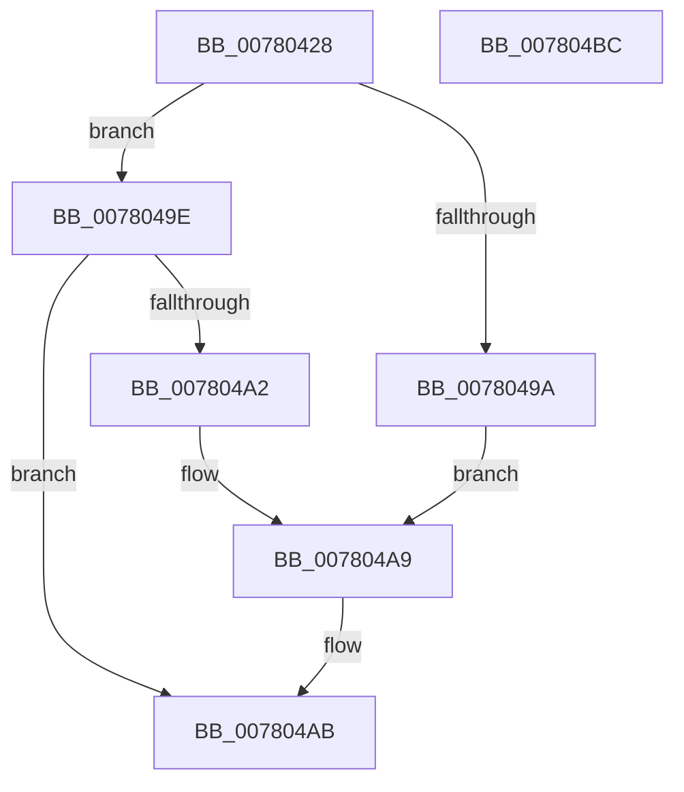

# PspSiloGetMultiUserTsFromRegistry

- RVA: `0x00780428`–`0x007804BD` (길이 `149` bytes)
- VA: `0x0000000140780428`
- 실행 섹션: `PAGE`
- PDB 이름 있음: `예`; PDB Function 태그: `아니요`
- unwind 정보 RVA: `0x000CE150`
- 디코드: `36`개 명령, `149/149` bytes 표시
- 미해석 바이트: `0` (있으면 어셈블리에 `.byte`로 보존)

> 이 문서는 커널 이미지의 기계어와 PDB 기호를 분석해 생성했습니다. 4번과 5번은 함수 원형과 자료형을 바이너리 사용 방식에서 추정한 C 해석이며 원본 소스 복구 결과는 아닙니다.

## 1. Dependencies

- 직접 호출 지점: **2**; 고유 호출 대상: **2**
- 직접 호출자로 확인된 함수: **1**
- RIP 상대 이미지 참조: **2**

### Outgoing calls
- `0x00780449` → [memset](../../text/6C/memset_function_006C6C40.md) (function, `0x006C6C40`)
- `0x0078048E` → [RtlpQueryRegistryValues](../8C/RtlpQueryRegistryValues_function_008C9050.md) (function, `0x008C9050`)

### Direct callers
- [PspSiloInitializeUserSharedData](PspSiloInitializeUserSharedData_function_00780684.md) at `0x007807E4`

### Static image references
- `0x0078044E` → RVA `0x00B04BB0` (` ?? ::NNGAKEGL::`string'`; read)
- `0x0078047F` → RVA `0x00B04B90` (` ?? ::NNGAKEGL::`string'`; read)

## 2. Other-region calls and transfers

- 다른 실행 섹션으로 향하는 call: **1**
  - `0x00780449` → [memset](../../text/6C/memset_function_006C6C40.md) (`PAGE` → `.text`)
- 별도 외부 분기/꼬리 이동을 확인하지 못했습니다.

## 3. Assembly (complete function range)

```asm
00780428  48 8B C4                        mov rax, rsp
0078042B  48 89 58 08                     mov qword ptr [rax + 8], rbx
0078042F  57                              push rdi
00780430  48 81 EC A0 00 00 00            sub rsp, 0xa0
00780437  33 DB                           xor ebx, ebx
00780439  48 8B F9                        mov rdi, rcx
0078043C  33 D2                           xor edx, edx
0078043E  89 58 10                        mov dword ptr [rax + 0x10], ebx
00780441  48 8D 48 88                     lea rcx, [rax - 0x78]
00780445  44 8D 43 70                     lea r8d, [rbx + 0x70]
00780449  E8 F2 67 F4 FF                  call 0x1406c6c40
0078044E  48 8D 05 5B 47 38 00            lea rax, [rip + 0x38475b]
00780455  C7 44 24 38 24 01 00 00         mov dword ptr [rsp + 0x38], 0x124
0078045D  48 89 44 24 40                  mov qword ptr [rsp + 0x40], rax
00780462  4C 8D 44 24 30                  lea r8, [rsp + 0x30]
00780467  48 8D 84 24 B8 00 00 00         lea rax, [rsp + 0xb8]
0078046F  C7 44 24 50 00 00 00 04         mov dword ptr [rsp + 0x50], 0x4000000
00780477  45 33 C9                        xor r9d, r9d
0078047A  48 89 44 24 48                  mov qword ptr [rsp + 0x48], rax
0078047F  48 8D 15 0A 47 38 00            lea rdx, [rip + 0x38470a]
00780486  C6 44 24 28 01                  mov byte ptr [rsp + 0x28], 1
0078048B  8D 4B 02                        lea ecx, [rbx + 2]
0078048E  E8 BD 8B 14 00                  call 0x1408c9050
00780493  3D 34 00 00 C0                  cmp eax, 0xc0000034
00780498  75 04                           jne 0x14078049e
0078049A  8B C3                           mov eax, ebx
0078049C  EB 0B                           jmp 0x1407804a9
0078049E  85 C0                           test eax, eax
007804A0  78 09                           js 0x1407804ab
007804A2  8B 9C 24 B8 00 00 00            mov ebx, dword ptr [rsp + 0xb8]
007804A9  88 1F                           mov byte ptr [rdi], bl
007804AB  48 8B 9C 24 B0 00 00 00         mov rbx, qword ptr [rsp + 0xb0]
007804B3  48 81 C4 A0 00 00 00            add rsp, 0xa0
007804BA  5F                              pop rdi
007804BB  C3                              ret
007804BC  CC                              int3
```

## 4. C-style interpretation (structured pseudocode)

```c
__int64 __fastcall PspSiloGetMultiUserTsFromRegistry(__int64 a1, int a2, __int64 a3, int a4)
{
    __int64 result;
    __int64 v_rbx;
    __int64 v_rsp;
    unsigned int v_stack_m58;
    unsigned __int64 v_stack_m60;
    unsigned __int64 v_stack_m68;
    unsigned int v_stack_m70;
    unsigned __int64 v_stack_m78;
    unsigned __int8 v_stack_m80;
    unsigned __int64 v_stack_p10;
    unsigned __int64 v_stack_p8;

    *(unsigned __int64 *)(v_rsp + 8) = v_rbx;
    v_rsp = (v_rsp) - (160);
    v_rbx = 0;
    a2 = 0;
    *(unsigned int *)(v_rsp + 16) = 0;
    result = memset(v_rsp - 120, a2, v_rbx + 112, a4);
    v_stack_m70 = 292;
    v_stack_m68 = v_rip + 3688283;
    v_stack_m58 = 0x4000000ULL;
    a4 = 0;
    v_stack_m60 = v_stack_p10;
    v_stack_m80 = 1;
    result = RtlpQueryRegistryValues(v_rbx + 2, v_rip + 3688202, v_stack_m78, a4);
    if (((unsigned int)(result)) != 0xC0000034ULL) goto loc_0078049E;
    goto loc_007804A9;
loc_0078049E:
    if (sign_flag) goto loc_007804AB;
loc_007804A9:
    *(unsigned __int8 *)(a1) = (unsigned __int8)((unsigned int)(v_stack_p10));
loc_007804AB:
    v_rsp = (v_rsp) + (160);
    return 0;
}
```

## 5. (Beta) C Style

```c
int64_t PspSiloGetMultiUserTsFromRegistry(void *Arg1, int32_t Arg2, int64_t Arg3, int32_t Arg4)
{
    uint8_t *arg1 = (uint8_t *)Arg1;

    int64_t result;
    int64_t local_rbx;
    int64_t local_rsp;
    uint32_t v_stack_m58;
    uint64_t v_stack_m60;
    uint64_t v_stack_m68;
    uint32_t v_stack_m70;
    uint64_t v_stack_m78;
    uint8_t v_stack_m80;
    uint64_t v_stack_p10;
    uint64_t v_stack_p8;

    *(uint64_t *)(local_rsp + 0x8) = local_rbx;
    local_rsp = (local_rsp) - (160);
    local_rbx = 0;
    Arg2 = 0;
    *(uint32_t *)(local_rsp + 0x10) = 0;
    result = memset(local_rsp - 120, Arg2, local_rbx + 112, Arg4);
    v_stack_m70 = 292;
    v_stack_m68 = v_rip + 3688283;
    v_stack_m58 = 0x4000000ULL;
    Arg4 = 0;
    v_stack_m60 = v_stack_p10;
    v_stack_m80 = 1;
    result = RtlpQueryRegistryValues(local_rbx + 2, v_rip + 3688202, v_stack_m78, Arg4);
    if (((uint32_t)(result)) != 0xC0000034ULL) goto loc_0078049E;
    goto loc_007804A9;
loc_0078049E:
    if (sign_flag) goto loc_007804AB;
loc_007804A9:
    *(uint8_t *)(arg1) = (uint8_t)((uint32_t)(v_stack_p10));
loc_007804AB:
    local_rsp = (local_rsp) + (160);
    return 0;
}
```

### 관측된 메모리 오프셋

구조체 형식이 확인되지 않은 접근은 인자 기준의 오프셋으로만 기록했습니다.

| 기준 인자 | 오프셋 표현 | 폭 (bit) | 접근 |
|---|---:|---:|---|
| `Arg1` | `+ 0x0` | `8` | `W` |

## 6. Execution-region graph

[열기: 2D/3D 그래프와 함수 탐색 컨트롤 패널](../../../control-panel.html?section=page&rva=0x00780428&view=graph)

- 2D 그래프는 위에서 아래로 흐르고, 3D 그래프는 빈 공간을 드래그해 회전합니다. Shift+드래그는 이동, 휠은 확대·축소, 함수 노드 선택은 대상 보고서 이동입니다.

### Static fallback


