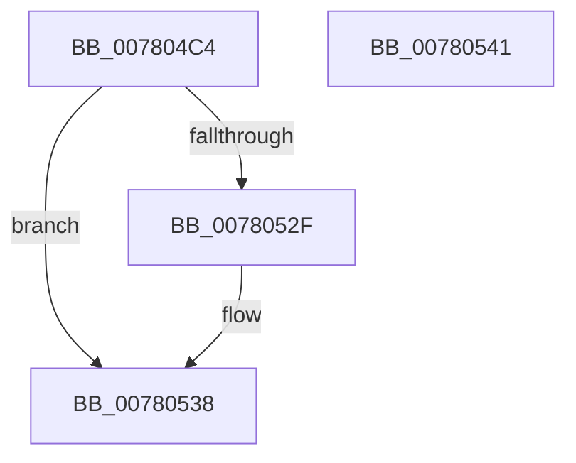

# PspSiloGetSuiteMaskStringFromRegistry

- RVA: `0x007804C4`–`0x00780542` (길이 `126` bytes)
- VA: `0x00000001407804C4`
- 실행 섹션: `PAGE`
- PDB 이름 있음: `예`; PDB Function 태그: `아니요`
- unwind 정보 RVA: `0x000CE164`
- 디코드: `29`개 명령, `126/126` bytes 표시
- 미해석 바이트: `0` (있으면 어셈블리에 `.byte`로 보존)

> 이 문서는 커널 이미지의 기계어와 PDB 기호를 분석해 생성했습니다. 4번과 5번은 함수 원형과 자료형을 바이너리 사용 방식에서 추정한 C 해석이며 원본 소스 복구 결과는 아닙니다.

## 1. Dependencies

- 직접 호출 지점: **2**; 고유 호출 대상: **2**
- 직접 호출자로 확인된 함수: **1**
- RIP 상대 이미지 참조: **2**

### Outgoing calls
- `0x007804E3` → [memset](../../text/6C/memset_function_006C6C40.md) (function, `0x006C6C40`)
- `0x00780526` → [RtlpQueryRegistryValues](../8C/RtlpQueryRegistryValues_function_008C9050.md) (function, `0x008C9050`)

### Direct callers
- [PspSiloInitializeUserSharedData](PspSiloInitializeUserSharedData_function_00780684.md) at `0x007807D5`

### Static image references
- `0x007804F3` → RVA `0x00B04B20` (` ?? ::NNGAKEGL::`string'`; read)
- `0x0078051F` → RVA `0x00B04BD0` (` ?? ::NNGAKEGL::`string'`; read)

## 2. Other-region calls and transfers

- 다른 실행 섹션으로 향하는 call: **1**
  - `0x007804E3` → [memset](../../text/6C/memset_function_006C6C40.md) (`PAGE` → `.text`)
- 별도 외부 분기/꼬리 이동을 확인하지 못했습니다.

## 3. Assembly (complete function range)

```asm
007804C4  40 53                           push rbx
007804C6  48 81 EC B0 00 00 00            sub rsp, 0xb0
007804CD  33 D2                           xor edx, edx
007804CF  48 8B D9                        mov rbx, rcx
007804D2  0F 57 C0                        xorps xmm0, xmm0
007804D5  48 8D 4C 24 40                  lea rcx, [rsp + 0x40]
007804DA  0F 11 44 24 30                  movups xmmword ptr [rsp + 0x30], xmm0
007804DF  44 8D 42 70                     lea r8d, [rdx + 0x70]
007804E3  E8 58 67 F4 FF                  call 0x1406c6c40
007804E8  45 33 C9                        xor r9d, r9d
007804EB  C7 44 24 48 34 01 00 00         mov dword ptr [rsp + 0x48], 0x134
007804F3  48 8D 05 26 46 38 00            lea rax, [rip + 0x384626]
007804FA  C7 44 24 60 00 00 00 07         mov dword ptr [rsp + 0x60], 0x7000000
00780502  48 89 44 24 50                  mov qword ptr [rsp + 0x50], rax
00780507  4C 8D 44 24 40                  lea r8, [rsp + 0x40]
0078050C  48 8D 44 24 30                  lea rax, [rsp + 0x30]
00780511  C6 44 24 28 01                  mov byte ptr [rsp + 0x28], 1
00780516  41 8D 49 02                     lea ecx, [r9 + 2]
0078051A  48 89 44 24 58                  mov qword ptr [rsp + 0x58], rax
0078051F  48 8D 15 AA 46 38 00            lea rdx, [rip + 0x3846aa]
00780526  E8 25 8B 14 00                  call 0x1408c9050
0078052B  85 C0                           test eax, eax
0078052D  78 09                           js 0x140780538
0078052F  0F 10 44 24 30                  movups xmm0, xmmword ptr [rsp + 0x30]
00780534  F3 0F 7F 03                     movdqu xmmword ptr [rbx], xmm0
00780538  48 81 C4 B0 00 00 00            add rsp, 0xb0
0078053F  5B                              pop rbx
00780540  C3                              ret
00780541  CC                              int3
```

## 4. C-style interpretation (structured pseudocode)

```c
__int64 __fastcall PspSiloGetSuiteMaskStringFromRegistry(__int64 a1, int a2, __int64 a3, int a4)
{
    __int64 result;
    __int64 v_rsp;
    unsigned int v_stack_m58;
    unsigned __int64 v_stack_m60;
    unsigned __int64 v_stack_m68;
    unsigned int v_stack_m70;
    unsigned __int64 v_stack_m78;
    unsigned __int64 v_stack_m88;
    unsigned __int8 v_stack_m90;

    v_rsp = (v_rsp) - (176);
    a2 = 0;
    v_stack_m88 = v_xmm0;
    result = memset(v_stack_m78, a2, a2 + 112, a4);
    a4 = 0;
    v_stack_m70 = 308;
    v_stack_m58 = 0x7000000ULL;
    v_stack_m68 = v_rip + 3687974;
    v_stack_m90 = 1;
    v_stack_m60 = v_stack_m88;
    result = RtlpQueryRegistryValues(a4 + 2, v_rip + 3688106, v_stack_m78, a4);
    if (!(sign_flag)) {
        *(unsigned __int64 *)(a1) = v_xmm0;
    }
    v_rsp = (v_rsp) + (176);
    return result;
}
```

## 5. (Beta) C Style

```c
int64_t PspSiloGetSuiteMaskStringFromRegistry(void *Arg1, int32_t Arg2, int64_t Arg3, int32_t Arg4)
{
    uint8_t *arg1 = (uint8_t *)Arg1;

    int64_t result;
    int64_t local_rsp;
    uint32_t v_stack_m58;
    uint64_t v_stack_m60;
    uint64_t v_stack_m68;
    uint32_t v_stack_m70;
    uint64_t v_stack_m78;
    uint64_t v_stack_m88;
    uint8_t v_stack_m90;

    local_rsp = (local_rsp) - (176);
    Arg2 = 0;
    v_stack_m88 = v_xmm0;
    result = memset(v_stack_m78, Arg2, Arg2 + 112, Arg4);
    Arg4 = 0;
    v_stack_m70 = 308;
    v_stack_m58 = 0x7000000ULL;
    v_stack_m68 = v_rip + 3687974;
    v_stack_m90 = 1;
    v_stack_m60 = v_stack_m88;
    result = RtlpQueryRegistryValues(Arg4 + 2, v_rip + 3688106, v_stack_m78, Arg4);
    if (!(sign_flag)) {
        *(uint64_t *)(arg1) = v_xmm0;
    }
    local_rsp = (local_rsp) + (176);
    return result;
}
```

### 관측된 메모리 오프셋

구조체 형식이 확인되지 않은 접근은 인자 기준의 오프셋으로만 기록했습니다.

| 기준 인자 | 오프셋 표현 | 폭 (bit) | 접근 |
|---|---:|---:|---|
| `Arg1` | `+ 0x0` | `128` | `W` |

## 6. Execution-region graph

[열기: 2D/3D 그래프와 함수 탐색 컨트롤 패널](../../../control-panel.html?section=page&rva=0x007804C4&view=graph)

- 2D 그래프는 위에서 아래로 흐르고, 3D 그래프는 빈 공간을 드래그해 회전합니다. Shift+드래그는 이동, 휠은 확대·축소, 함수 노드 선택은 대상 보고서 이동입니다.

### Static fallback


