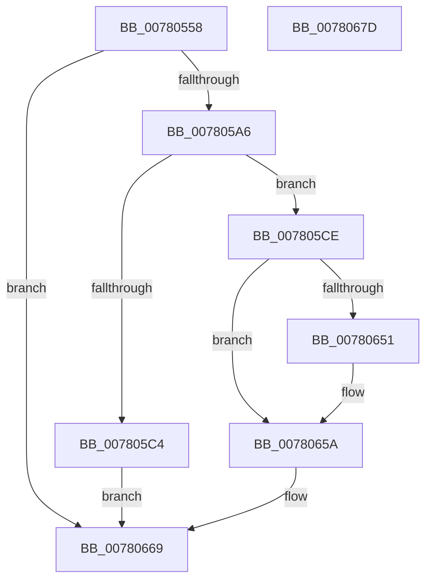

# PspSiloInitializeSystemRootSymlink

- RVA: `0x00780558`–`0x0078067E` (길이 `294` bytes)
- VA: `0x0000000140780558`
- 실행 섹션: `PAGE`
- PDB 이름 있음: `예`; PDB Function 태그: `아니요`
- unwind 정보 RVA: `0x000CE10C`
- 디코드: `77`개 명령, `294/294` bytes 표시
- 미해석 바이트: `0` (있으면 어셈블리에 `.byte`로 보존)

> 이 문서는 커널 이미지의 기계어와 PDB 기호를 분석해 생성했습니다. 4번과 5번은 함수 원형과 자료형을 바이너리 사용 방식에서 추정한 C 해석이며 원본 소스 복구 결과는 아닙니다.

## 1. Dependencies

- 직접 호출 지점: **10**; 고유 호출 대상: **10**
- 직접 호출자로 확인된 함수: **1**
- RIP 상대 이미지 참조: **2**

### Outgoing calls
- `0x00780582` → [PsGetServerSiloGlobals](../../text/22/PsGetServerSiloGlobals_function_002250A0.md) (function, `0x002250A0`)
- `0x00780599` → [RtlUShortAdd](../../text/47/RtlUShortAdd_function_00474F70.md) (function, `0x00474F70`)
- `0x007805B7` → [ExAllocatePool2](../../poolcode/B8/ExAllocatePool2_function_00B820F0.md) (function, `0x00B820F0`)
- `0x007805E8` → [RtlCopyUnicodeString](../../text/3F/RtlCopyUnicodeString_function_003FEF30.md) (function, `0x003FEF30`)
- `0x007805F8` → [RtlAppendUnicodeStringToString](../../text/40/RtlAppendUnicodeStringToString_function_0040FA50.md) (function, `0x0040FA50`)
- `0x00780625` → [PsAttachSiloToCurrentThread](../../text/44/PsAttachSiloToCurrentThread_function_004428C0.md) (function, `0x004428C0`)
- `0x0078063E` → [ZwCreateSymbolicLinkObject](../../text/6A/ZwCreateSymbolicLinkObject_function_006AE9D0.md) (function, `0x006AE9D0`)
- `0x00780648` → [PsDetachSiloFromCurrentThread](../../text/44/PsDetachSiloFromCurrentThread_function_00449AC0.md) (function, `0x00449AC0`)
- `0x00780655` → [ZwClose](../../text/6A/ZwClose_function_006AD2B0.md) (function, `0x006AD2B0`)
- `0x00780662` → [ExFreePoolWithTag](../../poolcode/B8/ExFreePoolWithTag_function_00B82870.md) (function, `0x00B82870`)

### Direct callers
- [PspInitializeServerSiloDeferred](../77/PspInitializeServerSiloDeferred_function_0077FEE0.md) at `0x0077FF2C`

### Static image references
- `0x007805D1` → RVA `0x00B4B570` (`PspSystemRootTargetPrefix`; read)
- `0x007805FD` → RVA `0x00B4BEC8` (`PspSystemRootSymlinkName`; read)

## 2. Other-region calls and transfers

- 다른 실행 섹션으로 향하는 call: **10**
  - `0x00780582` → [PsGetServerSiloGlobals](../../text/22/PsGetServerSiloGlobals_function_002250A0.md) (`PAGE` → `.text`)
  - `0x00780599` → [RtlUShortAdd](../../text/47/RtlUShortAdd_function_00474F70.md) (`PAGE` → `.text`)
  - `0x007805B7` → [ExAllocatePool2](../../poolcode/B8/ExAllocatePool2_function_00B820F0.md) (`PAGE` → `POOLCODE`)
  - `0x007805E8` → [RtlCopyUnicodeString](../../text/3F/RtlCopyUnicodeString_function_003FEF30.md) (`PAGE` → `.text`)
  - `0x007805F8` → [RtlAppendUnicodeStringToString](../../text/40/RtlAppendUnicodeStringToString_function_0040FA50.md) (`PAGE` → `.text`)
  - `0x00780625` → [PsAttachSiloToCurrentThread](../../text/44/PsAttachSiloToCurrentThread_function_004428C0.md) (`PAGE` → `.text`)
  - `0x0078063E` → [ZwCreateSymbolicLinkObject](../../text/6A/ZwCreateSymbolicLinkObject_function_006AE9D0.md) (`PAGE` → `.text`)
  - `0x00780648` → [PsDetachSiloFromCurrentThread](../../text/44/PsDetachSiloFromCurrentThread_function_00449AC0.md) (`PAGE` → `.text`)
  - `0x00780655` → [ZwClose](../../text/6A/ZwClose_function_006AD2B0.md) (`PAGE` → `.text`)
  - `0x00780662` → [ExFreePoolWithTag](../../poolcode/B8/ExFreePoolWithTag_function_00B82870.md) (`PAGE` → `POOLCODE`)
- 별도 외부 분기/꼬리 이동을 확인하지 못했습니다.

## 3. Assembly (complete function range)

```asm
00780558  48 89 5C 24 08                  mov qword ptr [rsp + 8], rbx
0078055D  55                              push rbp
0078055E  56                              push rsi
0078055F  57                              push rdi
00780560  41 56                           push r14
00780562  41 57                           push r15
00780564  48 8B EC                        mov rbp, rsp
00780567  48 83 EC 60                     sub rsp, 0x60
0078056B  45 33 FF                        xor r15d, r15d
0078056E  4C 8B F1                        mov r14, rcx
00780571  66 44 89 7D 38                  mov word ptr [rbp + 0x38], r15w
00780576  44 89 7D D4                     mov dword ptr [rbp - 0x2c], r15d
0078057A  44 89 7D EC                     mov dword ptr [rbp - 0x14], r15d
0078057E  4C 89 7D 40                     mov qword ptr [rbp + 0x40], r15
00780582  E8 19 4B AA FF                  call 0x1402250a0
00780587  41 8D 4F 14                     lea ecx, [r15 + 0x14]
0078058B  48 8B D8                        mov rbx, rax
0078058E  4C 8D 45 38                     lea r8, [rbp + 0x38]
00780592  0F B7 90 D0 04 00 00            movzx edx, word ptr [rax + 0x4d0]
00780599  E8 D2 49 CF FF                  call 0x140474f70
0078059E  85 C0                           test eax, eax
007805A0  0F 88 C3 00 00 00               js 0x140780669
007805A6  0F B7 75 38                     movzx esi, word ptr [rbp + 0x38]
007805AA  B9 00 01 00 00                  mov ecx, 0x100
007805AF  8B D6                           mov edx, esi
007805B1  41 B8 50 73 53 70               mov r8d, 0x70537350
007805B7  E8 34 1B 40 00                  call 0x140b820f0
007805BC  48 8B F8                        mov rdi, rax
007805BF  48 85 C0                        test rax, rax
007805C2  75 0A                           jne 0x1407805ce
007805C4  B8 9A 00 00 C0                  mov eax, 0xc000009a
007805C9  E9 9B 00 00 00                  jmp 0x140780669
007805CE  0F 57 C0                        xorps xmm0, xmm0
007805D1  48 8D 15 98 AF 3C 00            lea rdx, [rip + 0x3caf98]
007805D8  0F 11 45 C0                     movups xmmword ptr [rbp - 0x40], xmm0
007805DC  48 8D 4D C0                     lea rcx, [rbp - 0x40]
007805E0  66 89 75 C2                     mov word ptr [rbp - 0x3e], si
007805E4  48 89 7D C8                     mov qword ptr [rbp - 0x38], rdi
007805E8  E8 43 E9 C7 FF                  call 0x1403fef30
007805ED  48 8D 93 D0 04 00 00            lea rdx, [rbx + 0x4d0]
007805F4  48 8D 4D C0                     lea rcx, [rbp - 0x40]
007805F8  E8 53 F4 C8 FF                  call 0x14040fa50
007805FD  48 8D 05 C4 B8 3C 00            lea rax, [rip + 0x3cb8c4]
00780604  C7 45 D0 30 00 00 00            mov dword ptr [rbp - 0x30], 0x30
0078060B  0F 57 C0                        xorps xmm0, xmm0
0078060E  48 89 45 E0                     mov qword ptr [rbp - 0x20], rax
00780612  49 8B CE                        mov rcx, r14
00780615  4C 89 7D D8                     mov qword ptr [rbp - 0x28], r15
00780619  F3 0F 7F 45 F0                  movdqu xmmword ptr [rbp - 0x10], xmm0
0078061E  C7 45 E8 10 02 00 00            mov dword ptr [rbp - 0x18], 0x210
00780625  E8 96 22 CC FF                  call 0x1404428c0
0078062A  4C 8D 4D C0                     lea r9, [rbp - 0x40]
0078062E  BA 01 00 0F 00                  mov edx, 0xf0001
00780633  4C 8D 45 D0                     lea r8, [rbp - 0x30]
00780637  48 8B D8                        mov rbx, rax
0078063A  48 8D 4D 40                     lea rcx, [rbp + 0x40]
0078063E  E8 8D E3 F2 FF                  call 0x1406ae9d0
00780643  48 8B CB                        mov rcx, rbx
00780646  8B F0                           mov esi, eax
00780648  E8 73 94 CC FF                  call 0x140449ac0
0078064D  85 F6                           test esi, esi
0078064F  78 09                           js 0x14078065a
00780651  48 8B 4D 40                     mov rcx, qword ptr [rbp + 0x40]
00780655  E8 56 CC F2 FF                  call 0x1406ad2b0
0078065A  BA 50 73 53 70                  mov edx, 0x70537350
0078065F  48 8B CF                        mov rcx, rdi
00780662  E8 09 22 40 00                  call 0x140b82870
00780667  8B C6                           mov eax, esi
00780669  48 8B 9C 24 90 00 00 00         mov rbx, qword ptr [rsp + 0x90]
00780671  48 83 C4 60                     add rsp, 0x60
00780675  41 5F                           pop r15
00780677  41 5E                           pop r14
00780679  5F                              pop rdi
0078067A  5E                              pop rsi
0078067B  5D                              pop rbp
0078067C  C3                              ret
0078067D  CC                              int3
```

## 4. C-style interpretation (structured pseudocode)

```c
__int64 __fastcall PspSiloInitializeSystemRootSymlink(__int64 a1)
{
    __int64 result;
    __int64 v_r15;
    __int64 v_rsp;
    unsigned __int64 v_stack_m38;
    unsigned int v_stack_m3C;
    unsigned int v_stack_m40;
    unsigned __int64 v_stack_m48;
    unsigned __int64 v_stack_m50;
    unsigned int v_stack_m54;
    unsigned int v_stack_m58;
    unsigned __int64 v_stack_m60;
    unsigned __int16 v_stack_m66;
    unsigned __int64 v_stack_m68;
    unsigned __int16 v_stack_p10;
    unsigned __int64 v_stack_p18;
    unsigned __int64 v_stack_p8;

    v_stack_p8 = v_rbx;
    v_rsp = (v_rsp) - (96);
    v_r15 = 0;
    v_stack_p10 = 0;
    v_stack_m54 = 0;
    v_stack_m3C = 0;
    v_stack_p18 = 0;
    result = PsGetServerSiloGlobals(a1, a2, a3, a4);
    result = RtlUShortAdd(v_r15 + 20, *(unsigned __int16 *)(result + 1232), v_stack_p10, a4);
    if (sign_flag) goto loc_00780669;
    result = ExAllocatePool2(256, (unsigned int)((unsigned int)(v_stack_p10)), (unsigned int)(0x70537350ULL), a4);
    if (result != 0) goto loc_007805CE;
    goto loc_00780669;
loc_007805CE:
    v_stack_m68 = v_xmm0;
    v_stack_m66 = (unsigned __int16)(v_stack_p10);
    v_stack_m60 = result;
    result = RtlCopyUnicodeString(v_stack_m68, v_rip + 3977112, (unsigned int)(0x70537350ULL), a4);
    result = RtlAppendUnicodeStringToString(v_stack_m68, result + 1232, (unsigned int)(0x70537350ULL), a4);
    v_stack_m58 = 48;
    v_stack_m48 = v_rip + 3979460;
    v_stack_m50 = 0;
    v_stack_m38 = v_xmm0;
    v_stack_m40 = 528;
    result = PsAttachSiloToCurrentThread(a1, result + 1232, (unsigned int)(0x70537350ULL), a4);
    result = ZwCreateSymbolicLinkObject(v_stack_p18, (unsigned int)(0xF0001ULL), v_stack_m58, v_stack_m68);
    result = PsDetachSiloFromCurrentThread(result, (unsigned int)(0xF0001ULL), v_stack_m58, v_stack_m68);
    if (!(sign_flag)) {
        a1 = v_stack_p18;
        result = ZwClose(a1, (unsigned int)(0xF0001ULL), v_stack_m58, v_stack_m68);
    }
    result = ExFreePoolWithTag(result, (unsigned int)(0x70537350ULL), v_stack_m58, v_stack_m68);
loc_00780669:
    v_rsp = (v_rsp) + (96);
    return (unsigned int)((unsigned int)((unsigned int)((unsigned int)(result))));
}
```

## 5. (Beta) C Style

```c
int64_t PspSiloInitializeSystemRootSymlink(int64_t Arg1)
{
    int64_t result;
    int64_t local_r15;
    int64_t local_rsp;
    uint64_t v_stack_m38;
    uint32_t v_stack_m3C;
    uint32_t v_stack_m40;
    uint64_t v_stack_m48;
    uint64_t v_stack_m50;
    uint32_t v_stack_m54;
    uint32_t v_stack_m58;
    uint64_t v_stack_m60;
    uint16_t v_stack_m66;
    uint64_t v_stack_m68;
    uint16_t v_stack_p10;
    uint64_t v_stack_p18;
    uint64_t v_stack_p8;

    v_stack_p8 = local_rbx;
    local_rsp = (local_rsp) - (96);
    local_r15 = 0;
    v_stack_p10 = 0;
    v_stack_m54 = 0;
    v_stack_m3C = 0;
    v_stack_p18 = 0;
    result = PsGetServerSiloGlobals(Arg1, a2, a3, a4);
    result = RtlUShortAdd(local_r15 + 20, *(uint16_t *)(result + 0x4D0), v_stack_p10, a4);
    if (sign_flag) goto loc_00780669;
    result = ExAllocatePool2(256, (uint32_t)((uint32_t)(v_stack_p10)), (uint32_t)(0x70537350ULL), a4);
    if (result != 0) goto loc_007805CE;
    goto loc_00780669;
loc_007805CE:
    v_stack_m68 = v_xmm0;
    v_stack_m66 = (uint16_t)(v_stack_p10);
    v_stack_m60 = result;
    result = RtlCopyUnicodeString(v_stack_m68, v_rip + 3977112, (uint32_t)(0x70537350ULL), a4);
    result = RtlAppendUnicodeStringToString(v_stack_m68, result + 1232, (uint32_t)(0x70537350ULL), a4);
    v_stack_m58 = 48;
    v_stack_m48 = v_rip + 3979460;
    v_stack_m50 = 0;
    v_stack_m38 = v_xmm0;
    v_stack_m40 = 528;
    result = PsAttachSiloToCurrentThread(Arg1, result + 1232, (uint32_t)(0x70537350ULL), a4);
    result = ZwCreateSymbolicLinkObject(v_stack_p18, (uint32_t)(0xF0001ULL), v_stack_m58, v_stack_m68);
    result = PsDetachSiloFromCurrentThread(result, (uint32_t)(0xF0001ULL), v_stack_m58, v_stack_m68);
    if (!(sign_flag)) {
        Arg1 = v_stack_p18;
        result = ZwClose(Arg1, (uint32_t)(0xF0001ULL), v_stack_m58, v_stack_m68);
    }
    result = ExFreePoolWithTag(result, (uint32_t)(0x70537350ULL), v_stack_m58, v_stack_m68);
loc_00780669:
    local_rsp = (local_rsp) + (96);
    return (uint32_t)((uint32_t)((uint32_t)((uint32_t)(result))));
}
```

## 6. Execution-region graph

[열기: 2D/3D 그래프와 함수 탐색 컨트롤 패널](../../../control-panel.html?section=page&rva=0x00780558&view=graph)

- 2D 그래프는 위에서 아래로 흐르고, 3D 그래프는 빈 공간을 드래그해 회전합니다. Shift+드래그는 이동, 휠은 확대·축소, 함수 노드 선택은 대상 보고서 이동입니다.

### Static fallback


