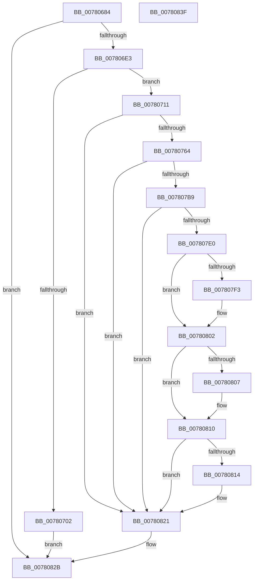

# PspSiloInitializeUserSharedData

- RVA: `0x00780684`–`0x00780840` (길이 `444` bytes)
- VA: `0x0000000140780684`
- 실행 섹션: `PAGE`
- PDB 이름 있음: `예`; PDB Function 태그: `아니요`
- unwind 정보 RVA: `0x000CE138`
- 디코드: `117`개 명령, `444/444` bytes 표시
- 미해석 바이트: `0` (있으면 어셈블리에 `.byte`로 보존)

> 이 문서는 커널 이미지의 기계어와 PDB 기호를 분석해 생성했습니다. 4번과 5번은 함수 원형과 자료형을 바이너리 사용 방식에서 추정한 C 해석이며 원본 소스 복구 결과는 아닙니다.

## 1. Dependencies

- 직접 호출 지점: **14**; 고유 호출 대상: **14**
- 직접 호출자로 확인된 함수: **1**
- RIP 상대 이미지 참조: **1**

### Outgoing calls
- `0x007806D6` → [MmCreateSection](../98/MmCreateSection_function_009838B0.md) (function, `0x009838B0`)
- `0x007806F7` → [MmMapViewInSessionSpace](../98/MmMapViewInSessionSpace_function_00982480.md) (function, `0x00982480`)
- `0x00780705` → [ObfDereferenceObject](../../text/2F/ObfDereferenceObject_function_002F9350.md) (function, `0x002F9350`)
- `0x00780714` → [PsGetServerSiloGlobals](../../text/22/PsGetServerSiloGlobals_function_002250A0.md) (function, `0x002250A0`)
- `0x00780731` → [PsAttachSiloToCurrentThread](../../text/44/PsAttachSiloToCurrentThread_function_004428C0.md) (function, `0x004428C0`)
- `0x00780755` → [PsRemoveSiloContext](../77/PsRemoveSiloContext_function_0077F450.md) (function, `0x0077F450`)
- `0x00780791` → [RtlCopyUnicodeString](../../text/3F/RtlCopyUnicodeString_function_003FEF30.md) (function, `0x003FEF30`)
- `0x0078079A` → [HalPutDmaAdapter](../../text/48/HalPutDmaAdapter_function_0048E530.md) (function, `0x0048E530`)
- `0x007807AE` → [RtlpGetNtProductTypeFromRegistry](../AA/RtlpGetNtProductTypeFromRegistry_function_00AA26D8.md) (function, `0x00AA26D8`)
- `0x007807D5` → [PspSiloGetSuiteMaskStringFromRegistry](PspSiloGetSuiteMaskStringFromRegistry_function_007804C4.md) (function, `0x007804C4`)
- `0x007807E4` → [PspSiloGetMultiUserTsFromRegistry](PspSiloGetMultiUserTsFromRegistry_function_00780428.md) (function, `0x00780428`)
- `0x007807F9` → [ExGetSuiteMask](../7C/ExGetSuiteMask_function_007C68D0.md) (function, `0x007C68D0`)
- `0x0078080B` → [RtlFreeAnsiString](../9C/RtlFreeAnsiString_function_009C0800.md) (function, `0x009C0800`)
- `0x00780824` → [PsDetachSiloFromCurrentThread](../../text/44/PsDetachSiloFromCurrentThread_function_00449AC0.md) (function, `0x00449AC0`)

### Direct callers
- [PspInitializeServerSiloDeferred](../77/PspInitializeServerSiloDeferred_function_0077FEE0.md) at `0x0077FF1A`

### Static image references
- `0x0078074F` → RVA `0x00FC5168` (`ALMOSTRO`; read)

## 2. Other-region calls and transfers

- 다른 실행 섹션으로 향하는 call: **6**
  - `0x00780705` → [ObfDereferenceObject](../../text/2F/ObfDereferenceObject_function_002F9350.md) (`PAGE` → `.text`)
  - `0x00780714` → [PsGetServerSiloGlobals](../../text/22/PsGetServerSiloGlobals_function_002250A0.md) (`PAGE` → `.text`)
  - `0x00780731` → [PsAttachSiloToCurrentThread](../../text/44/PsAttachSiloToCurrentThread_function_004428C0.md) (`PAGE` → `.text`)
  - `0x00780791` → [RtlCopyUnicodeString](../../text/3F/RtlCopyUnicodeString_function_003FEF30.md) (`PAGE` → `.text`)
  - `0x0078079A` → [HalPutDmaAdapter](../../text/48/HalPutDmaAdapter_function_0048E530.md) (`PAGE` → `.text`)
  - `0x00780824` → [PsDetachSiloFromCurrentThread](../../text/44/PsDetachSiloFromCurrentThread_function_00449AC0.md) (`PAGE` → `.text`)
- 별도 외부 분기/꼬리 이동을 확인하지 못했습니다.

## 3. Assembly (complete function range)

```asm
00780684  48 8B C4                        mov rax, rsp
00780687  48 89 58 08                     mov qword ptr [rax + 8], rbx
0078068B  55                              push rbp
0078068C  56                              push rsi
0078068D  57                              push rdi
0078068E  41 56                           push r14
00780690  41 57                           push r15
00780692  48 8B EC                        mov rbp, rsp
00780695  48 83 EC 50                     sub rsp, 0x50
00780699  48 83 60 C0 00                  and qword ptr [rax - 0x40], 0
0078069E  4C 8D 4D 48                     lea r9, [rbp + 0x48]
007806A2  48 83 60 B8 00                  and qword ptr [rax - 0x48], 0
007806A7  48 8B F1                        mov rsi, rcx
007806AA  48 83 65 40 00                  and qword ptr [rbp + 0x40], 0
007806AF  48 8D 4D 38                     lea rcx, [rbp + 0x38]
007806B3  48 83 65 38 00                  and qword ptr [rbp + 0x38], 0
007806B8  45 33 C0                        xor r8d, r8d
007806BB  C7 40 B0 00 00 00 08            mov dword ptr [rax - 0x50], 0x8000000
007806C2  BA 1F 00 0F 00                  mov edx, 0xf001f
007806C7  C7 40 A8 04 00 00 00            mov dword ptr [rax - 0x58], 4
007806CE  48 C7 45 48 70 02 00 00         mov qword ptr [rbp + 0x48], 0x270
007806D6  E8 D5 31 20 00                  call 0x1409838b0
007806DB  85 C0                           test eax, eax
007806DD  0F 88 48 01 00 00               js 0x14078082b
007806E3  48 8B 5D 38                     mov rbx, qword ptr [rbp + 0x38]
007806E7  4C 8D 45 48                     lea r8, [rbp + 0x48]
007806EB  48 83 65 48 00                  and qword ptr [rbp + 0x48], 0
007806F0  48 8D 55 40                     lea rdx, [rbp + 0x40]
007806F4  48 8B CB                        mov rcx, rbx
007806F7  E8 84 1D 20 00                  call 0x140982480
007806FC  8B F8                           mov edi, eax
007806FE  85 C0                           test eax, eax
00780700  79 0F                           jns 0x140780711
00780702  48 8B CB                        mov rcx, rbx
00780705  E8 46 8C B7 FF                  call 0x1402f9350
0078070A  8B C7                           mov eax, edi
0078070C  E9 1A 01 00 00                  jmp 0x14078082b
00780711  48 8B CE                        mov rcx, rsi
00780714  E8 87 49 AA FF                  call 0x1402250a0
00780719  48 8B 4D 40                     mov rcx, qword ptr [rbp + 0x40]
0078071D  48 8B F8                        mov rdi, rax
00780720  48 89 88 08 05 00 00            mov qword ptr [rax + 0x508], rcx
00780727  48 8B CE                        mov rcx, rsi
0078072A  48 89 98 10 05 00 00            mov qword ptr [rax + 0x510], rbx
00780731  E8 8A 21 CC FF                  call 0x1404428c0
00780736  48 8B 8F 08 05 00 00            mov rcx, qword ptr [rdi + 0x508]
0078073D  4C 8D 45 38                     lea r8, [rbp + 0x38]
00780741  48 83 65 38 00                  and qword ptr [rbp + 0x38], 0
00780746  4C 8B F8                        mov r15, rax
00780749  83 09 FF                        or dword ptr [rcx], 0xffffffff
0078074C  48 8B CE                        mov rcx, rsi
0078074F  8B 15 13 4A 84 00               mov edx, dword ptr [rip + 0x844a13]
00780755  E8 F6 EC FF FF                  call 0x14077f450
0078075A  8B D8                           mov ebx, eax
0078075C  85 C0                           test eax, eax
0078075E  0F 88 BD 00 00 00               js 0x140780821
00780764  48 8B 86 E0 05 00 00            mov rax, qword ptr [rsi + 0x5e0]
0078076B  0F 57 C0                        xorps xmm0, xmm0
0078076E  48 8B 90 08 05 00 00            mov rdx, qword ptr [rax + 0x508]
00780775  48 8D 88 D0 04 00 00            lea rcx, [rax + 0x4d0]
0078077C  48 83 C2 1E                     add rdx, 0x1e
00780780  0F 11 01                        movups xmmword ptr [rcx], xmm0
00780783  48 89 51 08                     mov qword ptr [rcx + 8], rdx
00780787  48 8B 55 38                     mov rdx, qword ptr [rbp + 0x38]
0078078B  66 C7 41 02 08 02               mov word ptr [rcx + 2], 0x208
00780791  E8 9A E7 C7 FF                  call 0x1403fef30
00780796  48 8B 4D 38                     mov rcx, qword ptr [rbp + 0x38]
0078079A  E8 91 DD D0 FF                  call 0x14048e530
0078079F  48 8B B7 08 05 00 00            mov rsi, qword ptr [rdi + 0x508]
007807A6  48 8D 4D 38                     lea rcx, [rbp + 0x38]
007807AA  83 65 38 00                     and dword ptr [rbp + 0x38], 0
007807AE  E8 25 1F 32 00                  call 0x140aa26d8
007807B3  8B D8                           mov ebx, eax
007807B5  85 C0                           test eax, eax
007807B7  78 68                           js 0x140780821
007807B9  8B 45 38                        mov eax, dword ptr [rbp + 0x38]
007807BC  48 8D 4D F0                     lea rcx, [rbp - 0x10]
007807C0  0F 57 C0                        xorps xmm0, xmm0
007807C3  89 46 10                        mov dword ptr [rsi + 0x10], eax
007807C6  4C 8B B7 08 05 00 00            mov r14, qword ptr [rdi + 0x508]
007807CD  0F 11 45 F0                     movups xmmword ptr [rbp - 0x10], xmm0
007807D1  C6 45 38 00                     mov byte ptr [rbp + 0x38], 0
007807D5  E8 EA FC FF FF                  call 0x1407804c4
007807DA  8B D8                           mov ebx, eax
007807DC  85 C0                           test eax, eax
007807DE  78 41                           js 0x140780821
007807E0  48 8D 4D 38                     lea rcx, [rbp + 0x38]
007807E4  E8 3F FC FF FF                  call 0x140780428
007807E9  48 8B 75 F8                     mov rsi, qword ptr [rbp - 8]
007807ED  8B D8                           mov ebx, eax
007807EF  85 C0                           test eax, eax
007807F1  78 0F                           js 0x140780802
007807F3  8A 55 38                        mov dl, byte ptr [rbp + 0x38]
007807F6  48 8B CE                        mov rcx, rsi
007807F9  E8 D2 60 04 00                  call 0x1407c68d0
007807FE  41 89 46 14                     mov dword ptr [r14 + 0x14], eax
00780802  48 85 F6                        test rsi, rsi
00780805  74 09                           je 0x140780810
00780807  48 8D 4D F0                     lea rcx, [rbp - 0x10]
0078080B  E8 F0 FF 23 00                  call 0x1409c0800
00780810  85 DB                           test ebx, ebx
00780812  78 0D                           js 0x140780821
00780814  48 8B 87 08 05 00 00            mov rax, qword ptr [rdi + 0x508]
0078081B  83 48 18 FF                     or dword ptr [rax + 0x18], 0xffffffff
0078081F  33 DB                           xor ebx, ebx
00780821  49 8B CF                        mov rcx, r15
00780824  E8 97 92 CC FF                  call 0x140449ac0
00780829  8B C3                           mov eax, ebx
0078082B  48 8B 9C 24 80 00 00 00         mov rbx, qword ptr [rsp + 0x80]
00780833  48 83 C4 50                     add rsp, 0x50
00780837  41 5F                           pop r15
00780839  41 5E                           pop r14
0078083B  5F                              pop rdi
0078083C  5E                              pop rsi
0078083D  5D                              pop rbp
0078083E  C3                              ret
0078083F  CC                              int3
```

## 4. C-style interpretation (structured pseudocode)

```c
__int64 __fastcall PspSiloInitializeUserSharedData(__int64 a1, __int64 a2, int a3)
{
    __int64 result;
    __int64 v_rbx;
    __int64 v_rsp;
    unsigned __int64 v_stack_m30;
    unsigned __int64 v_stack_m38;
    unsigned __int64 v_stack_p10;
    unsigned __int64 v_stack_p18;
    unsigned __int64 v_stack_p20;
    unsigned __int64 v_stack_p8;

    *(unsigned __int64 *)(v_rsp + 8) = v_rbx;
    v_rsp = (v_rsp) - (80);
    a3 = 0;
    *(unsigned int *)(v_rsp - 80) = 0x8000000ULL;
    *(unsigned int *)(v_rsp - 88) = 4;
    v_stack_p20 = 624;
    result = MmCreateSection(v_stack_p10, (unsigned int)(0xF001FULL), a3, v_stack_p20);
    if (sign_flag) goto loc_0078082B;
    result = MmMapViewInSessionSpace(v_stack_p10, v_stack_p18, v_stack_p20, v_stack_p20);
    if (!sign_flag) goto loc_00780711;
    result = ObfDereferenceObject(v_stack_p10, v_stack_p18, v_stack_p20, v_stack_p20);
    goto loc_0078082B;
loc_00780711:
    result = PsGetServerSiloGlobals(a1, v_stack_p18, v_stack_p20, v_stack_p20);
    *(unsigned __int64 *)(result + 1288) = v_stack_p18;
    *(unsigned __int64 *)(result + 1296) = v_stack_p10;
    result = PsAttachSiloToCurrentThread(a1, v_stack_p18, v_stack_p20, v_stack_p20);
    result = PsRemoveSiloContext(a1, (unsigned int)(*(unsigned int *)(v_rip + 8669715)), v_stack_p10, v_stack_p20);
    if (sign_flag) goto loc_00780821;
    a2 = (*(unsigned __int64 *)(*(unsigned __int64 *)(a1 + 1504) + 1288)) + (30);
    *(unsigned __int64 *)(*(unsigned __int64 *)(a1 + 1504) + 1232) = v_xmm0;
    *(unsigned __int64 *)(*(unsigned __int64 *)(a1 + 1504) + 1232 + 8) = a2;
    *(unsigned __int16 *)(*(unsigned __int64 *)(a1 + 1504) + 1232 + 2) = 520;
    result = RtlCopyUnicodeString(*(unsigned __int64 *)(a1 + 1504) + 1232, v_stack_p10, v_stack_p10, v_stack_p20);
    result = HalPutDmaAdapter(v_stack_p10, v_stack_p10, v_stack_p10, v_stack_p20);
    result = RtlpGetNtProductTypeFromRegistry(v_stack_p10, v_stack_p10, v_stack_p10, v_stack_p20);
    if (sign_flag) goto loc_00780821;
    *(unsigned int *)(*(unsigned __int64 *)(result + 1288) + 16) = (unsigned int)((unsigned int)(v_stack_p10));
    v_stack_m38 = v_xmm0;
    v_stack_p10 = 0;
    result = PspSiloGetSuiteMaskStringFromRegistry(v_stack_m38, v_stack_p10, v_stack_p10, v_stack_p20);
    if (sign_flag) goto loc_00780821;
    result = PspSiloGetMultiUserTsFromRegistry(v_stack_p10, v_stack_p10, v_stack_p10, v_stack_p20);
    if (!(sign_flag)) {
        a2 = v_stack_p10;
        a1 = v_stack_m30;
        result = ExGetSuiteMask(a1, a2, v_stack_p10, v_stack_p20);
        *(unsigned int *)(*(unsigned __int64 *)(result + 1288) + 20) = (unsigned int)(result);
    }
    if (v_stack_m30 != 0) {
        a1 = v_stack_m38;
        result = RtlFreeAnsiString(a1, a2, v_stack_p10, v_stack_p20);
    }
    v_rbx = (unsigned int)((unsigned int)(result));
    if (!(sign_flag)) {
        result = *(unsigned __int64 *)(result + 1288);
        v_rbx = 0;
    }
    result = PsDetachSiloFromCurrentThread(result, a2, v_stack_p10, v_stack_p20);
loc_0078082B:
    v_rsp = (v_rsp) + (80);
    return 0;
}
```

## 5. (Beta) C Style

```c
int64_t PspSiloInitializeUserSharedData(void *Arg1, int64_t Arg2, int32_t Arg3)
{
    uint8_t *arg1 = (uint8_t *)Arg1;

    int64_t result;
    int64_t local_rbx;
    int64_t local_rsp;
    uint64_t v_stack_m30;
    uint64_t v_stack_m38;
    uint64_t v_stack_p10;
    uint64_t v_stack_p18;
    uint64_t v_stack_p20;
    uint64_t v_stack_p8;

    *(uint64_t *)(local_rsp + 0x8) = local_rbx;
    local_rsp = (local_rsp) - (80);
    Arg3 = 0;
    *(uint32_t *)(local_rsp - 0x50) = 0x8000000ULL;
    *(uint32_t *)(local_rsp - 0x58) = 4;
    v_stack_p20 = 624;
    result = MmCreateSection(v_stack_p10, (uint32_t)(0xF001FULL), Arg3, v_stack_p20);
    if (sign_flag) goto loc_0078082B;
    result = MmMapViewInSessionSpace(v_stack_p10, v_stack_p18, v_stack_p20, v_stack_p20);
    if (!sign_flag) goto loc_00780711;
    result = ObfDereferenceObject(v_stack_p10, v_stack_p18, v_stack_p20, v_stack_p20);
    goto loc_0078082B;
loc_00780711:
    result = PsGetServerSiloGlobals(Arg1, v_stack_p18, v_stack_p20, v_stack_p20);
    *(uint64_t *)(result + 0x508) = v_stack_p18;
    *(uint64_t *)(result + 0x510) = v_stack_p10;
    result = PsAttachSiloToCurrentThread(Arg1, v_stack_p18, v_stack_p20, v_stack_p20);
    result = PsRemoveSiloContext(Arg1, (uint32_t)(*(uint32_t *)(v_rip + 0x844A13)), v_stack_p10, v_stack_p20);
    if (sign_flag) goto loc_00780821;
    Arg2 = (*(uint64_t *)(*(uint64_t *)(arg1 + 0x5E0) + 0x508)) + (30);
    *(uint64_t *)(*(uint64_t *)(arg1 + 0x5E0) + 0x4D0) = v_xmm0;
    *(uint64_t *)(*(uint64_t *)(arg1 + 0x5E0) + 0x4D0 + 0x8) = Arg2;
    *(uint16_t *)(*(uint64_t *)(arg1 + 0x5E0) + 0x4D0 + 0x2) = 520;
    result = RtlCopyUnicodeString(*(uint64_t *)(arg1 + 0x5E0) + 1232, v_stack_p10, v_stack_p10, v_stack_p20);
    result = HalPutDmaAdapter(v_stack_p10, v_stack_p10, v_stack_p10, v_stack_p20);
    result = RtlpGetNtProductTypeFromRegistry(v_stack_p10, v_stack_p10, v_stack_p10, v_stack_p20);
    if (sign_flag) goto loc_00780821;
    *(uint32_t *)(*(uint64_t *)(result + 0x508) + 0x10) = (uint32_t)((uint32_t)(v_stack_p10));
    v_stack_m38 = v_xmm0;
    v_stack_p10 = 0;
    result = PspSiloGetSuiteMaskStringFromRegistry(v_stack_m38, v_stack_p10, v_stack_p10, v_stack_p20);
    if (sign_flag) goto loc_00780821;
    result = PspSiloGetMultiUserTsFromRegistry(v_stack_p10, v_stack_p10, v_stack_p10, v_stack_p20);
    if (!(sign_flag)) {
        Arg2 = v_stack_p10;
        Arg1 = v_stack_m30;
        result = ExGetSuiteMask(Arg1, Arg2, v_stack_p10, v_stack_p20);
        *(uint32_t *)(*(uint64_t *)(result + 0x508) + 0x14) = (uint32_t)(result);
    }
    if (v_stack_m30 != 0) {
        Arg1 = v_stack_m38;
        result = RtlFreeAnsiString(Arg1, Arg2, v_stack_p10, v_stack_p20);
    }
    local_rbx = (uint32_t)((uint32_t)(result));
    if (!(sign_flag)) {
        result = *(uint64_t *)(result + 0x508);
        local_rbx = 0;
    }
    result = PsDetachSiloFromCurrentThread(result, Arg2, v_stack_p10, v_stack_p20);
loc_0078082B:
    local_rsp = (local_rsp) + (80);
    return 0;
}
```

### 관측된 메모리 오프셋

구조체 형식이 확인되지 않은 접근은 인자 기준의 오프셋으로만 기록했습니다.

| 기준 인자 | 오프셋 표현 | 폭 (bit) | 접근 |
|---|---:|---:|---|
| `Arg1` | `+ 0x5E0` | `64` | `R` |

## 6. Execution-region graph

[열기: 2D/3D 그래프와 함수 탐색 컨트롤 패널](../../../control-panel.html?section=page&rva=0x00780684&view=graph)

- 2D 그래프는 위에서 아래로 흐르고, 3D 그래프는 빈 공간을 드래그해 회전합니다. Shift+드래그는 이동, 휠은 확대·축소, 함수 노드 선택은 대상 보고서 이동입니다.

### Static fallback


