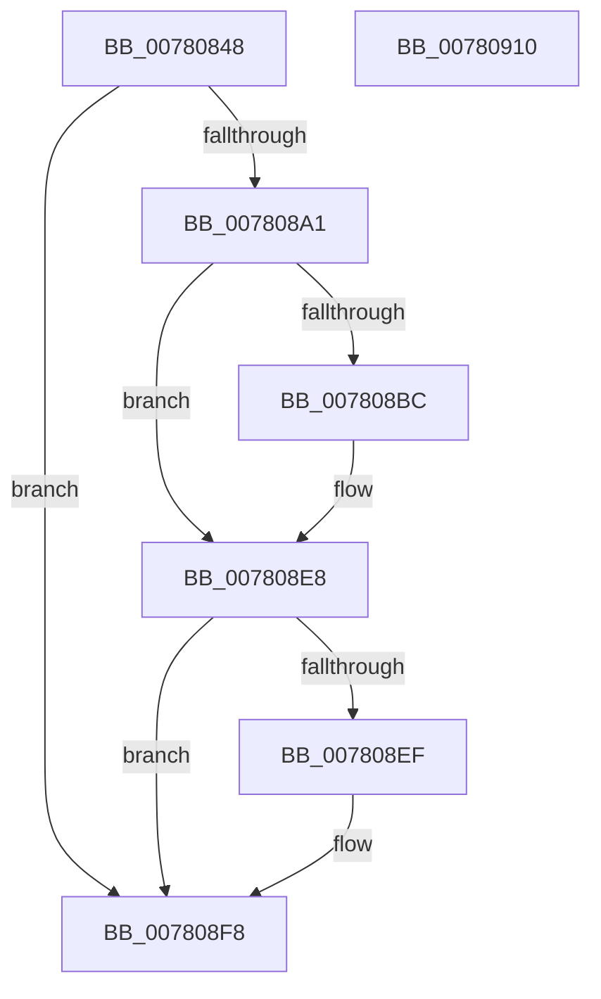

# PspSiloLoadApiSets

- RVA: `0x00780848`–`0x00780911` (길이 `201` bytes)
- VA: `0x0000000140780848`
- 실행 섹션: `PAGE`
- PDB 이름 있음: `예`; PDB Function 태그: `아니요`
- unwind 정보 RVA: `0x000CE0DC`
- 디코드: `54`개 명령, `201/201` bytes 표시
- 미해석 바이트: `0` (있으면 어셈블리에 `.byte`로 보존)

> 이 문서는 커널 이미지의 기계어와 PDB 기호를 분석해 생성했습니다. 4번과 5번은 함수 원형과 자료형을 바이너리 사용 방식에서 추정한 C 해석이며 원본 소스 복구 결과는 아닙니다.

## 1. Dependencies

- 직접 호출 지점: **7**; 고유 호출 대상: **7**
- 직접 호출자로 확인된 함수: **1**
- RIP 상대 이미지 참조: **1**

### Outgoing calls
- `0x00780882` → [PsAttachSiloToCurrentThread](../../text/44/PsAttachSiloToCurrentThread_function_004428C0.md) (function, `0x004428C0`)
- `0x00780896` → [ApiSetLoadSchemaWithExtensions](../7D/ApiSetLoadSchemaWithExtensions_function_007D9810.md) (function, `0x007D9810`)
- `0x007808B1` → [PspApiSetCopyToSystemSpace](../77/PspApiSetCopyToSystemSpace_function_0077F648.md) (function, `0x0077F648`)
- `0x007808BF` → [PsGetServerSiloGlobals](../../text/22/PsGetServerSiloGlobals_function_002250A0.md) (function, `0x002250A0`)
- `0x007808DD` → [PspQueryForwardersEnabled](PspQueryForwardersEnabled_function_00781A0C.md) (function, `0x00781A0C`)
- `0x007808F3` → [ApiSetReleaseSchema](../../text/66/ApiSetReleaseSchema_function_00661F54.md) (function, `0x00661F54`)
- `0x007808FB` → [PsDetachSiloFromCurrentThread](../../text/44/PsDetachSiloFromCurrentThread_function_00449AC0.md) (function, `0x00449AC0`)

### Direct callers
- [PspInitializeServerSiloDeferred](../77/PspInitializeServerSiloDeferred_function_0077FEE0.md) at `0x0077FF50`

### Static image references
- `0x0078085D` → RVA `0x00B04B40` (` ?? ::NNGAKEGL::`string'`; read)

## 2. Other-region calls and transfers

- 다른 실행 섹션으로 향하는 call: **4**
  - `0x00780882` → [PsAttachSiloToCurrentThread](../../text/44/PsAttachSiloToCurrentThread_function_004428C0.md) (`PAGE` → `.text`)
  - `0x007808BF` → [PsGetServerSiloGlobals](../../text/22/PsGetServerSiloGlobals_function_002250A0.md) (`PAGE` → `.text`)
  - `0x007808F3` → [ApiSetReleaseSchema](../../text/66/ApiSetReleaseSchema_function_00661F54.md) (`PAGE` → `.text`)
  - `0x007808FB` → [PsDetachSiloFromCurrentThread](../../text/44/PsDetachSiloFromCurrentThread_function_00449AC0.md) (`PAGE` → `.text`)
- 별도 외부 분기/꼬리 이동을 확인하지 못했습니다.

## 3. Assembly (complete function range)

```asm
00780848  48 89 5C 24 08                  mov qword ptr [rsp + 8], rbx
0078084D  55                              push rbp
0078084E  56                              push rsi
0078084F  41 56                           push r14
00780851  48 8B EC                        mov rbp, rsp
00780854  48 83 EC 40                     sub rsp, 0x40
00780858  48 83 65 E0 00                  and qword ptr [rbp - 0x20], 0
0078085D  48 8D 05 DC 42 38 00            lea rax, [rip + 0x3842dc]
00780864  48 83 65 38 00                  and qword ptr [rbp + 0x38], 0
00780869  48 8B D9                        mov rbx, rcx
0078086C  48 83 65 28 00                  and qword ptr [rbp + 0x28], 0
00780871  48 83 65 30 00                  and qword ptr [rbp + 0x30], 0
00780876  48 89 45 F0                     mov qword ptr [rbp - 0x10], rax
0078087A  48 C7 45 E8 4A 00 4C 00         mov qword ptr [rbp - 0x18], 0x4c004a
00780882  E8 39 20 CC FF                  call 0x1404428c0
00780887  4C 8D 45 30                     lea r8, [rbp + 0x30]
0078088B  4C 8B F0                        mov r14, rax
0078088E  48 8D 55 28                     lea rdx, [rbp + 0x28]
00780892  48 8D 4D E8                     lea rcx, [rbp - 0x18]
00780896  E8 75 8F 05 00                  call 0x1407d9810
0078089B  8B F0                           mov esi, eax
0078089D  85 C0                           test eax, eax
0078089F  78 57                           js 0x1407808f8
007808A1  48 8B 55 30                     mov rdx, qword ptr [rbp + 0x30]
007808A5  4C 8D 4D E0                     lea r9, [rbp - 0x20]
007808A9  48 8B 4D 28                     mov rcx, qword ptr [rbp + 0x28]
007808AD  4C 8D 45 38                     lea r8, [rbp + 0x38]
007808B1  E8 92 ED FF FF                  call 0x14077f648
007808B6  8B F0                           mov esi, eax
007808B8  85 C0                           test eax, eax
007808BA  78 2C                           js 0x1407808e8
007808BC  48 8B CB                        mov rcx, rbx
007808BF  E8 DC 47 AA FF                  call 0x1402250a0
007808C4  48 8B 55 38                     mov rdx, qword ptr [rbp + 0x38]
007808C8  48 8B D8                        mov rbx, rax
007808CB  48 89 90 E8 03 00 00            mov qword ptr [rax + 0x3e8], rdx
007808D2  48 8B 55 E0                     mov rdx, qword ptr [rbp - 0x20]
007808D6  48 89 90 F0 03 00 00            mov qword ptr [rax + 0x3f0], rdx
007808DD  E8 2A 11 00 00                  call 0x140781a0c
007808E2  88 83 F8 03 00 00               mov byte ptr [rbx + 0x3f8], al
007808E8  48 83 7D 28 00                  cmp qword ptr [rbp + 0x28], 0
007808ED  74 09                           je 0x1407808f8
007808EF  48 8B 4D 28                     mov rcx, qword ptr [rbp + 0x28]
007808F3  E8 5C 16 EE FF                  call 0x140661f54
007808F8  49 8B CE                        mov rcx, r14
007808FB  E8 C0 91 CC FF                  call 0x140449ac0
00780900  48 8B 5C 24 60                  mov rbx, qword ptr [rsp + 0x60]
00780905  8B C6                           mov eax, esi
00780907  48 83 C4 40                     add rsp, 0x40
0078090B  41 5E                           pop r14
0078090D  5E                              pop rsi
0078090E  5D                              pop rbp
0078090F  C3                              ret
00780910  CC                              int3
```

## 4. C-style interpretation (structured pseudocode)

```c
__int64 __fastcall PspSiloLoadApiSets(__int64 a1)
{
    __int64 result;
    __int64 v_rbx;
    __int64 v_rsp;
    unsigned __int64 v_stack_m28;
    unsigned __int64 v_stack_m30;
    unsigned __int64 v_stack_m38;
    unsigned __int64 v_stack_p10;
    unsigned __int64 v_stack_p18;
    unsigned __int64 v_stack_p20;
    unsigned __int64 v_stack_p8;

    v_stack_p8 = v_rbx;
    v_rsp = (v_rsp) - (64);
    v_stack_m28 = v_rip + 3687132;
    v_stack_m30 = 0x4C004AULL;
    result = PsAttachSiloToCurrentThread(a1, a2, a3, a4);
    result = ApiSetLoadSchemaWithExtensions(v_stack_m30, v_stack_p10, v_stack_p18, a4);
    if (sign_flag) goto loc_007808F8;
    result = PspApiSetCopyToSystemSpace(v_stack_p10, v_stack_p18, v_stack_p20, v_stack_m38);
    v_rbx = a1;
    if (!(sign_flag)) {
        a1 = a1;
        result = PsGetServerSiloGlobals(a1, v_stack_p18, v_stack_p20, v_stack_m38);
        a2 = v_stack_p20;
        v_rbx = result;
        *(unsigned __int64 *)(result + 1000) = a2;
        a2 = v_stack_m38;
        *(unsigned __int64 *)(result + 1008) = a2;
        result = PspQueryForwardersEnabled(a1, a2, v_stack_p20, v_stack_m38);
        *(unsigned __int8 *)(v_rbx + 1016) = (unsigned __int8)(result);
    }
    if (v_stack_p10 != 0) {
        a1 = v_stack_p10;
        result = ApiSetReleaseSchema(a1, a2, v_stack_p20, v_stack_m38);
    }
    result = PsDetachSiloFromCurrentThread(result, a2, v_stack_p20, v_stack_m38);
    v_rsp = (v_rsp) + (64);
    return (unsigned int)((unsigned int)((unsigned int)((unsigned int)(result))));
}
```

## 5. (Beta) C Style

```c
int64_t PspSiloLoadApiSets(int64_t Arg1)
{
    int64_t result;
    int64_t local_rbx;
    int64_t local_rsp;
    uint64_t v_stack_m28;
    uint64_t v_stack_m30;
    uint64_t v_stack_m38;
    uint64_t v_stack_p10;
    uint64_t v_stack_p18;
    uint64_t v_stack_p20;
    uint64_t v_stack_p8;

    v_stack_p8 = local_rbx;
    local_rsp = (local_rsp) - (64);
    v_stack_m28 = v_rip + 3687132;
    v_stack_m30 = 0x4C004AULL;
    result = PsAttachSiloToCurrentThread(Arg1, a2, a3, a4);
    result = ApiSetLoadSchemaWithExtensions(v_stack_m30, v_stack_p10, v_stack_p18, a4);
    if (sign_flag) goto loc_007808F8;
    result = PspApiSetCopyToSystemSpace(v_stack_p10, v_stack_p18, v_stack_p20, v_stack_m38);
    local_rbx = Arg1;
    if (!(sign_flag)) {
        Arg1 = Arg1;
        result = PsGetServerSiloGlobals(Arg1, v_stack_p18, v_stack_p20, v_stack_m38);
        a2 = v_stack_p20;
        local_rbx = result;
        *(uint64_t *)(result + 0x3E8) = a2;
        a2 = v_stack_m38;
        *(uint64_t *)(result + 0x3F0) = a2;
        result = PspQueryForwardersEnabled(Arg1, a2, v_stack_p20, v_stack_m38);
        *(uint8_t *)(local_rbx + 0x3F8) = (uint8_t)(result);
    }
    if (v_stack_p10 != 0) {
        Arg1 = v_stack_p10;
        result = ApiSetReleaseSchema(Arg1, a2, v_stack_p20, v_stack_m38);
    }
    result = PsDetachSiloFromCurrentThread(result, a2, v_stack_p20, v_stack_m38);
    local_rsp = (local_rsp) + (64);
    return (uint32_t)((uint32_t)((uint32_t)((uint32_t)(result))));
}
```

## 6. Execution-region graph

[열기: 2D/3D 그래프와 함수 탐색 컨트롤 패널](../../../control-panel.html?section=page&rva=0x00780848&view=graph)

- 2D 그래프는 위에서 아래로 흐르고, 3D 그래프는 빈 공간을 드래그해 회전합니다. Shift+드래그는 이동, 휠은 확대·축소, 함수 노드 선택은 대상 보고서 이동입니다.

### Static fallback


