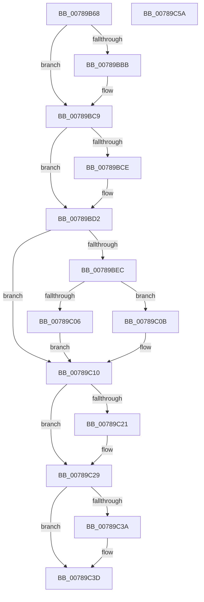

# PspStorageAllocSlot

- RVA: `0x00789B68`–`0x00789C5B` (길이 `243` bytes)
- VA: `0x0000000140789B68`
- 실행 섹션: `PAGE`
- PDB 이름 있음: `예`; PDB Function 태그: `아니요`
- unwind 정보 RVA: `0x0005E6B4`
- 디코드: `66`개 명령, `243/243` bytes 표시
- 미해석 바이트: `0` (있으면 어셈블리에 `.byte`로 보존)

> 이 문서는 커널 이미지의 기계어와 PDB 기호를 분석해 생성했습니다. 4번과 5번은 함수 원형과 자료형을 바이너리 사용 방식에서 추정한 C 해석이며 원본 소스 복구 결과는 아닙니다.

## 1. Dependencies

- 직접 호출 지점: **7**; 고유 호출 대상: **6**
- 직접 호출자로 확인된 함수: **5**
- RIP 상대 이미지 참조: **4**

### Outgoing calls
- `0x00789BAA` → [KeAbPreAcquire](../../text/21/KeAbPreAcquire_function_00210230.md) (function, `0x00210230`)
- `0x00789BC4` → [ExfAcquirePushLockExclusiveEx](../../text/20/ExfAcquirePushLockExclusiveEx_function_0020FC90.md) (function, `0x0020FC90`)
- `0x00789BE0` → [RtlFindClearBitsAndSet](../../text/3E/RtlFindClearBitsAndSet_function_003E0CD0.md) (function, `0x003E0CD0`)
- `0x00789BFA` → [RtlFindClearBitsAndSet](../../text/3E/RtlFindClearBitsAndSet_function_003E0CD0.md) (function, `0x003E0CD0`)
- `0x00789C24` → [ExfTryToWakePushLock](../../text/26/ExfTryToWakePushLock_function_00265DD0.md) (function, `0x00265DD0`)
- `0x00789C2C` → [KeAbPostRelease](../../text/2E/KeAbPostRelease_function_002E1600.md) (function, `0x002E1600`)
- `0x00789C31` → [KeLeaveCriticalRegion](../../text/25/KeLeaveCriticalRegion_function_0025D8B0.md) (function, `0x0025D8B0`)

### Direct callers
- [PsAllocSiloContextSlot](../77/PsAllocSiloContextSlot_function_0077F340.md) at `0x0077F347`
- [PsRegisterSiloMonitor](PsRegisterSiloMonitor_function_007866A0.md) at `0x00786770`
- [CmpInitSiloSupport](../7E/CmpInitSiloSupport_function_007E5B94.md) at `0x007E5BA4`
- [VRegSetup](../83/VRegSetup_function_0083AE90.md) at `0x0083B096`
- [PspInitializeSiloStructures](../../init/C4/PspInitializeSiloStructures_function_00C461B0.md) at `0x00C46204`
- [PspInitializeSiloStructures](../../init/C4/PspInitializeSiloStructures_function_00C461B0.md) at `0x00C46214`
- [PspInitializeSiloStructures](../../init/C4/PspInitializeSiloStructures_function_00C461B0.md) at `0x00C4624F`

### Static image references
- `0x00789B8A` → RVA `0x00FD9D90` (`PAGEDATA`; read)
- `0x00789BD5` → RVA `0x00FDA048` (`PAGEDATA`; read)
- `0x00789BEF` → RVA `0x00FDA058` (`PAGEDATA`; read)
- `0x00789C10` → RVA `0x00FD9D90` (`PAGEDATA`; read/write)

## 2. Other-region calls and transfers

- 다른 실행 섹션으로 향하는 call: **7**
  - `0x00789BAA` → [KeAbPreAcquire](../../text/21/KeAbPreAcquire_function_00210230.md) (`PAGE` → `.text`)
  - `0x00789BC4` → [ExfAcquirePushLockExclusiveEx](../../text/20/ExfAcquirePushLockExclusiveEx_function_0020FC90.md) (`PAGE` → `.text`)
  - `0x00789BE0` → [RtlFindClearBitsAndSet](../../text/3E/RtlFindClearBitsAndSet_function_003E0CD0.md) (`PAGE` → `.text`)
  - `0x00789BFA` → [RtlFindClearBitsAndSet](../../text/3E/RtlFindClearBitsAndSet_function_003E0CD0.md) (`PAGE` → `.text`)
  - `0x00789C24` → [ExfTryToWakePushLock](../../text/26/ExfTryToWakePushLock_function_00265DD0.md) (`PAGE` → `.text`)
  - `0x00789C2C` → [KeAbPostRelease](../../text/2E/KeAbPostRelease_function_002E1600.md) (`PAGE` → `.text`)
  - `0x00789C31` → [KeLeaveCriticalRegion](../../text/25/KeLeaveCriticalRegion_function_0025D8B0.md) (`PAGE` → `.text`)
- 별도 외부 분기/꼬리 이동을 확인하지 못했습니다.

## 3. Assembly (complete function range)

```asm
00789B68  48 8B C4                        mov rax, rsp
00789B6B  48 89 58 08                     mov qword ptr [rax + 8], rbx
00789B6F  48 89 68 10                     mov qword ptr [rax + 0x10], rbp
00789B73  48 89 70 18                     mov qword ptr [rax + 0x18], rsi
00789B77  48 89 78 20                     mov qword ptr [rax + 0x20], rdi
00789B7B  41 56                           push r14
00789B7D  48 83 EC 20                     sub rsp, 0x20
00789B81  65 48 8B 04 25 88 01 00 00      mov rax, qword ptr gs:[0x188]
00789B8A  48 8D 2D FF 01 85 00            lea rbp, [rip + 0x8501ff]
00789B91  4C 8B F1                        mov r14, rcx
00789B94  48 83 CB FF                     or rbx, 0xffffffffffffffff
00789B98  45 33 C0                        xor r8d, r8d
00789B9B  33 D2                           xor edx, edx
00789B9D  48 8B CD                        mov rcx, rbp
00789BA0  33 F6                           xor esi, esi
00789BA2  66 01 98 E4 01 00 00            add word ptr [rax + 0x1e4], bx
00789BA9  90                              nop
00789BAA  E8 81 66 A8 FF                  call 0x140210230
00789BAF  F0 48 0F BA 6D 00 00            lock bts qword ptr [rbp], 0
00789BB6  48 8B F8                        mov rdi, rax
00789BB9  73 0E                           jae 0x140789bc9
00789BBB  4C 8B C5                        mov r8, rbp
00789BBE  48 8B D0                        mov rdx, rax
00789BC1  48 8B CD                        mov rcx, rbp
00789BC4  E8 C7 60 A8 FF                  call 0x14020fc90
00789BC9  48 85 FF                        test rdi, rdi
00789BCC  74 04                           je 0x140789bd2
00789BCE  C6 47 0A 01                     mov byte ptr [rdi + 0xa], 1
00789BD2  45 33 C0                        xor r8d, r8d
00789BD5  48 8D 0D 6C 04 85 00            lea rcx, [rip + 0x85046c]
00789BDC  41 8D 50 01                     lea edx, [r8 + 1]
00789BE0  E8 EB 70 C5 FF                  call 0x1403e0cd0
00789BE5  8B F8                           mov edi, eax
00789BE7  83 F8 FF                        cmp eax, -1
00789BEA  75 24                           jne 0x140789c10
00789BEC  45 33 C0                        xor r8d, r8d
00789BEF  48 8D 0D 62 04 85 00            lea rcx, [rip + 0x850462]
00789BF6  41 8D 50 01                     lea edx, [r8 + 1]
00789BFA  E8 D1 70 C5 FF                  call 0x1403e0cd0
00789BFF  8B F8                           mov edi, eax
00789C01  83 F8 FF                        cmp eax, -1
00789C04  74 05                           je 0x140789c0b
00789C06  83 C7 20                        add edi, 0x20
00789C09  EB 05                           jmp 0x140789c10
00789C0B  BE 9A 00 00 C0                  mov esi, 0xc000009a
00789C10  F0 48 0F C1 1D 77 01 85 00      lock xadd qword ptr [rip + 0x850177], rbx
00789C19  80 E3 06                        and bl, 6
00789C1C  80 FB 02                        cmp bl, 2
00789C1F  75 08                           jne 0x140789c29
00789C21  48 8B CD                        mov rcx, rbp
00789C24  E8 A7 C1 AD FF                  call 0x140265dd0
00789C29  48 8B CD                        mov rcx, rbp
00789C2C  E8 CF 79 B5 FF                  call 0x1402e1600
00789C31  E8 7A 3C AD FF                  call 0x14025d8b0
00789C36  85 F6                           test esi, esi
00789C38  78 03                           js 0x140789c3d
00789C3A  41 89 3E                        mov dword ptr [r14], edi
00789C3D  48 8B 5C 24 30                  mov rbx, qword ptr [rsp + 0x30]
00789C42  8B C6                           mov eax, esi
00789C44  48 8B 74 24 40                  mov rsi, qword ptr [rsp + 0x40]
00789C49  48 8B 6C 24 38                  mov rbp, qword ptr [rsp + 0x38]
00789C4E  48 8B 7C 24 48                  mov rdi, qword ptr [rsp + 0x48]
00789C53  48 83 C4 20                     add rsp, 0x20
00789C57  41 5E                           pop r14
00789C59  C3                              ret
00789C5A  CC                              int3
```

## 4. C-style interpretation (structured pseudocode)

```c
__int64 __fastcall PspStorageAllocSlot(__int64 a1, int a2, int a3)
{
    __int64 result;
    __int64 v_rbx;
    __int64 v_rdi;
    __int64 v_rsi;
    __int64 v_rsp;
    unsigned __int64 v_stack_p10;
    unsigned __int64 v_stack_p18;
    unsigned __int64 v_stack_p20;
    unsigned __int64 v_stack_p8;

    *(unsigned __int64 *)(v_rsp + 8) = v_rbx;
    *(unsigned __int64 *)(v_rsp + 16) = v_rbp;
    *(unsigned __int64 *)(v_rsp + 24) = v_rsi;
    *(unsigned __int64 *)(v_rsp + 32) = v_rdi;
    v_rsp = (v_rsp) - (32);
    v_rbx = (v_rbx) | (-1);
    a3 = 0;
    a2 = 0;
    v_rsi = 0;
    result = KeAbPreAcquire(v_rip + 8716799, a2, a3, a4);
    if (!(condition_is_above_or_equal)) {
        a3 = v_rip + 8716799;
        a2 = result;
        a1 = v_rip + 8716799;
        result = ExfAcquirePushLockExclusiveEx(a1, a2, a3, a4);
    }
    if (result != 0) {
        *(unsigned __int8 *)(result + 10) = 1;
    }
    a3 = 0;
    result = RtlFindClearBitsAndSet(v_rip + 8717420, a3 + 1, a3, a4);
    if (((unsigned int)(result)) != -1) goto loc_00789C10;
    a3 = 0;
    result = RtlFindClearBitsAndSet(v_rip + 8717410, a3 + 1, a3, a4);
    if (((unsigned int)(result)) == -1) goto loc_00789C0B;
    v_rdi = (unsigned int)(((unsigned int)((unsigned int)(result))) + (32));
    goto loc_00789C10;
loc_00789C0B:
loc_00789C10:
    v_rbx = (unsigned __int8)((v_rbx) & (6));
    if (((unsigned __int8)(v_rbx)) == 2) {
        a1 = v_rip + 8716799;
        result = ExfTryToWakePushLock(a1, a3 + 1, a3, a4);
    }
    result = KeAbPostRelease(v_rip + 8716799, a3 + 1, a3, a4);
    result = KeLeaveCriticalRegion(v_rip + 8716799, a3 + 1, a3, a4);
    if (!(sign_flag)) {
        *(unsigned int *)(a1) = (unsigned int)(v_rdi);
    }
    v_rsp = (v_rsp) + (32);
    return (unsigned int)((unsigned int)((unsigned int)(0xC000009AULL)));
}
```

## 5. (Beta) C Style

```c
int64_t PspStorageAllocSlot(void *Arg1, int32_t Arg2, int32_t Arg3)
{
    uint8_t *arg1 = (uint8_t *)Arg1;

    int64_t result;
    int64_t local_rbx;
    int64_t local_rdi;
    int64_t local_rsi;
    int64_t local_rsp;
    uint64_t v_stack_p10;
    uint64_t v_stack_p18;
    uint64_t v_stack_p20;
    uint64_t v_stack_p8;

    *(uint64_t *)(local_rsp + 0x8) = local_rbx;
    *(uint64_t *)(local_rsp + 0x10) = local_rbp;
    *(uint64_t *)(local_rsp + 0x18) = local_rsi;
    *(uint64_t *)(local_rsp + 0x20) = local_rdi;
    local_rsp = (local_rsp) - (32);
    local_rbx = (local_rbx) | (-1);
    Arg3 = 0;
    Arg2 = 0;
    local_rsi = 0;
    result = KeAbPreAcquire(v_rip + 8716799, Arg2, Arg3, a4);
    if (!(condition_is_above_or_equal)) {
        Arg3 = v_rip + 8716799;
        Arg2 = result;
        Arg1 = v_rip + 8716799;
        result = ExfAcquirePushLockExclusiveEx(Arg1, Arg2, Arg3, a4);
    }
    if (result != 0) {
        *(uint8_t *)(result + 0xA) = 1;
    }
    Arg3 = 0;
    result = RtlFindClearBitsAndSet(v_rip + 8717420, Arg3 + 1, Arg3, a4);
    if (((uint32_t)(result)) != -1) goto loc_00789C10;
    Arg3 = 0;
    result = RtlFindClearBitsAndSet(v_rip + 8717410, Arg3 + 1, Arg3, a4);
    if (((uint32_t)(result)) == -1) goto loc_00789C0B;
    local_rdi = (uint32_t)(((uint32_t)((uint32_t)(result))) + (32));
    goto loc_00789C10;
loc_00789C0B:
loc_00789C10:
    local_rbx = (uint8_t)((local_rbx) & (6));
    if (((uint8_t)(local_rbx)) == 2) {
        Arg1 = v_rip + 8716799;
        result = ExfTryToWakePushLock(Arg1, Arg3 + 1, Arg3, a4);
    }
    result = KeAbPostRelease(v_rip + 8716799, Arg3 + 1, Arg3, a4);
    result = KeLeaveCriticalRegion(v_rip + 8716799, Arg3 + 1, Arg3, a4);
    if (!(sign_flag)) {
        *(uint32_t *)(arg1) = (uint32_t)(local_rdi);
    }
    local_rsp = (local_rsp) + (32);
    return (uint32_t)((uint32_t)((uint32_t)(0xC000009AULL)));
}
```

### 관측된 메모리 오프셋

구조체 형식이 확인되지 않은 접근은 인자 기준의 오프셋으로만 기록했습니다.

| 기준 인자 | 오프셋 표현 | 폭 (bit) | 접근 |
|---|---:|---:|---|
| `Arg1` | `+ 0x0` | `32` | `W` |

## 6. Execution-region graph

[열기: 2D/3D 그래프와 함수 탐색 컨트롤 패널](../../../control-panel.html?section=page&rva=0x00789B68&view=graph)

- 2D 그래프는 위에서 아래로 흐르고, 3D 그래프는 빈 공간을 드래그해 회전합니다. Shift+드래그는 이동, 휠은 확대·축소, 함수 노드 선택은 대상 보고서 이동입니다.

### Static fallback


