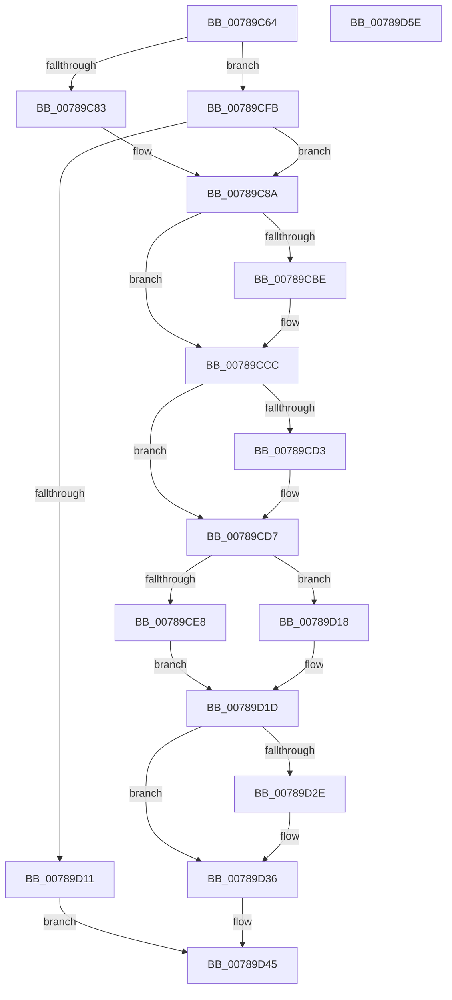

# PspStorageFreeSlot

- RVA: `0x00789C64`–`0x00789D5F` (길이 `251` bytes)
- VA: `0x0000000140789C64`
- 실행 섹션: `PAGE`
- PDB 이름 있음: `예`; PDB Function 태그: `아니요`
- unwind 정보 RVA: `0x00060300`
- 디코드: `69`개 명령, `251/251` bytes 표시
- 미해석 바이트: `0` (있으면 어셈블리에 `.byte`로 보존)

> 이 문서는 커널 이미지의 기계어와 PDB 기호를 분석해 생성했습니다. 4번과 5번은 함수 원형과 자료형을 바이너리 사용 방식에서 추정한 C 해석이며 원본 소스 복구 결과는 아닙니다.

## 1. Dependencies

- 직접 호출 지점: **5**; 고유 호출 대상: **5**
- 직접 호출자로 확인된 함수: **3**
- RIP 상대 이미지 참조: **4**

### Outgoing calls
- `0x00789CAE` → [KeAbPreAcquire](../../text/21/KeAbPreAcquire_function_00210230.md) (function, `0x00210230`)
- `0x00789CC7` → [ExfAcquirePushLockExclusiveEx](../../text/20/ExfAcquirePushLockExclusiveEx_function_0020FC90.md) (function, `0x0020FC90`)
- `0x00789D31` → [ExfTryToWakePushLock](../../text/26/ExfTryToWakePushLock_function_00265DD0.md) (function, `0x00265DD0`)
- `0x00789D39` → [KeAbPostRelease](../../text/2E/KeAbPostRelease_function_002E1600.md) (function, `0x002E1600`)
- `0x00789D3E` → [KeLeaveCriticalRegion](../../text/25/KeLeaveCriticalRegion_function_0025D8B0.md) (function, `0x0025D8B0`)

### Direct callers
- [PsFreeSiloContextSlot](../77/PsFreeSiloContextSlot_function_0077F360.md) at `0x0077F3CE`
- [PsUnregisterSiloMonitor](PsUnregisterSiloMonitor_function_00786A00.md) at `0x00786B31`
- [PspInitializeSiloStructures](../../init/C4/PspInitializeSiloStructures_function_00C461B0.md) at `0x00C46223`
- [PspInitializeSiloStructures](../../init/C4/PspInitializeSiloStructures_function_00C461B0.md) at `0x00C4625E`

### Static image references
- `0x00789C83` → RVA `0x00FDA048` (`PAGEDATA`; read)
- `0x00789C93` → RVA `0x00FD9D90` (`PAGEDATA`; read)
- `0x00789CFE` → RVA `0x00FDA058` (`PAGEDATA`; read)
- `0x00789D1D` → RVA `0x00FD9D90` (`PAGEDATA`; read/write)

## 2. Other-region calls and transfers

- 다른 실행 섹션으로 향하는 call: **5**
  - `0x00789CAE` → [KeAbPreAcquire](../../text/21/KeAbPreAcquire_function_00210230.md) (`PAGE` → `.text`)
  - `0x00789CC7` → [ExfAcquirePushLockExclusiveEx](../../text/20/ExfAcquirePushLockExclusiveEx_function_0020FC90.md) (`PAGE` → `.text`)
  - `0x00789D31` → [ExfTryToWakePushLock](../../text/26/ExfTryToWakePushLock_function_00265DD0.md) (`PAGE` → `.text`)
  - `0x00789D39` → [KeAbPostRelease](../../text/2E/KeAbPostRelease_function_002E1600.md) (`PAGE` → `.text`)
  - `0x00789D3E` → [KeLeaveCriticalRegion](../../text/25/KeLeaveCriticalRegion_function_0025D8B0.md) (`PAGE` → `.text`)
- 별도 외부 분기/꼬리 이동을 확인하지 못했습니다.

## 3. Assembly (complete function range)

```asm
00789C64  48 89 5C 24 08                  mov qword ptr [rsp + 8], rbx
00789C69  48 89 6C 24 10                  mov qword ptr [rsp + 0x10], rbp
00789C6E  48 89 74 24 18                  mov qword ptr [rsp + 0x18], rsi
00789C73  57                              push rdi
00789C74  41 56                           push r14
00789C76  41 57                           push r15
00789C78  48 83 EC 20                     sub rsp, 0x20
00789C7C  8B F9                           mov edi, ecx
00789C7E  83 F9 20                        cmp ecx, 0x20
00789C81  73 78                           jae 0x140789cfb
00789C83  4C 8D 35 BE 03 85 00            lea r14, [rip + 0x8503be]
00789C8A  65 48 8B 04 25 88 01 00 00      mov rax, qword ptr gs:[0x188]
00789C93  4C 8D 3D F6 00 85 00            lea r15, [rip + 0x8500f6]
00789C9A  48 83 CB FF                     or rbx, 0xffffffffffffffff
00789C9E  45 33 C0                        xor r8d, r8d
00789CA1  33 D2                           xor edx, edx
00789CA3  49 8B CF                        mov rcx, r15
00789CA6  66 01 98 E4 01 00 00            add word ptr [rax + 0x1e4], bx
00789CAD  90                              nop
00789CAE  E8 7D 65 A8 FF                  call 0x140210230
00789CB3  F0 49 0F BA 2F 00               lock bts qword ptr [r15], 0
00789CB9  48 8B E8                        mov rbp, rax
00789CBC  73 0E                           jae 0x140789ccc
00789CBE  4D 8B C7                        mov r8, r15
00789CC1  48 8B D0                        mov rdx, rax
00789CC4  49 8B CF                        mov rcx, r15
00789CC7  E8 C4 5F A8 FF                  call 0x14020fc90
00789CCC  33 F6                           xor esi, esi
00789CCE  48 85 ED                        test rbp, rbp
00789CD1  74 04                           je 0x140789cd7
00789CD3  C6 45 0A 01                     mov byte ptr [rbp + 0xa], 1
00789CD7  49 8B 56 08                     mov rdx, qword ptr [r14 + 8]
00789CDB  8B CF                           mov ecx, edi
00789CDD  48 0F A3 0A                     bt qword ptr [rdx], rcx
00789CE1  0F 92 C0                        setb al
00789CE4  84 C0                           test al, al
00789CE6  74 30                           je 0x140789d18
00789CE8  48 C1 E9 03                     shr rcx, 3
00789CEC  83 E7 07                        and edi, 7
00789CEF  0F BE 04 11                     movsx eax, byte ptr [rcx + rdx]
00789CF3  0F B3 F8                        btr eax, edi
00789CF6  88 04 11                        mov byte ptr [rcx + rdx], al
00789CF9  EB 22                           jmp 0x140789d1d
00789CFB  83 C7 E0                        add edi, -0x20
00789CFE  4C 8D 35 53 03 85 00            lea r14, [rip + 0x850353]
00789D05  81 FF 00 01 00 00               cmp edi, 0x100
00789D0B  0F 82 79 FF FF FF               jb 0x140789c8a
00789D11  B8 0D 00 00 C0                  mov eax, 0xc000000d
00789D16  EB 2D                           jmp 0x140789d45
00789D18  BE 0D 00 00 C0                  mov esi, 0xc000000d
00789D1D  F0 48 0F C1 1D 6A 00 85 00      lock xadd qword ptr [rip + 0x85006a], rbx
00789D26  80 E3 06                        and bl, 6
00789D29  80 FB 02                        cmp bl, 2
00789D2C  75 08                           jne 0x140789d36
00789D2E  49 8B CF                        mov rcx, r15
00789D31  E8 9A C0 AD FF                  call 0x140265dd0
00789D36  49 8B CF                        mov rcx, r15
00789D39  E8 C2 78 B5 FF                  call 0x1402e1600
00789D3E  E8 6D 3B AD FF                  call 0x14025d8b0
00789D43  8B C6                           mov eax, esi
00789D45  48 8B 5C 24 40                  mov rbx, qword ptr [rsp + 0x40]
00789D4A  48 8B 6C 24 48                  mov rbp, qword ptr [rsp + 0x48]
00789D4F  48 8B 74 24 50                  mov rsi, qword ptr [rsp + 0x50]
00789D54  48 83 C4 20                     add rsp, 0x20
00789D58  41 5F                           pop r15
00789D5A  41 5E                           pop r14
00789D5C  5F                              pop rdi
00789D5D  C3                              ret
00789D5E  CC                              int3
```

## 4. C-style interpretation (structured pseudocode)

```c
__int64 __fastcall PspStorageFreeSlot(int a1, int a2, int a3)
{
    __int64 result;
    __int64 v_rbx;
    __int64 v_rdi;
    __int64 v_rsi;
    __int64 v_rsp;
    unsigned __int64 v_stack_p10;
    unsigned __int64 v_stack_p18;
    unsigned __int64 v_stack_p8;

    v_stack_p8 = v_rbx;
    v_stack_p10 = v_rbp;
    v_stack_p18 = v_rsi;
    v_rsp = (v_rsp) - (32);
    if (a1 >= 32) goto loc_00789CFB;
loc_00789C8A:
    v_rbx = (v_rbx) | (-1);
    a3 = 0;
    a2 = 0;
    result = KeAbPreAcquire(v_rip + 8716534, a2, a3, a4);
    if (!(condition_is_above_or_equal)) {
        a3 = v_rip + 8716534;
        a2 = result;
        a1 = v_rip + 8716534;
        result = ExfAcquirePushLockExclusiveEx(a1, a2, a3, a4);
    }
    v_rsi = 0;
    if (result != 0) {
        *(unsigned __int8 *)(result + 10) = 1;
    }
    result = (condition_is_below) ? 1 : 0;
    if ((unsigned __int8)(result) == 0) goto loc_00789D18;
    a1 = ((unsigned int)((unsigned int)((unsigned int)(a1)))) >> (3);
    v_rdi = (unsigned int)(((unsigned int)(a1)) & (7));
    *(unsigned __int8 *)(a1 + *(unsigned __int64 *)(v_rip + 8717246 + 8) * 1) = (unsigned __int8)((__int8)(*(unsigned __int8 *)(a1 + *(unsigned __int64 *)(v_rip + 8717246 + 8) * 1)));
    goto loc_00789D1D;
loc_00789CFB:
    v_rdi = (unsigned int)((v_rdi) + (-32));
    if (((unsigned int)(v_rdi)) < 256) goto loc_00789C8A;
    goto loc_00789D45;
loc_00789D18:
loc_00789D1D:
    v_rbx = (unsigned __int8)((v_rbx) & (6));
    result = (unsigned int)(0xC000000DULL);
    if (((unsigned __int8)(v_rbx)) == 2) {
        a1 = v_rip + 8716534;
        result = ExfTryToWakePushLock(a1, *(unsigned __int64 *)(v_rip + 8717246 + 8), a3, a4);
    }
    result = KeAbPostRelease(v_rip + 8716534, *(unsigned __int64 *)(v_rip + 8717246 + 8), a3, a4);
    result = KeLeaveCriticalRegion(v_rip + 8716534, *(unsigned __int64 *)(v_rip + 8717246 + 8), a3, a4);
loc_00789D45:
    v_rsp = (v_rsp) + (32);
    return (unsigned int)((unsigned int)((unsigned int)(0xC000000DULL)));
}
```

## 5. (Beta) C Style

```c
int64_t PspStorageFreeSlot(int32_t Arg1, int32_t Arg2, int32_t Arg3)
{
    int64_t result;
    int64_t local_rbx;
    int64_t local_rdi;
    int64_t local_rsi;
    int64_t local_rsp;
    uint64_t v_stack_p10;
    uint64_t v_stack_p18;
    uint64_t v_stack_p8;

    v_stack_p8 = local_rbx;
    v_stack_p10 = local_rbp;
    v_stack_p18 = local_rsi;
    local_rsp = (local_rsp) - (32);
    if (Arg1 >= 32) goto loc_00789CFB;
loc_00789C8A:
    local_rbx = (local_rbx) | (-1);
    Arg3 = 0;
    Arg2 = 0;
    result = KeAbPreAcquire(v_rip + 8716534, Arg2, Arg3, a4);
    if (!(condition_is_above_or_equal)) {
        Arg3 = v_rip + 8716534;
        Arg2 = result;
        Arg1 = v_rip + 8716534;
        result = ExfAcquirePushLockExclusiveEx(Arg1, Arg2, Arg3, a4);
    }
    local_rsi = 0;
    if (result != 0) {
        *(uint8_t *)(result + 0xA) = 1;
    }
    result = (condition_is_below) ? 1 : 0;
    if ((uint8_t)(result) == 0) goto loc_00789D18;
    Arg1 = ((uint32_t)((uint32_t)((uint32_t)(Arg1)))) >> (3);
    local_rdi = (uint32_t)(((uint32_t)(Arg1)) & (7));
    *(uint8_t *)(Arg1 + *(uint64_t *)(v_rip + 0x8503BE + 0x8) * 1) = (uint8_t)((int8_t)(*(uint8_t *)(Arg1 + *(uint64_t *)(v_rip + 0x8503BE + 0x8) * 1)));
    goto loc_00789D1D;
loc_00789CFB:
    local_rdi = (uint32_t)((local_rdi) + (-32));
    if (((uint32_t)(local_rdi)) < 256) goto loc_00789C8A;
    goto loc_00789D45;
loc_00789D18:
loc_00789D1D:
    local_rbx = (uint8_t)((local_rbx) & (6));
    result = (uint32_t)(0xC000000DULL);
    if (((uint8_t)(local_rbx)) == 2) {
        Arg1 = v_rip + 8716534;
        result = ExfTryToWakePushLock(Arg1, *(uint64_t *)(v_rip + 0x8503BE + 0x8), Arg3, a4);
    }
    result = KeAbPostRelease(v_rip + 8716534, *(uint64_t *)(v_rip + 0x8503BE + 0x8), Arg3, a4);
    result = KeLeaveCriticalRegion(v_rip + 8716534, *(uint64_t *)(v_rip + 0x8503BE + 0x8), Arg3, a4);
loc_00789D45:
    local_rsp = (local_rsp) + (32);
    return (uint32_t)((uint32_t)((uint32_t)(0xC000000DULL)));
}
```

## 6. Execution-region graph

[열기: 2D/3D 그래프와 함수 탐색 컨트롤 패널](../../../control-panel.html?section=page&rva=0x00789C64&view=graph)

- 2D 그래프는 위에서 아래로 흐르고, 3D 그래프는 빈 공간을 드래그해 회전합니다. Shift+드래그는 이동, 휠은 확대·축소, 함수 노드 선택은 대상 보고서 이동입니다.

### Static fallback


