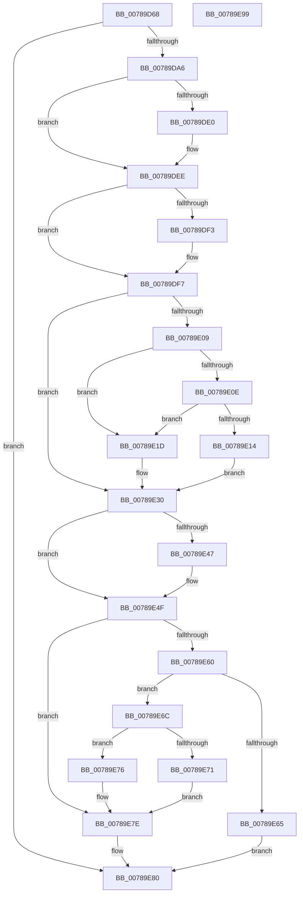

# PspStorageRemoveObject

- RVA: `0x00789D68`–`0x00789E9A` (길이 `306` bytes)
- VA: `0x0000000140789D68`
- 실행 섹션: `PAGE`
- PDB 이름 있음: `예`; PDB Function 태그: `아니요`
- unwind 정보 RVA: `0x00084C9C`
- 디코드: `89`개 명령, `306/306` bytes 표시
- 미해석 바이트: `0` (있으면 어셈블리에 `.byte`로 보존)

> 이 문서는 커널 이미지의 기계어와 PDB 기호를 분석해 생성했습니다. 4번과 5번은 함수 원형과 자료형을 바이너리 사용 방식에서 추정한 C 해석이며 원본 소스 복구 결과는 아닙니다.

## 1. Dependencies

- 직접 호출 지점: **7**; 고유 호출 대상: **7**
- 직접 호출자로 확인된 함수: **2**
- RIP 상대 이미지 참조: **0**

### Outgoing calls
- `0x00789D97` → [PspGetStorageArrayIfPossible](../../text/42/PspGetStorageArrayIfPossible_function_00420E40.md) (function, `0x00420E40`)
- `0x00789DD0` → [KeAbPreAcquire](../../text/21/KeAbPreAcquire_function_00210230.md) (function, `0x00210230`)
- `0x00789DE9` → [ExfAcquirePushLockExclusiveEx](../../text/20/ExfAcquirePushLockExclusiveEx_function_0020FC90.md) (function, `0x0020FC90`)
- `0x00789E4A` → [ExfTryToWakePushLock](../../text/26/ExfTryToWakePushLock_function_00265DD0.md) (function, `0x00265DD0`)
- `0x00789E52` → [KeAbPostRelease](../../text/2E/KeAbPostRelease_function_002E1600.md) (function, `0x002E1600`)
- `0x00789E57` → [KeLeaveCriticalRegion](../../text/25/KeLeaveCriticalRegion_function_0025D8B0.md) (function, `0x0025D8B0`)
- `0x00789E79` → [ObfDereferenceObject](../../text/2F/ObfDereferenceObject_function_002F9350.md) (function, `0x002F9350`)

### Direct callers
- [PsRemoveSiloContext](../77/PsRemoveSiloContext_function_0077F450.md) at `0x0077F478`
- [PsUnregisterSiloMonitor](PsUnregisterSiloMonitor_function_00786A00.md) at `0x00786B0D`

### Static image references
- 디코드된 RIP-relative 메모리 참조가 없습니다.

## 2. Other-region calls and transfers

- 다른 실행 섹션으로 향하는 call: **7**
  - `0x00789D97` → [PspGetStorageArrayIfPossible](../../text/42/PspGetStorageArrayIfPossible_function_00420E40.md) (`PAGE` → `.text`)
  - `0x00789DD0` → [KeAbPreAcquire](../../text/21/KeAbPreAcquire_function_00210230.md) (`PAGE` → `.text`)
  - `0x00789DE9` → [ExfAcquirePushLockExclusiveEx](../../text/20/ExfAcquirePushLockExclusiveEx_function_0020FC90.md) (`PAGE` → `.text`)
  - `0x00789E4A` → [ExfTryToWakePushLock](../../text/26/ExfTryToWakePushLock_function_00265DD0.md) (`PAGE` → `.text`)
  - `0x00789E52` → [KeAbPostRelease](../../text/2E/KeAbPostRelease_function_002E1600.md) (`PAGE` → `.text`)
  - `0x00789E57` → [KeLeaveCriticalRegion](../../text/25/KeLeaveCriticalRegion_function_0025D8B0.md) (`PAGE` → `.text`)
  - `0x00789E79` → [ObfDereferenceObject](../../text/2F/ObfDereferenceObject_function_002F9350.md) (`PAGE` → `.text`)
- 별도 외부 분기/꼬리 이동을 확인하지 못했습니다.

## 3. Assembly (complete function range)

```asm
00789D68  48 8B C4                        mov rax, rsp
00789D6B  48 89 58 08                     mov qword ptr [rax + 8], rbx
00789D6F  48 89 68 10                     mov qword ptr [rax + 0x10], rbp
00789D73  48 89 70 18                     mov qword ptr [rax + 0x18], rsi
00789D77  57                              push rdi
00789D78  41 56                           push r14
00789D7A  41 57                           push r15
00789D7C  48 83 EC 30                     sub rsp, 0x30
00789D80  83 60 D8 00                     and dword ptr [rax - 0x28], 0
00789D84  4D 8B F1                        mov r14, r9
00789D87  48 83 60 E0 00                  and qword ptr [rax - 0x20], 0
00789D8C  4C 8D 48 E0                     lea r9, [rax - 0x20]
00789D90  45 8A F8                        mov r15b, r8b
00789D93  4C 8D 40 D8                     lea r8, [rax - 0x28]
00789D97  E8 A4 70 C9 FF                  call 0x140420e40
00789D9C  8B E8                           mov ebp, eax
00789D9E  85 C0                           test eax, eax
00789DA0  0F 88 DA 00 00 00               js 0x140789e80
00789DA6  65 48 8B 04 25 88 01 00 00      mov rax, qword ptr gs:[0x188]
00789DAF  48 83 CB FF                     or rbx, 0xffffffffffffffff
00789DB3  8B 7C 24 20                     mov edi, dword ptr [rsp + 0x20]
00789DB7  45 33 C0                        xor r8d, r8d
00789DBA  48 C1 E7 04                     shl rdi, 4
00789DBE  33 D2                           xor edx, edx
00789DC0  48 03 7C 24 28                  add rdi, qword ptr [rsp + 0x28]
00789DC5  66 01 98 E4 01 00 00            add word ptr [rax + 0x1e4], bx
00789DCC  48 8B CF                        mov rcx, rdi
00789DCF  90                              nop
00789DD0  E8 5B 64 A8 FF                  call 0x140210230
00789DD5  F0 48 0F BA 2F 00               lock bts qword ptr [rdi], 0
00789DDB  48 8B F0                        mov rsi, rax
00789DDE  73 0E                           jae 0x140789dee
00789DE0  4C 8B C7                        mov r8, rdi
00789DE3  48 8B D0                        mov rdx, rax
00789DE6  48 8B CF                        mov rcx, rdi
00789DE9  E8 A2 5E A8 FF                  call 0x14020fc90
00789DEE  48 85 F6                        test rsi, rsi
00789DF1  74 04                           je 0x140789df7
00789DF3  C6 46 0A 01                     mov byte ptr [rsi + 0xa], 1
00789DF7  48 8B 7F 08                     mov rdi, qword ptr [rdi + 8]
00789DFB  8B 4C 24 20                     mov ecx, dword ptr [rsp + 0x20]
00789DFF  48 8B 54 24 28                  mov rdx, qword ptr [rsp + 0x28]
00789E04  48 85 FF                        test rdi, rdi
00789E07  74 27                           je 0x140789e30
00789E09  45 84 FF                        test r15b, r15b
00789E0C  75 0F                           jne 0x140789e1d
00789E0E  40 F6 C7 01                     test dil, 1
00789E12  74 09                           je 0x140789e1d
00789E14  33 FF                           xor edi, edi
00789E16  BD BB 00 00 C0                  mov ebp, 0xc00000bb
00789E1B  EB 13                           jmp 0x140789e30
00789E1D  48 8B C1                        mov rax, rcx
00789E20  48 03 C0                        add rax, rax
00789E23  48 83 E7 FE                     and rdi, 0xfffffffffffffffe
00789E27  48 C7 44 C2 08 00 00 00 00      mov qword ptr [rdx + rax*8 + 8], 0
00789E30  48 8B F1                        mov rsi, rcx
00789E33  48 C1 E6 04                     shl rsi, 4
00789E37  48 03 F2                        add rsi, rdx
00789E3A  F0 48 0F C1 1E                  lock xadd qword ptr [rsi], rbx
00789E3F  80 E3 06                        and bl, 6
00789E42  80 FB 02                        cmp bl, 2
00789E45  75 08                           jne 0x140789e4f
00789E47  48 8B CE                        mov rcx, rsi
00789E4A  E8 81 BF AD FF                  call 0x140265dd0
00789E4F  48 8B CE                        mov rcx, rsi
00789E52  E8 A9 77 B5 FF                  call 0x1402e1600
00789E57  E8 54 3A AD FF                  call 0x14025d8b0
00789E5C  85 ED                           test ebp, ebp
00789E5E  78 1E                           js 0x140789e7e
00789E60  48 85 FF                        test rdi, rdi
00789E63  75 07                           jne 0x140789e6c
00789E65  B8 25 02 00 C0                  mov eax, 0xc0000225
00789E6A  EB 14                           jmp 0x140789e80
00789E6C  4D 85 F6                        test r14, r14
00789E6F  74 05                           je 0x140789e76
00789E71  49 89 3E                        mov qword ptr [r14], rdi
00789E74  EB 08                           jmp 0x140789e7e
00789E76  48 8B CF                        mov rcx, rdi
00789E79  E8 D2 F4 B6 FF                  call 0x1402f9350
00789E7E  8B C5                           mov eax, ebp
00789E80  48 8B 5C 24 50                  mov rbx, qword ptr [rsp + 0x50]
00789E85  48 8B 6C 24 58                  mov rbp, qword ptr [rsp + 0x58]
00789E8A  48 8B 74 24 60                  mov rsi, qword ptr [rsp + 0x60]
00789E8F  48 83 C4 30                     add rsp, 0x30
00789E93  41 5F                           pop r15
00789E95  41 5E                           pop r14
00789E97  5F                              pop rdi
00789E98  C3                              ret
00789E99  CC                              int3
```

## 4. C-style interpretation (structured pseudocode)

```c
__int64 __fastcall PspStorageRemoveObject(__int64 a1, int a2, unsigned __int8 a3, __int64 a4)
{
    __int64 result;
    __int64 v_rbx;
    __int64 v_rdi;
    __int64 v_rsi;
    __int64 v_rsp;
    unsigned __int64 v_stack_m20;
    unsigned int v_stack_m28;
    unsigned __int64 v_stack_p10;
    unsigned __int64 v_stack_p18;
    unsigned __int64 v_stack_p8;

    *(unsigned __int64 *)(v_rsp + 8) = v_rbx;
    *(unsigned __int64 *)(v_rsp + 16) = v_rbp;
    *(unsigned __int64 *)(v_rsp + 24) = v_rsi;
    v_rsp = (v_rsp) - (48);
    result = PspGetStorageArrayIfPossible(a1, a2, v_rsp - 40, v_rsp - 32);
    if (sign_flag) goto loc_00789E80;
    v_rbx = (v_rbx) | (-1);
    a3 = 0;
    v_rdi = ((unsigned int)(v_stack_m28)) << (4);
    a2 = 0;
    v_rdi = (v_rdi) + (v_stack_m20);
    result = KeAbPreAcquire(v_rdi, a2, a3, v_rsp - 32);
    if (!(condition_is_above_or_equal)) {
        a3 = v_rdi;
        a2 = result;
        a1 = v_rdi;
        result = ExfAcquirePushLockExclusiveEx(a1, a2, a3, v_rsp - 32);
    }
    if (result != 0) {
        *(unsigned __int8 *)(result + 10) = 1;
    }
    if (*(unsigned __int64 *)(v_rdi + 8) == 0) goto loc_00789E30;
    if (a3 != 0) goto loc_00789E1D;
    if ((((unsigned __int8)(*(unsigned __int64 *)(v_rdi + 8))) & (1)) == 0) goto loc_00789E1D;
    v_rdi = 0;
    goto loc_00789E30;
loc_00789E1D:
    result = ((unsigned int)(v_stack_m28)) + ((unsigned int)(v_stack_m28));
    v_rdi = (v_rdi) & (-2);
    *(unsigned __int64 *)(v_stack_m20 + result * 8 + 8) = 0;
loc_00789E30:
    v_rsi = ((unsigned int)(v_stack_m28)) << (4);
    v_rsi = (v_rsi) + (v_stack_m20);
    v_rbx = (unsigned __int8)((v_rbx) & (6));
    if (((unsigned __int8)(v_rbx)) == 2) {
        a1 = v_rsi;
        result = ExfTryToWakePushLock(a1, v_stack_m20, a3, v_rsp - 32);
    }
    result = KeAbPostRelease(v_rsi, v_stack_m20, a3, v_rsp - 32);
    result = KeLeaveCriticalRegion(v_rsi, v_stack_m20, a3, v_rsp - 32);
    if (sign_flag) goto loc_00789E7E;
    if (v_rdi != 0) goto loc_00789E6C;
    goto loc_00789E80;
loc_00789E6C:
    if (a4 == 0) goto loc_00789E76;
    *(unsigned __int64 *)(a4) = v_rdi;
    goto loc_00789E7E;
loc_00789E76:
    result = ObfDereferenceObject(v_rdi, v_stack_m20, a3, v_rsp - 32);
loc_00789E7E:
loc_00789E80:
    v_rsp = (v_rsp) + (48);
    return (unsigned int)((unsigned int)((unsigned int)(0xC00000BBULL)));
}
```

## 5. (Beta) C Style

```c
int64_t PspStorageRemoveObject(int64_t Arg1, int32_t Arg2, uint8_t Arg3, int64_t Arg4)
{
    int64_t result;
    int64_t local_rbx;
    int64_t local_rdi;
    int64_t local_rsi;
    int64_t local_rsp;
    uint64_t v_stack_m20;
    uint32_t v_stack_m28;
    uint64_t v_stack_p10;
    uint64_t v_stack_p18;
    uint64_t v_stack_p8;

    *(uint64_t *)(local_rsp + 0x8) = local_rbx;
    *(uint64_t *)(local_rsp + 0x10) = local_rbp;
    *(uint64_t *)(local_rsp + 0x18) = local_rsi;
    local_rsp = (local_rsp) - (48);
    result = PspGetStorageArrayIfPossible(Arg1, Arg2, local_rsp - 40, local_rsp - 32);
    if (sign_flag) goto loc_00789E80;
    local_rbx = (local_rbx) | (-1);
    Arg3 = 0;
    local_rdi = ((uint32_t)(v_stack_m28)) << (4);
    Arg2 = 0;
    local_rdi = (local_rdi) + (v_stack_m20);
    result = KeAbPreAcquire(local_rdi, Arg2, Arg3, local_rsp - 32);
    if (!(condition_is_above_or_equal)) {
        Arg3 = local_rdi;
        Arg2 = result;
        Arg1 = local_rdi;
        result = ExfAcquirePushLockExclusiveEx(Arg1, Arg2, Arg3, local_rsp - 32);
    }
    if (result != 0) {
        *(uint8_t *)(result + 0xA) = 1;
    }
    if (*(uint64_t *)(local_rdi + 0x8) == 0) goto loc_00789E30;
    if (Arg3 != 0) goto loc_00789E1D;
    if ((((uint8_t)(*(uint64_t *)(local_rdi + 0x8))) & (1)) == 0) goto loc_00789E1D;
    local_rdi = 0;
    goto loc_00789E30;
loc_00789E1D:
    result = ((uint32_t)(v_stack_m28)) + ((uint32_t)(v_stack_m28));
    local_rdi = (local_rdi) & (-2);
    *(uint64_t *)(v_stack_m20 + result * 8 + 0x8) = 0;
loc_00789E30:
    local_rsi = ((uint32_t)(v_stack_m28)) << (4);
    local_rsi = (local_rsi) + (v_stack_m20);
    local_rbx = (uint8_t)((local_rbx) & (6));
    if (((uint8_t)(local_rbx)) == 2) {
        Arg1 = local_rsi;
        result = ExfTryToWakePushLock(Arg1, v_stack_m20, Arg3, local_rsp - 32);
    }
    result = KeAbPostRelease(local_rsi, v_stack_m20, Arg3, local_rsp - 32);
    result = KeLeaveCriticalRegion(local_rsi, v_stack_m20, Arg3, local_rsp - 32);
    if (sign_flag) goto loc_00789E7E;
    if (local_rdi != 0) goto loc_00789E6C;
    goto loc_00789E80;
loc_00789E6C:
    if (Arg4 == 0) goto loc_00789E76;
    *(uint64_t *)(Arg4) = local_rdi;
    goto loc_00789E7E;
loc_00789E76:
    result = ObfDereferenceObject(local_rdi, v_stack_m20, Arg3, local_rsp - 32);
loc_00789E7E:
loc_00789E80:
    local_rsp = (local_rsp) + (48);
    return (uint32_t)((uint32_t)((uint32_t)(0xC00000BBULL)));
}
```

## 6. Execution-region graph

[열기: 2D/3D 그래프와 함수 탐색 컨트롤 패널](../../../control-panel.html?section=page&rva=0x00789D68&view=graph)

- 2D 그래프는 위에서 아래로 흐르고, 3D 그래프는 빈 공간을 드래그해 회전합니다. Shift+드래그는 이동, 휠은 확대·축소, 함수 노드 선택은 대상 보고서 이동입니다.

### Static fallback


