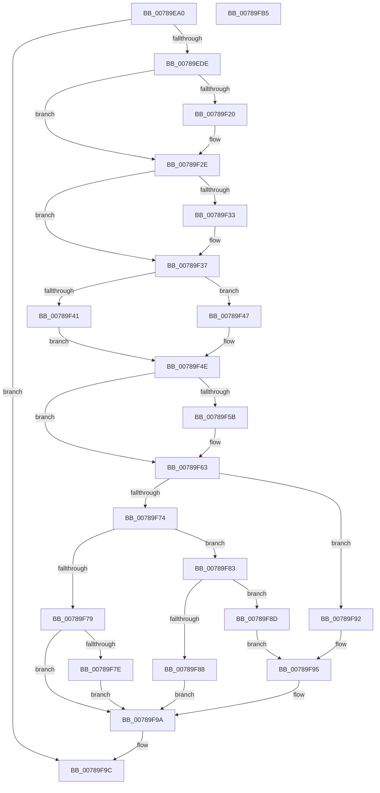

# PspStorageReplaceObject

- RVA: `0x00789EA0`–`0x00789FB6` (길이 `278` bytes)
- VA: `0x0000000140789EA0`
- 실행 섹션: `PAGE`
- PDB 이름 있음: `예`; PDB Function 태그: `아니요`
- unwind 정보 RVA: `0x00084C9C`
- 디코드: `83`개 명령, `278/278` bytes 표시
- 미해석 바이트: `0` (있으면 어셈블리에 `.byte`로 보존)

> 이 문서는 커널 이미지의 기계어와 PDB 기호를 분석해 생성했습니다. 4번과 5번은 함수 원형과 자료형을 바이너리 사용 방식에서 추정한 C 해석이며 원본 소스 복구 결과는 아닙니다.

## 1. Dependencies

- 직접 호출 지점: **8**; 고유 호출 대상: **8**
- 직접 호출자로 확인된 함수: **1**
- RIP 상대 이미지 참조: **0**

### Outgoing calls
- `0x00789ECF` → [PspGetStorageArray](../9E/PspGetStorageArray_function_009E8538.md) (function, `0x009E8538`)
- `0x00789EE1` → [ObfReferenceObject](../../text/20/ObfReferenceObject_function_0020FA20.md) (function, `0x0020FA20`)
- `0x00789F10` → [KeAbPreAcquire](../../text/21/KeAbPreAcquire_function_00210230.md) (function, `0x00210230`)
- `0x00789F29` → [ExfAcquirePushLockExclusiveEx](../../text/20/ExfAcquirePushLockExclusiveEx_function_0020FC90.md) (function, `0x0020FC90`)
- `0x00789F5E` → [ExfTryToWakePushLock](../../text/26/ExfTryToWakePushLock_function_00265DD0.md) (function, `0x00265DD0`)
- `0x00789F66` → [KeAbPostRelease](../../text/2E/KeAbPostRelease_function_002E1600.md) (function, `0x002E1600`)
- `0x00789F6B` → [KeLeaveCriticalRegion](../../text/25/KeLeaveCriticalRegion_function_0025D8B0.md) (function, `0x0025D8B0`)
- `0x00789F95` → [ObfDereferenceObject](../../text/2F/ObfDereferenceObject_function_002F9350.md) (function, `0x002F9350`)

### Direct callers
- [PsReplaceSiloContext](../77/PsReplaceSiloContext_function_0077F490.md) at `0x0077F4F6`

### Static image references
- 디코드된 RIP-relative 메모리 참조가 없습니다.

## 2. Other-region calls and transfers

- 다른 실행 섹션으로 향하는 call: **7**
  - `0x00789EE1` → [ObfReferenceObject](../../text/20/ObfReferenceObject_function_0020FA20.md) (`PAGE` → `.text`)
  - `0x00789F10` → [KeAbPreAcquire](../../text/21/KeAbPreAcquire_function_00210230.md) (`PAGE` → `.text`)
  - `0x00789F29` → [ExfAcquirePushLockExclusiveEx](../../text/20/ExfAcquirePushLockExclusiveEx_function_0020FC90.md) (`PAGE` → `.text`)
  - `0x00789F5E` → [ExfTryToWakePushLock](../../text/26/ExfTryToWakePushLock_function_00265DD0.md) (`PAGE` → `.text`)
  - `0x00789F66` → [KeAbPostRelease](../../text/2E/KeAbPostRelease_function_002E1600.md) (`PAGE` → `.text`)
  - `0x00789F6B` → [KeLeaveCriticalRegion](../../text/25/KeLeaveCriticalRegion_function_0025D8B0.md) (`PAGE` → `.text`)
  - `0x00789F95` → [ObfDereferenceObject](../../text/2F/ObfDereferenceObject_function_002F9350.md) (`PAGE` → `.text`)
- 별도 외부 분기/꼬리 이동을 확인하지 못했습니다.

## 3. Assembly (complete function range)

```asm
00789EA0  48 8B C4                        mov rax, rsp
00789EA3  48 89 58 08                     mov qword ptr [rax + 8], rbx
00789EA7  48 89 68 10                     mov qword ptr [rax + 0x10], rbp
00789EAB  48 89 70 18                     mov qword ptr [rax + 0x18], rsi
00789EAF  57                              push rdi
00789EB0  41 56                           push r14
00789EB2  41 57                           push r15
00789EB4  48 83 EC 30                     sub rsp, 0x30
00789EB8  83 60 D8 00                     and dword ptr [rax - 0x28], 0
00789EBC  4D 8B F1                        mov r14, r9
00789EBF  48 83 60 E0 00                  and qword ptr [rax - 0x20], 0
00789EC4  4C 8D 48 E0                     lea r9, [rax - 0x20]
00789EC8  4D 8B F8                        mov r15, r8
00789ECB  4C 8D 40 D8                     lea r8, [rax - 0x28]
00789ECF  E8 64 E6 25 00                  call 0x1409e8538
00789ED4  8B E8                           mov ebp, eax
00789ED6  85 C0                           test eax, eax
00789ED8  0F 88 BE 00 00 00               js 0x140789f9c
00789EDE  49 8B CF                        mov rcx, r15
00789EE1  E8 3A 5B A8 FF                  call 0x14020fa20
00789EE6  65 48 8B 04 25 88 01 00 00      mov rax, qword ptr gs:[0x188]
00789EEF  48 83 CB FF                     or rbx, 0xffffffffffffffff
00789EF3  8B 7C 24 20                     mov edi, dword ptr [rsp + 0x20]
00789EF7  45 33 C0                        xor r8d, r8d
00789EFA  48 C1 E7 04                     shl rdi, 4
00789EFE  33 D2                           xor edx, edx
00789F00  48 03 7C 24 28                  add rdi, qword ptr [rsp + 0x28]
00789F05  66 01 98 E4 01 00 00            add word ptr [rax + 0x1e4], bx
00789F0C  48 8B CF                        mov rcx, rdi
00789F0F  90                              nop
00789F10  E8 1B 63 A8 FF                  call 0x140210230
00789F15  F0 48 0F BA 2F 00               lock bts qword ptr [rdi], 0
00789F1B  48 8B F0                        mov rsi, rax
00789F1E  73 0E                           jae 0x140789f2e
00789F20  4C 8B C7                        mov r8, rdi
00789F23  48 8B D0                        mov rdx, rax
00789F26  48 8B CF                        mov rcx, rdi
00789F29  E8 62 5D A8 FF                  call 0x14020fc90
00789F2E  48 85 F6                        test rsi, rsi
00789F31  74 04                           je 0x140789f37
00789F33  C6 46 0A 01                     mov byte ptr [rsi + 0xa], 1
00789F37  48 8B 77 08                     mov rsi, qword ptr [rdi + 8]
00789F3B  40 F6 C6 01                     test sil, 1
00789F3F  75 06                           jne 0x140789f47
00789F41  4C 89 7F 08                     mov qword ptr [rdi + 8], r15
00789F45  EB 07                           jmp 0x140789f4e
00789F47  33 F6                           xor esi, esi
00789F49  BD BB 00 00 C0                  mov ebp, 0xc00000bb
00789F4E  F0 48 0F C1 1F                  lock xadd qword ptr [rdi], rbx
00789F53  80 E3 06                        and bl, 6
00789F56  80 FB 02                        cmp bl, 2
00789F59  75 08                           jne 0x140789f63
00789F5B  48 8B CF                        mov rcx, rdi
00789F5E  E8 6D BE AD FF                  call 0x140265dd0
00789F63  48 8B CF                        mov rcx, rdi
00789F66  E8 95 76 B5 FF                  call 0x1402e1600
00789F6B  E8 40 39 AD FF                  call 0x14025d8b0
00789F70  85 ED                           test ebp, ebp
00789F72  78 1E                           js 0x140789f92
00789F74  48 85 F6                        test rsi, rsi
00789F77  75 0A                           jne 0x140789f83
00789F79  4D 85 F6                        test r14, r14
00789F7C  74 1C                           je 0x140789f9a
00789F7E  49 21 36                        and qword ptr [r14], rsi
00789F81  EB 17                           jmp 0x140789f9a
00789F83  4D 85 F6                        test r14, r14
00789F86  74 05                           je 0x140789f8d
00789F88  49 89 36                        mov qword ptr [r14], rsi
00789F8B  EB 0D                           jmp 0x140789f9a
00789F8D  48 8B CE                        mov rcx, rsi
00789F90  EB 03                           jmp 0x140789f95
00789F92  49 8B CF                        mov rcx, r15
00789F95  E8 B6 F3 B6 FF                  call 0x1402f9350
00789F9A  8B C5                           mov eax, ebp
00789F9C  48 8B 5C 24 50                  mov rbx, qword ptr [rsp + 0x50]
00789FA1  48 8B 6C 24 58                  mov rbp, qword ptr [rsp + 0x58]
00789FA6  48 8B 74 24 60                  mov rsi, qword ptr [rsp + 0x60]
00789FAB  48 83 C4 30                     add rsp, 0x30
00789FAF  41 5F                           pop r15
00789FB1  41 5E                           pop r14
00789FB3  5F                              pop rdi
00789FB4  C3                              ret
00789FB5  CC                              int3
```

## 4. C-style interpretation (structured pseudocode)

```c
__int64 __fastcall PspStorageReplaceObject(__int64 a1, int a2, __int64 a3, __int64 a4)
{
    __int64 result;
    __int64 v_rbx;
    __int64 v_rdi;
    __int64 v_rsi;
    __int64 v_rsp;
    unsigned __int64 v_stack_m20;
    unsigned int v_stack_m28;
    unsigned __int64 v_stack_p10;
    unsigned __int64 v_stack_p18;
    unsigned __int64 v_stack_p8;

    *(unsigned __int64 *)(v_rsp + 8) = v_rbx;
    *(unsigned __int64 *)(v_rsp + 16) = v_rbp;
    *(unsigned __int64 *)(v_rsp + 24) = v_rsi;
    v_rsp = (v_rsp) - (48);
    result = PspGetStorageArray(a1, a2, v_rsp - 40, v_rsp - 32);
    if (sign_flag) goto loc_00789F9C;
    result = ObfReferenceObject(a3, a2, v_rsp - 40, v_rsp - 32);
    v_rbx = (v_rbx) | (-1);
    a3 = 0;
    v_rdi = ((unsigned int)(v_stack_m28)) << (4);
    a2 = 0;
    v_rdi = (v_rdi) + (v_stack_m20);
    result = KeAbPreAcquire(v_rdi, a2, a3, v_rsp - 32);
    if (!(condition_is_above_or_equal)) {
        a3 = v_rdi;
        a2 = result;
        a1 = v_rdi;
        result = ExfAcquirePushLockExclusiveEx(a1, a2, a3, v_rsp - 32);
    }
    if (result != 0) {
        *(unsigned __int8 *)(result + 10) = 1;
    }
    if ((((unsigned __int8)(*(unsigned __int64 *)(v_rdi + 8))) & (1)) != 0) goto loc_00789F47;
    *(unsigned __int64 *)(v_rdi + 8) = a3;
    goto loc_00789F4E;
loc_00789F47:
    v_rsi = 0;
loc_00789F4E:
    v_rbx = (unsigned __int8)((v_rbx) & (6));
    if (((unsigned __int8)(v_rbx)) == 2) {
        a1 = v_rdi;
        result = ExfTryToWakePushLock(a1, a2, a3, v_rsp - 32);
    }
    result = KeAbPostRelease(v_rdi, a2, a3, v_rsp - 32);
    result = KeLeaveCriticalRegion(v_rdi, a2, a3, v_rsp - 32);
    if (sign_flag) goto loc_00789F92;
    if (0 != 0) goto loc_00789F83;
    if (a4 == 0) goto loc_00789F9A;
    goto loc_00789F9A;
loc_00789F83:
    if (a4 == 0) goto loc_00789F8D;
    *(unsigned __int64 *)(a4) = 0;
    goto loc_00789F9A;
loc_00789F8D:
    goto loc_00789F95;
loc_00789F92:
loc_00789F95:
    result = ObfDereferenceObject(a3, a2, a3, v_rsp - 32);
loc_00789F9A:
loc_00789F9C:
    v_rsp = (v_rsp) + (48);
    return (unsigned int)((unsigned int)((unsigned int)(0xC00000BBULL)));
}
```

## 5. (Beta) C Style

```c
int64_t PspStorageReplaceObject(int64_t Arg1, int32_t Arg2, int64_t Arg3, int64_t Arg4)
{
    int64_t result;
    int64_t local_rbx;
    int64_t local_rdi;
    int64_t local_rsi;
    int64_t local_rsp;
    uint64_t v_stack_m20;
    uint32_t v_stack_m28;
    uint64_t v_stack_p10;
    uint64_t v_stack_p18;
    uint64_t v_stack_p8;

    *(uint64_t *)(local_rsp + 0x8) = local_rbx;
    *(uint64_t *)(local_rsp + 0x10) = local_rbp;
    *(uint64_t *)(local_rsp + 0x18) = local_rsi;
    local_rsp = (local_rsp) - (48);
    result = PspGetStorageArray(Arg1, Arg2, local_rsp - 40, local_rsp - 32);
    if (sign_flag) goto loc_00789F9C;
    result = ObfReferenceObject(Arg3, Arg2, local_rsp - 40, local_rsp - 32);
    local_rbx = (local_rbx) | (-1);
    Arg3 = 0;
    local_rdi = ((uint32_t)(v_stack_m28)) << (4);
    Arg2 = 0;
    local_rdi = (local_rdi) + (v_stack_m20);
    result = KeAbPreAcquire(local_rdi, Arg2, Arg3, local_rsp - 32);
    if (!(condition_is_above_or_equal)) {
        Arg3 = local_rdi;
        Arg2 = result;
        Arg1 = local_rdi;
        result = ExfAcquirePushLockExclusiveEx(Arg1, Arg2, Arg3, local_rsp - 32);
    }
    if (result != 0) {
        *(uint8_t *)(result + 0xA) = 1;
    }
    if ((((uint8_t)(*(uint64_t *)(local_rdi + 0x8))) & (1)) != 0) goto loc_00789F47;
    *(uint64_t *)(local_rdi + 0x8) = Arg3;
    goto loc_00789F4E;
loc_00789F47:
    local_rsi = 0;
loc_00789F4E:
    local_rbx = (uint8_t)((local_rbx) & (6));
    if (((uint8_t)(local_rbx)) == 2) {
        Arg1 = local_rdi;
        result = ExfTryToWakePushLock(Arg1, Arg2, Arg3, local_rsp - 32);
    }
    result = KeAbPostRelease(local_rdi, Arg2, Arg3, local_rsp - 32);
    result = KeLeaveCriticalRegion(local_rdi, Arg2, Arg3, local_rsp - 32);
    if (sign_flag) goto loc_00789F92;
    if (0 != 0) goto loc_00789F83;
    if (Arg4 == 0) goto loc_00789F9A;
    goto loc_00789F9A;
loc_00789F83:
    if (Arg4 == 0) goto loc_00789F8D;
    *(uint64_t *)(Arg4) = 0;
    goto loc_00789F9A;
loc_00789F8D:
    goto loc_00789F95;
loc_00789F92:
loc_00789F95:
    result = ObfDereferenceObject(Arg3, Arg2, Arg3, local_rsp - 32);
loc_00789F9A:
loc_00789F9C:
    local_rsp = (local_rsp) + (48);
    return (uint32_t)((uint32_t)((uint32_t)(0xC00000BBULL)));
}
```

## 6. Execution-region graph

[열기: 2D/3D 그래프와 함수 탐색 컨트롤 패널](../../../control-panel.html?section=page&rva=0x00789EA0&view=graph)

- 2D 그래프는 위에서 아래로 흐르고, 3D 그래프는 빈 공간을 드래그해 회전합니다. Shift+드래그는 이동, 휠은 확대·축소, 함수 노드 선택은 대상 보고서 이동입니다.

### Static fallback


