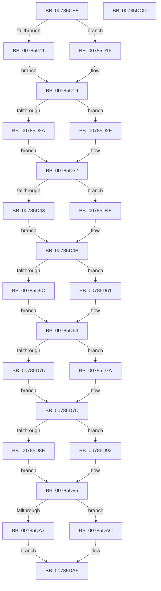

# PspSubtractAccountingValues

- RVA: `0x00785CE8`–`0x00785DCE` (길이 `230` bytes)
- VA: `0x0000000140785CE8`
- 실행 섹션: `PAGE`
- PDB 이름 있음: `예`; PDB Function 태그: `아니요`
- unwind 정보 RVA: `0x000DB714`
- 디코드: `74`개 명령, `230/230` bytes 표시
- 미해석 바이트: `0` (있으면 어셈블리에 `.byte`로 보존)

> 이 문서는 커널 이미지의 기계어와 PDB 기호를 분석해 생성했습니다. 4번과 5번은 함수 원형과 자료형을 바이너리 사용 방식에서 추정한 C 해석이며 원본 소스 복구 결과는 아닙니다.

## 1. Dependencies

- 직접 호출 지점: **0**; 고유 호출 대상: **0**
- 직접 호출자로 확인된 함수: **1**
- RIP 상대 이미지 참조: **0**

### Outgoing calls
- 직접 디코드된 call 명령이 없습니다.

### Direct callers
- [PspRemoveProcessFromJobChain](../90/PspRemoveProcessFromJobChain_function_00907288.md) at `0x0090748D`

### Static image references
- 디코드된 RIP-relative 메모리 참조가 없습니다.

## 2. Other-region calls and transfers

- 다른 실행 섹션으로 향하는 call: **0**
- 별도 외부 분기/꼬리 이동을 확인하지 못했습니다.

## 3. Assembly (complete function range)

```asm
00785CE8  4C 8B 01                        mov r8, qword ptr [rcx]
00785CEB  45 33 DB                        xor r11d, r11d
00785CEE  4C 8B 0A                        mov r9, qword ptr [rdx]
00785CF1  49 8B C0                        mov rax, r8
00785CF4  49 2B C1                        sub rax, r9
00785CF7  4C 8B D1                        mov r10, rcx
00785CFA  4D 3B C8                        cmp r9, r8
00785CFD  49 0F 47 C3                     cmova rax, r11
00785D01  48 89 01                        mov qword ptr [rcx], rax
00785D04  4C 8B 42 08                     mov r8, qword ptr [rdx + 8]
00785D08  48 8B 41 08                     mov rax, qword ptr [rcx + 8]
00785D0C  4C 3B C0                        cmp r8, rax
00785D0F  77 05                           ja 0x140785d16
00785D11  49 2B C0                        sub rax, r8
00785D14  EB 03                           jmp 0x140785d19
00785D16  49 8B C3                        mov rax, r11
00785D19  48 89 41 08                     mov qword ptr [rcx + 8], rax
00785D1D  4C 8B 42 18                     mov r8, qword ptr [rdx + 0x18]
00785D21  48 8B 41 18                     mov rax, qword ptr [rcx + 0x18]
00785D25  4C 3B C0                        cmp r8, rax
00785D28  77 05                           ja 0x140785d2f
00785D2A  49 2B C0                        sub rax, r8
00785D2D  EB 03                           jmp 0x140785d32
00785D2F  49 8B C3                        mov rax, r11
00785D32  48 89 41 18                     mov qword ptr [rcx + 0x18], rax
00785D36  4C 8B 42 28                     mov r8, qword ptr [rdx + 0x28]
00785D3A  48 8B 41 28                     mov rax, qword ptr [rcx + 0x28]
00785D3E  4C 3B C0                        cmp r8, rax
00785D41  7F 05                           jg 0x140785d48
00785D43  49 2B C0                        sub rax, r8
00785D46  EB 03                           jmp 0x140785d4b
00785D48  49 8B C3                        mov rax, r11
00785D4B  48 89 41 28                     mov qword ptr [rcx + 0x28], rax
00785D4F  4C 8B 42 30                     mov r8, qword ptr [rdx + 0x30]
00785D53  48 8B 41 30                     mov rax, qword ptr [rcx + 0x30]
00785D57  4C 3B C0                        cmp r8, rax
00785D5A  7F 05                           jg 0x140785d61
00785D5C  49 2B C0                        sub rax, r8
00785D5F  EB 03                           jmp 0x140785d64
00785D61  49 8B C3                        mov rax, r11
00785D64  48 89 41 30                     mov qword ptr [rcx + 0x30], rax
00785D68  4C 8B 42 38                     mov r8, qword ptr [rdx + 0x38]
00785D6C  48 8B 41 38                     mov rax, qword ptr [rcx + 0x38]
00785D70  4C 3B C0                        cmp r8, rax
00785D73  7F 05                           jg 0x140785d7a
00785D75  49 2B C0                        sub rax, r8
00785D78  EB 03                           jmp 0x140785d7d
00785D7A  49 8B C3                        mov rax, r11
00785D7D  48 89 41 38                     mov qword ptr [rcx + 0x38], rax
00785D81  4C 8B 42 40                     mov r8, qword ptr [rdx + 0x40]
00785D85  48 8B 41 40                     mov rax, qword ptr [rcx + 0x40]
00785D89  4C 3B C0                        cmp r8, rax
00785D8C  7F 05                           jg 0x140785d93
00785D8E  49 2B C0                        sub rax, r8
00785D91  EB 03                           jmp 0x140785d96
00785D93  49 8B C3                        mov rax, r11
00785D96  48 89 41 40                     mov qword ptr [rcx + 0x40], rax
00785D9A  4C 8B 42 48                     mov r8, qword ptr [rdx + 0x48]
00785D9E  48 8B 41 48                     mov rax, qword ptr [rcx + 0x48]
00785DA2  4C 3B C0                        cmp r8, rax
00785DA5  7F 05                           jg 0x140785dac
00785DA7  49 2B C0                        sub rax, r8
00785DAA  EB 03                           jmp 0x140785daf
00785DAC  49 8B C3                        mov rax, r11
00785DAF  48 89 41 48                     mov qword ptr [rcx + 0x48], rax
00785DB3  48 8B 49 50                     mov rcx, qword ptr [rcx + 0x50]
00785DB7  48 8B 52 50                     mov rdx, qword ptr [rdx + 0x50]
00785DBB  48 8B C1                        mov rax, rcx
00785DBE  48 2B C2                        sub rax, rdx
00785DC1  48 3B D1                        cmp rdx, rcx
00785DC4  49 0F 4F C3                     cmovg rax, r11
00785DC8  49 89 42 50                     mov qword ptr [r10 + 0x50], rax
00785DCC  C3                              ret
00785DCD  CC                              int3
```

## 4. C-style interpretation (structured pseudocode)

```c
__int64 __fastcall PspSubtractAccountingValues(__int64 a1, __int64 a2)
{
    __int64 result;
    __int64 v_r11;

    v_r11 = 0;
    result = (*(unsigned __int64 *)(a1)) - (*(unsigned __int64 *)(a2));
    if ((*(unsigned __int64 *)(a2)) > (*(unsigned __int64 *)(a1))) { result = 0; }
    *(unsigned __int64 *)(a1) = result;
    if ((*(unsigned __int64 *)(a2 + 8)) > (*(unsigned __int64 *)(a1 + 8))) goto loc_00785D16;
    result = (*(unsigned __int64 *)(a1 + 8)) - (*(unsigned __int64 *)(a2 + 8));
    goto loc_00785D19;
loc_00785D16:
loc_00785D19:
    *(unsigned __int64 *)(a1 + 8) = 0;
    if ((*(unsigned __int64 *)(a2 + 24)) > (*(unsigned __int64 *)(a1 + 24))) goto loc_00785D2F;
    result = (*(unsigned __int64 *)(a1 + 24)) - (*(unsigned __int64 *)(a2 + 24));
    goto loc_00785D32;
loc_00785D2F:
loc_00785D32:
    *(unsigned __int64 *)(a1 + 24) = 0;
    if ((*(unsigned __int64 *)(a2 + 40)) > (*(unsigned __int64 *)(a1 + 40))) goto loc_00785D48;
    result = (*(unsigned __int64 *)(a1 + 40)) - (*(unsigned __int64 *)(a2 + 40));
    goto loc_00785D4B;
loc_00785D48:
loc_00785D4B:
    *(unsigned __int64 *)(a1 + 40) = 0;
    if ((*(unsigned __int64 *)(a2 + 48)) > (*(unsigned __int64 *)(a1 + 48))) goto loc_00785D61;
    result = (*(unsigned __int64 *)(a1 + 48)) - (*(unsigned __int64 *)(a2 + 48));
    goto loc_00785D64;
loc_00785D61:
loc_00785D64:
    *(unsigned __int64 *)(a1 + 48) = 0;
    if ((*(unsigned __int64 *)(a2 + 56)) > (*(unsigned __int64 *)(a1 + 56))) goto loc_00785D7A;
    result = (*(unsigned __int64 *)(a1 + 56)) - (*(unsigned __int64 *)(a2 + 56));
    goto loc_00785D7D;
loc_00785D7A:
loc_00785D7D:
    *(unsigned __int64 *)(a1 + 56) = 0;
    if ((*(unsigned __int64 *)(a2 + 64)) > (*(unsigned __int64 *)(a1 + 64))) goto loc_00785D93;
    result = (*(unsigned __int64 *)(a1 + 64)) - (*(unsigned __int64 *)(a2 + 64));
    goto loc_00785D96;
loc_00785D93:
loc_00785D96:
    *(unsigned __int64 *)(a1 + 64) = 0;
    if ((*(unsigned __int64 *)(a2 + 72)) > (*(unsigned __int64 *)(a1 + 72))) goto loc_00785DAC;
    result = (*(unsigned __int64 *)(a1 + 72)) - (*(unsigned __int64 *)(a2 + 72));
    goto loc_00785DAF;
loc_00785DAC:
loc_00785DAF:
    *(unsigned __int64 *)(a1 + 72) = 0;
    result = (*(unsigned __int64 *)(a1 + 80)) - (*(unsigned __int64 *)(a2 + 80));
    if ((*(unsigned __int64 *)(a2 + 80)) > (*(unsigned __int64 *)(a1 + 80))) { result = 0; }
    *(unsigned __int64 *)(a1 + 80) = result;
    return result;
}
```

## 5. (Beta) C Style

```c
int64_t PspSubtractAccountingValues(void *Arg1, void *Arg2)
{
    uint8_t *arg1 = (uint8_t *)Arg1;
    uint8_t *arg2 = (uint8_t *)Arg2;

    int64_t result;
    int64_t local_r11;

    local_r11 = 0;
    result = (*(uint64_t *)(arg1)) - (*(uint64_t *)(arg2));
    if ((*(uint64_t *)(arg2)) > (*(uint64_t *)(arg1))) { result = 0; }
    *(uint64_t *)(arg1) = result;
    if ((*(uint64_t *)(arg2 + 0x8)) > (*(uint64_t *)(arg1 + 0x8))) goto loc_00785D16;
    result = (*(uint64_t *)(arg1 + 0x8)) - (*(uint64_t *)(arg2 + 0x8));
    goto loc_00785D19;
loc_00785D16:
loc_00785D19:
    *(uint64_t *)(arg1 + 0x8) = 0;
    if ((*(uint64_t *)(arg2 + 0x18)) > (*(uint64_t *)(arg1 + 0x18))) goto loc_00785D2F;
    result = (*(uint64_t *)(arg1 + 0x18)) - (*(uint64_t *)(arg2 + 0x18));
    goto loc_00785D32;
loc_00785D2F:
loc_00785D32:
    *(uint64_t *)(arg1 + 0x18) = 0;
    if ((*(uint64_t *)(arg2 + 0x28)) > (*(uint64_t *)(arg1 + 0x28))) goto loc_00785D48;
    result = (*(uint64_t *)(arg1 + 0x28)) - (*(uint64_t *)(arg2 + 0x28));
    goto loc_00785D4B;
loc_00785D48:
loc_00785D4B:
    *(uint64_t *)(arg1 + 0x28) = 0;
    if ((*(uint64_t *)(arg2 + 0x30)) > (*(uint64_t *)(arg1 + 0x30))) goto loc_00785D61;
    result = (*(uint64_t *)(arg1 + 0x30)) - (*(uint64_t *)(arg2 + 0x30));
    goto loc_00785D64;
loc_00785D61:
loc_00785D64:
    *(uint64_t *)(arg1 + 0x30) = 0;
    if ((*(uint64_t *)(arg2 + 0x38)) > (*(uint64_t *)(arg1 + 0x38))) goto loc_00785D7A;
    result = (*(uint64_t *)(arg1 + 0x38)) - (*(uint64_t *)(arg2 + 0x38));
    goto loc_00785D7D;
loc_00785D7A:
loc_00785D7D:
    *(uint64_t *)(arg1 + 0x38) = 0;
    if ((*(uint64_t *)(arg2 + 0x40)) > (*(uint64_t *)(arg1 + 0x40))) goto loc_00785D93;
    result = (*(uint64_t *)(arg1 + 0x40)) - (*(uint64_t *)(arg2 + 0x40));
    goto loc_00785D96;
loc_00785D93:
loc_00785D96:
    *(uint64_t *)(arg1 + 0x40) = 0;
    if ((*(uint64_t *)(arg2 + 0x48)) > (*(uint64_t *)(arg1 + 0x48))) goto loc_00785DAC;
    result = (*(uint64_t *)(arg1 + 0x48)) - (*(uint64_t *)(arg2 + 0x48));
    goto loc_00785DAF;
loc_00785DAC:
loc_00785DAF:
    *(uint64_t *)(arg1 + 0x48) = 0;
    result = (*(uint64_t *)(arg1 + 0x50)) - (*(uint64_t *)(arg2 + 0x50));
    if ((*(uint64_t *)(arg2 + 0x50)) > (*(uint64_t *)(arg1 + 0x50))) { result = 0; }
    *(uint64_t *)(arg1 + 0x50) = result;
    return result;
}
```

### 관측된 메모리 오프셋

구조체 형식이 확인되지 않은 접근은 인자 기준의 오프셋으로만 기록했습니다.

| 기준 인자 | 오프셋 표현 | 폭 (bit) | 접근 |
|---|---:|---:|---|
| `Arg1` | `+ 0x0` | `64` | `R` |
| `Arg1` | `+ 0x0` | `64` | `W` |
| `Arg1` | `+ 0x8` | `64` | `R` |
| `Arg1` | `+ 0x8` | `64` | `W` |
| `Arg1` | `+ 0x18` | `64` | `R` |
| `Arg1` | `+ 0x18` | `64` | `W` |
| `Arg1` | `+ 0x28` | `64` | `R` |
| `Arg1` | `+ 0x28` | `64` | `W` |
| `Arg1` | `+ 0x30` | `64` | `R` |
| `Arg1` | `+ 0x30` | `64` | `W` |
| `Arg1` | `+ 0x38` | `64` | `R` |
| `Arg1` | `+ 0x38` | `64` | `W` |
| `Arg1` | `+ 0x40` | `64` | `R` |
| `Arg1` | `+ 0x40` | `64` | `W` |
| `Arg1` | `+ 0x48` | `64` | `R` |
| `Arg1` | `+ 0x48` | `64` | `W` |
| `Arg1` | `+ 0x50` | `64` | `R` |
| `Arg1` | `+ 0x50` | `64` | `W` |
| `Arg2` | `+ 0x0` | `64` | `R` |
| `Arg2` | `+ 0x8` | `64` | `R` |
| `Arg2` | `+ 0x18` | `64` | `R` |
| `Arg2` | `+ 0x28` | `64` | `R` |
| `Arg2` | `+ 0x30` | `64` | `R` |
| `Arg2` | `+ 0x38` | `64` | `R` |
| `Arg2` | `+ 0x40` | `64` | `R` |
| `Arg2` | `+ 0x48` | `64` | `R` |
| `Arg2` | `+ 0x50` | `64` | `R` |

## 6. Execution-region graph

[열기: 2D/3D 그래프와 함수 탐색 컨트롤 패널](../../../control-panel.html?section=page&rva=0x00785CE8&view=graph)

- 2D 그래프는 위에서 아래로 흐르고, 3D 그래프는 빈 공간을 드래그해 회전합니다. Shift+드래그는 이동, 휠은 확대·축소, 함수 노드 선택은 대상 보고서 이동입니다.

### Static fallback


