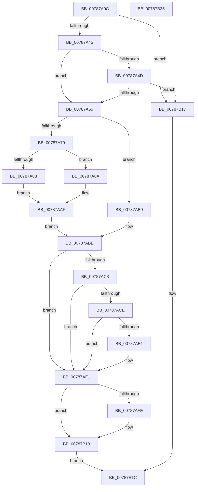

# PspSuspendThread

- RVA: `0x00787A0C`–`0x00787B36` (길이 `298` bytes)
- VA: `0x0000000140787A0C`
- 실행 섹션: `PAGE`
- PDB 이름 있음: `예`; PDB Function 태그: `아니요`
- unwind 정보 RVA: `0x000C683C`
- 디코드: `89`개 명령, `298/298` bytes 표시
- 미해석 바이트: `0` (있으면 어셈블리에 `.byte`로 보존)

> 이 문서는 커널 이미지의 기계어와 PDB 기호를 분석해 생성했습니다. 4번과 5번은 함수 원형과 자료형을 바이너리 사용 방식에서 추정한 C 해석이며 원본 소스 복구 결과는 아닙니다.

## 1. Dependencies

- 직접 호출 지점: **8**; 고유 호출 대상: **7**
- 직접 호출자로 확인된 함수: **2**
- RIP 상대 이미지 참조: **0**

### Outgoing calls
- `0x00787A70` → [ExAcquireRundownProtection](../../text/21/ExAcquireRundownProtection_function_00216620.md) (function, `0x00216620`)
- `0x00787AA2` → [KeSuspendThread](../../text/4E/KeSuspendThread_function_004E8B9C.md) (function, `0x004E8B9C`)
- `0x00787AB2` → [ExReleaseRundownProtection](../../text/34/ExReleaseRundownProtection_function_00349E80.md) (function, `0x00349E80`)
- `0x00787AEC` → [EtwTiLogSuspendResumeThread](../A3/EtwTiLogSuspendResumeThread_function_00A34DE0.md) (function, `0x00A34DE0`)
- `0x00787AF4` → [KiLeaveCriticalRegionUnsafe](../../text/25/KiLeaveCriticalRegionUnsafe_function_0025F010.md) (function, `0x0025F010`)
- `0x00787B00` → [KeSetKernelStackSwapEnable](../../text/45/KeSetKernelStackSwapEnable_function_00450760.md) (function, `0x00450760`)
- `0x00787B07` → [KeWaitForSynchronousSuspend](../../text/5B/KeWaitForSynchronousSuspend_function_005B9120.md) (function, `0x005B9120`)
- `0x00787B0E` → [KeSetKernelStackSwapEnable](../../text/45/KeSetKernelStackSwapEnable_function_00450760.md) (function, `0x00450760`)

### Direct callers
- [PsSuspendThread](../A1/PsSuspendThread_function_00A110D0.md) at `0x00A110FF`
- [NtChangeThreadState](../AE/NtChangeThreadState_function_00AEA210.md) at `0x00AEA4C9`

### Static image references
- 디코드된 RIP-relative 메모리 참조가 없습니다.

## 2. Other-region calls and transfers

- 다른 실행 섹션으로 향하는 call: **7**
  - `0x00787A70` → [ExAcquireRundownProtection](../../text/21/ExAcquireRundownProtection_function_00216620.md) (`PAGE` → `.text`)
  - `0x00787AA2` → [KeSuspendThread](../../text/4E/KeSuspendThread_function_004E8B9C.md) (`PAGE` → `.text`)
  - `0x00787AB2` → [ExReleaseRundownProtection](../../text/34/ExReleaseRundownProtection_function_00349E80.md) (`PAGE` → `.text`)
  - `0x00787AF4` → [KiLeaveCriticalRegionUnsafe](../../text/25/KiLeaveCriticalRegionUnsafe_function_0025F010.md) (`PAGE` → `.text`)
  - `0x00787B00` → [KeSetKernelStackSwapEnable](../../text/45/KeSetKernelStackSwapEnable_function_00450760.md) (`PAGE` → `.text`)
  - `0x00787B07` → [KeWaitForSynchronousSuspend](../../text/5B/KeWaitForSynchronousSuspend_function_005B9120.md) (`PAGE` → `.text`)
  - `0x00787B0E` → [KeSetKernelStackSwapEnable](../../text/45/KeSetKernelStackSwapEnable_function_00450760.md) (`PAGE` → `.text`)
- 별도 외부 분기/꼬리 이동을 확인하지 못했습니다.

## 3. Assembly (complete function range)

```asm
00787A0C  48 8B C4                        mov rax, rsp
00787A0F  48 89 58 08                     mov qword ptr [rax + 8], rbx
00787A13  48 89 68 18                     mov qword ptr [rax + 0x18], rbp
00787A17  56                              push rsi
00787A18  57                              push rdi
00787A19  41 54                           push r12
00787A1B  41 56                           push r14
00787A1D  41 57                           push r15
00787A1F  48 83 EC 40                     sub rsp, 0x40
00787A23  45 33 E4                        xor r12d, r12d
00787A26  4D 8B F1                        mov r14, r9
00787A29  44 89 60 C8                     mov dword ptr [rax - 0x38], r12d
00787A2D  8B DA                           mov ebx, edx
00787A2F  44 88 60 10                     mov byte ptr [rax + 0x10], r12b
00787A33  48 8B F9                        mov rdi, rcx
00787A36  41 8B EC                        mov ebp, r12d
00787A39  F7 C2 FE FF FF FF               test edx, 0xfffffffe
00787A3F  0F 85 D2 00 00 00               jne 0x140787b17
00787A45  83 E3 01                        and ebx, 1
00787A48  4D 85 C0                        test r8, r8
00787A4B  74 08                           je 0x140787a55
00787A4D  85 DB                           test ebx, ebx
00787A4F  0F 84 C2 00 00 00               je 0x140787b17
00787A55  65 48 8B 34 25 88 01 00 00      mov rsi, qword ptr gs:[0x188]
00787A5E  4C 8D B9 88 05 00 00            lea r15, [rcx + 0x588]
00787A65  49 8B CF                        mov rcx, r15
00787A68  66 FF 8E E4 01 00 00            dec word ptr [rsi + 0x1e4]
00787A6F  90                              nop
00787A70  E8 AB EB A8 FF                  call 0x140216620
00787A75  84 C0                           test al, al
00787A77  74 40                           je 0x140787ab9
00787A79  8B 87 A0 05 00 00               mov eax, dword ptr [rdi + 0x5a0]
00787A7F  A8 01                           test al, 1
00787A81  74 07                           je 0x140787a8a
00787A83  BB 4B 00 00 C0                  mov ebx, 0xc000004b
00787A88  EB 25                           jmp 0x140787aaf
00787A8A  48 8D 44 24 78                  lea rax, [rsp + 0x78]
00787A8F  F7 DB                           neg ebx
00787A91  4C 8D 44 24 30                  lea r8, [rsp + 0x30]
00787A96  48 8B CF                        mov rcx, rdi
00787A99  48 1B ED                        sbb rbp, rbp
00787A9C  48 23 E8                        and rbp, rax
00787A9F  48 8B D5                        mov rdx, rbp
00787AA2  E8 F5 10 D6 FF                  call 0x1404e8b9c
00787AA7  85 C0                           test eax, eax
00787AA9  8B D8                           mov ebx, eax
00787AAB  49 0F 48 EC                     cmovs rbp, r12
00787AAF  49 8B CF                        mov rcx, r15
00787AB2  E8 C9 23 BC FF                  call 0x140349e80
00787AB7  EB 05                           jmp 0x140787abe
00787AB9  BB 4B 00 00 C0                  mov ebx, 0xc000004b
00787ABE  4D 85 F6                        test r14, r14
00787AC1  74 2E                           je 0x140787af1
00787AC3  8B 44 24 30                     mov eax, dword ptr [rsp + 0x30]
00787AC7  41 89 06                        mov dword ptr [r14], eax
00787ACA  85 C0                           test eax, eax
00787ACC  75 23                           jne 0x140787af1
00787ACE  48 8B 87 20 02 00 00            mov rax, qword ptr [rdi + 0x220]
00787AD5  F7 80 FC 05 00 00 00 00 10 00   test dword ptr [rax + 0x5fc], 0x100000
00787ADF  74 10                           je 0x140787af1
00787AE1  41 B1 01                        mov r9b, 1
00787AE4  4C 8B C7                        mov r8, rdi
00787AE7  48 8B D6                        mov rdx, rsi
00787AEA  8B CB                           mov ecx, ebx
00787AEC  E8 EF D2 2A 00                  call 0x140a34de0
00787AF1  48 8B CE                        mov rcx, rsi
00787AF4  E8 17 75 AD FF                  call 0x14025f010
00787AF9  48 85 ED                        test rbp, rbp
00787AFC  74 15                           je 0x140787b13
00787AFE  33 C9                           xor ecx, ecx
00787B00  E8 5B 8C CC FF                  call 0x140450760
00787B05  8A C8                           mov cl, al
00787B07  E8 14 16 E3 FF                  call 0x1405b9120
00787B0C  8B D8                           mov ebx, eax
00787B0E  E8 4D 8C CC FF                  call 0x140450760
00787B13  8B C3                           mov eax, ebx
00787B15  EB 05                           jmp 0x140787b1c
00787B17  B8 0D 00 00 C0                  mov eax, 0xc000000d
00787B1C  4C 8D 5C 24 40                  lea r11, [rsp + 0x40]
00787B21  49 8B 5B 30                     mov rbx, qword ptr [r11 + 0x30]
00787B25  49 8B 6B 40                     mov rbp, qword ptr [r11 + 0x40]
00787B29  49 8B E3                        mov rsp, r11
00787B2C  41 5F                           pop r15
00787B2E  41 5E                           pop r14
00787B30  41 5C                           pop r12
00787B32  5F                              pop rdi
00787B33  5E                              pop rsi
00787B34  C3                              ret
00787B35  CC                              int3
```

## 4. C-style interpretation (structured pseudocode)

```c
__int64 __fastcall PspSuspendThread(__int64 a1, int a2, __int64 a3, __int64 a4)
{
    __int64 result;
    __int64 v_r12;
    __int64 v_rbp;
    __int64 v_rbx;
    __int64 v_rsp;
    unsigned __int64 v_stack_m28;
    unsigned __int64 v_stack_m38;
    unsigned __int64 v_stack_p10;

    *(unsigned __int64 *)(v_rsp + 8) = v_rbx;
    *(unsigned __int64 *)(v_rsp + 24) = v_rbp;
    v_rsp = (v_rsp) - (64);
    v_r12 = 0;
    *(unsigned int *)(v_rsp - 56) = 0;
    *(unsigned __int8 *)(v_rsp + 16) = 0;
    if (((a2) & (0xFFFFFFFEULL)) != 0) goto loc_00787B17;
    v_rbx = (unsigned int)(((unsigned int)(a2)) & (1));
    if (a3 == 0) goto loc_00787A55;
    if ((unsigned int)(v_rbx) == 0) goto loc_00787B17;
loc_00787A55:
    result = ExAcquireRundownProtection(a1 + 1416, a2, a3, a4);
    if ((unsigned __int8)(result) == 0) goto loc_00787AB9;
    if ((((unsigned __int8)((unsigned int)(*(unsigned int *)(a1 + 1440)))) & (1)) == 0) goto loc_00787A8A;
    goto loc_00787AAF;
loc_00787A8A:
    v_rbx = (unsigned int)(-((unsigned int)(0xC000004BULL)));
    v_rbp = (0) & (v_stack_p10);
    result = KeSuspendThread(a1, v_rbp, v_stack_m38, a4);
    if (sign_flag) { v_rbp = 0; }
loc_00787AAF:
    result = ExReleaseRundownProtection(a1 + 1416, v_rbp, v_stack_m38, a4);
    goto loc_00787ABE;
loc_00787AB9:
loc_00787ABE:
    if (a4 == 0) goto loc_00787AF1;
    *(unsigned int *)(a4) = (unsigned int)((unsigned int)(v_stack_m38));
    if ((unsigned int)((unsigned int)(v_stack_m38)) != 0) goto loc_00787AF1;
    result = *(unsigned __int64 *)(a1 + 544);
    if (((*(unsigned int *)(*(unsigned __int64 *)(a1 + 544) + 1532)) & (0x100000ULL)) != 0) {
        a4 = 1;
        a3 = a1;
        a2 = *(unsigned __int64 *)(gs_base + (0 + 392));
        a1 = (unsigned int)((unsigned int)(0xC000004BULL));
        result = EtwTiLogSuspendResumeThread(a1, a2, a3, a4);
    }
    result = KiLeaveCriticalRegionUnsafe(*(unsigned __int64 *)(gs_base + (0 + 392)), a2, a3, a4);
    v_rbx = (unsigned int)(0xC000004BULL);
    if (v_rbp != 0) {
        a1 = 0;
        result = KeSetKernelStackSwapEnable(a1, a2, a3, a4);
        a1 = (unsigned __int8)(result);
        result = KeWaitForSynchronousSuspend(a1, a2, a3, a4);
        v_rbx = (unsigned int)(result);
        result = KeSetKernelStackSwapEnable(a1, a2, a3, a4);
    }
    goto loc_00787B1C;
loc_00787B17:
loc_00787B1C:
    return (unsigned int)(0xC000000DULL);
}
```

## 5. (Beta) C Style

```c
int64_t PspSuspendThread(void *Arg1, int32_t Arg2, int64_t Arg3, int64_t Arg4)
{
    uint8_t *arg1 = (uint8_t *)Arg1;

    int64_t result;
    int64_t local_r12;
    int64_t local_rbp;
    int64_t local_rbx;
    int64_t local_rsp;
    uint64_t v_stack_m28;
    uint64_t v_stack_m38;
    uint64_t v_stack_p10;

    *(uint64_t *)(local_rsp + 0x8) = local_rbx;
    *(uint64_t *)(local_rsp + 0x18) = local_rbp;
    local_rsp = (local_rsp) - (64);
    local_r12 = 0;
    *(uint32_t *)(local_rsp - 0x38) = 0;
    *(uint8_t *)(local_rsp + 0x10) = 0;
    if (((Arg2) & (0xFFFFFFFEULL)) != 0) goto loc_00787B17;
    local_rbx = (uint32_t)(((uint32_t)(Arg2)) & (1));
    if (Arg3 == 0) goto loc_00787A55;
    if ((uint32_t)(local_rbx) == 0) goto loc_00787B17;
loc_00787A55:
    result = ExAcquireRundownProtection(Arg1 + 1416, Arg2, Arg3, Arg4);
    if ((uint8_t)(result) == 0) goto loc_00787AB9;
    if ((((uint8_t)((uint32_t)(*(uint32_t *)(arg1 + 0x5A0)))) & (1)) == 0) goto loc_00787A8A;
    goto loc_00787AAF;
loc_00787A8A:
    local_rbx = (uint32_t)(-((uint32_t)(0xC000004BULL)));
    local_rbp = (0) & (v_stack_p10);
    result = KeSuspendThread(Arg1, local_rbp, v_stack_m38, Arg4);
    if (sign_flag) { local_rbp = 0; }
loc_00787AAF:
    result = ExReleaseRundownProtection(Arg1 + 1416, local_rbp, v_stack_m38, Arg4);
    goto loc_00787ABE;
loc_00787AB9:
loc_00787ABE:
    if (Arg4 == 0) goto loc_00787AF1;
    *(uint32_t *)(Arg4) = (uint32_t)((uint32_t)(v_stack_m38));
    if ((uint32_t)((uint32_t)(v_stack_m38)) != 0) goto loc_00787AF1;
    result = *(uint64_t *)(arg1 + 0x220);
    if (((*(uint32_t *)(*(uint64_t *)(arg1 + 0x220) + 0x5FC)) & (0x100000ULL)) != 0) {
        Arg4 = 1;
        Arg3 = Arg1;
        Arg2 = *(uint64_t *)(gs_base + (0 + 0x188));
        Arg1 = (uint32_t)((uint32_t)(0xC000004BULL));
        result = EtwTiLogSuspendResumeThread(Arg1, Arg2, Arg3, Arg4);
    }
    result = KiLeaveCriticalRegionUnsafe(*(uint64_t *)(gs_base + (0 + 0x188)), Arg2, Arg3, Arg4);
    local_rbx = (uint32_t)(0xC000004BULL);
    if (local_rbp != 0) {
        Arg1 = 0;
        result = KeSetKernelStackSwapEnable(Arg1, Arg2, Arg3, Arg4);
        Arg1 = (uint8_t)(result);
        result = KeWaitForSynchronousSuspend(Arg1, Arg2, Arg3, Arg4);
        local_rbx = (uint32_t)(result);
        result = KeSetKernelStackSwapEnable(Arg1, Arg2, Arg3, Arg4);
    }
    goto loc_00787B1C;
loc_00787B17:
loc_00787B1C:
    return (uint32_t)(0xC000000DULL);
}
```

### 관측된 메모리 오프셋

구조체 형식이 확인되지 않은 접근은 인자 기준의 오프셋으로만 기록했습니다.

| 기준 인자 | 오프셋 표현 | 폭 (bit) | 접근 |
|---|---:|---:|---|
| `Arg1` | `+ 0x220` | `64` | `R` |
| `Arg1` | `+ 0x588` | `64` | `R` |
| `Arg1` | `+ 0x5A0` | `32` | `R` |

## 6. Execution-region graph

[열기: 2D/3D 그래프와 함수 탐색 컨트롤 패널](../../../control-panel.html?section=page&rva=0x00787A0C&view=graph)

- 2D 그래프는 위에서 아래로 흐르고, 3D 그래프는 빈 공간을 드래그해 회전합니다. Shift+드래그는 이동, 휠은 확대·축소, 함수 노드 선택은 대상 보고서 이동입니다.

### Static fallback


