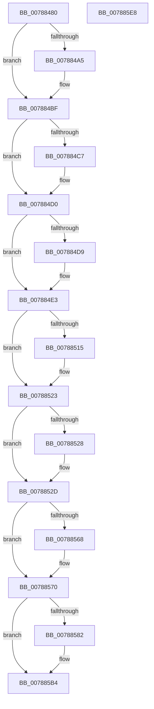

# PspTeardownPartition

- RVA: `0x00788480`–`0x007885E9` (길이 `361` bytes)
- VA: `0x0000000140788480`
- 실행 섹션: `PAGE`
- PDB 이름 있음: `예`; PDB Function 태그: `아니요`
- unwind 정보 RVA: `0x000CF454`
- 디코드: `95`개 명령, `361/361` bytes 표시
- 미해석 바이트: `0` (있으면 어셈블리에 `.byte`로 보존)

> 이 문서는 커널 이미지의 기계어와 PDB 기호를 분석해 생성했습니다. 4번과 5번은 함수 원형과 자료형을 바이너리 사용 방식에서 추정한 C 해석이며 원본 소스 복구 결과는 아닙니다.

## 1. Dependencies

- 직접 호출 지점: **14**; 고유 호출 대상: **14**
- 직접 호출자로 확인된 함수: **0**
- RIP 상대 이미지 참조: **2**

### Outgoing calls
- `0x007884B9` → [KeBugCheckEx](../../text/4F/KeBugCheckEx_function_004FD660.md) (function, `0x004FD660`)
- `0x007884C7` → [MiDeletePartition](../7F/MiDeletePartition_function_007FD2BC.md) (function, `0x007FD2BC`)
- `0x007884D9` → [ExpPartitionDestroy](../7C/ExpPartitionDestroy_function_007CF9B8.md) (function, `0x007CF9B8`)
- `0x00788504` → [KeAbPreAcquire](../../text/21/KeAbPreAcquire_function_00210230.md) (function, `0x00210230`)
- `0x0078851E` → [ExfAcquirePushLockExclusiveEx](../../text/20/ExfAcquirePushLockExclusiveEx_function_0020FC90.md) (function, `0x0020FC90`)
- `0x0078856B` → [ExfTryToWakePushLock](../../text/26/ExfTryToWakePushLock_function_00265DD0.md) (function, `0x00265DD0`)
- `0x00788573` → [KeAbPostRelease](../../text/2E/KeAbPostRelease_function_002E1600.md) (function, `0x002E1600`)
- `0x00788578` → [KeLeaveCriticalRegion](../../text/25/KeLeaveCriticalRegion_function_0025D8B0.md) (function, `0x0025D8B0`)
- `0x00788587` → [PsTerminateMinimalProcess](PsTerminateMinimalProcess_function_007861A8.md) (function, `0x007861A8`)
- `0x0078859D` → [KeWaitForSingleObject](../../text/20/KeWaitForSingleObject_function_0020E6B0.md) (function, `0x0020E6B0`)
- `0x007885A5` → [ObfDereferenceObject](../../text/2F/ObfDereferenceObject_function_002F9350.md) (function, `0x002F9350`)
- `0x007885AF` → [ObCloseHandle](../8A/ObCloseHandle_function_008A1870.md) (function, `0x008A1870`)
- `0x007885BC` → [PsDereferencePartition](../../text/34/PsDereferencePartition_function_00342E70.md) (function, `0x00342E70`)
- `0x007885C9` → [ObfDereferenceObjectWithTag](../../text/2F/ObfDereferenceObjectWithTag_function_002F78E0.md) (function, `0x002F78E0`)

### Direct callers
- 이 함수 시작 RVA로 연결되는 직접 call은 확인되지 않았습니다. 간접 호출은 완전히 역산할 수 없습니다.

### Static image references
- `0x00788499` → RVA `0x00FC6EA0` (`ALMOSTRO`; read)
- `0x0078852D` → RVA `0x00FC6C08` (`ALMOSTRO`; read)

## 2. Other-region calls and transfers

- 다른 실행 섹션으로 향하는 call: **10**
  - `0x007884B9` → [KeBugCheckEx](../../text/4F/KeBugCheckEx_function_004FD660.md) (`PAGE` → `.text`)
  - `0x00788504` → [KeAbPreAcquire](../../text/21/KeAbPreAcquire_function_00210230.md) (`PAGE` → `.text`)
  - `0x0078851E` → [ExfAcquirePushLockExclusiveEx](../../text/20/ExfAcquirePushLockExclusiveEx_function_0020FC90.md) (`PAGE` → `.text`)
  - `0x0078856B` → [ExfTryToWakePushLock](../../text/26/ExfTryToWakePushLock_function_00265DD0.md) (`PAGE` → `.text`)
  - `0x00788573` → [KeAbPostRelease](../../text/2E/KeAbPostRelease_function_002E1600.md) (`PAGE` → `.text`)
  - `0x00788578` → [KeLeaveCriticalRegion](../../text/25/KeLeaveCriticalRegion_function_0025D8B0.md) (`PAGE` → `.text`)
  - `0x0078859D` → [KeWaitForSingleObject](../../text/20/KeWaitForSingleObject_function_0020E6B0.md) (`PAGE` → `.text`)
  - `0x007885A5` → [ObfDereferenceObject](../../text/2F/ObfDereferenceObject_function_002F9350.md) (`PAGE` → `.text`)
  - `0x007885BC` → [PsDereferencePartition](../../text/34/PsDereferencePartition_function_00342E70.md) (`PAGE` → `.text`)
  - `0x007885C9` → [ObfDereferenceObjectWithTag](../../text/2F/ObfDereferenceObjectWithTag_function_002F78E0.md) (`PAGE` → `.text`)
- 별도 외부 분기/꼬리 이동을 확인하지 못했습니다.

## 3. Assembly (complete function range)

```asm
00788480  48 8B C4                        mov rax, rsp
00788483  48 89 58 08                     mov qword ptr [rax + 8], rbx
00788487  48 89 68 10                     mov qword ptr [rax + 0x10], rbp
0078848B  48 89 78 18                     mov qword ptr [rax + 0x18], rdi
0078848F  41 54                           push r12
00788491  41 56                           push r14
00788493  41 57                           push r15
00788495  48 83 EC 30                     sub rsp, 0x30
00788499  48 3B 0D 00 EA 83 00            cmp rcx, qword ptr [rip + 0x83ea00]
007884A0  48 8B F9                        mov rdi, rcx
007884A3  75 1A                           jne 0x1407884bf
007884A5  48 83 60 D8 00                  and qword ptr [rax - 0x28], 0
007884AA  45 33 C9                        xor r9d, r9d
007884AD  4C 8B C1                        mov r8, rcx
007884B0  B9 8E 01 00 00                  mov ecx, 0x18e
007884B5  41 8D 51 01                     lea edx, [r9 + 1]
007884B9  E8 A2 51 D7 FF                  call 0x1404fd660
007884BE  CC                              int3
007884BF  48 8B 09                        mov rcx, qword ptr [rcx]
007884C2  48 85 C9                        test rcx, rcx
007884C5  74 09                           je 0x1407884d0
007884C7  E8 F0 4D 07 00                  call 0x1407fd2bc
007884CC  48 83 27 00                     and qword ptr [rdi], 0
007884D0  48 8B 4F 10                     mov rcx, qword ptr [rdi + 0x10]
007884D4  48 85 C9                        test rcx, rcx
007884D7  74 0A                           je 0x1407884e3
007884D9  E8 DA 74 04 00                  call 0x1407cf9b8
007884DE  48 83 67 10 00                  and qword ptr [rdi + 0x10], 0
007884E3  65 48 8B 04 25 88 01 00 00      mov rax, qword ptr gs:[0x188]
007884EC  48 8D 6F 70                     lea rbp, [rdi + 0x70]
007884F0  48 83 CB FF                     or rbx, 0xffffffffffffffff
007884F4  45 33 C0                        xor r8d, r8d
007884F7  33 D2                           xor edx, edx
007884F9  48 8B CD                        mov rcx, rbp
007884FC  66 01 98 E4 01 00 00            add word ptr [rax + 0x1e4], bx
00788503  90                              nop
00788504  E8 27 7D A8 FF                  call 0x140210230
00788509  F0 48 0F BA 6D 00 00            lock bts qword ptr [rbp], 0
00788510  4C 8B F0                        mov r14, rax
00788513  73 0E                           jae 0x140788523
00788515  4C 8B C5                        mov r8, rbp
00788518  48 8B D0                        mov rdx, rax
0078851B  48 8B CD                        mov rcx, rbp
0078851E  E8 6D 77 A8 FF                  call 0x14020fc90
00788523  4D 85 F6                        test r14, r14
00788526  74 05                           je 0x14078852d
00788528  41 C6 46 0A 01                  mov byte ptr [r14 + 0xa], 1
0078852D  48 8B 05 D4 E6 83 00            mov rax, qword ptr [rip + 0x83e6d4]
00788534  4C 8B 7F 48                     mov r15, qword ptr [rdi + 0x48]
00788538  4C 8B 77 78                     mov r14, qword ptr [rdi + 0x78]
0078853C  4C 8B A7 80 00 00 00            mov r12, qword ptr [rdi + 0x80]
00788543  48 89 47 48                     mov qword ptr [rdi + 0x48], rax
00788547  48 8B 05 BA E6 83 00            mov rax, qword ptr [rip + 0x83e6ba]
0078854E  48 83 A7 80 00 00 00 00         and qword ptr [rdi + 0x80], 0
00788556  48 89 47 78                     mov qword ptr [rdi + 0x78], rax
0078855A  F0 48 0F C1 5D 00               lock xadd qword ptr [rbp], rbx
00788560  80 E3 06                        and bl, 6
00788563  80 FB 02                        cmp bl, 2
00788566  75 08                           jne 0x140788570
00788568  48 8B CD                        mov rcx, rbp
0078856B  E8 60 D8 AD FF                  call 0x140265dd0
00788570  48 8B CD                        mov rcx, rbp
00788573  E8 88 90 B5 FF                  call 0x1402e1600
00788578  E8 33 53 AD FF                  call 0x14025d8b0
0078857D  4D 85 F6                        test r14, r14
00788580  74 32                           je 0x1407885b4
00788582  33 D2                           xor edx, edx
00788584  49 8B CE                        mov rcx, r14
00788587  E8 1C DC FF FF                  call 0x1407861a8
0078858C  48 83 64 24 20 00               and qword ptr [rsp + 0x20], 0
00788592  45 33 C9                        xor r9d, r9d
00788595  45 33 C0                        xor r8d, r8d
00788598  33 D2                           xor edx, edx
0078859A  49 8B CE                        mov rcx, r14
0078859D  E8 0E 61 A8 FF                  call 0x14020e6b0
007885A2  49 8B CE                        mov rcx, r14
007885A5  E8 A6 0D B7 FF                  call 0x1402f9350
007885AA  33 D2                           xor edx, edx
007885AC  49 8B CC                        mov rcx, r12
007885AF  E8 BC 92 11 00                  call 0x1408a1870
007885B4  BA 50 73 50 61                  mov edx, 0x61507350
007885B9  49 8B CF                        mov rcx, r15
007885BC  E8 AF A8 BB FF                  call 0x140342e70
007885C1  BA 48 61 72 64                  mov edx, 0x64726148
007885C6  48 8B CF                        mov rcx, rdi
007885C9  E8 12 F3 B6 FF                  call 0x1402f78e0
007885CE  48 8B 5C 24 50                  mov rbx, qword ptr [rsp + 0x50]
007885D3  48 8B 6C 24 58                  mov rbp, qword ptr [rsp + 0x58]
007885D8  48 8B 7C 24 60                  mov rdi, qword ptr [rsp + 0x60]
007885DD  48 83 C4 30                     add rsp, 0x30
007885E1  41 5F                           pop r15
007885E3  41 5E                           pop r14
007885E5  41 5C                           pop r12
007885E7  C3                              ret
007885E8  CC                              int3
```

## 4. C-style interpretation (structured pseudocode)

```c
__int64 __fastcall PspTeardownPartition(__int64 a1, __int64 a2, __int64 a3, int a4)
{
    __int64 result;
    __int64 v_rbx;
    __int64 v_rsp;
    unsigned __int64 v_stack_m28;
    unsigned __int64 v_stack_p10;
    unsigned __int64 v_stack_p18;
    unsigned __int64 v_stack_p8;

    *(unsigned __int64 *)(v_rsp + 8) = v_rbx;
    *(unsigned __int64 *)(v_rsp + 16) = v_rbp;
    *(unsigned __int64 *)(v_rsp + 24) = v_rdi;
    v_rsp = (v_rsp) - (48);
    result = v_rsp;
    if (a1 == (*(unsigned __int64 *)(v_rip + 8645120))) {
        a4 = 0;
        a3 = a1;
        a1 = 398;
        a2 = a4 + 1;
        result = KeBugCheckEx(a1, a2, a3, a4);
    }
    if (*(unsigned __int64 *)(a1) != 0) {
        result = MiDeletePartition(*(unsigned __int64 *)(a1), a2, a3, a4);
    }
    if (*(unsigned __int64 *)(a1 + 16) != 0) {
        result = ExpPartitionDestroy(*(unsigned __int64 *)(a1 + 16), a2, a3, a4);
    }
    v_rbx = (v_rbx) | (-1);
    a3 = 0;
    a2 = 0;
    result = KeAbPreAcquire(a1 + 112, a2, a3, a4);
    if (!(condition_is_above_or_equal)) {
        a3 = a1 + 112;
        a2 = result;
        a1 = a1 + 112;
        result = ExfAcquirePushLockExclusiveEx(a1, a2, a3, a4);
    }
    if (result != 0) {
        *(unsigned __int8 *)(result + 10) = 1;
    }
    *(unsigned __int64 *)(a1 + 72) = *(unsigned __int64 *)(v_rip + 8644308);
    *(unsigned __int64 *)(a1 + 120) = *(unsigned __int64 *)(v_rip + 8644282);
    v_rbx = (unsigned __int8)((v_rbx) & (6));
    result = *(unsigned __int64 *)(v_rip + 8644282);
    if (((unsigned __int8)(v_rbx)) == 2) {
        a1 = a1 + 112;
        result = ExfTryToWakePushLock(a1, a2, a3, a4);
    }
    result = KeAbPostRelease(a1 + 112, a2, a3, a4);
    result = KeLeaveCriticalRegion(a1 + 112, a2, a3, a4);
    if (*(unsigned __int64 *)(a1 + 120) != 0) {
        a2 = 0;
        a1 = *(unsigned __int64 *)(a1 + 120);
        result = PsTerminateMinimalProcess(a1, a2, a3, a4);
        a4 = 0;
        a3 = 0;
        a2 = 0;
        a1 = *(unsigned __int64 *)(a1 + 120);
        result = KeWaitForSingleObject(a1, a2, a3, a4);
        a1 = *(unsigned __int64 *)(a1 + 120);
        result = ObfDereferenceObject(a1, a2, a3, a4);
        a2 = 0;
        a1 = *(unsigned __int64 *)(a1 + 128);
        result = ObCloseHandle(a1, a2, a3, a4);
    }
    result = PsDereferencePartition(*(unsigned __int64 *)(a1 + 72), (unsigned int)(0x61507350ULL), a3, a4);
    result = ObfDereferenceObjectWithTag(a1, (unsigned int)(0x64726148ULL), a3, a4);
    v_rsp = (v_rsp) + (48);
    return result;
}
```

## 5. (Beta) C Style

```c
int64_t PspTeardownPartition(int64_t Arg1, int64_t Arg2, int64_t Arg3, int32_t Arg4)
{
    int64_t result;
    int64_t local_rbx;
    int64_t local_rsp;
    uint64_t v_stack_m28;
    uint64_t v_stack_p10;
    uint64_t v_stack_p18;
    uint64_t v_stack_p8;

    *(uint64_t *)(local_rsp + 0x8) = local_rbx;
    *(uint64_t *)(local_rsp + 0x10) = local_rbp;
    *(uint64_t *)(local_rsp + 0x18) = local_rdi;
    local_rsp = (local_rsp) - (48);
    result = local_rsp;
    if (Arg1 == (*(uint64_t *)(v_rip + 0x83EA00))) {
        Arg4 = 0;
        Arg3 = Arg1;
        Arg1 = 398;
        Arg2 = Arg4 + 1;
        result = KeBugCheckEx(Arg1, Arg2, Arg3, Arg4);
    }
    if (*(uint64_t *)(Arg1) != 0) {
        result = MiDeletePartition(*(uint64_t *)(Arg1), Arg2, Arg3, Arg4);
    }
    if (*(uint64_t *)(Arg1 + 0x10) != 0) {
        result = ExpPartitionDestroy(*(uint64_t *)(Arg1 + 0x10), Arg2, Arg3, Arg4);
    }
    local_rbx = (local_rbx) | (-1);
    Arg3 = 0;
    Arg2 = 0;
    result = KeAbPreAcquire(Arg1 + 112, Arg2, Arg3, Arg4);
    if (!(condition_is_above_or_equal)) {
        Arg3 = Arg1 + 112;
        Arg2 = result;
        Arg1 = Arg1 + 112;
        result = ExfAcquirePushLockExclusiveEx(Arg1, Arg2, Arg3, Arg4);
    }
    if (result != 0) {
        *(uint8_t *)(result + 0xA) = 1;
    }
    *(uint64_t *)(Arg1 + 0x48) = *(uint64_t *)(v_rip + 0x83E6D4);
    *(uint64_t *)(Arg1 + 0x78) = *(uint64_t *)(v_rip + 0x83E6BA);
    local_rbx = (uint8_t)((local_rbx) & (6));
    result = *(uint64_t *)(v_rip + 0x83E6BA);
    if (((uint8_t)(local_rbx)) == 2) {
        Arg1 = Arg1 + 112;
        result = ExfTryToWakePushLock(Arg1, Arg2, Arg3, Arg4);
    }
    result = KeAbPostRelease(Arg1 + 112, Arg2, Arg3, Arg4);
    result = KeLeaveCriticalRegion(Arg1 + 112, Arg2, Arg3, Arg4);
    if (*(uint64_t *)(Arg1 + 0x78) != 0) {
        Arg2 = 0;
        Arg1 = *(uint64_t *)(Arg1 + 0x78);
        result = PsTerminateMinimalProcess(Arg1, Arg2, Arg3, Arg4);
        Arg4 = 0;
        Arg3 = 0;
        Arg2 = 0;
        Arg1 = *(uint64_t *)(Arg1 + 0x78);
        result = KeWaitForSingleObject(Arg1, Arg2, Arg3, Arg4);
        Arg1 = *(uint64_t *)(Arg1 + 0x78);
        result = ObfDereferenceObject(Arg1, Arg2, Arg3, Arg4);
        Arg2 = 0;
        Arg1 = *(uint64_t *)(Arg1 + 0x80);
        result = ObCloseHandle(Arg1, Arg2, Arg3, Arg4);
    }
    result = PsDereferencePartition(*(uint64_t *)(Arg1 + 0x48), (uint32_t)(0x61507350ULL), Arg3, Arg4);
    result = ObfDereferenceObjectWithTag(Arg1, (uint32_t)(0x64726148ULL), Arg3, Arg4);
    local_rsp = (local_rsp) + (48);
    return result;
}
```

## 6. Execution-region graph

[열기: 2D/3D 그래프와 함수 탐색 컨트롤 패널](../../../control-panel.html?section=page&rva=0x00788480&view=graph)

- 2D 그래프는 위에서 아래로 흐르고, 3D 그래프는 빈 공간을 드래그해 회전합니다. Shift+드래그는 이동, 휠은 확대·축소, 함수 노드 선택은 대상 보고서 이동입니다.

### Static fallback


