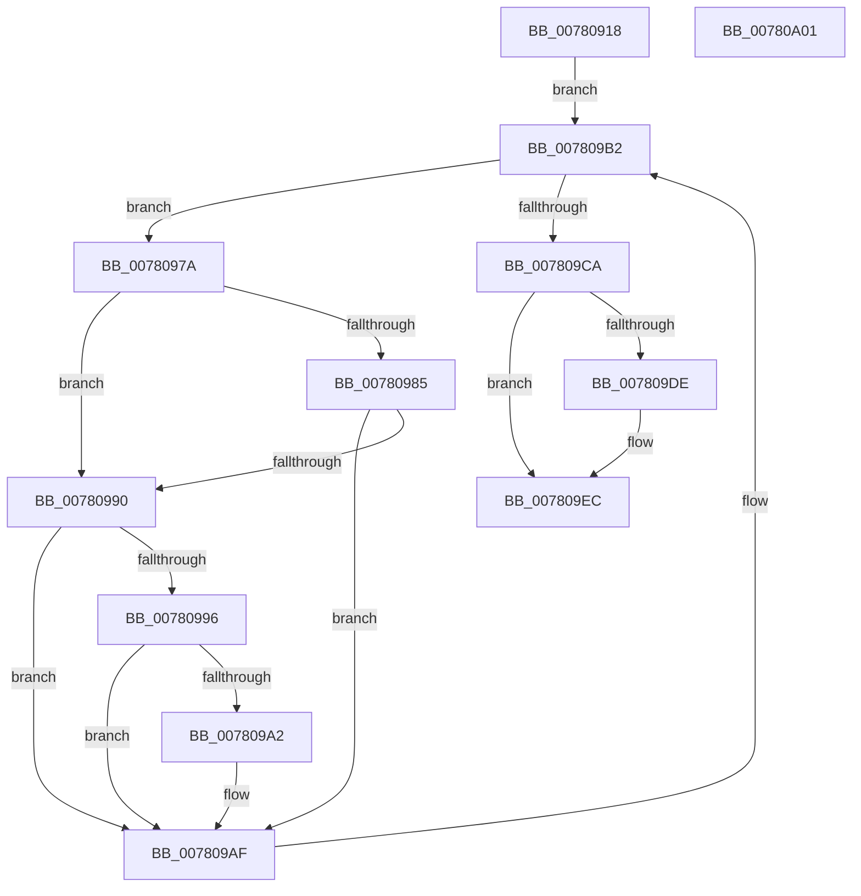

# PspTerminateSiloSubsystemProcesses

- RVA: `0x00780918`–`0x00780A02` (길이 `234` bytes)
- VA: `0x0000000140780918`
- 실행 섹션: `PAGE`
- PDB 이름 있음: `예`; PDB Function 태그: `아니요`
- unwind 정보 RVA: `0x000A1020`
- 디코드: `64`개 명령, `234/234` bytes 표시
- 미해석 바이트: `0` (있으면 어셈블리에 `.byte`로 보존)

> 이 문서는 커널 이미지의 기계어와 PDB 기호를 분석해 생성했습니다. 4번과 5번은 함수 원형과 자료형을 바이너리 사용 방식에서 추정한 C 해석이며 원본 소스 복구 결과는 아닙니다.

## 1. Dependencies

- 직접 호출 지점: **7**; 고유 호출 대상: **6**
- 직접 호출자로 확인된 함수: **1**
- RIP 상대 이미지 참조: **1**

### Outgoing calls
- `0x0078095D` → [PspEnumJobsAndProcessesInJobHierarchy](../91/PspEnumJobsAndProcessesInJobHierarchy_function_0091A1EC.md) (function, `0x0091A1EC`)
- `0x0078096E` → [PsGetServerSiloServiceSessionId](../../text/45/PsGetServerSiloServiceSessionId_function_0045ED00.md) (function, `0x0045ED00`)
- `0x00780999` → [PsGetProcessSessionId](../../text/22/PsGetProcessSessionId_function_002233A0.md) (function, `0x002233A0`)
- `0x007809AA` → [PspShutdownCsrProcess](PspShutdownCsrProcess_function_00780214.md) (function, `0x00780214`)
- `0x007809BD` → [PspGetNextJobProcess](../91/PspGetNextJobProcess_function_00918450.md) (function, `0x00918450`)
- `0x007809CD` → [PsGetServerSiloGlobals](../../text/22/PsGetServerSiloGlobals_function_002250A0.md) (function, `0x002250A0`)
- `0x007809E7` → [PspShutdownCsrProcess](PspShutdownCsrProcess_function_00780214.md) (function, `0x00780214`)

### Direct callers
- [PspCompleteServerSiloShutdownDeferred](../77/PspCompleteServerSiloShutdownDeferred_function_0077F860.md) at `0x0077F88C`

### Static image references
- `0x0078093A` → RVA `0x00785DE0` (`PspWaitOnAllProcessesJobCallback`; read)

## 2. Other-region calls and transfers

- 다른 실행 섹션으로 향하는 call: **3**
  - `0x0078096E` → [PsGetServerSiloServiceSessionId](../../text/45/PsGetServerSiloServiceSessionId_function_0045ED00.md) (`PAGE` → `.text`)
  - `0x00780999` → [PsGetProcessSessionId](../../text/22/PsGetProcessSessionId_function_002233A0.md) (`PAGE` → `.text`)
  - `0x007809CD` → [PsGetServerSiloGlobals](../../text/22/PsGetServerSiloGlobals_function_002250A0.md) (`PAGE` → `.text`)
- 별도 외부 분기/꼬리 이동을 확인하지 못했습니다.

## 3. Assembly (complete function range)

```asm
00780918  4C 8B DC                        mov r11, rsp
0078091B  49 89 5B 08                     mov qword ptr [r11 + 8], rbx
0078091F  49 89 6B 18                     mov qword ptr [r11 + 0x18], rbp
00780923  49 89 73 20                     mov qword ptr [r11 + 0x20], rsi
00780927  57                              push rdi
00780928  48 83 EC 50                     sub rsp, 0x50
0078092C  33 C0                           xor eax, eax
0078092E  C7 44 24 28 02 00 00 00         mov dword ptr [rsp + 0x28], 2
00780936  49 21 43 10                     and qword ptr [r11 + 0x10], rax
0078093A  4C 8D 05 9F 54 00 00            lea r8, [rip + 0x549f]
00780941  0F 57 C0                        xorps xmm0, xmm0
00780944  45 33 C9                        xor r9d, r9d
00780947  0F 11 44 24 30                  movups xmmword ptr [rsp + 0x30], xmm0
0078094C  49 89 43 E8                     mov qword ptr [r11 - 0x18], rax
00780950  33 D2                           xor edx, edx
00780952  49 8D 43 10                     lea rax, [r11 + 0x10]
00780956  48 8B F9                        mov rdi, rcx
00780959  49 89 43 C8                     mov qword ptr [r11 - 0x38], rax
0078095D  E8 8A 98 19 00                  call 0x14091a1ec
00780962  65 48 8B 34 25 88 01 00 00      mov rsi, qword ptr gs:[0x188]
0078096B  48 8B CF                        mov rcx, rdi
0078096E  E8 8D E3 CD FF                  call 0x14045ed00
00780973  8B E8                           mov ebp, eax
00780975  45 33 C9                        xor r9d, r9d
00780978  EB 38                           jmp 0x1407809b2
0078097A  8B 93 FC 05 00 00               mov edx, dword ptr [rbx + 0x5fc]
00780980  F6 C2 40                        test dl, 0x40
00780983  75 0B                           jne 0x140780990
00780985  8B 8B F0 01 00 00               mov ecx, dword ptr [rbx + 0x1f0]
0078098B  F6 C1 01                        test cl, 1
0078098E  75 1F                           jne 0x1407809af
00780990  0F BA E2 0C                     bt edx, 0xc
00780994  72 19                           jb 0x1407809af
00780996  48 8B CB                        mov rcx, rbx
00780999  E8 02 2A AA FF                  call 0x1402233a0
0078099E  3B C5                           cmp eax, ebp
007809A0  74 0D                           je 0x1407809af
007809A2  4C 8B C3                        mov r8, rbx
007809A5  8B D0                           mov edx, eax
007809A7  48 8B CF                        mov rcx, rdi
007809AA  E8 65 F8 FF FF                  call 0x140780214
007809AF  4C 8B CB                        mov r9, rbx
007809B2  4C 8D 44 24 30                  lea r8, [rsp + 0x30]
007809B7  48 8B D6                        mov rdx, rsi
007809BA  48 8B CF                        mov rcx, rdi
007809BD  E8 8E 7A 19 00                  call 0x140918450
007809C2  48 8B D8                        mov rbx, rax
007809C5  48 85 C0                        test rax, rax
007809C8  75 B0                           jne 0x14078097a
007809CA  48 8B CF                        mov rcx, rdi
007809CD  E8 CE 46 AA FF                  call 0x1402250a0
007809D2  4C 8B 80 50 03 00 00            mov r8, qword ptr [rax + 0x350]
007809D9  4D 85 C0                        test r8, r8
007809DC  74 0E                           je 0x1407809ec
007809DE  48 8B 90 08 05 00 00            mov rdx, qword ptr [rax + 0x508]
007809E5  8B 12                           mov edx, dword ptr [rdx]
007809E7  E8 28 F8 FF FF                  call 0x140780214
007809EC  48 8B 5C 24 60                  mov rbx, qword ptr [rsp + 0x60]
007809F1  48 8B 6C 24 70                  mov rbp, qword ptr [rsp + 0x70]
007809F6  48 8B 74 24 78                  mov rsi, qword ptr [rsp + 0x78]
007809FB  48 83 C4 50                     add rsp, 0x50
007809FF  5F                              pop rdi
00780A00  C3                              ret
00780A01  CC                              int3
```

## 4. C-style interpretation (structured pseudocode)

```c
__int64 __fastcall PspTerminateSiloSubsystemProcesses(__int64 a1, int a2, __int64 a3, int a4)
{
    __int64 result;
    __int64 v_rsp;
    unsigned __int64 v_stack_m28;
    unsigned int v_stack_m30;
    unsigned __int64 v_stack_p18;
    unsigned __int64 v_stack_p20;
    unsigned __int64 v_stack_p8;

    *(unsigned __int64 *)(v_rsp + 8) = v_rbx;
    *(unsigned __int64 *)(v_rsp + 24) = v_rbp;
    *(unsigned __int64 *)(v_rsp + 32) = v_rsi;
    v_rsp = (v_rsp) - (80);
    result = 0;
    v_stack_m30 = 2;
    a4 = 0;
    v_stack_m28 = v_xmm0;
    *(unsigned __int64 *)(v_rsp - 24) = 0;
    a2 = 0;
    *(unsigned __int64 *)(v_rsp - 56) = v_rsp + 16;
    result = PspEnumJobsAndProcessesInJobHierarchy(a1, a2, v_rip + 21663, a4);
    result = PsGetServerSiloServiceSessionId(a1, a2, v_rip + 21663, a4);
    a4 = 0;
    goto loc_007809B2;
loc_0078097A:
    if ((((unsigned __int8)((unsigned int)(*(unsigned int *)(v_rbx + 1532)))) & (64)) != 0) goto loc_00780990;
    if ((((unsigned __int8)((unsigned int)(*(unsigned int *)(v_rbx + 496)))) & (1)) != 0) goto loc_007809AF;
loc_00780990:
    if (condition_is_below) goto loc_007809AF;
    result = PsGetProcessSessionId(v_rbx, (unsigned int)(*(unsigned int *)(v_rbx + 1532)), v_rip + 21663, a4);
    if (((unsigned int)(result)) != ((unsigned int)((unsigned int)((unsigned int)(result))))) {
        a3 = v_rbx;
        a2 = (unsigned int)(result);
        a1 = a1;
        result = PspShutdownCsrProcess(a1, a2, a3, a4);
    }
loc_007809B2:
    result = PspGetNextJobProcess(a1, *(unsigned __int64 *)(gs_base + (0 + 392)), v_stack_m28, v_rbx);
    if (result != 0) goto loc_0078097A;
    result = PsGetServerSiloGlobals(a1, *(unsigned __int64 *)(gs_base + (0 + 392)), v_stack_m28, v_rbx);
    if (*(unsigned __int64 *)(result + 848) != 0) {
        a2 = *(unsigned __int64 *)(result + 1288);
        a2 = *(unsigned int *)(a2);
        result = PspShutdownCsrProcess(a1, a2, *(unsigned __int64 *)(result + 848), v_rbx);
    }
    v_rsp = (v_rsp) + (80);
    return result;
}
```

## 5. (Beta) C Style

```c
int64_t PspTerminateSiloSubsystemProcesses(int64_t Arg1, int32_t Arg2, int64_t Arg3, int32_t Arg4)
{
    int64_t result;
    int64_t local_rsp;
    uint64_t v_stack_m28;
    uint32_t v_stack_m30;
    uint64_t v_stack_p18;
    uint64_t v_stack_p20;
    uint64_t v_stack_p8;

    *(uint64_t *)(local_rsp + 0x8) = local_rbx;
    *(uint64_t *)(local_rsp + 0x18) = local_rbp;
    *(uint64_t *)(local_rsp + 0x20) = local_rsi;
    local_rsp = (local_rsp) - (80);
    result = 0;
    v_stack_m30 = 2;
    Arg4 = 0;
    v_stack_m28 = v_xmm0;
    *(uint64_t *)(local_rsp - 0x18) = 0;
    Arg2 = 0;
    *(uint64_t *)(local_rsp - 0x38) = local_rsp + 16;
    result = PspEnumJobsAndProcessesInJobHierarchy(Arg1, Arg2, v_rip + 21663, Arg4);
    result = PsGetServerSiloServiceSessionId(Arg1, Arg2, v_rip + 21663, Arg4);
    Arg4 = 0;
    goto loc_007809B2;
loc_0078097A:
    if ((((uint8_t)((uint32_t)(*(uint32_t *)(local_rbx + 0x5FC)))) & (64)) != 0) goto loc_00780990;
    if ((((uint8_t)((uint32_t)(*(uint32_t *)(local_rbx + 0x1F0)))) & (1)) != 0) goto loc_007809AF;
loc_00780990:
    if (condition_is_below) goto loc_007809AF;
    result = PsGetProcessSessionId(local_rbx, (uint32_t)(*(uint32_t *)(local_rbx + 0x5FC)), v_rip + 21663, Arg4);
    if (((uint32_t)(result)) != ((uint32_t)((uint32_t)((uint32_t)(result))))) {
        Arg3 = local_rbx;
        Arg2 = (uint32_t)(result);
        Arg1 = Arg1;
        result = PspShutdownCsrProcess(Arg1, Arg2, Arg3, Arg4);
    }
loc_007809B2:
    result = PspGetNextJobProcess(Arg1, *(uint64_t *)(gs_base + (0 + 0x188)), v_stack_m28, local_rbx);
    if (result != 0) goto loc_0078097A;
    result = PsGetServerSiloGlobals(Arg1, *(uint64_t *)(gs_base + (0 + 0x188)), v_stack_m28, local_rbx);
    if (*(uint64_t *)(result + 0x350) != 0) {
        Arg2 = *(uint64_t *)(result + 0x508);
        Arg2 = *(uint32_t *)(Arg2);
        result = PspShutdownCsrProcess(Arg1, Arg2, *(uint64_t *)(result + 0x350), local_rbx);
    }
    local_rsp = (local_rsp) + (80);
    return result;
}
```

## 6. Execution-region graph

[열기: 2D/3D 그래프와 함수 탐색 컨트롤 패널](../../../control-panel.html?section=page&rva=0x00780918&view=graph)

- 2D 그래프는 위에서 아래로 흐르고, 3D 그래프는 빈 공간을 드래그해 회전합니다. Shift+드래그는 이동, 휠은 확대·축소, 함수 노드 선택은 대상 보고서 이동입니다.

### Static fallback


