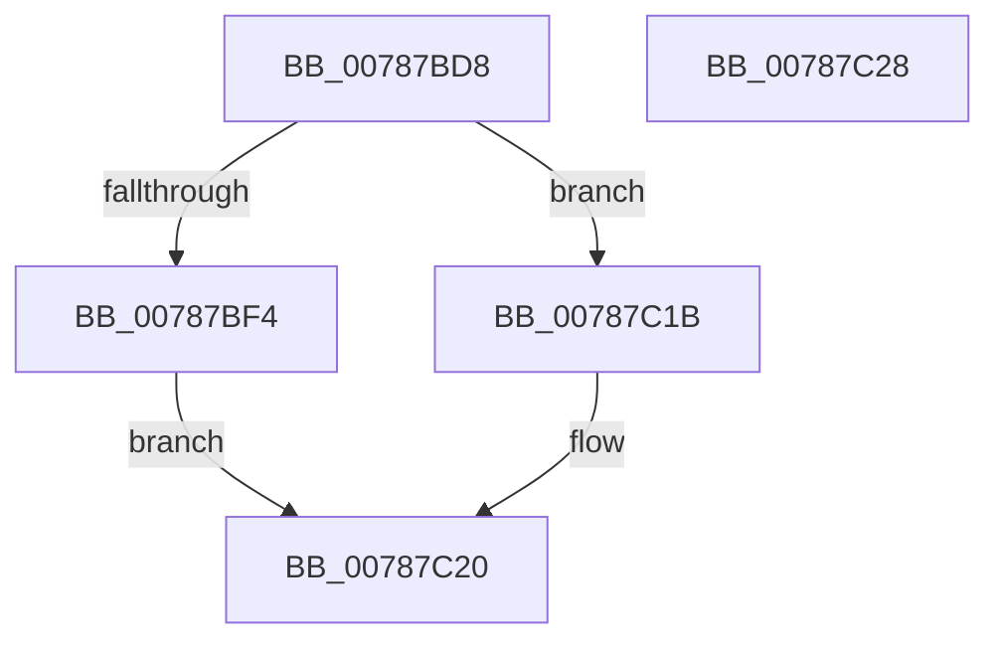

# PspTlsAlloc

- RVA: `0x00787BD8`–`0x00787C29` (길이 `81` bytes)
- VA: `0x0000000140787BD8`
- 실행 섹션: `PAGE`
- PDB 이름 있음: `예`; PDB Function 태그: `아니요`
- unwind 정보 RVA: `0x00064C80`
- 디코드: `21`개 명령, `81/81` bytes 표시
- 미해석 바이트: `0` (있으면 어셈블리에 `.byte`로 보존)

> 이 문서는 커널 이미지의 기계어와 PDB 기호를 분석해 생성했습니다. 4번과 5번은 함수 원형과 자료형을 바이너리 사용 방식에서 추정한 C 해석이며 원본 소스 복구 결과는 아닙니다.

## 1. Dependencies

- 직접 호출 지점: **2**; 고유 호출 대상: **2**
- 직접 호출자로 확인된 함수: **1**
- RIP 상대 이미지 참조: **0**

### Outgoing calls
- `0x00787C0D` → [RtlpFlsAlloc](../79/RtlpFlsAlloc_function_00795074.md) (function, `0x00795074`)
- `0x00787C14` → [KeLeaveGuardedRegion](../../text/2E/KeLeaveGuardedRegion_function_002E2C40.md) (function, `0x002E2C40`)

### Direct callers
- [PsTlsAlloc](PsTlsAlloc_function_00787B40.md) at `0x00787B5E`

### Static image references
- 디코드된 RIP-relative 메모리 참조가 없습니다.

## 2. Other-region calls and transfers

- 다른 실행 섹션으로 향하는 call: **1**
  - `0x00787C14` → [KeLeaveGuardedRegion](../../text/2E/KeLeaveGuardedRegion_function_002E2C40.md) (`PAGE` → `.text`)
- 별도 외부 분기/꼬리 이동을 확인하지 못했습니다.

## 3. Assembly (complete function range)

```asm
00787BD8  40 53                           push rbx
00787BDA  48 83 EC 30                     sub rsp, 0x30
00787BDE  65 48 8B 04 25 88 01 00 00      mov rax, qword ptr gs:[0x188]
00787BE7  44 8B 80 F0 06 00 00            mov r8d, dword ptr [rax + 0x6f0]
00787BEE  41 F6 C0 03                     test r8b, 3
00787BF2  75 27                           jne 0x140787c1b
00787BF4  65 48 8B 04 25 88 01 00 00      mov rax, qword ptr gs:[0x188]
00787BFD  4C 8B C1                        mov r8, rcx
00787C00  48 89 54 24 20                  mov qword ptr [rsp + 0x20], rdx
00787C05  66 FF 88 E6 01 00 00            dec word ptr [rax + 0x1e6]
00787C0C  90                              nop
00787C0D  E8 62 D4 00 00                  call 0x140795074
00787C12  8B D8                           mov ebx, eax
00787C14  E8 27 B0 B5 FF                  call 0x1402e2c40
00787C19  EB 05                           jmp 0x140787c20
00787C1B  BB 4B 00 00 C0                  mov ebx, 0xc000004b
00787C20  8B C3                           mov eax, ebx
00787C22  48 83 C4 30                     add rsp, 0x30
00787C26  5B                              pop rbx
00787C27  C3                              ret
00787C28  CC                              int3
```

## 4. C-style interpretation (structured pseudocode)

```c
__int64 __fastcall PspTlsAlloc(__int64 a1, __int64 a2)
{
    __int64 result;
    __int64 v_rsp;
    unsigned __int64 v_stack_m18;

    v_rsp = (v_rsp) - (48);
    if ((((unsigned __int8)((unsigned int)(*(unsigned int *)(*(unsigned __int64 *)(gs_base + (0 + 392)) + 1776)))) & (3)) != 0) goto loc_00787C1B;
    v_stack_m18 = a2;
    result = RtlpFlsAlloc(a1, a2, a1, a4);
    result = KeLeaveGuardedRegion(a1, a2, a1, a4);
    goto loc_00787C20;
loc_00787C1B:
loc_00787C20:
    v_rsp = (v_rsp) + (48);
    return (unsigned int)((unsigned int)((unsigned int)(0xC000004BULL)));
}
```

## 5. (Beta) C Style

```c
int64_t PspTlsAlloc(int64_t Arg1, int64_t Arg2)
{
    int64_t result;
    int64_t local_rsp;
    uint64_t v_stack_m18;

    local_rsp = (local_rsp) - (48);
    if ((((uint8_t)((uint32_t)(*(uint32_t *)(*(uint64_t *)(gs_base + (0 + 0x188)) + 0x6F0)))) & (3)) != 0) goto loc_00787C1B;
    v_stack_m18 = Arg2;
    result = RtlpFlsAlloc(Arg1, Arg2, Arg1, a4);
    result = KeLeaveGuardedRegion(Arg1, Arg2, Arg1, a4);
    goto loc_00787C20;
loc_00787C1B:
loc_00787C20:
    local_rsp = (local_rsp) + (48);
    return (uint32_t)((uint32_t)((uint32_t)(0xC000004BULL)));
}
```

## 6. Execution-region graph

[열기: 2D/3D 그래프와 함수 탐색 컨트롤 패널](../../../control-panel.html?section=page&rva=0x00787BD8&view=graph)

- 2D 그래프는 위에서 아래로 흐르고, 3D 그래프는 빈 공간을 드래그해 회전합니다. Shift+드래그는 이동, 휠은 확대·축소, 함수 노드 선택은 대상 보고서 이동입니다.

### Static fallback


