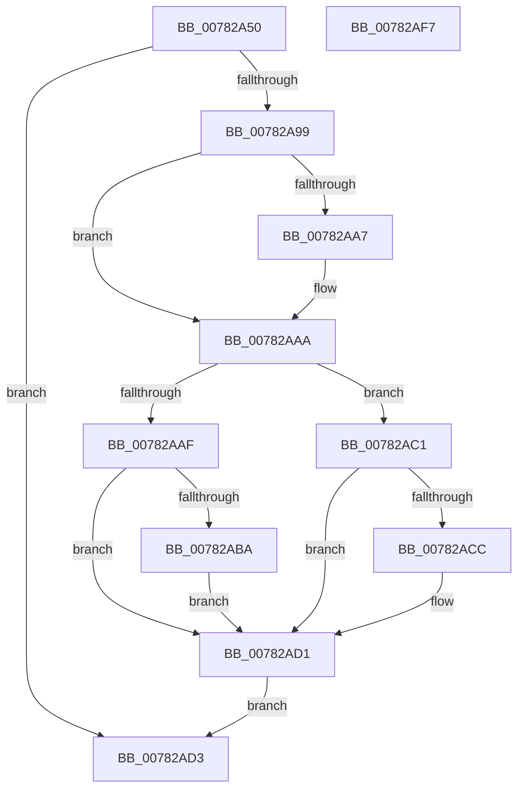

# PspTrySetProcessPebThrottlingFlags

- RVA: `0x00782A50`–`0x00782AF8` (길이 `168` bytes)
- VA: `0x0000000140782A50`
- 실행 섹션: `PAGE`
- PDB 이름 있음: `예`; PDB Function 태그: `아니요`
- unwind 정보 RVA: `0x000CE420`
- 디코드: `46`개 명령, `168/168` bytes 표시
- 미해석 바이트: `0` (있으면 어셈블리에 `.byte`로 보존)

> 이 문서는 커널 이미지의 기계어와 PDB 기호를 분석해 생성했습니다. 4번과 5번은 함수 원형과 자료형을 바이너리 사용 방식에서 추정한 C 해석이며 원본 소스 복구 결과는 아닙니다.

## 1. Dependencies

- 직접 호출 지점: **3**; 고유 호출 대상: **3**
- 직접 호출자로 확인된 함수: **0**
- RIP 상대 이미지 참조: **1**

### Outgoing calls
- `0x00782A88` → [KiStackAttachProcess](../../text/21/KiStackAttachProcess_function_00216820.md) (function, `0x00216820`)
- `0x00782ADA` → [KiUnstackDetachProcess](../../text/21/KiUnstackDetachProcess_function_00217D30.md) (function, `0x00217D30`)
- `0x00782AE7` → [_security_check_cookie](../../text/6A/_security_check_cookie_function_006AC640.md) (function, `0x006AC640`)

### Direct callers
- 이 함수 시작 RVA로 연결되는 직접 call은 확인되지 않았습니다. 간접 호출은 완전히 역산할 수 없습니다.

### Static image references
- `0x00782A5A` → RVA `0x00E0A740` (`.data`; read)

## 2. Other-region calls and transfers

- 다른 실행 섹션으로 향하는 call: **3**
  - `0x00782A88` → [KiStackAttachProcess](../../text/21/KiStackAttachProcess_function_00216820.md) (`PAGE` → `.text`)
  - `0x00782ADA` → [KiUnstackDetachProcess](../../text/21/KiUnstackDetachProcess_function_00217D30.md) (`PAGE` → `.text`)
  - `0x00782AE7` → [_security_check_cookie](../../text/6A/_security_check_cookie_function_006AC640.md) (`PAGE` → `.text`)
- 별도 외부 분기/꼬리 이동을 확인하지 못했습니다.

## 3. Assembly (complete function range)

```asm
00782A50  48 89 5C 24 10                  mov qword ptr [rsp + 0x10], rbx
00782A55  57                              push rdi
00782A56  48 83 EC 60                     sub rsp, 0x60
00782A5A  48 8B 05 DF 7C 68 00            mov rax, qword ptr [rip + 0x687cdf]
00782A61  48 33 C4                        xor rax, rsp
00782A64  48 89 44 24 50                  mov qword ptr [rsp + 0x50], rax
00782A69  40 8A FA                        mov dil, dl
00782A6C  48 8B D9                        mov rbx, rcx
00782A6F  0F 57 C0                        xorps xmm0, xmm0
00782A72  0F 11 44 24 20                  movups xmmword ptr [rsp + 0x20], xmm0
00782A77  0F 11 44 24 30                  movups xmmword ptr [rsp + 0x30], xmm0
00782A7C  0F 11 44 24 40                  movups xmmword ptr [rsp + 0x40], xmm0
00782A81  4C 8D 44 24 20                  lea r8, [rsp + 0x20]
00782A86  33 D2                           xor edx, edx
00782A88  E8 93 3D A9 FF                  call 0x140216820
00782A8D  4C 8B 83 E0 02 00 00            mov r8, qword ptr [rbx + 0x2e0]
00782A94  4D 85 C0                        test r8, r8
00782A97  74 3A                           je 0x140782ad3
00782A99  33 C0                           xor eax, eax
00782A9B  48 8B 8B 10 03 00 00            mov rcx, qword ptr [rbx + 0x310]
00782AA2  48 85 C9                        test rcx, rcx
00782AA5  74 03                           je 0x140782aaa
00782AA7  48 8B 01                        mov rax, qword ptr [rcx]
00782AAA  40 84 FF                        test dil, dil
00782AAD  74 12                           je 0x140782ac1
00782AAF  F0 41 83 48 50 60               lock or dword ptr [r8 + 0x50], 0x60
00782AB5  48 85 C0                        test rax, rax
00782AB8  74 17                           je 0x140782ad1
00782ABA  F0 83 48 28 60                  lock or dword ptr [rax + 0x28], 0x60
00782ABF  EB 10                           jmp 0x140782ad1
00782AC1  F0 41 83 60 50 BF               lock and dword ptr [r8 + 0x50], 0xffffffbf
00782AC7  48 85 C0                        test rax, rax
00782ACA  74 05                           je 0x140782ad1
00782ACC  F0 83 60 28 BF                  lock and dword ptr [rax + 0x28], 0xffffffbf
00782AD1  EB 00                           jmp 0x140782ad3
00782AD3  33 D2                           xor edx, edx
00782AD5  48 8D 4C 24 20                  lea rcx, [rsp + 0x20]
00782ADA  E8 51 52 A9 FF                  call 0x140217d30
00782ADF  48 8B 4C 24 50                  mov rcx, qword ptr [rsp + 0x50]
00782AE4  48 33 CC                        xor rcx, rsp
00782AE7  E8 54 9B F2 FF                  call 0x1406ac640
00782AEC  48 8B 5C 24 78                  mov rbx, qword ptr [rsp + 0x78]
00782AF1  48 83 C4 60                     add rsp, 0x60
00782AF5  5F                              pop rdi
00782AF6  C3                              ret
00782AF7  CC                              int3
```

## 4. C-style interpretation (structured pseudocode)

```c
__int64 __fastcall PspTrySetProcessPebThrottlingFlags(__int64 a1, int a2)
{
    __int64 result;
    __int64 v_rsp;
    unsigned __int64 v_stack_m18;
    unsigned __int64 v_stack_m28;
    unsigned __int64 v_stack_m38;
    unsigned __int64 v_stack_m48;
    unsigned __int64 v_stack_p10;

    v_stack_p10 = v_rbx;
    v_rsp = (v_rsp) - (96);
    result = (*(unsigned __int64 *)(v_rip + 6847711)) ^ (v_rsp);
    v_stack_m18 = result;
    v_stack_m48 = v_xmm0;
    v_stack_m38 = v_xmm0;
    v_stack_m28 = v_xmm0;
    a2 = 0;
    result = KiStackAttachProcess(a1, a2, v_stack_m48, a4);
    if (*(unsigned __int64 *)(a1 + 736) == 0) goto loc_00782AD3;
    result = 0;
    if (*(unsigned __int64 *)(a1 + 784) != 0) {
        result = *(unsigned __int64 *)(*(unsigned __int64 *)(a1 + 784));
    }
    if ((unsigned __int8)((unsigned __int8)(a2)) == 0) goto loc_00782AC1;
    if (result == 0) goto loc_00782AD1;
    goto loc_00782AD1;
loc_00782AC1:
    if (result != 0) {
    }
    goto loc_00782AD3;
loc_00782AD3:
    a2 = 0;
    result = KiUnstackDetachProcess(v_stack_m48, a2, *(unsigned __int64 *)(a1 + 736), a4);
    a1 = (v_stack_m18) ^ (v_rsp);
    result = _security_check_cookie(a1, a2, *(unsigned __int64 *)(a1 + 736), a4);
    v_rsp = (v_rsp) + (96);
    return result;
}
```

## 5. (Beta) C Style

```c
int64_t PspTrySetProcessPebThrottlingFlags(void *Arg1, int32_t Arg2)
{
    uint8_t *arg1 = (uint8_t *)Arg1;

    int64_t result;
    int64_t local_rsp;
    uint64_t v_stack_m18;
    uint64_t v_stack_m28;
    uint64_t v_stack_m38;
    uint64_t v_stack_m48;
    uint64_t v_stack_p10;

    v_stack_p10 = local_rbx;
    local_rsp = (local_rsp) - (96);
    result = (*(uint64_t *)(v_rip + 0x687CDF)) ^ (local_rsp);
    v_stack_m18 = result;
    v_stack_m48 = v_xmm0;
    v_stack_m38 = v_xmm0;
    v_stack_m28 = v_xmm0;
    Arg2 = 0;
    result = KiStackAttachProcess(Arg1, Arg2, v_stack_m48, a4);
    if (*(uint64_t *)(arg1 + 0x2E0) == 0) goto loc_00782AD3;
    result = 0;
    if (*(uint64_t *)(arg1 + 0x310) != 0) {
        result = *(uint64_t *)(*(uint64_t *)(arg1 + 0x310));
    }
    if ((uint8_t)((uint8_t)(Arg2)) == 0) goto loc_00782AC1;
    if (result == 0) goto loc_00782AD1;
    goto loc_00782AD1;
loc_00782AC1:
    if (result != 0) {
    }
    goto loc_00782AD3;
loc_00782AD3:
    Arg2 = 0;
    result = KiUnstackDetachProcess(v_stack_m48, Arg2, *(uint64_t *)(arg1 + 0x2E0), a4);
    Arg1 = (v_stack_m18) ^ (local_rsp);
    result = _security_check_cookie(Arg1, Arg2, *(uint64_t *)(arg1 + 0x2E0), a4);
    local_rsp = (local_rsp) + (96);
    return result;
}
```

### 관측된 메모리 오프셋

구조체 형식이 확인되지 않은 접근은 인자 기준의 오프셋으로만 기록했습니다.

| 기준 인자 | 오프셋 표현 | 폭 (bit) | 접근 |
|---|---:|---:|---|
| `Arg1` | `+ 0x2E0` | `64` | `R` |
| `Arg1` | `+ 0x310` | `64` | `R` |

## 6. Execution-region graph

[열기: 2D/3D 그래프와 함수 탐색 컨트롤 패널](../../../control-panel.html?section=page&rva=0x00782A50&view=graph)

- 2D 그래프는 위에서 아래로 흐르고, 3D 그래프는 빈 공간을 드래그해 회전합니다. Shift+드래그는 이동, 휠은 확대·축소, 함수 노드 선택은 대상 보고서 이동입니다.

### Static fallback


