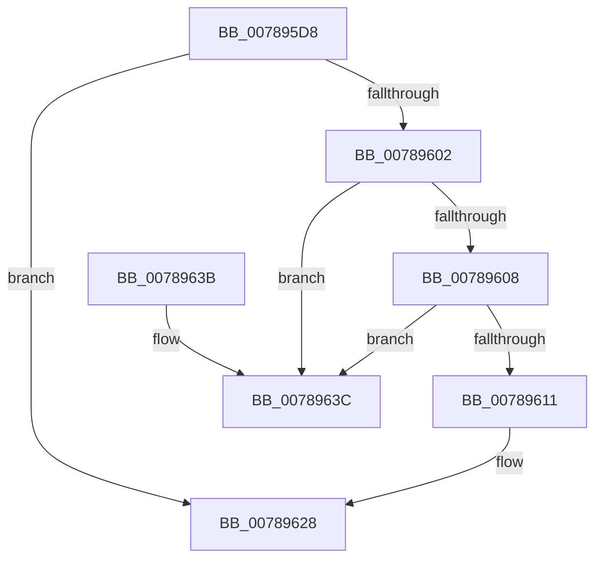

# PspUnlinkSessionId

- RVA: `0x007895D8`–`0x00789643` (길이 `107` bytes)
- VA: `0x00000001407895D8`
- 실행 섹션: `PAGE`
- PDB 이름 있음: `예`; PDB Function 태그: `아니요`
- unwind 정보 RVA: `0x0006CF28`
- 디코드: `30`개 명령, `107/107` bytes 표시
- 미해석 바이트: `0` (있으면 어셈블리에 `.byte`로 보존)

> 이 문서는 커널 이미지의 기계어와 PDB 기호를 분석해 생성했습니다. 4번과 5번은 함수 원형과 자료형을 바이너리 사용 방식에서 추정한 C 해석이며 원본 소스 복구 결과는 아닙니다.

## 1. Dependencies

- 직접 호출 지점: **3**; 고유 호출 대상: **3**
- 직접 호출자로 확인된 함수: **1**
- RIP 상대 이미지 참조: **1**

### Outgoing calls
- `0x007895F1` → [PspLockProcessListExclusive](../../text/22/PspLockProcessListExclusive_function_0022578C.md) (function, `0x0022578C`)
- `0x00789623` → [RtlAvlRemoveNode](../../text/29/RtlAvlRemoveNode_function_00296650.md) (function, `0x00296650`)
- `0x0078962B` → [PspUnlockProcessListExclusive](../../text/2D/PspUnlockProcessListExclusive_function_002DFD18.md) (function, `0x002DFD18`)

### Direct callers
- [sub_00B48FD4](../B4/Unknown_function_00B48FD4.md) at `0x00B48FD4`

### Static image references
- `0x0078961C` → RVA `0x00F05D50` (`.data`; read)

## 2. Other-region calls and transfers

- 다른 실행 섹션으로 향하는 call: **3**
  - `0x007895F1` → [PspLockProcessListExclusive](../../text/22/PspLockProcessListExclusive_function_0022578C.md) (`PAGE` → `.text`)
  - `0x00789623` → [RtlAvlRemoveNode](../../text/29/RtlAvlRemoveNode_function_00296650.md) (`PAGE` → `.text`)
  - `0x0078962B` → [PspUnlockProcessListExclusive](../../text/2D/PspUnlockProcessListExclusive_function_002DFD18.md) (`PAGE` → `.text`)
- 별도 외부 분기/꼬리 이동을 확인하지 못했습니다.

## 3. Assembly (complete function range)

```asm
007895D8  48 89 5C 24 08                  mov qword ptr [rsp + 8], rbx
007895DD  57                              push rdi
007895DE  48 83 EC 20                     sub rsp, 0x20
007895E2  65 48 8B 1C 25 88 01 00 00      mov rbx, qword ptr gs:[0x188]
007895EB  48 8B F9                        mov rdi, rcx
007895EE  48 8B CB                        mov rcx, rbx
007895F1  E8 96 C1 A9 FF                  call 0x14022578c
007895F6  48 8D 47 50                     lea rax, [rdi + 0x50]
007895FA  48 8B 10                        mov rdx, qword ptr [rax]
007895FD  48 85 D2                        test rdx, rdx
00789600  74 26                           je 0x140789628
00789602  48 39 42 08                     cmp qword ptr [rdx + 8], rax
00789606  75 34                           jne 0x14078963c
00789608  48 8B 48 08                     mov rcx, qword ptr [rax + 8]
0078960C  48 39 01                        cmp qword ptr [rcx], rax
0078960F  75 2B                           jne 0x14078963c
00789611  48 89 11                        mov qword ptr [rcx], rdx
00789614  48 89 4A 08                     mov qword ptr [rdx + 8], rcx
00789618  48 8D 57 60                     lea rdx, [rdi + 0x60]
0078961C  48 8D 0D 2D C7 77 00            lea rcx, [rip + 0x77c72d]
00789623  E8 28 D0 B0 FF                  call 0x140296650
00789628  48 8B CB                        mov rcx, rbx
0078962B  E8 E8 66 B5 FF                  call 0x1402dfd18
00789630  48 8B 5C 24 30                  mov rbx, qword ptr [rsp + 0x30]
00789635  48 83 C4 20                     add rsp, 0x20
00789639  5F                              pop rdi
0078963A  C3                              ret
0078963B  CC                              int3
0078963C  B9 03 00 00 00                  mov ecx, 3
00789641  CD 29                           int 0x29
```

## 4. C-style interpretation (structured pseudocode)

```c
__int64 __fastcall PspUnlinkSessionId(__int64 a1)
{
    __int64 result;
    __int64 v_rsp;
    unsigned __int64 v_stack_p8;

    v_stack_p8 = v_rbx;
    v_rsp = (v_rsp) - (32);
    result = PspLockProcessListExclusive(*(unsigned __int64 *)(gs_base + (0 + 392)), a2, a3, a4);
    if (*(unsigned __int64 *)(a1 + 80) == 0) goto loc_00789628;
    if ((*(unsigned __int64 *)(*(unsigned __int64 *)(a1 + 80) + 8)) != (a1 + 80)) goto loc_0078963C;
    if ((*(unsigned __int64 *)(*(unsigned __int64 *)(a1 + 80 + 8))) != (a1 + 80)) goto loc_0078963C;
    *(unsigned __int64 *)(*(unsigned __int64 *)(a1 + 80 + 8)) = *(unsigned __int64 *)(a1 + 80);
    *(unsigned __int64 *)(*(unsigned __int64 *)(a1 + 80) + 8) = *(unsigned __int64 *)(a1 + 80 + 8);
    result = RtlAvlRemoveNode(v_rip + 7849773, a1 + 96, a3, a4);
loc_00789628:
    result = PspUnlockProcessListExclusive(*(unsigned __int64 *)(gs_base + (0 + 392)), a1 + 96, a3, a4);
    v_rsp = (v_rsp) + (32);
    return result;
loc_0078963C:
    return result;
}
```

## 5. (Beta) C Style

```c
int64_t PspUnlinkSessionId(void *Arg1)
{
    uint8_t *arg1 = (uint8_t *)Arg1;

    int64_t result;
    int64_t local_rsp;
    uint64_t v_stack_p8;

    v_stack_p8 = local_rbx;
    local_rsp = (local_rsp) - (32);
    result = PspLockProcessListExclusive(*(uint64_t *)(gs_base + (0 + 0x188)), a2, a3, a4);
    if (*(uint64_t *)(arg1 + 0x50) == 0) goto loc_00789628;
    if ((*(uint64_t *)(*(uint64_t *)(arg1 + 0x50) + 0x8)) != (Arg1 + 80)) goto loc_0078963C;
    if ((*(uint64_t *)(*(uint64_t *)(arg1 + 0x50 + 0x8))) != (Arg1 + 80)) goto loc_0078963C;
    *(uint64_t *)(*(uint64_t *)(arg1 + 0x50 + 0x8)) = *(uint64_t *)(arg1 + 0x50);
    *(uint64_t *)(*(uint64_t *)(arg1 + 0x50) + 0x8) = *(uint64_t *)(arg1 + 0x50 + 0x8);
    result = RtlAvlRemoveNode(v_rip + 7849773, Arg1 + 96, a3, a4);
loc_00789628:
    result = PspUnlockProcessListExclusive(*(uint64_t *)(gs_base + (0 + 0x188)), Arg1 + 96, a3, a4);
    local_rsp = (local_rsp) + (32);
    return result;
loc_0078963C:
    return result;
}
```

### 관측된 메모리 오프셋

구조체 형식이 확인되지 않은 접근은 인자 기준의 오프셋으로만 기록했습니다.

| 기준 인자 | 오프셋 표현 | 폭 (bit) | 접근 |
|---|---:|---:|---|
| `Arg1` | `+ 0x0` | `64` | `R` |
| `Arg1` | `+ 0x8` | `64` | `R` |
| `Arg1` | `+ 0x50` | `64` | `R` |
| `Arg1` | `+ 0x60` | `64` | `R` |

## 6. Execution-region graph

[열기: 2D/3D 그래프와 함수 탐색 컨트롤 패널](../../../control-panel.html?section=page&rva=0x007895D8&view=graph)

- 2D 그래프는 위에서 아래로 흐르고, 3D 그래프는 빈 공간을 드래그해 회전합니다. Shift+드래그는 이동, 휠은 확대·축소, 함수 노드 선택은 대상 보고서 이동입니다.

### Static fallback


