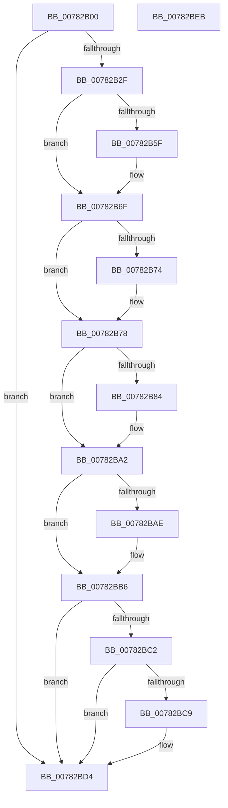

# PspUpdateSingleProcessAffinity

- RVA: `0x00782B00`–`0x00782BEC` (길이 `236` bytes)
- VA: `0x0000000140782B00`
- 실행 섹션: `PAGE`
- PDB 이름 있음: `예`; PDB Function 태그: `아니요`
- unwind 정보 RVA: `0x000C517C`
- 디코드: `69`개 명령, `236/236` bytes 표시
- 미해석 바이트: `0` (있으면 어셈블리에 `.byte`로 보존)

> 이 문서는 커널 이미지의 기계어와 PDB 기호를 분석해 생성했습니다. 4번과 5번은 함수 원형과 자료형을 바이너리 사용 방식에서 추정한 C 해석이며 원본 소스 복구 결과는 아닙니다.

## 1. Dependencies

- 직접 호출 지점: **6**; 고유 호출 대상: **6**
- 직접 호출자로 확인된 함수: **2**
- RIP 상대 이미지 참조: **0**

### Outgoing calls
- `0x00782B49` → [KeAbPreAcquire](../../text/21/KeAbPreAcquire_function_00210230.md) (function, `0x00210230`)
- `0x00782B6A` → [ExfAcquirePushLockSharedEx](../../text/21/ExfAcquirePushLockSharedEx_function_0021044C.md) (function, `0x0021044C`)
- `0x00782B9B` → [PspSetProcessAffinitySafe](../A6/PspSetProcessAffinitySafe_function_00A60904.md) (function, `0x00A60904`)
- `0x00782BB1` → [ExfReleasePushLockShared](../../text/26/ExfReleasePushLockShared_function_00263440.md) (function, `0x00263440`)
- `0x00782BB9` → [KeAbPostRelease](../../text/2E/KeAbPostRelease_function_002E1600.md) (function, `0x002E1600`)
- `0x00782BCF` → [PspUpdatePebForAffinityChange](../A5/PspUpdatePebForAffinityChange_function_00A50790.md) (function, `0x00A50790`)

### Direct callers
- [PsUpdateActiveProcessAffinity](PsUpdateActiveProcessAffinity_function_00781DA8.md) at `0x00781E94`
- [PspSetProcessAffinityUpdateMode](PspSetProcessAffinityUpdateMode_function_007828D8.md) at `0x007829FA`

### Static image references
- 디코드된 RIP-relative 메모리 참조가 없습니다.

## 2. Other-region calls and transfers

- 다른 실행 섹션으로 향하는 call: **4**
  - `0x00782B49` → [KeAbPreAcquire](../../text/21/KeAbPreAcquire_function_00210230.md) (`PAGE` → `.text`)
  - `0x00782B6A` → [ExfAcquirePushLockSharedEx](../../text/21/ExfAcquirePushLockSharedEx_function_0021044C.md) (`PAGE` → `.text`)
  - `0x00782BB1` → [ExfReleasePushLockShared](../../text/26/ExfReleasePushLockShared_function_00263440.md) (`PAGE` → `.text`)
  - `0x00782BB9` → [KeAbPostRelease](../../text/2E/KeAbPostRelease_function_002E1600.md) (`PAGE` → `.text`)
- 별도 외부 분기/꼬리 이동을 확인하지 못했습니다.

## 3. Assembly (complete function range)

```asm
00782B00  48 89 5C 24 08                  mov qword ptr [rsp + 8], rbx
00782B05  48 89 6C 24 18                  mov qword ptr [rsp + 0x18], rbp
00782B0A  56                              push rsi
00782B0B  57                              push rdi
00782B0C  41 54                           push r12
00782B0E  41 56                           push r14
00782B10  41 57                           push r15
00782B12  48 83 EC 30                     sub rsp, 0x30
00782B16  F7 82 F0 01 00 00 00 00 08 00   test dword ptr [rdx + 0x1f0], 0x80000
00782B20  4D 8B F8                        mov r15, r8
00782B23  48 8B FA                        mov rdi, rdx
00782B26  4C 8B F1                        mov r14, rcx
00782B29  0F 84 A5 00 00 00               je 0x140782bd4
00782B2F  48 8D 9A C8 01 00 00            lea rbx, [rdx + 0x1c8]
00782B36  45 33 E4                        xor r12d, r12d
00782B39  48 8B CB                        mov rcx, rbx
00782B3C  44 89 64 24 68                  mov dword ptr [rsp + 0x68], r12d
00782B41  45 33 C0                        xor r8d, r8d
00782B44  33 D2                           xor edx, edx
00782B46  41 8B EC                        mov ebp, r12d
00782B49  E8 E2 D6 A8 FF                  call 0x140210230
00782B4E  48 8B F0                        mov rsi, rax
00782B51  41 8D 4C 24 11                  lea ecx, [r12 + 0x11]
00782B56  33 C0                           xor eax, eax
00782B58  F0 48 0F B1 0B                  lock cmpxchg qword ptr [rbx], rcx
00782B5D  74 10                           je 0x140782b6f
00782B5F  4C 8B CB                        mov r9, rbx
00782B62  4C 8B C6                        mov r8, rsi
00782B65  33 D2                           xor edx, edx
00782B67  48 8B CB                        mov rcx, rbx
00782B6A  E8 DD D8 A8 FF                  call 0x14021044c
00782B6F  48 85 F6                        test rsi, rsi
00782B72  74 04                           je 0x140782b78
00782B74  C6 46 0A 01                     mov byte ptr [rsi + 0xa], 1
00782B78  8B 87 F0 01 00 00               mov eax, dword ptr [rdi + 0x1f0]
00782B7E  0F BA E0 13                     bt eax, 0x13
00782B82  73 1E                           jae 0x140782ba2
00782B84  45 33 C9                        xor r9d, r9d
00782B87  48 8D 4C 24 68                  lea rcx, [rsp + 0x68]
00782B8C  48 89 4C 24 20                  mov qword ptr [rsp + 0x20], rcx
00782B91  4D 8B C7                        mov r8, r15
00782B94  48 8B CF                        mov rcx, rdi
00782B97  41 8D 51 02                     lea edx, [r9 + 2]
00782B9B  E8 64 DD 2D 00                  call 0x140a60904
00782BA0  8B E8                           mov ebp, eax
00782BA2  B8 11 00 00 00                  mov eax, 0x11
00782BA7  F0 4C 0F B1 23                  lock cmpxchg qword ptr [rbx], r12
00782BAC  74 08                           je 0x140782bb6
00782BAE  48 8B CB                        mov rcx, rbx
00782BB1  E8 8A 08 AE FF                  call 0x140263440
00782BB6  48 8B CB                        mov rcx, rbx
00782BB9  E8 42 EA B5 FF                  call 0x1402e1600
00782BBE  85 ED                           test ebp, ebp
00782BC0  78 12                           js 0x140782bd4
00782BC2  44 39 64 24 68                  cmp dword ptr [rsp + 0x68], r12d
00782BC7  74 0B                           je 0x140782bd4
00782BC9  48 8B D7                        mov rdx, rdi
00782BCC  49 8B CE                        mov rcx, r14
00782BCF  E8 BC DB 2C 00                  call 0x140a50790
00782BD4  48 8B 5C 24 60                  mov rbx, qword ptr [rsp + 0x60]
00782BD9  48 8B 6C 24 70                  mov rbp, qword ptr [rsp + 0x70]
00782BDE  48 83 C4 30                     add rsp, 0x30
00782BE2  41 5F                           pop r15
00782BE4  41 5E                           pop r14
00782BE6  41 5C                           pop r12
00782BE8  5F                              pop rdi
00782BE9  5E                              pop rsi
00782BEA  C3                              ret
00782BEB  CC                              int3
```

## 4. C-style interpretation (structured pseudocode)

```c
__int64 __fastcall PspUpdateSingleProcessAffinity(__int64 a1, __int64 a2, __int64 a3)
{
    __int64 result;
    __int64 v_r12;
    __int64 v_rbp;
    __int64 v_rsp;
    unsigned __int64 v_stack_m38;
    unsigned int v_stack_p10;
    unsigned __int64 v_stack_p18;
    unsigned __int64 v_stack_p8;

    v_stack_p8 = v_rbx;
    v_stack_p18 = v_rbp;
    v_rsp = (v_rsp) - (48);
    if (((*(unsigned int *)(a2 + 496)) & (0x80000ULL)) == 0) goto loc_00782BD4;
    v_r12 = 0;
    v_stack_p10 = 0;
    a3 = 0;
    a2 = 0;
    result = KeAbPreAcquire(a2 + 456, a2, a3, a4);
    result = 0;
    if (!(condition_is_equal)) {
        a4 = a2 + 456;
        a3 = 0;
        a2 = 0;
        a1 = a2 + 456;
        result = ExfAcquirePushLockSharedEx(a1, a2, a3, a4);
    }
    if (result != 0) {
        *(unsigned __int8 *)(result + 10) = 1;
    }
    result = (unsigned int)(*(unsigned int *)(a2 + 496));
    v_rbp = 0;
    if (!(condition_is_above_or_equal)) {
        a4 = 0;
        a1 = v_stack_p10;
        v_stack_m38 = a1;
        a3 = a3;
        a1 = 0;
        a2 = a4 + 2;
        result = PspSetProcessAffinitySafe(a1, a2, a3, a4);
        v_rbp = (unsigned int)(result);
    }
    result = 17;
    if (!(condition_is_equal)) {
        a1 = a2 + 456;
        result = ExfReleasePushLockShared(a1, a2, a3, a4);
    }
    result = KeAbPostRelease(a2 + 456, a2, a3, a4);
    if (sign_flag) goto loc_00782BD4;
    if (v_stack_p10 != 0) {
        a2 = a2;
        a1 = a1;
        result = PspUpdatePebForAffinityChange(a1, a2, a3, a4);
    }
    v_rsp = (v_rsp) + (48);
    return result;
}
```

## 5. (Beta) C Style

```c
int64_t PspUpdateSingleProcessAffinity(int64_t Arg1, void *Arg2, int64_t Arg3)
{
    uint8_t *arg2 = (uint8_t *)Arg2;

    int64_t result;
    int64_t local_r12;
    int64_t local_rbp;
    int64_t local_rsp;
    uint64_t v_stack_m38;
    uint32_t v_stack_p10;
    uint64_t v_stack_p18;
    uint64_t v_stack_p8;

    v_stack_p8 = local_rbx;
    v_stack_p18 = local_rbp;
    local_rsp = (local_rsp) - (48);
    if (((*(uint32_t *)(arg2 + 0x1F0)) & (0x80000ULL)) == 0) goto loc_00782BD4;
    local_r12 = 0;
    v_stack_p10 = 0;
    Arg3 = 0;
    Arg2 = 0;
    result = KeAbPreAcquire(Arg2 + 456, Arg2, Arg3, a4);
    result = 0;
    if (!(condition_is_equal)) {
        a4 = Arg2 + 456;
        Arg3 = 0;
        Arg2 = 0;
        Arg1 = Arg2 + 456;
        result = ExfAcquirePushLockSharedEx(Arg1, Arg2, Arg3, a4);
    }
    if (result != 0) {
        *(uint8_t *)(result + 0xA) = 1;
    }
    result = (uint32_t)(*(uint32_t *)(arg2 + 0x1F0));
    local_rbp = 0;
    if (!(condition_is_above_or_equal)) {
        a4 = 0;
        Arg1 = v_stack_p10;
        v_stack_m38 = Arg1;
        Arg3 = Arg3;
        Arg1 = 0;
        Arg2 = a4 + 2;
        result = PspSetProcessAffinitySafe(Arg1, Arg2, Arg3, a4);
        local_rbp = (uint32_t)(result);
    }
    result = 17;
    if (!(condition_is_equal)) {
        Arg1 = Arg2 + 456;
        result = ExfReleasePushLockShared(Arg1, Arg2, Arg3, a4);
    }
    result = KeAbPostRelease(Arg2 + 456, Arg2, Arg3, a4);
    if (sign_flag) goto loc_00782BD4;
    if (v_stack_p10 != 0) {
        Arg2 = Arg2;
        Arg1 = Arg1;
        result = PspUpdatePebForAffinityChange(Arg1, Arg2, Arg3, a4);
    }
    local_rsp = (local_rsp) + (48);
    return result;
}
```

### 관측된 메모리 오프셋

구조체 형식이 확인되지 않은 접근은 인자 기준의 오프셋으로만 기록했습니다.

| 기준 인자 | 오프셋 표현 | 폭 (bit) | 접근 |
|---|---:|---:|---|
| `Arg2` | `+ 0x0` | `64` | `R` |
| `Arg2` | `+ 0x1C8` | `64` | `R` |
| `Arg2` | `+ 0x1F0` | `32` | `R` |

## 6. Execution-region graph

[열기: 2D/3D 그래프와 함수 탐색 컨트롤 패널](../../../control-panel.html?section=page&rva=0x00782B00&view=graph)

- 2D 그래프는 위에서 아래로 흐르고, 3D 그래프는 빈 공간을 드래그해 회전합니다. Shift+드래그는 이동, 휠은 확대·축소, 함수 노드 선택은 대상 보고서 이동입니다.

### Static fallback


