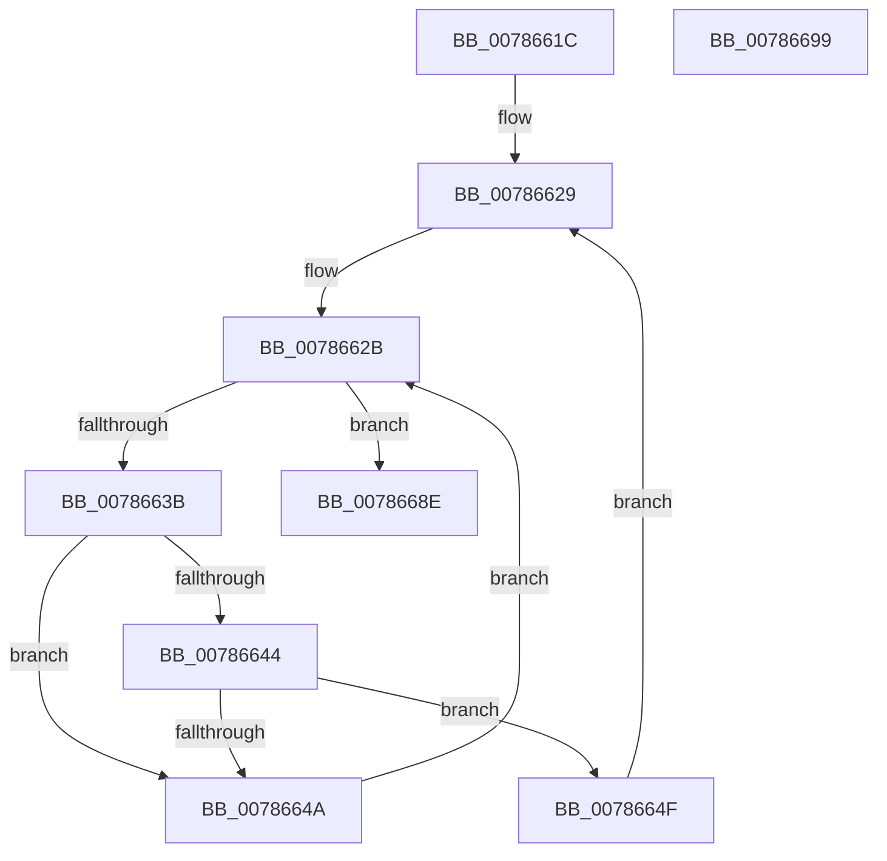

# PspWaitForUsermodeExit

- RVA: `0x0078661C`–`0x0078669A` (길이 `126` bytes)
- VA: `0x000000014078661C`
- 실행 섹션: `PAGE`
- PDB 이름 있음: `예`; PDB Function 태그: `아니요`
- unwind 정보 RVA: `0x0006E5F8`
- 디코드: `37`개 명령, `126/126` bytes 표시
- 미해석 바이트: `0` (있으면 어셈블리에 `.byte`로 보존)

> 이 문서는 커널 이미지의 기계어와 PDB 기호를 분석해 생성했습니다. 4번과 5번은 함수 원형과 자료형을 바이너리 사용 방식에서 추정한 C 해석이며 원본 소스 복구 결과는 아닙니다.

## 1. Dependencies

- 직접 호출 지점: **5**; 고유 호출 대상: **4**
- 직접 호출자로 확인된 함수: **2**
- RIP 상대 이미지 참조: **0**

### Outgoing calls
- `0x0078662E` → [PsGetNextProcessThread](../8C/PsGetNextProcessThread_function_008C9CF0.md) (function, `0x008C9CF0`)
- `0x00786657` → [ObfReferenceObjectWithTag](../../text/21/ObfReferenceObjectWithTag_function_00210710.md) (function, `0x00210710`)
- `0x00786664` → [ObfDereferenceObjectWithTag](../../text/2F/ObfDereferenceObjectWithTag_function_002F78E0.md) (function, `0x002F78E0`)
- `0x0078667A` → [KeWaitForSingleObject](../../text/20/KeWaitForSingleObject_function_0020E6B0.md) (function, `0x0020E6B0`)
- `0x00786687` → [ObfDereferenceObjectWithTag](../../text/2F/ObfDereferenceObjectWithTag_function_002F78E0.md) (function, `0x002F78E0`)

### Direct callers
- [PspWaitOnAllProcessesJobCallback](PspWaitOnAllProcessesJobCallback_function_00785DE0.md) at `0x00785E3A`
- [PsShutdownSystem](PsShutdownSystem_function_00785E94.md) at `0x00786069`

### Static image references
- 디코드된 RIP-relative 메모리 참조가 없습니다.

## 2. Other-region calls and transfers

- 다른 실행 섹션으로 향하는 call: **4**
  - `0x00786657` → [ObfReferenceObjectWithTag](../../text/21/ObfReferenceObjectWithTag_function_00210710.md) (`PAGE` → `.text`)
  - `0x00786664` → [ObfDereferenceObjectWithTag](../../text/2F/ObfDereferenceObjectWithTag_function_002F78E0.md) (`PAGE` → `.text`)
  - `0x0078667A` → [KeWaitForSingleObject](../../text/20/KeWaitForSingleObject_function_0020E6B0.md) (`PAGE` → `.text`)
  - `0x00786687` → [ObfDereferenceObjectWithTag](../../text/2F/ObfDereferenceObjectWithTag_function_002F78E0.md) (`PAGE` → `.text`)
- 별도 외부 분기/꼬리 이동을 확인하지 못했습니다.

## 3. Assembly (complete function range)

```asm
0078661C  48 89 5C 24 08                  mov qword ptr [rsp + 8], rbx
00786621  57                              push rdi
00786622  48 83 EC 30                     sub rsp, 0x30
00786626  48 8B F9                        mov rdi, rcx
00786629  33 D2                           xor edx, edx
0078662B  48 8B CF                        mov rcx, rdi
0078662E  E8 BD 36 14 00                  call 0x1408c9cf0
00786633  48 8B D8                        mov rbx, rax
00786636  48 85 C0                        test rax, rax
00786639  74 53                           je 0x14078668e
0078663B  F7 40 74 00 04 00 00            test dword ptr [rax + 0x74], 0x400
00786642  75 06                           jne 0x14078664a
00786644  80 78 04 00                     cmp byte ptr [rax + 4], 0
00786648  74 05                           je 0x14078664f
0078664A  48 8B D3                        mov rdx, rbx
0078664D  EB DC                           jmp 0x14078662b
0078664F  BA 50 73 54 65                  mov edx, 0x65547350
00786654  48 8B CB                        mov rcx, rbx
00786657  E8 B4 A0 A8 FF                  call 0x140210710
0078665C  BA 50 73 45 6E                  mov edx, 0x6e457350
00786661  48 8B CB                        mov rcx, rbx
00786664  E8 77 12 B7 FF                  call 0x1402f78e0
00786669  48 83 64 24 20 00               and qword ptr [rsp + 0x20], 0
0078666F  45 33 C9                        xor r9d, r9d
00786672  45 33 C0                        xor r8d, r8d
00786675  33 D2                           xor edx, edx
00786677  48 8B CB                        mov rcx, rbx
0078667A  E8 31 80 A8 FF                  call 0x14020e6b0
0078667F  BA 50 73 54 65                  mov edx, 0x65547350
00786684  48 8B CB                        mov rcx, rbx
00786687  E8 54 12 B7 FF                  call 0x1402f78e0
0078668C  EB 9B                           jmp 0x140786629
0078668E  48 8B 5C 24 40                  mov rbx, qword ptr [rsp + 0x40]
00786693  48 83 C4 30                     add rsp, 0x30
00786697  5F                              pop rdi
00786698  C3                              ret
00786699  CC                              int3
```

## 4. C-style interpretation (structured pseudocode)

```c
__int64 __fastcall PspWaitForUsermodeExit(__int64 a1, int a2, int a3, int a4)
{
    __int64 result;
    __int64 v_rsp;
    unsigned __int64 v_stack_m18;
    unsigned __int64 v_stack_p8;

    v_stack_p8 = v_rbx;
    v_rsp = (v_rsp) - (48);
loc_00786629:
    a2 = 0;
loc_0078662B:
    result = PsGetNextProcessThread(a1, a2, a3, a4);
    if (result == 0) goto loc_0078668E;
    if (((*(unsigned int *)(result + 116)) & (0x400ULL)) != 0) goto loc_0078664A;
    if ((*(unsigned __int8 *)(result + 4)) == 0) goto loc_0078664F;
loc_0078664A:
    goto loc_0078662B;
loc_0078664F:
    result = ObfReferenceObjectWithTag(result, (unsigned int)(0x65547350ULL), a3, a4);
    result = ObfDereferenceObjectWithTag(result, (unsigned int)(0x6E457350ULL), a3, a4);
    a4 = 0;
    a3 = 0;
    a2 = 0;
    result = KeWaitForSingleObject(result, a2, a3, a4);
    result = ObfDereferenceObjectWithTag(result, (unsigned int)(0x65547350ULL), a3, a4);
    goto loc_00786629;
loc_0078668E:
    v_rsp = (v_rsp) + (48);
    return result;
}
```

## 5. (Beta) C Style

```c
int64_t PspWaitForUsermodeExit(int64_t Arg1, int32_t Arg2, int32_t Arg3, int32_t Arg4)
{
    int64_t result;
    int64_t local_rsp;
    uint64_t v_stack_m18;
    uint64_t v_stack_p8;

    v_stack_p8 = local_rbx;
    local_rsp = (local_rsp) - (48);
loc_00786629:
    Arg2 = 0;
loc_0078662B:
    result = PsGetNextProcessThread(Arg1, Arg2, Arg3, Arg4);
    if (result == 0) goto loc_0078668E;
    if (((*(uint32_t *)(result + 0x74)) & (0x400ULL)) != 0) goto loc_0078664A;
    if ((*(uint8_t *)(result + 0x4)) == 0) goto loc_0078664F;
loc_0078664A:
    goto loc_0078662B;
loc_0078664F:
    result = ObfReferenceObjectWithTag(result, (uint32_t)(0x65547350ULL), Arg3, Arg4);
    result = ObfDereferenceObjectWithTag(result, (uint32_t)(0x6E457350ULL), Arg3, Arg4);
    Arg4 = 0;
    Arg3 = 0;
    Arg2 = 0;
    result = KeWaitForSingleObject(result, Arg2, Arg3, Arg4);
    result = ObfDereferenceObjectWithTag(result, (uint32_t)(0x65547350ULL), Arg3, Arg4);
    goto loc_00786629;
loc_0078668E:
    local_rsp = (local_rsp) + (48);
    return result;
}
```

## 6. Execution-region graph

[열기: 2D/3D 그래프와 함수 탐색 컨트롤 패널](../../../control-panel.html?section=page&rva=0x0078661C&view=graph)

- 2D 그래프는 위에서 아래로 흐르고, 3D 그래프는 빈 공간을 드래그해 회전합니다. Shift+드래그는 이동, 휠은 확대·축소, 함수 노드 선택은 대상 보고서 이동입니다.

### Static fallback


