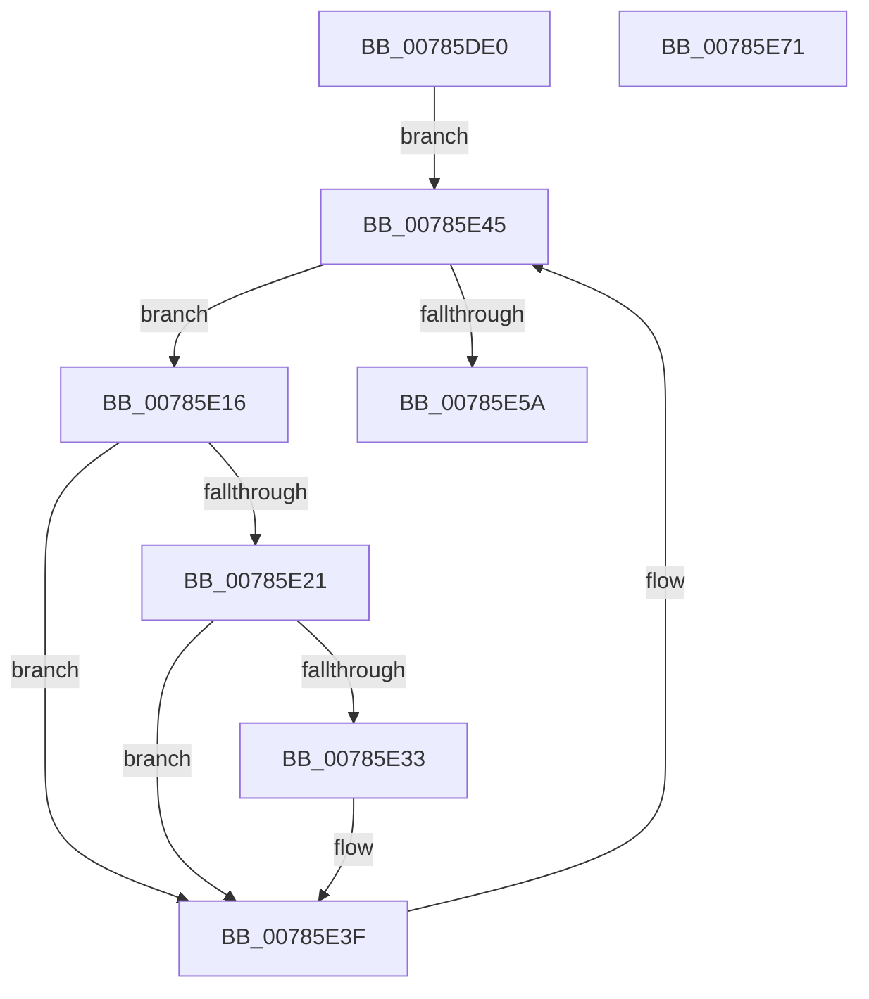

# PspWaitOnAllProcessesJobCallback

- RVA: `0x00785DE0`–`0x00785E72` (길이 `146` bytes)
- VA: `0x0000000140785DE0`
- 실행 섹션: `PAGE`
- PDB 이름 있음: `예`; PDB Function 태그: `아니요`
- unwind 정보 RVA: `0x0007D3C0`
- 디코드: `40`개 명령, `146/146` bytes 표시
- 미해석 바이트: `0` (있으면 어셈블리에 `.byte`로 보존)

> 이 문서는 커널 이미지의 기계어와 PDB 기호를 분석해 생성했습니다. 4번과 5번은 함수 원형과 자료형을 바이너리 사용 방식에서 추정한 C 해석이며 원본 소스 복구 결과는 아닙니다.

## 1. Dependencies

- 직접 호출 지점: **2**; 고유 호출 대상: **2**
- 직접 호출자로 확인된 함수: **0**
- RIP 상대 이미지 참조: **0**

### Outgoing calls
- `0x00785E3A` → [PspWaitForUsermodeExit](PspWaitForUsermodeExit_function_0078661C.md) (function, `0x0078661C`)
- `0x00785E4D` → [PspGetNextJobProcess](../91/PspGetNextJobProcess_function_00918450.md) (function, `0x00918450`)

### Direct callers
- 이 함수 시작 RVA로 연결되는 직접 call은 확인되지 않았습니다. 간접 호출은 완전히 역산할 수 없습니다.

### Static image references
- 디코드된 RIP-relative 메모리 참조가 없습니다.

## 2. Other-region calls and transfers

- 다른 실행 섹션으로 향하는 call: **0**
- 별도 외부 분기/꼬리 이동을 확인하지 못했습니다.

## 3. Assembly (complete function range)

```asm
00785DE0  4C 8B DC                        mov r11, rsp
00785DE3  49 89 5B 08                     mov qword ptr [r11 + 8], rbx
00785DE7  49 89 6B 10                     mov qword ptr [r11 + 0x10], rbp
00785DEB  49 89 73 18                     mov qword ptr [r11 + 0x18], rsi
00785DEF  57                              push rdi
00785DF0  48 83 EC 40                     sub rsp, 0x40
00785DF4  33 C0                           xor eax, eax
00785DF6  0F 57 C0                        xorps xmm0, xmm0
00785DF9  0F 11 44 24 20                  movups xmmword ptr [rsp + 0x20], xmm0
00785DFE  49 89 43 E8                     mov qword ptr [r11 - 0x18], rax
00785E02  48 8B FA                        mov rdi, rdx
00785E05  65 48 8B 2C 25 88 01 00 00      mov rbp, qword ptr gs:[0x188]
00785E0E  48 8B F1                        mov rsi, rcx
00785E11  45 33 C9                        xor r9d, r9d
00785E14  EB 2F                           jmp 0x140785e45
00785E16  8B 8B FC 05 00 00               mov ecx, dword ptr [rbx + 0x5fc]
00785E1C  F6 C1 40                        test cl, 0x40
00785E1F  75 1E                           jne 0x140785e3f
00785E21  65 48 8B 0C 25 88 01 00 00      mov rcx, qword ptr gs:[0x188]
00785E2A  48 3B 99 B8 00 00 00            cmp rbx, qword ptr [rcx + 0xb8]
00785E31  74 0C                           je 0x140785e3f
00785E33  80 4F 04 02                     or byte ptr [rdi + 4], 2
00785E37  48 8B CB                        mov rcx, rbx
00785E3A  E8 DD 07 00 00                  call 0x14078661c
00785E3F  4C 8B CB                        mov r9, rbx
00785E42  48 8B CE                        mov rcx, rsi
00785E45  4C 8D 44 24 20                  lea r8, [rsp + 0x20]
00785E4A  48 8B D5                        mov rdx, rbp
00785E4D  E8 FE 25 19 00                  call 0x140918450
00785E52  48 8B D8                        mov rbx, rax
00785E55  48 85 C0                        test rax, rax
00785E58  75 BC                           jne 0x140785e16
00785E5A  48 8B 5C 24 50                  mov rbx, qword ptr [rsp + 0x50]
00785E5F  33 C0                           xor eax, eax
00785E61  48 8B 6C 24 58                  mov rbp, qword ptr [rsp + 0x58]
00785E66  48 8B 74 24 60                  mov rsi, qword ptr [rsp + 0x60]
00785E6B  48 83 C4 40                     add rsp, 0x40
00785E6F  5F                              pop rdi
00785E70  C3                              ret
00785E71  CC                              int3
```

## 4. C-style interpretation (structured pseudocode)

```c
__int64 __fastcall PspWaitOnAllProcessesJobCallback(__int64 a1, __int64 a2, __int64 a3, int a4)
{
    __int64 result;
    __int64 v_rsp;
    unsigned __int64 v_stack_m28;
    unsigned __int64 v_stack_p10;
    unsigned __int64 v_stack_p18;
    unsigned __int64 v_stack_p8;

    *(unsigned __int64 *)(v_rsp + 8) = v_rbx;
    *(unsigned __int64 *)(v_rsp + 16) = v_rbp;
    *(unsigned __int64 *)(v_rsp + 24) = v_rsi;
    v_rsp = (v_rsp) - (64);
    result = 0;
    v_stack_m28 = v_xmm0;
    *(unsigned __int64 *)(v_rsp - 24) = 0;
    a4 = 0;
    goto loc_00785E45;
loc_00785E16:
    if ((((unsigned __int8)((unsigned int)(*(unsigned int *)(v_rbx + 1532)))) & (64)) != 0) goto loc_00785E3F;
    if (v_rbx != (*(unsigned __int64 *)(*(unsigned __int64 *)(gs_base + (0 + 392)) + 184))) {
        a1 = v_rbx;
        result = PspWaitForUsermodeExit(a1, a2, a3, a4);
    }
loc_00785E45:
    result = PspGetNextJobProcess(a1, *(unsigned __int64 *)(gs_base + (0 + 392)), v_stack_m28, v_rbx);
    if (result != 0) goto loc_00785E16;
    result = 0;
    v_rsp = (v_rsp) + (64);
    return result;
}
```

## 5. (Beta) C Style

```c
int64_t PspWaitOnAllProcessesJobCallback(int64_t Arg1, void *Arg2, int64_t Arg3, int32_t Arg4)
{
    uint8_t *arg2 = (uint8_t *)Arg2;

    int64_t result;
    int64_t local_rsp;
    uint64_t v_stack_m28;
    uint64_t v_stack_p10;
    uint64_t v_stack_p18;
    uint64_t v_stack_p8;

    *(uint64_t *)(local_rsp + 0x8) = local_rbx;
    *(uint64_t *)(local_rsp + 0x10) = local_rbp;
    *(uint64_t *)(local_rsp + 0x18) = local_rsi;
    local_rsp = (local_rsp) - (64);
    result = 0;
    v_stack_m28 = v_xmm0;
    *(uint64_t *)(local_rsp - 0x18) = 0;
    Arg4 = 0;
    goto loc_00785E45;
loc_00785E16:
    if ((((uint8_t)((uint32_t)(*(uint32_t *)(local_rbx + 0x5FC)))) & (64)) != 0) goto loc_00785E3F;
    if (local_rbx != (*(uint64_t *)(*(uint64_t *)(gs_base + (0 + 0x188)) + 0xB8))) {
        Arg1 = local_rbx;
        result = PspWaitForUsermodeExit(Arg1, Arg2, Arg3, Arg4);
    }
loc_00785E45:
    result = PspGetNextJobProcess(Arg1, *(uint64_t *)(gs_base + (0 + 0x188)), v_stack_m28, local_rbx);
    if (result != 0) goto loc_00785E16;
    result = 0;
    local_rsp = (local_rsp) + (64);
    return result;
}
```

### 관측된 메모리 오프셋

구조체 형식이 확인되지 않은 접근은 인자 기준의 오프셋으로만 기록했습니다.

| 기준 인자 | 오프셋 표현 | 폭 (bit) | 접근 |
|---|---:|---:|---|
| `Arg2` | `+ 0x4` | `8` | `R/W` |

## 6. Execution-region graph

[열기: 2D/3D 그래프와 함수 탐색 컨트롤 패널](../../../control-panel.html?section=page&rva=0x00785DE0&view=graph)

- 2D 그래프는 위에서 아래로 흐르고, 3D 그래프는 빈 공간을 드래그해 회전합니다. Shift+드래그는 이동, 휠은 확대·축소, 함수 노드 선택은 대상 보고서 이동입니다.

### Static fallback


