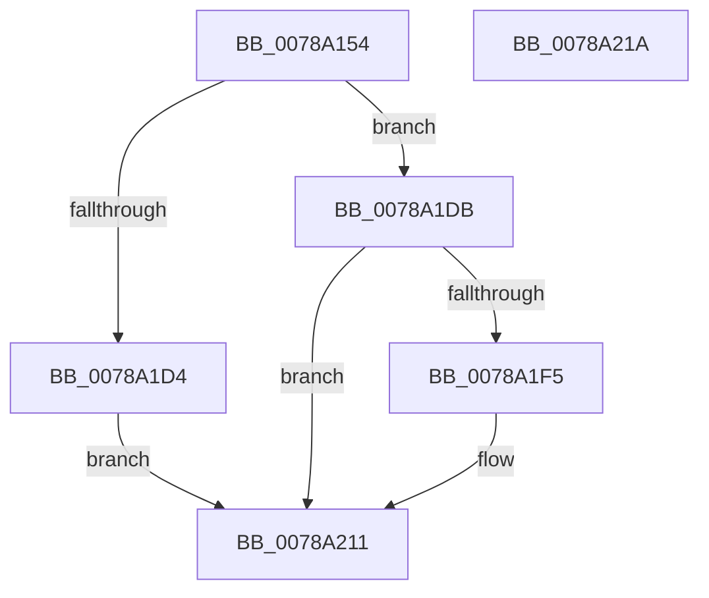

# RawPerformDevIoCtrl

- RVA: `0x0078A154`–`0x0078A21B` (길이 `199` bytes)
- VA: `0x000000014078A154`
- 실행 섹션: `PAGE`
- PDB 이름 있음: `예`; PDB Function 태그: `아니요`
- unwind 정보 RVA: `0x000BA960`
- 디코드: `49`개 명령, `199/199` bytes 표시
- 미해석 바이트: `0` (있으면 어셈블리에 `.byte`로 보존)

> 이 문서는 커널 이미지의 기계어와 PDB 기호를 분석해 생성했습니다. 4번과 5번은 함수 원형과 자료형을 바이너리 사용 방식에서 추정한 C 해석이며 원본 소스 복구 결과는 아닙니다.

## 1. Dependencies

- 직접 호출 지점: **4**; 고유 호출 대상: **4**
- 직접 호출자로 확인된 함수: **1**
- RIP 상대 이미지 참조: **0**

### Outgoing calls
- `0x0078A186` → [KeInitializeEvent](../../text/40/KeInitializeEvent_function_0040DD10.md) (function, `0x0040DD10`)
- `0x0078A1C7` → [IoBuildDeviceIoControlRequest](../../text/20/IoBuildDeviceIoControlRequest_function_00204FD0.md) (function, `0x00204FD0`)
- `0x0078A1E9` → [IofCallDriver](../../text/29/IofCallDriver_function_0029B4B0.md) (function, `0x0029B4B0`)
- `0x0078A208` → [KeWaitForSingleObject](../../text/20/KeWaitForSingleObject_function_0020E6B0.md) (function, `0x0020E6B0`)

### Direct callers
- [RawQueryFileSystemInformation](RawQueryFileSystemInformation_function_0078A350.md) at `0x0078A3DC`

### Static image references
- 디코드된 RIP-relative 메모리 참조가 없습니다.

## 2. Other-region calls and transfers

- 다른 실행 섹션으로 향하는 call: **4**
  - `0x0078A186` → [KeInitializeEvent](../../text/40/KeInitializeEvent_function_0040DD10.md) (`PAGE` → `.text`)
  - `0x0078A1C7` → [IoBuildDeviceIoControlRequest](../../text/20/IoBuildDeviceIoControlRequest_function_00204FD0.md) (`PAGE` → `.text`)
  - `0x0078A1E9` → [IofCallDriver](../../text/29/IofCallDriver_function_0029B4B0.md) (`PAGE` → `.text`)
  - `0x0078A208` → [KeWaitForSingleObject](../../text/20/KeWaitForSingleObject_function_0020E6B0.md) (`PAGE` → `.text`)
- 별도 외부 분기/꼬리 이동을 확인하지 못했습니다.

## 3. Assembly (complete function range)

```asm
0078A154  40 53                           push rbx
0078A156  48 81 EC 80 00 00 00            sub rsp, 0x80
0078A15D  33 C0                           xor eax, eax
0078A15F  48 8D 4C 24 60                  lea rcx, [rsp + 0x60]
0078A164  21 44 24 54                     and dword ptr [rsp + 0x54], eax
0078A168  48 8B DA                        mov rbx, rdx
0078A16B  21 44 24 50                     and dword ptr [rsp + 0x50], eax
0078A16F  0F 57 C0                        xorps xmm0, xmm0
0078A172  48 21 44 24 58                  and qword ptr [rsp + 0x58], rax
0078A177  33 D2                           xor edx, edx
0078A179  45 33 C0                        xor r8d, r8d
0078A17C  48 89 44 24 70                  mov qword ptr [rsp + 0x70], rax
0078A181  0F 11 44 24 60                  movups xmmword ptr [rsp + 0x60], xmm0
0078A186  E8 85 3B C8 FF                  call 0x14040dd10
0078A18B  48 8D 44 24 50                  lea rax, [rsp + 0x50]
0078A190  45 33 C9                        xor r9d, r9d
0078A193  48 89 44 24 40                  mov qword ptr [rsp + 0x40], rax
0078A198  45 33 C0                        xor r8d, r8d
0078A19B  48 8D 44 24 60                  lea rax, [rsp + 0x60]
0078A1A0  48 8B D3                        mov rdx, rbx
0078A1A3  48 89 44 24 38                  mov qword ptr [rsp + 0x38], rax
0078A1A8  B9 00 00 07 00                  mov ecx, 0x70000
0078A1AD  48 8B 84 24 B0 00 00 00         mov rax, qword ptr [rsp + 0xb0]
0078A1B5  C6 44 24 30 00                  mov byte ptr [rsp + 0x30], 0
0078A1BA  C7 44 24 28 18 00 00 00         mov dword ptr [rsp + 0x28], 0x18
0078A1C2  48 89 44 24 20                  mov qword ptr [rsp + 0x20], rax
0078A1C7  E8 04 AE A7 FF                  call 0x140204fd0
0078A1CC  48 8B D0                        mov rdx, rax
0078A1CF  48 85 C0                        test rax, rax
0078A1D2  75 07                           jne 0x14078a1db
0078A1D4  B8 9A 00 00 C0                  mov eax, 0xc000009a
0078A1D9  EB 36                           jmp 0x14078a211
0078A1DB  48 8B 80 B8 00 00 00            mov rax, qword ptr [rax + 0xb8]
0078A1E2  48 8B CB                        mov rcx, rbx
0078A1E5  80 48 BA 02                     or byte ptr [rax - 0x46], 2
0078A1E9  E8 C2 12 B1 FF                  call 0x14029b4b0
0078A1EE  3D 03 01 00 00                  cmp eax, 0x103
0078A1F3  75 1C                           jne 0x14078a211
0078A1F5  48 83 64 24 20 00               and qword ptr [rsp + 0x20], 0
0078A1FB  48 8D 4C 24 60                  lea rcx, [rsp + 0x60]
0078A200  45 33 C9                        xor r9d, r9d
0078A203  45 33 C0                        xor r8d, r8d
0078A206  33 D2                           xor edx, edx
0078A208  E8 A3 44 A8 FF                  call 0x14020e6b0
0078A20D  8B 44 24 50                     mov eax, dword ptr [rsp + 0x50]
0078A211  48 81 C4 80 00 00 00            add rsp, 0x80
0078A218  5B                              pop rbx
0078A219  C3                              ret
0078A21A  CC                              int3
```

## 4. C-style interpretation (structured pseudocode)

```c
__int64 __fastcall RawPerformDevIoCtrl(__int64 a1, __int64 a2, int a3, int a4, __int64 a5)
{
    __int64 result;
    __int64 v_rsp;
    unsigned __int64 v_stack_m18;
    unsigned __int64 v_stack_m28;
    unsigned __int64 v_stack_m30;
    unsigned int v_stack_m34;
    unsigned int v_stack_m38;
    unsigned __int64 v_stack_m48;
    unsigned __int64 v_stack_m50;
    unsigned __int8 v_stack_m58;
    unsigned int v_stack_m60;
    unsigned __int64 v_stack_m68;

    v_rsp = (v_rsp) - (128);
    result = 0;
    a2 = 0;
    a3 = 0;
    v_stack_m18 = 0;
    v_stack_m28 = v_xmm0;
    result = KeInitializeEvent(v_stack_m28, a2, a3, a4);
    a4 = 0;
    v_stack_m48 = v_stack_m38;
    a3 = 0;
    v_stack_m50 = v_stack_m28;
    v_stack_m58 = 0;
    v_stack_m60 = 24;
    v_stack_m68 = a5;
    result = IoBuildDeviceIoControlRequest((unsigned int)(0x70000ULL), 0, a3, a4);
    if (result != 0) goto loc_0078A1DB;
    goto loc_0078A211;
loc_0078A1DB:
    result = IofCallDriver(0, result, a3, a4);
    if (((unsigned int)(result)) == 259) {
        a1 = v_stack_m28;
        a4 = 0;
        a3 = 0;
        a2 = 0;
        result = KeWaitForSingleObject(a1, a2, a3, a4);
        result = v_stack_m38;
    }
    v_rsp = (v_rsp) + (128);
    return result;
}
```

## 5. (Beta) C Style

```c
int64_t RawPerformDevIoCtrl(int64_t Arg1, int64_t Arg2, int32_t Arg3, int32_t Arg4, int64_t Arg5)
{
    int64_t result;
    int64_t local_rsp;
    uint64_t v_stack_m18;
    uint64_t v_stack_m28;
    uint64_t v_stack_m30;
    uint32_t v_stack_m34;
    uint32_t v_stack_m38;
    uint64_t v_stack_m48;
    uint64_t v_stack_m50;
    uint8_t v_stack_m58;
    uint32_t v_stack_m60;
    uint64_t v_stack_m68;

    local_rsp = (local_rsp) - (128);
    result = 0;
    Arg2 = 0;
    Arg3 = 0;
    v_stack_m18 = 0;
    v_stack_m28 = v_xmm0;
    result = KeInitializeEvent(v_stack_m28, Arg2, Arg3, Arg4);
    Arg4 = 0;
    v_stack_m48 = v_stack_m38;
    Arg3 = 0;
    v_stack_m50 = v_stack_m28;
    v_stack_m58 = 0;
    v_stack_m60 = 24;
    v_stack_m68 = Arg5;
    result = IoBuildDeviceIoControlRequest((uint32_t)(0x70000ULL), 0, Arg3, Arg4);
    if (result != 0) goto loc_0078A1DB;
    goto loc_0078A211;
loc_0078A1DB:
    result = IofCallDriver(0, result, Arg3, Arg4);
    if (((uint32_t)(result)) == 259) {
        Arg1 = v_stack_m28;
        Arg4 = 0;
        Arg3 = 0;
        Arg2 = 0;
        result = KeWaitForSingleObject(Arg1, Arg2, Arg3, Arg4);
        result = v_stack_m38;
    }
    local_rsp = (local_rsp) + (128);
    return result;
}
```

## 6. Execution-region graph

[열기: 2D/3D 그래프와 함수 탐색 컨트롤 패널](../../../control-panel.html?section=page&rva=0x0078A154&view=graph)

- 2D 그래프는 위에서 아래로 흐르고, 3D 그래프는 빈 공간을 드래그해 회전합니다. Shift+드래그는 이동, 휠은 확대·축소, 함수 노드 선택은 대상 보고서 이동입니다.

### Static fallback


