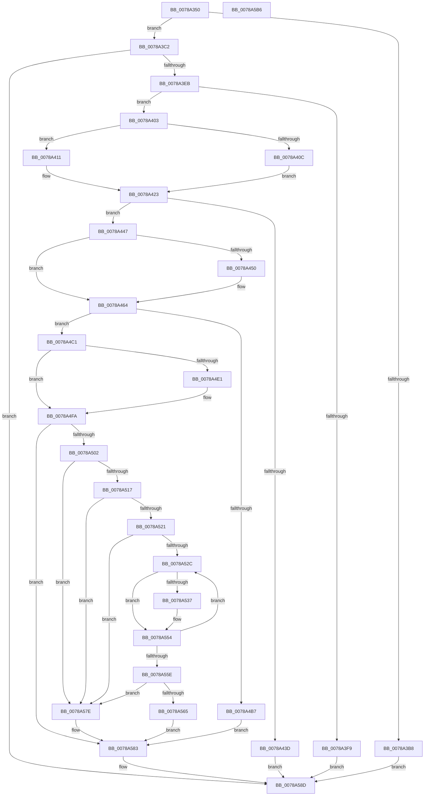

# RawQueryFileSystemInformation

- RVA: `0x0078A350`–`0x0078A5B7` (길이 `615` bytes)
- VA: `0x000000014078A350`
- 실행 섹션: `PAGE`
- PDB 이름 있음: `예`; PDB Function 태그: `아니요`
- unwind 정보 RVA: `0x000C98BC`
- 디코드: `167`개 명령, `615/615` bytes 표시
- 미해석 바이트: `0` (있으면 어셈블리에 `.byte`로 보존)

> 이 문서는 커널 이미지의 기계어와 PDB 기호를 분석해 생성했습니다. 4번과 5번은 함수 원형과 자료형을 바이너리 사용 방식에서 추정한 C 해석이며 원본 소스 복구 결과는 아닙니다.

## 1. Dependencies

- 직접 호출 지점: **13**; 고유 호출 대상: **10**
- 직접 호출자로 확인된 함수: **1**
- RIP 상대 이미지 참조: **1**

### Outgoing calls
- `0x0078A3C7` → [memset](../../text/6C/memset_function_006C6C40.md) (function, `0x006C6C40`)
- `0x0078A3DC` → [RawPerformDevIoCtrl](RawPerformDevIoCtrl_function_0078A154.md) (function, `0x0078A154`)
- `0x0078A403` → [Feature_RAW_Sector_Alignment_Fix__private_IsEnabledDeviceUsageNoInline](../../text/5E/Feature_RAW_Sector_Alignment_Fix__private_IsEnabledDeviceUsageNoInline_function_005E50CC.md) (function, `0x005E50CC`)
- `0x0078A430` → [ExAllocatePoolWithTag](../../poolcode/B8/ExAllocatePoolWithTag_function_00B82010.md) (function, `0x00B82010`)
- `0x0078A447` → [Feature_RAW_Sector_Alignment_Fix__private_IsEnabledDeviceUsageNoInline](../../text/5E/Feature_RAW_Sector_Alignment_Fix__private_IsEnabledDeviceUsageNoInline_function_005E50CC.md) (function, `0x005E50CC`)
- `0x0078A46D` → [KeInitializeEvent](../../text/40/KeInitializeEvent_function_0040DD10.md) (function, `0x0040DD10`)
- `0x0078A472` → [Feature_RAW_Sector_Alignment_Fix__private_IsEnabledDeviceUsageNoInline](../../text/5E/Feature_RAW_Sector_Alignment_Fix__private_IsEnabledDeviceUsageNoInline_function_005E50CC.md) (function, `0x005E50CC`)
- `0x0078A4AA` → [IoBuildSynchronousFsdRequest](../A4/IoBuildSynchronousFsdRequest_function_00A49880.md) (function, `0x00A49880`)
- `0x0078A4D3` → [IofCallDriver](../../text/29/IofCallDriver_function_0029B4B0.md) (function, `0x0029B4B0`)
- `0x0078A4F2` → [KeWaitForSingleObject](../../text/20/KeWaitForSingleObject_function_0020E6B0.md) (function, `0x0020E6B0`)
- `0x0078A502` → [Feature_RAW_Sector_Alignment_Fix__private_IsEnabledDeviceUsageNoInline](../../text/5E/Feature_RAW_Sector_Alignment_Fix__private_IsEnabledDeviceUsageNoInline_function_005E50CC.md) (function, `0x005E50CC`)
- `0x0078A588` → [ExFreePoolWithTag](../../poolcode/B8/ExFreePoolWithTag_function_00B82870.md) (function, `0x00B82870`)
- `0x0078A596` → [_security_check_cookie](../../text/6A/_security_check_cookie_function_006AC640.md) (function, `0x006AC640`)

### Direct callers
- [RawUserFsCtrl](../9A/RawUserFsCtrl_function_009A45F4.md) at `0x009A46BF`

### Static image references
- `0x0078A36C` → RVA `0x00E0A740` (`.data`; read)

## 2. Other-region calls and transfers

- 다른 실행 섹션으로 향하는 call: **11**
  - `0x0078A3C7` → [memset](../../text/6C/memset_function_006C6C40.md) (`PAGE` → `.text`)
  - `0x0078A403` → [Feature_RAW_Sector_Alignment_Fix__private_IsEnabledDeviceUsageNoInline](../../text/5E/Feature_RAW_Sector_Alignment_Fix__private_IsEnabledDeviceUsageNoInline_function_005E50CC.md) (`PAGE` → `.text`)
  - `0x0078A430` → [ExAllocatePoolWithTag](../../poolcode/B8/ExAllocatePoolWithTag_function_00B82010.md) (`PAGE` → `POOLCODE`)
  - `0x0078A447` → [Feature_RAW_Sector_Alignment_Fix__private_IsEnabledDeviceUsageNoInline](../../text/5E/Feature_RAW_Sector_Alignment_Fix__private_IsEnabledDeviceUsageNoInline_function_005E50CC.md) (`PAGE` → `.text`)
  - `0x0078A46D` → [KeInitializeEvent](../../text/40/KeInitializeEvent_function_0040DD10.md) (`PAGE` → `.text`)
  - `0x0078A472` → [Feature_RAW_Sector_Alignment_Fix__private_IsEnabledDeviceUsageNoInline](../../text/5E/Feature_RAW_Sector_Alignment_Fix__private_IsEnabledDeviceUsageNoInline_function_005E50CC.md) (`PAGE` → `.text`)
  - `0x0078A4D3` → [IofCallDriver](../../text/29/IofCallDriver_function_0029B4B0.md) (`PAGE` → `.text`)
  - `0x0078A4F2` → [KeWaitForSingleObject](../../text/20/KeWaitForSingleObject_function_0020E6B0.md) (`PAGE` → `.text`)
  - `0x0078A502` → [Feature_RAW_Sector_Alignment_Fix__private_IsEnabledDeviceUsageNoInline](../../text/5E/Feature_RAW_Sector_Alignment_Fix__private_IsEnabledDeviceUsageNoInline_function_005E50CC.md) (`PAGE` → `.text`)
  - `0x0078A588` → [ExFreePoolWithTag](../../poolcode/B8/ExFreePoolWithTag_function_00B82870.md) (`PAGE` → `POOLCODE`)
  - `0x0078A596` → [_security_check_cookie](../../text/6A/_security_check_cookie_function_006AC640.md) (`PAGE` → `.text`)
- 별도 외부 분기/꼬리 이동을 확인하지 못했습니다.

## 3. Assembly (complete function range)

```asm
0078A350  48 89 5C 24 20                  mov qword ptr [rsp + 0x20], rbx
0078A355  55                              push rbp
0078A356  56                              push rsi
0078A357  57                              push rdi
0078A358  41 54                           push r12
0078A35A  41 55                           push r13
0078A35C  41 56                           push r14
0078A35E  41 57                           push r15
0078A360  48 8D 6C 24 D9                  lea rbp, [rsp - 0x27]
0078A365  48 81 EC B0 00 00 00            sub rsp, 0xb0
0078A36C  48 8B 05 CD 03 68 00            mov rax, qword ptr [rip + 0x6803cd]
0078A373  48 33 C4                        xor rax, rsp
0078A376  48 89 45 17                     mov qword ptr [rbp + 0x17], rax
0078A37A  48 8B C1                        mov rax, rcx
0078A37D  48 89 4D CF                     mov qword ptr [rbp - 0x31], rcx
0078A381  33 C9                           xor ecx, ecx
0078A383  33 F6                           xor esi, esi
0078A385  0F 57 C0                        xorps xmm0, xmm0
0078A388  48 89 4D E7                     mov qword ptr [rbp - 0x19], rcx
0078A38C  48 89 4D 0F                     mov qword ptr [rbp + 0xf], rcx
0078A390  0F 57 C9                        xorps xmm1, xmm1
0078A393  48 8B 48 18                     mov rcx, qword ptr [rax + 0x18]
0078A397  4D 8B E8                        mov r13, r8
0078A39A  8B 42 08                        mov eax, dword ptr [rdx + 8]
0078A39D  44 8B F6                        mov r14d, esi
0078A3A0  48 89 4D C7                     mov qword ptr [rbp - 0x39], rcx
0078A3A4  44 8B E6                        mov r12d, esi
0078A3A7  0F 11 45 D7                     movups xmmword ptr [rbp - 0x29], xmm0
0078A3AB  0F 11 45 EF                     movups xmmword ptr [rbp - 0x11], xmm0
0078A3AF  0F 11 4D FF                     movups xmmword ptr [rbp - 1], xmm1
0078A3B3  83 F8 09                        cmp eax, 9
0078A3B6  73 0A                           jae 0x14078a3c2
0078A3B8  BB 23 00 00 C0                  mov ebx, 0xc0000023
0078A3BD  E9 CB 01 00 00                  jmp 0x14078a58d
0078A3C2  4C 8B C0                        mov r8, rax
0078A3C5  33 D2                           xor edx, edx
0078A3C7  E8 74 C8 F3 FF                  call 0x1406c6c40
0078A3CC  49 8B 95 C0 00 00 00            mov rdx, qword ptr [r13 + 0xc0]
0078A3D3  48 8D 45 FF                     lea rax, [rbp - 1]
0078A3D7  48 89 44 24 20                  mov qword ptr [rsp + 0x20], rax
0078A3DC  E8 73 FD FF FF                  call 0x14078a154
0078A3E1  8B D8                           mov ebx, eax
0078A3E3  85 C0                           test eax, eax
0078A3E5  0F 88 A2 01 00 00               js 0x14078a58d
0078A3EB  44 8B 7D 13                     mov r15d, dword ptr [rbp + 0x13]
0078A3EF  B8 18 00 00 00                  mov eax, 0x18
0078A3F4  44 3B F8                        cmp r15d, eax
0078A3F7  73 0A                           jae 0x14078a403
0078A3F9  BB BB 00 00 C0                  mov ebx, 0xc00000bb
0078A3FE  E9 8A 01 00 00                  jmp 0x14078a58d
0078A403  E8 C4 AC E5 FF                  call 0x1405e50cc
0078A408  85 C0                           test eax, eax
0078A40A  75 05                           jne 0x14078a411
0078A40C  41 8B C7                        mov eax, r15d
0078A40F  EB 12                           jmp 0x14078a423
0078A411  49 8B 85 C0 00 00 00            mov rax, qword ptr [r13 + 0xc0]
0078A418  44 8B A0 98 00 00 00            mov r12d, dword ptr [rax + 0x98]
0078A41F  43 8D 04 3C                     lea eax, [r12 + r15]
0078A423  8B D0                           mov edx, eax
0078A425  B9 01 04 00 00                  mov ecx, 0x401
0078A42A  41 B8 52 41 57 62               mov r8d, 0x62574152
0078A430  E8 DB 7B 3F 00                  call 0x140b82010
0078A435  48 8B F8                        mov rdi, rax
0078A438  48 85 C0                        test rax, rax
0078A43B  75 0A                           jne 0x14078a447
0078A43D  BB 9A 00 00 C0                  mov ebx, 0xc000009a
0078A442  E9 46 01 00 00                  jmp 0x14078a58d
0078A447  E8 80 AC E5 FF                  call 0x1405e50cc
0078A44C  85 C0                           test eax, eax
0078A44E  74 14                           je 0x14078a464
0078A450  41 8D 44 24 01                  lea eax, [r12 + 1]
0078A455  8B C8                           mov ecx, eax
0078A457  4C 8D 70 FF                     lea r14, [rax - 1]
0078A45B  4C 03 F7                        add r14, rdi
0078A45E  48 F7 D9                        neg rcx
0078A461  4C 23 F1                        and r14, rcx
0078A464  45 33 C0                        xor r8d, r8d
0078A467  48 8D 4D D7                     lea rcx, [rbp - 0x29]
0078A46B  33 D2                           xor edx, edx
0078A46D  E8 9E 38 C8 FF                  call 0x14040dd10
0078A472  E8 55 AC E5 FF                  call 0x1405e50cc
0078A477  49 8B 95 C0 00 00 00            mov rdx, qword ptr [r13 + 0xc0]
0078A47E  85 C0                           test eax, eax
0078A480  48 8D 45 EF                     lea rax, [rbp - 0x11]
0078A484  4D 8B C6                        mov r8, r14
0078A487  48 89 44 24 30                  mov qword ptr [rsp + 0x30], rax
0078A48C  41 BC 03 00 00 00               mov r12d, 3
0078A492  48 8D 45 D7                     lea rax, [rbp - 0x29]
0078A496  4C 0F 44 C7                     cmove r8, rdi
0078A49A  48 89 44 24 28                  mov qword ptr [rsp + 0x28], rax
0078A49F  45 8B CF                        mov r9d, r15d
0078A4A2  41 8B CC                        mov ecx, r12d
0078A4A5  48 89 74 24 20                  mov qword ptr [rsp + 0x20], rsi
0078A4AA  E8 D1 F3 2B 00                  call 0x140a49880
0078A4AF  48 8B D0                        mov rdx, rax
0078A4B2  48 85 C0                        test rax, rax
0078A4B5  75 0A                           jne 0x14078a4c1
0078A4B7  BB 9A 00 00 C0                  mov ebx, 0xc000009a
0078A4BC  E9 C2 00 00 00                  jmp 0x14078a583
0078A4C1  48 8B 80 B8 00 00 00            mov rax, qword ptr [rax + 0xb8]
0078A4C8  80 48 BA 02                     or byte ptr [rax - 0x46], 2
0078A4CC  49 8B 8D C0 00 00 00            mov rcx, qword ptr [r13 + 0xc0]
0078A4D3  E8 D8 0F B1 FF                  call 0x14029b4b0
0078A4D8  8B D8                           mov ebx, eax
0078A4DA  3D 03 01 00 00                  cmp eax, 0x103
0078A4DF  75 19                           jne 0x14078a4fa
0078A4E1  45 33 C9                        xor r9d, r9d
0078A4E4  48 89 74 24 20                  mov qword ptr [rsp + 0x20], rsi
0078A4E9  45 33 C0                        xor r8d, r8d
0078A4EC  48 8D 4D D7                     lea rcx, [rbp - 0x29]
0078A4F0  33 D2                           xor edx, edx
0078A4F2  E8 B9 41 A8 FF                  call 0x14020e6b0
0078A4F7  8B 5D EF                        mov ebx, dword ptr [rbp - 0x11]
0078A4FA  85 DB                           test ebx, ebx
0078A4FC  0F 88 81 00 00 00               js 0x14078a583
0078A502  E8 C5 AB E5 FF                  call 0x1405e50cc
0078A507  85 C0                           test eax, eax
0078A509  4C 0F 44 F7                     cmove r14, rdi
0078A50D  41 81 7E 10 46 53 52 53         cmp dword ptr [r14 + 0x10], 0x53525346
0078A515  75 67                           jne 0x14078a57e
0078A517  45 0F B7 46 14                  movzx r8d, word ptr [r14 + 0x14]
0078A51C  45 3B C7                        cmp r8d, r15d
0078A51F  77 5D                           ja 0x14078a57e
0078A521  B8 18 00 00 00                  mov eax, 0x18
0078A526  66 44 3B C0                     cmp r8w, ax
0078A52A  72 52                           jb 0x14078a57e
0078A52C  41 8D 44 24 EA                  lea eax, [r12 - 0x16]
0078A531  66 83 F8 01                     cmp ax, 1
0078A535  76 1D                           jbe 0x14078a554
0078A537  0F B7 CE                        movzx ecx, si
0078A53A  41 0F B7 C4                     movzx eax, r12w
0078A53E  66 D1 EE                        shr si, 1
0078A541  42 0F B6 14 30                  movzx edx, byte ptr [rax + r14]
0078A546  B8 00 80 00 00                  mov eax, 0x8000
0078A54B  0F AF C8                        imul ecx, eax
0078A54E  66 03 D1                        add dx, cx
0078A551  66 03 F2                        add si, dx
0078A554  66 41 FF C4                     inc r12w
0078A558  66 45 3B E0                     cmp r12w, r8w
0078A55C  72 CE                           jb 0x14078a52c
0078A55E  66 41 3B 76 16                  cmp si, word ptr [r14 + 0x16]
0078A563  75 19                           jne 0x14078a57e
0078A565  49 8B 46 03                     mov rax, qword ptr [r14 + 3]
0078A569  48 8B 4D C7                     mov rcx, qword ptr [rbp - 0x39]
0078A56D  48 89 01                        mov qword ptr [rcx], rax
0078A570  48 8B 45 CF                     mov rax, qword ptr [rbp - 0x31]
0078A574  48 C7 40 38 09 00 00 00         mov qword ptr [rax + 0x38], 9
0078A57C  EB 05                           jmp 0x14078a583
0078A57E  BB BB 00 00 C0                  mov ebx, 0xc00000bb
0078A583  33 D2                           xor edx, edx
0078A585  48 8B CF                        mov rcx, rdi
0078A588  E8 E3 82 3F 00                  call 0x140b82870
0078A58D  8B C3                           mov eax, ebx
0078A58F  48 8B 4D 17                     mov rcx, qword ptr [rbp + 0x17]
0078A593  48 33 CC                        xor rcx, rsp
0078A596  E8 A5 20 F2 FF                  call 0x1406ac640
0078A59B  48 8B 9C 24 08 01 00 00         mov rbx, qword ptr [rsp + 0x108]
0078A5A3  48 81 C4 B0 00 00 00            add rsp, 0xb0
0078A5AA  41 5F                           pop r15
0078A5AC  41 5E                           pop r14
0078A5AE  41 5D                           pop r13
0078A5B0  41 5C                           pop r12
0078A5B2  5F                              pop rdi
0078A5B3  5E                              pop rsi
0078A5B4  5D                              pop rbp
0078A5B5  C3                              ret
0078A5B6  CC                              int3
```

## 4. C-style interpretation (structured pseudocode)

```c
__int64 __fastcall RawQueryFileSystemInformation(__int64 a1, __int64 a2, __int64 a3)
{
    __int64 result;
    __int64 v_r12;
    __int64 v_r14;
    __int64 v_rbx;
    __int64 v_rsi;
    __int64 v_rsp;
    unsigned __int64 v_stack_m48;
    unsigned int v_stack_m4C;
    unsigned __int64 v_stack_m50;
    unsigned __int64 v_stack_m5F;
    unsigned __int64 v_stack_m60;
    unsigned __int64 v_stack_m70;
    unsigned __int64 v_stack_m78;
    unsigned __int64 v_stack_m88;
    unsigned __int64 v_stack_m90;
    unsigned __int64 v_stack_m98;
    unsigned __int64 v_stack_mB8;
    unsigned __int64 v_stack_mC0;
    unsigned __int64 v_stack_mC8;
    unsigned __int64 v_stack_p20;

    v_stack_p20 = v_rbx;
    v_rsp = (v_rsp) - (176);
    result = (*(unsigned __int64 *)(v_rip + 6816717)) ^ (v_rsp);
    v_stack_m48 = result;
    v_stack_m90 = a1;
    a1 = 0;
    v_rsi = 0;
    v_stack_m78 = 0;
    v_stack_m50 = 0;
    v_stack_m98 = *(unsigned __int64 *)(a1 + 24);
    v_stack_m88 = v_xmm0;
    v_stack_m70 = v_xmm0;
    v_stack_m60 = v_xmm1;
    if (((unsigned int)((unsigned int)(*(unsigned int *)(a2 + 8)))) >= 9) goto loc_0078A3C2;
    goto loc_0078A58D;
loc_0078A3C2:
    a2 = 0;
    result = memset(*(unsigned __int64 *)(a1 + 24), a2, (unsigned int)(*(unsigned int *)(a2 + 8)), a4);
    v_stack_mC8 = v_stack_m60;
    result = RawPerformDevIoCtrl(*(unsigned __int64 *)(a1 + 24), *(unsigned __int64 *)(a3 + 192), (unsigned int)(*(unsigned int *)(a2 + 8)), a4);
    if (sign_flag) goto loc_0078A58D;
    if (((unsigned int)((unsigned int)(v_stack_m4C))) >= 24) goto loc_0078A403;
    goto loc_0078A58D;
loc_0078A403:
    result = Feature_RAW_Sector_Alignment_Fix__private_IsEnabledDeviceUsageNoInline(*(unsigned __int64 *)(a1 + 24), *(unsigned __int64 *)(a3 + 192), (unsigned int)(*(unsigned int *)(a2 + 8)), a4);
    if ((unsigned int)(result) != 0) goto loc_0078A411;
    goto loc_0078A423;
loc_0078A411:
loc_0078A423:
    result = ExAllocatePoolWithTag((unsigned int)(0x401ULL), (unsigned int)((unsigned int)((unsigned int)(*(unsigned int *)(*(unsigned __int64 *)(a3 + 192) + 152)) + (unsigned int)(v_stack_m4C) * 1)), (unsigned int)(0x62574152ULL), a4);
    if (result != 0) goto loc_0078A447;
    goto loc_0078A58D;
loc_0078A447:
    result = Feature_RAW_Sector_Alignment_Fix__private_IsEnabledDeviceUsageNoInline((unsigned int)(0x401ULL), (unsigned int)((unsigned int)((unsigned int)(*(unsigned int *)(*(unsigned __int64 *)(a3 + 192) + 152)) + (unsigned int)(v_stack_m4C) * 1)), (unsigned int)(0x62574152ULL), a4);
    v_r14 = 0;
    if ((unsigned int)(result) != 0) {
        result = (unsigned int)(*(unsigned int *)(*(unsigned __int64 *)(a3 + 192) + 152)) + 1;
        a1 = (unsigned int)(result);
        v_r14 = result - 1;
        v_r14 = (v_r14) + (result);
        a1 = -(a1);
        v_r14 = (v_r14) & (a1);
    }
    a3 = 0;
    a2 = 0;
    result = KeInitializeEvent(v_stack_m88, a2, a3, a4);
    result = Feature_RAW_Sector_Alignment_Fix__private_IsEnabledDeviceUsageNoInline(v_stack_m88, a2, a3, a4);
    v_stack_mB8 = v_stack_m70;
    a3 = v_r14;
    if ((unsigned int)(result) == 0) { a3 = result; }
    v_stack_mC0 = v_stack_m88;
    v_stack_mC8 = 0;
    result = IoBuildSynchronousFsdRequest(3, *(unsigned __int64 *)(a3 + 192), a3, (unsigned int)((unsigned int)((unsigned int)(v_stack_m4C))));
    if (result != 0) goto loc_0078A4C1;
    goto loc_0078A583;
loc_0078A4C1:
    result = IofCallDriver(*(unsigned __int64 *)(a3 + 192), result, a3, (unsigned int)((unsigned int)((unsigned int)(v_stack_m4C))));
    v_rbx = (unsigned int)((unsigned int)(result));
    if (((unsigned int)(result)) == 259) {
        a4 = 0;
        v_stack_mC8 = 0;
        a3 = 0;
        a1 = v_stack_m88;
        a2 = 0;
        result = KeWaitForSingleObject(a1, a2, a3, a4);
        v_rbx = v_stack_m70;
    }
    if (sign_flag) goto loc_0078A583;
    result = Feature_RAW_Sector_Alignment_Fix__private_IsEnabledDeviceUsageNoInline(a1, a2, a3, a4);
    if ((unsigned int)(result) == 0) { v_r14 = result; }
    if ((*(unsigned int *)(v_r14 + 16)) != 0x53525346ULL) goto loc_0078A57E;
    if (((unsigned int)(*(unsigned __int16 *)(v_r14 + 20))) > ((unsigned int)((unsigned int)(v_stack_m4C)))) goto loc_0078A57E;
    if (((unsigned __int16)(*(unsigned __int16 *)(v_r14 + 20))) < 24) goto loc_0078A57E;
loc_0078A52C:
    result = 3 - 22;
    if (((unsigned __int16)(3 - 22)) >= = 1) {
        a1 = 0;
        result = 3;
        v_rsi = (unsigned __int16)((v_rsi) >> (1));
        a2 = *(unsigned __int8 *)(result + v_r14 * 1);
        result = 0x8000ULL;
        a1 = (unsigned int)((a1) * ((unsigned int)(result)));
        a2 = (unsigned __int16)((a2) + ((unsigned __int16)(a1)));
        v_rsi = (unsigned __int16)((v_rsi) + ((unsigned __int16)(a2)));
    }
    v_r12 = (unsigned __int16)((3) + 1);
    if (((unsigned __int16)(v_r12)) < ((unsigned __int16)(*(unsigned __int16 *)(v_r14 + 20)))) goto loc_0078A52C;
    if (((unsigned __int16)(v_rsi)) != (*(unsigned __int16 *)(v_r14 + 22))) goto loc_0078A57E;
    *(unsigned __int64 *)(v_stack_m98) = *(unsigned __int64 *)(v_r14 + 3);
    *(unsigned __int64 *)(v_stack_m90 + 56) = 9;
    goto loc_0078A583;
loc_0078A57E:
loc_0078A583:
    a2 = 0;
    result = ExFreePoolWithTag(result, a2, *(unsigned __int16 *)(v_r14 + 20), a4);
loc_0078A58D:
    a1 = (v_stack_m48) ^ (v_rsp);
    result = _security_check_cookie(a1, a2, *(unsigned __int16 *)(v_r14 + 20), a4);
    v_rsp = (v_rsp) + (176);
    return result;
}
```

## 5. (Beta) C Style

```c
int64_t RawQueryFileSystemInformation(void *Arg1, void *Arg2, void *Arg3)
{
    uint8_t *arg1 = (uint8_t *)Arg1;
    uint8_t *arg2 = (uint8_t *)Arg2;
    uint8_t *arg3 = (uint8_t *)Arg3;

    int64_t result;
    int64_t local_r12;
    int64_t local_r14;
    int64_t local_rbx;
    int64_t local_rsi;
    int64_t local_rsp;
    uint64_t v_stack_m48;
    uint32_t v_stack_m4C;
    uint64_t v_stack_m50;
    uint64_t v_stack_m5F;
    uint64_t v_stack_m60;
    uint64_t v_stack_m70;
    uint64_t v_stack_m78;
    uint64_t v_stack_m88;
    uint64_t v_stack_m90;
    uint64_t v_stack_m98;
    uint64_t v_stack_mB8;
    uint64_t v_stack_mC0;
    uint64_t v_stack_mC8;
    uint64_t v_stack_p20;

    v_stack_p20 = local_rbx;
    local_rsp = (local_rsp) - (176);
    result = (*(uint64_t *)(v_rip + 0x6803CD)) ^ (local_rsp);
    v_stack_m48 = result;
    v_stack_m90 = Arg1;
    Arg1 = 0;
    local_rsi = 0;
    v_stack_m78 = 0;
    v_stack_m50 = 0;
    v_stack_m98 = *(uint64_t *)(arg1 + 0x18);
    v_stack_m88 = v_xmm0;
    v_stack_m70 = v_xmm0;
    v_stack_m60 = v_xmm1;
    if (((uint32_t)((uint32_t)(*(uint32_t *)(arg2 + 0x8)))) >= 9) goto loc_0078A3C2;
    goto loc_0078A58D;
loc_0078A3C2:
    Arg2 = 0;
    result = memset(*(uint64_t *)(arg1 + 0x18), Arg2, (uint32_t)(*(uint32_t *)(arg2 + 0x8)), a4);
    v_stack_mC8 = v_stack_m60;
    result = RawPerformDevIoCtrl(*(uint64_t *)(arg1 + 0x18), *(uint64_t *)(arg3 + 0xC0), (uint32_t)(*(uint32_t *)(arg2 + 0x8)), a4);
    if (sign_flag) goto loc_0078A58D;
    if (((uint32_t)((uint32_t)(v_stack_m4C))) >= 24) goto loc_0078A403;
    goto loc_0078A58D;
loc_0078A403:
    result = Feature_RAW_Sector_Alignment_Fix__private_IsEnabledDeviceUsageNoInline(*(uint64_t *)(arg1 + 0x18), *(uint64_t *)(arg3 + 0xC0), (uint32_t)(*(uint32_t *)(arg2 + 0x8)), a4);
    if ((uint32_t)(result) != 0) goto loc_0078A411;
    goto loc_0078A423;
loc_0078A411:
loc_0078A423:
    result = ExAllocatePoolWithTag((uint32_t)(0x401ULL), (uint32_t)((uint32_t)((uint32_t)(*(uint32_t *)(*(uint64_t *)(arg3 + 0xC0) + 0x98)) + (uint32_t)(v_stack_m4C) * 1)), (uint32_t)(0x62574152ULL), a4);
    if (result != 0) goto loc_0078A447;
    goto loc_0078A58D;
loc_0078A447:
    result = Feature_RAW_Sector_Alignment_Fix__private_IsEnabledDeviceUsageNoInline((uint32_t)(0x401ULL), (uint32_t)((uint32_t)((uint32_t)(*(uint32_t *)(*(uint64_t *)(arg3 + 0xC0) + 0x98)) + (uint32_t)(v_stack_m4C) * 1)), (uint32_t)(0x62574152ULL), a4);
    local_r14 = 0;
    if ((uint32_t)(result) != 0) {
        result = (uint32_t)(*(uint32_t *)(*(uint64_t *)(arg3 + 0xC0) + 0x98)) + 1;
        Arg1 = (uint32_t)(result);
        local_r14 = result - 1;
        local_r14 = (local_r14) + (result);
        Arg1 = -(Arg1);
        local_r14 = (local_r14) & (Arg1);
    }
    Arg3 = 0;
    Arg2 = 0;
    result = KeInitializeEvent(v_stack_m88, Arg2, Arg3, a4);
    result = Feature_RAW_Sector_Alignment_Fix__private_IsEnabledDeviceUsageNoInline(v_stack_m88, Arg2, Arg3, a4);
    v_stack_mB8 = v_stack_m70;
    Arg3 = local_r14;
    if ((uint32_t)(result) == 0) { Arg3 = result; }
    v_stack_mC0 = v_stack_m88;
    v_stack_mC8 = 0;
    result = IoBuildSynchronousFsdRequest(3, *(uint64_t *)(arg3 + 0xC0), Arg3, (uint32_t)((uint32_t)((uint32_t)(v_stack_m4C))));
    if (result != 0) goto loc_0078A4C1;
    goto loc_0078A583;
loc_0078A4C1:
    result = IofCallDriver(*(uint64_t *)(arg3 + 0xC0), result, Arg3, (uint32_t)((uint32_t)((uint32_t)(v_stack_m4C))));
    local_rbx = (uint32_t)((uint32_t)(result));
    if (((uint32_t)(result)) == 259) {
        a4 = 0;
        v_stack_mC8 = 0;
        Arg3 = 0;
        Arg1 = v_stack_m88;
        Arg2 = 0;
        result = KeWaitForSingleObject(Arg1, Arg2, Arg3, a4);
        local_rbx = v_stack_m70;
    }
    if (sign_flag) goto loc_0078A583;
    result = Feature_RAW_Sector_Alignment_Fix__private_IsEnabledDeviceUsageNoInline(Arg1, Arg2, Arg3, a4);
    if ((uint32_t)(result) == 0) { local_r14 = result; }
    if ((*(uint32_t *)(local_r14 + 0x10)) != 0x53525346ULL) goto loc_0078A57E;
    if (((uint32_t)(*(uint16_t *)(local_r14 + 0x14))) > ((uint32_t)((uint32_t)(v_stack_m4C)))) goto loc_0078A57E;
    if (((uint16_t)(*(uint16_t *)(local_r14 + 0x14))) < 24) goto loc_0078A57E;
loc_0078A52C:
    result = 3 - 22;
    if (((uint16_t)(3 - 22)) >= = 1) {
        Arg1 = 0;
        result = 3;
        local_rsi = (uint16_t)((local_rsi) >> (1));
        Arg2 = *(uint8_t *)(result + local_r14 * 1);
        result = 0x8000ULL;
        Arg1 = (uint32_t)((Arg1) * ((uint32_t)(result)));
        Arg2 = (uint16_t)((Arg2) + ((uint16_t)(Arg1)));
        local_rsi = (uint16_t)((local_rsi) + ((uint16_t)(Arg2)));
    }
    local_r12 = (uint16_t)((3) + 1);
    if (((uint16_t)(local_r12)) < ((uint16_t)(*(uint16_t *)(local_r14 + 0x14)))) goto loc_0078A52C;
    if (((uint16_t)(local_rsi)) != (*(uint16_t *)(local_r14 + 0x16))) goto loc_0078A57E;
    *(uint64_t *)(v_stack_m98) = *(uint64_t *)(local_r14 + 0x3);
    *(uint64_t *)(v_stack_m90 + 0x38) = 9;
    goto loc_0078A583;
loc_0078A57E:
loc_0078A583:
    Arg2 = 0;
    result = ExFreePoolWithTag(result, Arg2, *(uint16_t *)(local_r14 + 0x14), a4);
loc_0078A58D:
    Arg1 = (v_stack_m48) ^ (local_rsp);
    result = _security_check_cookie(Arg1, Arg2, *(uint16_t *)(local_r14 + 0x14), a4);
    local_rsp = (local_rsp) + (176);
    return result;
}
```

### 관측된 메모리 오프셋

구조체 형식이 확인되지 않은 접근은 인자 기준의 오프셋으로만 기록했습니다.

| 기준 인자 | 오프셋 표현 | 폭 (bit) | 접근 |
|---|---:|---:|---|
| `Arg1` | `+ 0x18` | `64` | `R` |
| `Arg2` | `+ 0x8` | `32` | `R` |
| `Arg3` | `+ 0xC0` | `64` | `R` |

## 6. Execution-region graph

[열기: 2D/3D 그래프와 함수 탐색 컨트롤 패널](../../../control-panel.html?section=page&rva=0x0078A350&view=graph)

- 2D 그래프는 위에서 아래로 흐르고, 3D 그래프는 빈 공간을 드래그해 회전합니다. Shift+드래그는 이동, 휠은 확대·축소, 함수 노드 선택은 대상 보고서 이동입니다.

### Static fallback


