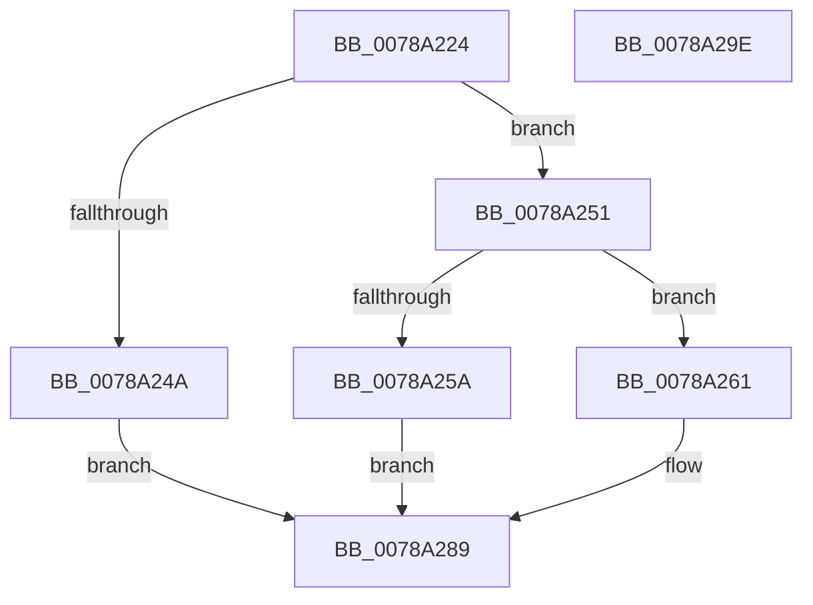

# RawQueryFsDeviceInfo

- RVA: `0x0078A224`–`0x0078A29F` (길이 `123` bytes)
- VA: `0x000000014078A224`
- 실행 섹션: `PAGE`
- PDB 이름 있음: `예`; PDB Function 태그: `아니요`
- unwind 정보 RVA: `0x0005C954`
- 디코드: `36`개 명령, `123/123` bytes 표시
- 미해석 바이트: `0` (있으면 어셈블리에 `.byte`로 보존)

> 이 문서는 커널 이미지의 기계어와 PDB 기호를 분석해 생성했습니다. 4번과 5번은 함수 원형과 자료형을 바이너리 사용 방식에서 추정한 C 해석이며 원본 소스 복구 결과는 아닙니다.

## 1. Dependencies

- 직접 호출 지점: **2**; 고유 호출 대상: **2**
- 직접 호출자로 확인된 함수: **1**
- RIP 상대 이미지 참조: **0**

### Outgoing calls
- `0x0078A251` → [RawBeginOperation](../../text/41/RawBeginOperation_function_00411F10.md) (function, `0x00411F10`)
- `0x0078A282` → [RawEndOperation](../../text/48/RawEndOperation_function_0048E70C.md) (function, `0x0048E70C`)

### Direct callers
- [RawQueryVolumeInformation](../9A/RawQueryVolumeInformation_function_009A4414.md) at `0x009A44EC`

### Static image references
- 디코드된 RIP-relative 메모리 참조가 없습니다.

## 2. Other-region calls and transfers

- 다른 실행 섹션으로 향하는 call: **2**
  - `0x0078A251` → [RawBeginOperation](../../text/41/RawBeginOperation_function_00411F10.md) (`PAGE` → `.text`)
  - `0x0078A282` → [RawEndOperation](../../text/48/RawEndOperation_function_0048E70C.md) (`PAGE` → `.text`)
- 별도 외부 분기/꼬리 이동을 확인하지 못했습니다.

## 3. Assembly (complete function range)

```asm
0078A224  48 89 5C 24 08                  mov qword ptr [rsp + 8], rbx
0078A229  48 89 6C 24 10                  mov qword ptr [rsp + 0x10], rbp
0078A22E  48 89 74 24 18                  mov qword ptr [rsp + 0x18], rsi
0078A233  57                              push rdi
0078A234  48 83 EC 20                     sub rsp, 0x20
0078A238  41 83 39 08                     cmp dword ptr [r9], 8
0078A23C  49 8B F9                        mov rdi, r9
0078A23F  49 8B F0                        mov rsi, r8
0078A242  48 8B EA                        mov rbp, rdx
0078A245  48 8B D9                        mov rbx, rcx
0078A248  73 07                           jae 0x14078a251
0078A24A  B8 05 00 00 80                  mov eax, 0x80000005
0078A24F  EB 38                           jmp 0x14078a289
0078A251  E8 BA 7C C8 FF                  call 0x140411f10
0078A256  84 C0                           test al, al
0078A258  75 07                           jne 0x14078a261
0078A25A  B8 6E 02 00 C0                  mov eax, 0xc000026e
0078A25F  EB 28                           jmp 0x14078a289
0078A261  83 07 F8                        add dword ptr [rdi], -8
0078A264  33 C0                           xor eax, eax
0078A266  48 89 06                        mov qword ptr [rsi], rax
0078A269  48 8B D5                        mov rdx, rbp
0078A26C  C7 06 07 00 00 00               mov dword ptr [rsi], 7
0078A272  48 8B 83 C0 00 00 00            mov rax, qword ptr [rbx + 0xc0]
0078A279  8B 48 34                        mov ecx, dword ptr [rax + 0x34]
0078A27C  89 4E 04                        mov dword ptr [rsi + 4], ecx
0078A27F  48 8B CB                        mov rcx, rbx
0078A282  E8 85 44 D0 FF                  call 0x14048e70c
0078A287  33 C0                           xor eax, eax
0078A289  48 8B 5C 24 30                  mov rbx, qword ptr [rsp + 0x30]
0078A28E  48 8B 6C 24 38                  mov rbp, qword ptr [rsp + 0x38]
0078A293  48 8B 74 24 40                  mov rsi, qword ptr [rsp + 0x40]
0078A298  48 83 C4 20                     add rsp, 0x20
0078A29C  5F                              pop rdi
0078A29D  C3                              ret
0078A29E  CC                              int3
```

## 4. C-style interpretation (structured pseudocode)

```c
__int64 __fastcall RawQueryFsDeviceInfo(__int64 a1, __int64 a2, __int64 a3, __int64 a4)
{
    __int64 result;
    __int64 v_rsp;
    unsigned __int64 v_stack_p10;
    unsigned __int64 v_stack_p18;
    unsigned __int64 v_stack_p8;

    v_stack_p8 = v_rbx;
    v_stack_p10 = v_rbp;
    v_stack_p18 = v_rsi;
    v_rsp = (v_rsp) - (32);
    if ((*(unsigned int *)(a4)) >= 8) goto loc_0078A251;
    goto loc_0078A289;
loc_0078A251:
    result = RawBeginOperation(a1, a2, a3, a4);
    if ((unsigned __int8)(result) != 0) goto loc_0078A261;
    goto loc_0078A289;
loc_0078A261:
    result = 0;
    *(unsigned __int64 *)(a3) = 0;
    *(unsigned int *)(a3) = 7;
    *(unsigned int *)(a3 + 4) = (unsigned int)((unsigned int)(*(unsigned int *)(*(unsigned __int64 *)(a1 + 192) + 52)));
    result = RawEndOperation(a1, a2, a3, a4);
    result = 0;
loc_0078A289:
    v_rsp = (v_rsp) + (32);
    return result;
}
```

## 5. (Beta) C Style

```c
int64_t RawQueryFsDeviceInfo(void *Arg1, int64_t Arg2, void *Arg3, void *Arg4)
{
    uint8_t *arg1 = (uint8_t *)Arg1;
    uint8_t *arg3 = (uint8_t *)Arg3;
    uint8_t *arg4 = (uint8_t *)Arg4;

    int64_t result;
    int64_t local_rsp;
    uint64_t v_stack_p10;
    uint64_t v_stack_p18;
    uint64_t v_stack_p8;

    v_stack_p8 = local_rbx;
    v_stack_p10 = local_rbp;
    v_stack_p18 = local_rsi;
    local_rsp = (local_rsp) - (32);
    if ((*(uint32_t *)(arg4)) >= 8) goto loc_0078A251;
    goto loc_0078A289;
loc_0078A251:
    result = RawBeginOperation(Arg1, Arg2, Arg3, Arg4);
    if ((uint8_t)(result) != 0) goto loc_0078A261;
    goto loc_0078A289;
loc_0078A261:
    result = 0;
    *(uint64_t *)(arg3) = 0;
    *(uint32_t *)(arg3) = 7;
    *(uint32_t *)(arg3 + 0x4) = (uint32_t)((uint32_t)(*(uint32_t *)(*(uint64_t *)(arg1 + 0xC0) + 0x34)));
    result = RawEndOperation(Arg1, Arg2, Arg3, Arg4);
    result = 0;
loc_0078A289:
    local_rsp = (local_rsp) + (32);
    return result;
}
```

### 관측된 메모리 오프셋

구조체 형식이 확인되지 않은 접근은 인자 기준의 오프셋으로만 기록했습니다.

| 기준 인자 | 오프셋 표현 | 폭 (bit) | 접근 |
|---|---:|---:|---|
| `Arg1` | `+ 0xC0` | `64` | `R` |
| `Arg3` | `+ 0x0` | `32` | `W` |
| `Arg3` | `+ 0x0` | `64` | `W` |
| `Arg3` | `+ 0x4` | `32` | `W` |
| `Arg4` | `+ 0x0` | `32` | `R` |
| `Arg4` | `+ 0x0` | `32` | `R/W` |

## 6. Execution-region graph

[열기: 2D/3D 그래프와 함수 탐색 컨트롤 패널](../../../control-panel.html?section=page&rva=0x0078A224&view=graph)

- 2D 그래프는 위에서 아래로 흐르고, 3D 그래프는 빈 공간을 드래그해 회전합니다. Shift+드래그는 이동, 휠은 확대·축소, 함수 노드 선택은 대상 보고서 이동입니다.

### Static fallback


