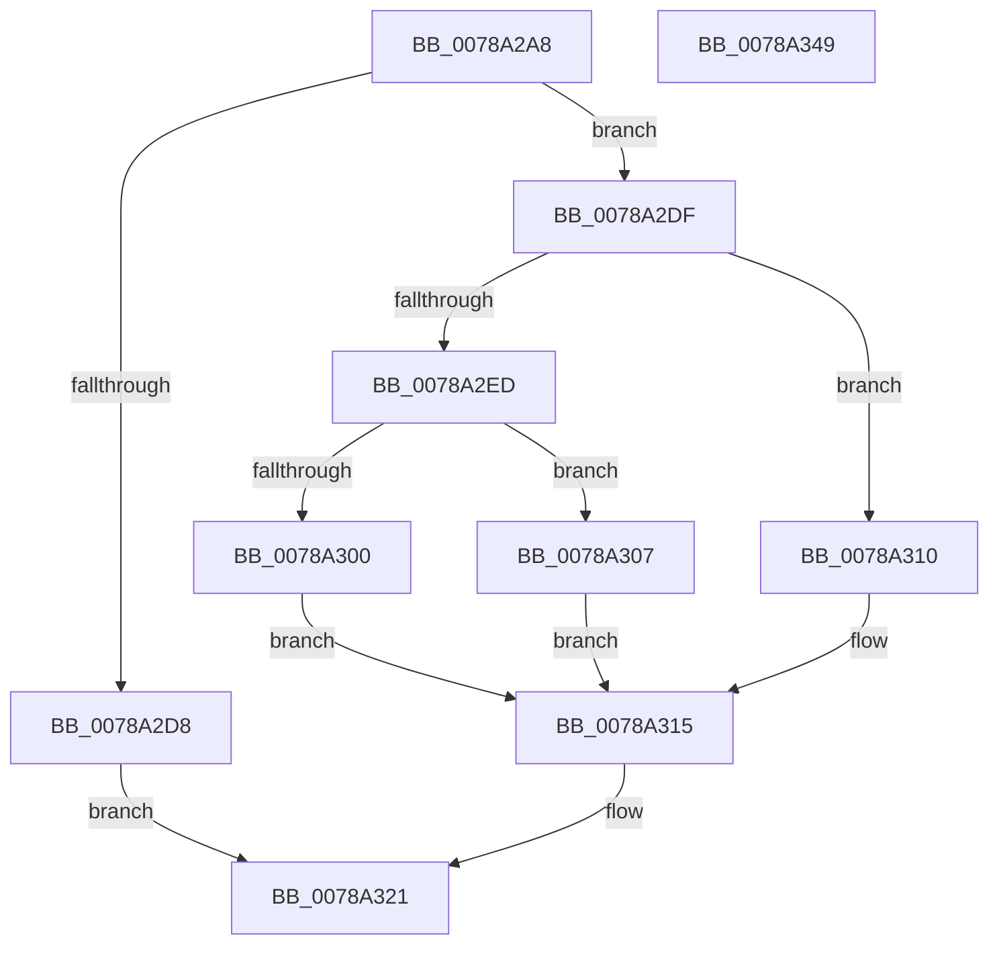

# RawSetInformation

- RVA: `0x0078A2A8`–`0x0078A34A` (길이 `162` bytes)
- VA: `0x000000014078A2A8`
- 실행 섹션: `PAGE`
- PDB 이름 있음: `예`; PDB Function 태그: `아니요`
- unwind 정보 RVA: `0x00060300`
- 디코드: `49`개 명령, `162/162` bytes 표시
- 미해석 바이트: `0` (있으면 어셈블리에 `.byte`로 보존)

> 이 문서는 커널 이미지의 기계어와 PDB 기호를 분석해 생성했습니다. 4번과 5번은 함수 원형과 자료형을 바이너리 사용 방식에서 추정한 C 해석이며 원본 소스 복구 결과는 아닙니다.

## 1. Dependencies

- 직접 호출 지점: **4**; 고유 호출 대상: **4**
- 직접 호출자로 확인된 함수: **1**
- RIP 상대 이미지 참조: **0**

### Outgoing calls
- `0x0078A2CD` → [RawBeginOperation](../../text/41/RawBeginOperation_function_00411F10.md) (function, `0x00411F10`)
- `0x0078A2F0` → [IoGetRelatedDeviceObject](../../text/29/IoGetRelatedDeviceObject_function_0029B120.md) (function, `0x0029B120`)
- `0x0078A31C` → [RawEndOperation](../../text/48/RawEndOperation_function_0048E70C.md) (function, `0x0048E70C`)
- `0x0078A329` → [IofCompleteRequest](../../text/29/IofCompleteRequest_function_0029B5C0.md) (function, `0x0029B5C0`)

### Direct callers
- [RawDispatch](../9A/RawDispatch_function_009A3920.md) at `0x009A3AB6`

### Static image references
- 디코드된 RIP-relative 메모리 참조가 없습니다.

## 2. Other-region calls and transfers

- 다른 실행 섹션으로 향하는 call: **4**
  - `0x0078A2CD` → [RawBeginOperation](../../text/41/RawBeginOperation_function_00411F10.md) (`PAGE` → `.text`)
  - `0x0078A2F0` → [IoGetRelatedDeviceObject](../../text/29/IoGetRelatedDeviceObject_function_0029B120.md) (`PAGE` → `.text`)
  - `0x0078A31C` → [RawEndOperation](../../text/48/RawEndOperation_function_0048E70C.md) (`PAGE` → `.text`)
  - `0x0078A329` → [IofCompleteRequest](../../text/29/IofCompleteRequest_function_0029B5C0.md) (`PAGE` → `.text`)
- 별도 외부 분기/꼬리 이동을 확인하지 못했습니다.

## 3. Assembly (complete function range)

```asm
0078A2A8  48 89 5C 24 08                  mov qword ptr [rsp + 8], rbx
0078A2AD  48 89 6C 24 10                  mov qword ptr [rsp + 0x10], rbp
0078A2B2  48 89 74 24 18                  mov qword ptr [rsp + 0x18], rsi
0078A2B7  57                              push rdi
0078A2B8  41 56                           push r14
0078A2BA  41 57                           push r15
0078A2BC  48 83 EC 20                     sub rsp, 0x20
0078A2C0  48 8B FA                        mov rdi, rdx
0078A2C3  49 8B F0                        mov rsi, r8
0078A2C6  49 8B 50 30                     mov rdx, qword ptr [r8 + 0x30]
0078A2CA  4C 8B F9                        mov r15, rcx
0078A2CD  E8 3E 7C C8 FF                  call 0x140411f10
0078A2D2  33 DB                           xor ebx, ebx
0078A2D4  84 C0                           test al, al
0078A2D6  75 07                           jne 0x14078a2df
0078A2D8  BB 6E 02 00 C0                  mov ebx, 0xc000026e
0078A2DD  EB 42                           jmp 0x14078a321
0078A2DF  83 7E 10 0E                     cmp dword ptr [rsi + 0x10], 0xe
0078A2E3  4C 8B 77 18                     mov r14, qword ptr [rdi + 0x18]
0078A2E7  48 8B 6E 30                     mov rbp, qword ptr [rsi + 0x30]
0078A2EB  75 23                           jne 0x14078a310
0078A2ED  48 8B CD                        mov rcx, rbp
0078A2F0  E8 2B 0E B1 FF                  call 0x14029b120
0078A2F5  8B 88 98 00 00 00               mov ecx, dword ptr [rax + 0x98]
0078A2FB  41 85 0E                        test dword ptr [r14], ecx
0078A2FE  74 07                           je 0x14078a307
0078A300  BB 0D 00 00 C0                  mov ebx, 0xc000000d
0078A305  EB 0E                           jmp 0x14078a315
0078A307  49 8B 06                        mov rax, qword ptr [r14]
0078A30A  48 89 45 68                     mov qword ptr [rbp + 0x68], rax
0078A30E  EB 05                           jmp 0x14078a315
0078A310  BB 10 00 00 C0                  mov ebx, 0xc0000010
0078A315  48 8B 56 30                     mov rdx, qword ptr [rsi + 0x30]
0078A319  49 8B CF                        mov rcx, r15
0078A31C  E8 EB 43 D0 FF                  call 0x14048e70c
0078A321  B2 01                           mov dl, 1
0078A323  89 5F 30                        mov dword ptr [rdi + 0x30], ebx
0078A326  48 8B CF                        mov rcx, rdi
0078A329  E8 92 12 B1 FF                  call 0x14029b5c0
0078A32E  48 8B 6C 24 48                  mov rbp, qword ptr [rsp + 0x48]
0078A333  8B C3                           mov eax, ebx
0078A335  48 8B 5C 24 40                  mov rbx, qword ptr [rsp + 0x40]
0078A33A  48 8B 74 24 50                  mov rsi, qword ptr [rsp + 0x50]
0078A33F  48 83 C4 20                     add rsp, 0x20
0078A343  41 5F                           pop r15
0078A345  41 5E                           pop r14
0078A347  5F                              pop rdi
0078A348  C3                              ret
0078A349  CC                              int3
```

## 4. C-style interpretation (structured pseudocode)

```c
__int64 __fastcall RawSetInformation(__int64 a1, __int64 a2, __int64 a3)
{
    __int64 result;
    __int64 v_rbx;
    __int64 v_rsp;
    unsigned __int64 v_stack_p10;
    unsigned __int64 v_stack_p18;
    unsigned __int64 v_stack_p8;

    v_stack_p8 = v_rbx;
    v_stack_p10 = v_rbp;
    v_stack_p18 = v_rsi;
    v_rsp = (v_rsp) - (32);
    result = RawBeginOperation(a1, *(unsigned __int64 *)(a3 + 48), a3, a4);
    v_rbx = 0;
    if ((unsigned __int8)(result) != 0) goto loc_0078A2DF;
    goto loc_0078A321;
loc_0078A2DF:
    if ((*(unsigned int *)(a3 + 16)) != 14) goto loc_0078A310;
    result = IoGetRelatedDeviceObject(*(unsigned __int64 *)(a3 + 48), *(unsigned __int64 *)(a3 + 48), a3, a4);
    if (((*(unsigned int *)(*(unsigned __int64 *)(a2 + 24))) & ((unsigned int)((unsigned int)(*(unsigned int *)(result + 152))))) == 0) goto loc_0078A307;
    goto loc_0078A315;
loc_0078A307:
    *(unsigned __int64 *)(*(unsigned __int64 *)(a3 + 48) + 104) = *(unsigned __int64 *)(*(unsigned __int64 *)(a2 + 24));
    goto loc_0078A315;
loc_0078A310:
loc_0078A315:
    result = RawEndOperation(a1, *(unsigned __int64 *)(a3 + 48), a3, a4);
loc_0078A321:
    *(unsigned int *)(a2 + 48) = (unsigned int)((unsigned int)(0xC0000010ULL));
    result = IofCompleteRequest(a2, 1, a3, a4);
    v_rsp = (v_rsp) + (32);
    return (unsigned int)((unsigned int)((unsigned int)(0xC0000010ULL)));
}
```

## 5. (Beta) C Style

```c
int64_t RawSetInformation(int64_t Arg1, void *Arg2, void *Arg3)
{
    uint8_t *arg2 = (uint8_t *)Arg2;
    uint8_t *arg3 = (uint8_t *)Arg3;

    int64_t result;
    int64_t local_rbx;
    int64_t local_rsp;
    uint64_t v_stack_p10;
    uint64_t v_stack_p18;
    uint64_t v_stack_p8;

    v_stack_p8 = local_rbx;
    v_stack_p10 = local_rbp;
    v_stack_p18 = local_rsi;
    local_rsp = (local_rsp) - (32);
    result = RawBeginOperation(Arg1, *(uint64_t *)(arg3 + 0x30), Arg3, a4);
    local_rbx = 0;
    if ((uint8_t)(result) != 0) goto loc_0078A2DF;
    goto loc_0078A321;
loc_0078A2DF:
    if ((*(uint32_t *)(arg3 + 0x10)) != 14) goto loc_0078A310;
    result = IoGetRelatedDeviceObject(*(uint64_t *)(arg3 + 0x30), *(uint64_t *)(arg3 + 0x30), Arg3, a4);
    if (((*(uint32_t *)(*(uint64_t *)(arg2 + 0x18))) & ((uint32_t)((uint32_t)(*(uint32_t *)(result + 0x98))))) == 0) goto loc_0078A307;
    goto loc_0078A315;
loc_0078A307:
    *(uint64_t *)(*(uint64_t *)(arg3 + 0x30) + 0x68) = *(uint64_t *)(*(uint64_t *)(arg2 + 0x18));
    goto loc_0078A315;
loc_0078A310:
loc_0078A315:
    result = RawEndOperation(Arg1, *(uint64_t *)(arg3 + 0x30), Arg3, a4);
loc_0078A321:
    *(uint32_t *)(arg2 + 0x30) = (uint32_t)((uint32_t)(0xC0000010ULL));
    result = IofCompleteRequest(Arg2, 1, Arg3, a4);
    local_rsp = (local_rsp) + (32);
    return (uint32_t)((uint32_t)((uint32_t)(0xC0000010ULL)));
}
```

### 관측된 메모리 오프셋

구조체 형식이 확인되지 않은 접근은 인자 기준의 오프셋으로만 기록했습니다.

| 기준 인자 | 오프셋 표현 | 폭 (bit) | 접근 |
|---|---:|---:|---|
| `Arg2` | `+ 0x18` | `64` | `R` |
| `Arg2` | `+ 0x30` | `32` | `W` |
| `Arg3` | `+ 0x10` | `32` | `R` |
| `Arg3` | `+ 0x30` | `64` | `R` |

## 6. Execution-region graph

[열기: 2D/3D 그래프와 함수 탐색 컨트롤 패널](../../../control-panel.html?section=page&rva=0x0078A2A8&view=graph)

- 2D 그래프는 위에서 아래로 흐르고, 3D 그래프는 빈 공간을 드래그해 회전합니다. Shift+드래그는 이동, 휠은 확대·축소, 함수 노드 선택은 대상 보고서 이동입니다.

### Static fallback


