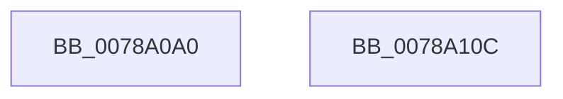

# RawShutdown

- RVA: `0x0078A0A0`–`0x0078A10D` (길이 `109` bytes)
- VA: `0x000000014078A0A0`
- 실행 섹션: `PAGE`
- PDB 이름 있음: `예`; PDB Function 태그: `아니요`
- unwind 정보 RVA: `0x0005CF00`
- 디코드: `25`개 명령, `109/109` bytes 표시
- 미해석 바이트: `0` (있으면 어셈블리에 `.byte`로 보존)

> 이 문서는 커널 이미지의 기계어와 PDB 기호를 분석해 생성했습니다. 4번과 5번은 함수 원형과 자료형을 바이너리 사용 방식에서 추정한 C 해석이며 원본 소스 복구 결과는 아닙니다.

## 1. Dependencies

- 직접 호출 지점: **8**; 고유 호출 대상: **4**
- 직접 호출자로 확인된 함수: **0**
- RIP 상대 이미지 참조: **3**

### Outgoing calls
- `0x0078A0A9` → [RawScanDeletedList](../9A/RawScanDeletedList_function_009A55F0.md) (function, `0x009A55F0`)
- `0x0078A0B5` → [IoUnregisterFileSystem](../71/IoUnregisterFileSystem_function_0071E110.md) (function, `0x0071E110`)
- `0x0078A0C1` → [IoUnregisterFileSystem](../71/IoUnregisterFileSystem_function_0071E110.md) (function, `0x0071E110`)
- `0x0078A0CD` → [IoUnregisterFileSystem](../71/IoUnregisterFileSystem_function_0071E110.md) (function, `0x0071E110`)
- `0x0078A0D9` → [IoDeleteDevice](../../text/26/IoDeleteDevice_function_0026FE90.md) (function, `0x0026FE90`)
- `0x0078A0E5` → [IoDeleteDevice](../../text/26/IoDeleteDevice_function_0026FE90.md) (function, `0x0026FE90`)
- `0x0078A0F1` → [IoDeleteDevice](../../text/26/IoDeleteDevice_function_0026FE90.md) (function, `0x0026FE90`)
- `0x0078A0FF` → [IofCompleteRequest](../../text/29/IofCompleteRequest_function_0029B5C0.md) (function, `0x0029B5C0`)

### Direct callers
- 이 함수 시작 RVA로 연결되는 직접 call은 확인되지 않았습니다. 간접 호출은 완전히 역산할 수 없습니다.

### Static image references
- `0x0078A0AE` → RVA `0x00F05D18` (`.data`; read)
- `0x0078A0BA` → RVA `0x00F05D10` (`.data`; read)
- `0x0078A0C6` → RVA `0x00F05D20` (`.data`; read)

## 2. Other-region calls and transfers

- 다른 실행 섹션으로 향하는 call: **4**
  - `0x0078A0D9` → [IoDeleteDevice](../../text/26/IoDeleteDevice_function_0026FE90.md) (`PAGE` → `.text`)
  - `0x0078A0E5` → [IoDeleteDevice](../../text/26/IoDeleteDevice_function_0026FE90.md) (`PAGE` → `.text`)
  - `0x0078A0F1` → [IoDeleteDevice](../../text/26/IoDeleteDevice_function_0026FE90.md) (`PAGE` → `.text`)
  - `0x0078A0FF` → [IofCompleteRequest](../../text/29/IofCompleteRequest_function_0029B5C0.md) (`PAGE` → `.text`)
- 별도 외부 분기/꼬리 이동을 확인하지 못했습니다.

## 3. Assembly (complete function range)

```asm
0078A0A0  40 53                           push rbx
0078A0A2  48 83 EC 20                     sub rsp, 0x20
0078A0A6  48 8B DA                        mov rbx, rdx
0078A0A9  E8 42 B5 21 00                  call 0x1409a55f0
0078A0AE  48 8B 0D 63 BC 77 00            mov rcx, qword ptr [rip + 0x77bc63]
0078A0B5  E8 56 40 F9 FF                  call 0x14071e110
0078A0BA  48 8B 0D 4F BC 77 00            mov rcx, qword ptr [rip + 0x77bc4f]
0078A0C1  E8 4A 40 F9 FF                  call 0x14071e110
0078A0C6  48 8B 0D 53 BC 77 00            mov rcx, qword ptr [rip + 0x77bc53]
0078A0CD  E8 3E 40 F9 FF                  call 0x14071e110
0078A0D2  48 8B 0D 47 BC 77 00            mov rcx, qword ptr [rip + 0x77bc47]
0078A0D9  E8 B2 5D AE FF                  call 0x14026fe90
0078A0DE  48 8B 0D 2B BC 77 00            mov rcx, qword ptr [rip + 0x77bc2b]
0078A0E5  E8 A6 5D AE FF                  call 0x14026fe90
0078A0EA  48 8B 0D 27 BC 77 00            mov rcx, qword ptr [rip + 0x77bc27]
0078A0F1  E8 9A 5D AE FF                  call 0x14026fe90
0078A0F6  83 63 30 00                     and dword ptr [rbx + 0x30], 0
0078A0FA  B2 01                           mov dl, 1
0078A0FC  48 8B CB                        mov rcx, rbx
0078A0FF  E8 BC 14 B1 FF                  call 0x14029b5c0
0078A104  33 C0                           xor eax, eax
0078A106  48 83 C4 20                     add rsp, 0x20
0078A10A  5B                              pop rbx
0078A10B  C3                              ret
0078A10C  CC                              int3
```

## 4. C-style interpretation (structured pseudocode)

```c
__int64 __fastcall RawShutdown(__int64 a1, __int64 a2)
{
    __int64 result;
    __int64 v_rsp;

    v_rsp = (v_rsp) - (32);
    result = RawScanDeletedList(a1, a2, a3, a4);
    result = IoUnregisterFileSystem(*(unsigned __int64 *)(v_rip + 7847011), a2, a3, a4);
    result = IoUnregisterFileSystem(*(unsigned __int64 *)(v_rip + 7846991), a2, a3, a4);
    result = IoUnregisterFileSystem(*(unsigned __int64 *)(v_rip + 7846995), a2, a3, a4);
    result = IoDeleteDevice(*(unsigned __int64 *)(v_rip + 7846983), a2, a3, a4);
    result = IoDeleteDevice(*(unsigned __int64 *)(v_rip + 7846955), a2, a3, a4);
    result = IoDeleteDevice(*(unsigned __int64 *)(v_rip + 7846951), a2, a3, a4);
    result = IofCompleteRequest(a2, 1, a3, a4);
    result = 0;
    v_rsp = (v_rsp) + (32);
    return result;
}
```

## 5. (Beta) C Style

```c
int64_t RawShutdown(int64_t Arg1, void *Arg2)
{
    uint8_t *arg2 = (uint8_t *)Arg2;

    int64_t result;
    int64_t local_rsp;

    local_rsp = (local_rsp) - (32);
    result = RawScanDeletedList(Arg1, Arg2, a3, a4);
    result = IoUnregisterFileSystem(*(uint64_t *)(v_rip + 0x77BC63), Arg2, a3, a4);
    result = IoUnregisterFileSystem(*(uint64_t *)(v_rip + 0x77BC4F), Arg2, a3, a4);
    result = IoUnregisterFileSystem(*(uint64_t *)(v_rip + 0x77BC53), Arg2, a3, a4);
    result = IoDeleteDevice(*(uint64_t *)(v_rip + 0x77BC47), Arg2, a3, a4);
    result = IoDeleteDevice(*(uint64_t *)(v_rip + 0x77BC2B), Arg2, a3, a4);
    result = IoDeleteDevice(*(uint64_t *)(v_rip + 0x77BC27), Arg2, a3, a4);
    result = IofCompleteRequest(Arg2, 1, a3, a4);
    result = 0;
    local_rsp = (local_rsp) + (32);
    return result;
}
```

### 관측된 메모리 오프셋

구조체 형식이 확인되지 않은 접근은 인자 기준의 오프셋으로만 기록했습니다.

| 기준 인자 | 오프셋 표현 | 폭 (bit) | 접근 |
|---|---:|---:|---|
| `Arg2` | `+ 0x30` | `32` | `R/W` |

## 6. Execution-region graph

[열기: 2D/3D 그래프와 함수 탐색 컨트롤 패널](../../../control-panel.html?section=page&rva=0x0078A0A0&view=graph)

- 2D 그래프는 위에서 아래로 흐르고, 3D 그래프는 빈 공간을 드래그해 회전합니다. Shift+드래그는 이동, 휠은 확대·축소, 함수 노드 선택은 대상 보고서 이동입니다.

### Static fallback


