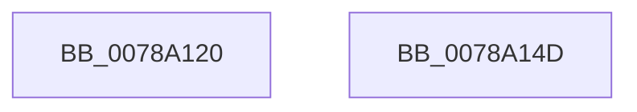

# RawUnload

- RVA: `0x0078A120`–`0x0078A14E` (길이 `46` bytes)
- VA: `0x000000014078A120`
- 실행 섹션: `PAGE`
- PDB 이름 있음: `예`; PDB Function 태그: `아니요`
- unwind 정보 RVA: `0x0005C788`
- 디코드: `10`개 명령, `46/46` bytes 표시
- 미해석 바이트: `0` (있으면 어셈블리에 `.byte`로 보존)

> 이 문서는 커널 이미지의 기계어와 PDB 기호를 분석해 생성했습니다. 4번과 5번은 함수 원형과 자료형을 바이너리 사용 방식에서 추정한 C 해석이며 원본 소스 복구 결과는 아닙니다.

## 1. Dependencies

- 직접 호출 지점: **3**; 고유 호출 대상: **1**
- 직접 호출자로 확인된 함수: **0**
- RIP 상대 이미지 참조: **3**

### Outgoing calls
- `0x0078A12B` → [ObfDereferenceObject](../../text/2F/ObfDereferenceObject_function_002F9350.md) (function, `0x002F9350`)
- `0x0078A137` → [ObfDereferenceObject](../../text/2F/ObfDereferenceObject_function_002F9350.md) (function, `0x002F9350`)
- `0x0078A143` → [ObfDereferenceObject](../../text/2F/ObfDereferenceObject_function_002F9350.md) (function, `0x002F9350`)

### Direct callers
- 이 함수 시작 RVA로 연결되는 직접 call은 확인되지 않았습니다. 간접 호출은 완전히 역산할 수 없습니다.

### Static image references
- `0x0078A124` → RVA `0x00F05D20` (`.data`; read)
- `0x0078A130` → RVA `0x00F05D10` (`.data`; read)
- `0x0078A13C` → RVA `0x00F05D18` (`.data`; read)

## 2. Other-region calls and transfers

- 다른 실행 섹션으로 향하는 call: **3**
  - `0x0078A12B` → [ObfDereferenceObject](../../text/2F/ObfDereferenceObject_function_002F9350.md) (`PAGE` → `.text`)
  - `0x0078A137` → [ObfDereferenceObject](../../text/2F/ObfDereferenceObject_function_002F9350.md) (`PAGE` → `.text`)
  - `0x0078A143` → [ObfDereferenceObject](../../text/2F/ObfDereferenceObject_function_002F9350.md) (`PAGE` → `.text`)
- 별도 외부 분기/꼬리 이동을 확인하지 못했습니다.

## 3. Assembly (complete function range)

```asm
0078A120  48 83 EC 28                     sub rsp, 0x28
0078A124  48 8B 0D F5 BB 77 00            mov rcx, qword ptr [rip + 0x77bbf5]
0078A12B  E8 20 F2 B6 FF                  call 0x1402f9350
0078A130  48 8B 0D D9 BB 77 00            mov rcx, qword ptr [rip + 0x77bbd9]
0078A137  E8 14 F2 B6 FF                  call 0x1402f9350
0078A13C  48 8B 0D D5 BB 77 00            mov rcx, qword ptr [rip + 0x77bbd5]
0078A143  E8 08 F2 B6 FF                  call 0x1402f9350
0078A148  48 83 C4 28                     add rsp, 0x28
0078A14C  C3                              ret
0078A14D  CC                              int3
```

## 4. C-style interpretation (structured pseudocode)

```c
__int64 __fastcall RawUnload(void)
{
    __int64 result;
    __int64 v_rsp;

    v_rsp = (v_rsp) - (40);
    result = ObfDereferenceObject(*(unsigned __int64 *)(v_rip + 7846901), a2, a3, a4);
    result = ObfDereferenceObject(*(unsigned __int64 *)(v_rip + 7846873), a2, a3, a4);
    result = ObfDereferenceObject(*(unsigned __int64 *)(v_rip + 7846869), a2, a3, a4);
    v_rsp = (v_rsp) + (40);
    return result;
}
```

## 5. (Beta) C Style

```c
void RawUnload(void)
{
    int64_t result;
    int64_t local_rsp;

    local_rsp = (local_rsp) - (40);
    result = ObfDereferenceObject(*(uint64_t *)(v_rip + 0x77BBF5), a2, a3, a4);
    result = ObfDereferenceObject(*(uint64_t *)(v_rip + 0x77BBD9), a2, a3, a4);
    result = ObfDereferenceObject(*(uint64_t *)(v_rip + 0x77BBD5), a2, a3, a4);
    local_rsp = (local_rsp) + (40);
    return result;
}
```

## 6. Execution-region graph

[열기: 2D/3D 그래프와 함수 탐색 컨트롤 패널](../../../control-panel.html?section=page&rva=0x0078A120&view=graph)

- 2D 그래프는 위에서 아래로 흐르고, 3D 그래프는 빈 공간을 드래그해 회전합니다. Shift+드래그는 이동, 휠은 확대·축소, 함수 노드 선택은 대상 보고서 이동입니다.

### Static fallback


