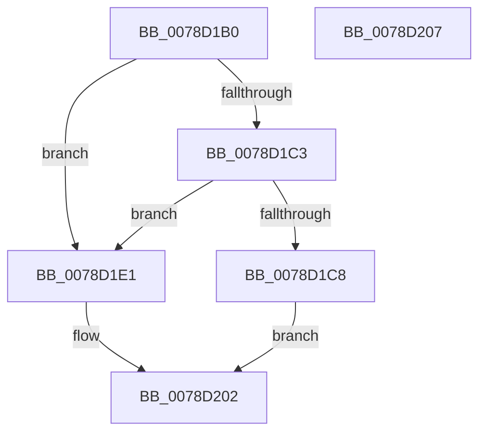

# RtlAddAccessDeniedObjectAce

- RVA: `0x0078D1B0`–`0x0078D208` (길이 `88` bytes)
- VA: `0x000000014078D1B0`
- 실행 섹션: `PAGE`
- PDB 이름 있음: `예`; PDB Function 태그: `아니요`
- unwind 정보 RVA: `0x00063458`
- 디코드: `21`개 명령, `88/88` bytes 표시
- 미해석 바이트: `0` (있으면 어셈블리에 `.byte`로 보존)

> 이 문서는 커널 이미지의 기계어와 PDB 기호를 분석해 생성했습니다. 4번과 5번은 함수 원형과 자료형을 바이너리 사용 방식에서 추정한 C 해석이며 원본 소스 복구 결과는 아닙니다.

## 1. Dependencies

- 직접 호출 지점: **2**; 고유 호출 대상: **2**
- 직접 호출자로 확인된 함수: **1**
- RIP 상대 이미지 참조: **0**

### Outgoing calls
- `0x0078D1DA` → [RtlpAddKnownAce](../92/RtlpAddKnownAce_function_00929A20.md) (function, `0x00929A20`)
- `0x0078D1FD` → [RtlpAddKnownObjectAce](RtlpAddKnownObjectAce_function_0078DBB4.md) (function, `0x0078DBB4`)

### Direct callers
- [LocalGetAclForString](../92/LocalGetAclForString_function_00927F30.md) at `0x00928F2E`

### Static image references
- 디코드된 RIP-relative 메모리 참조가 없습니다.

## 2. Other-region calls and transfers

- 다른 실행 섹션으로 향하는 call: **0**
- 별도 외부 분기/꼬리 이동을 확인하지 못했습니다.

## 3. Assembly (complete function range)

```asm
0078D1B0  48 83 EC 48                     sub rsp, 0x48
0078D1B4  4C 8B 5C 24 70                  mov r11, qword ptr [rsp + 0x70]
0078D1B9  4C 8B 54 24 78                  mov r10, qword ptr [rsp + 0x78]
0078D1BE  4D 85 DB                        test r11, r11
0078D1C1  75 1E                           jne 0x14078d1e1
0078D1C3  4D 85 D2                        test r10, r10
0078D1C6  75 19                           jne 0x14078d1e1
0078D1C8  48 8B 84 24 80 00 00 00         mov rax, qword ptr [rsp + 0x80]
0078D1D0  C6 44 24 28 01                  mov byte ptr [rsp + 0x28], 1
0078D1D5  48 89 44 24 20                  mov qword ptr [rsp + 0x20], rax
0078D1DA  E8 41 C8 19 00                  call 0x140929a20
0078D1DF  EB 21                           jmp 0x14078d202
0078D1E1  48 8B 84 24 80 00 00 00         mov rax, qword ptr [rsp + 0x80]
0078D1E9  C6 44 24 38 06                  mov byte ptr [rsp + 0x38], 6
0078D1EE  48 89 44 24 30                  mov qword ptr [rsp + 0x30], rax
0078D1F3  4C 89 54 24 28                  mov qword ptr [rsp + 0x28], r10
0078D1F8  4C 89 5C 24 20                  mov qword ptr [rsp + 0x20], r11
0078D1FD  E8 B2 09 00 00                  call 0x14078dbb4
0078D202  48 83 C4 48                     add rsp, 0x48
0078D206  C3                              ret
0078D207  CC                              int3
```

## 4. C-style interpretation (structured pseudocode)

```c
__int64 __fastcall RtlAddAccessDeniedObjectAce(__int64 a1, __int64 a2, __int64 a3, __int64 a4, __int64 a5, __int64 a6, __int64 a7)
{
    __int64 result;
    __int64 v_rsp;
    unsigned __int8 v_stack_m10;
    unsigned __int64 v_stack_m18;
    unsigned __int8 v_stack_m20;
    unsigned __int64 v_stack_m28;

    v_rsp = (v_rsp) - (72);
    if (a5 != 0) goto loc_0078D1E1;
    if (a6 != 0) goto loc_0078D1E1;
    v_stack_m20 = 1;
    v_stack_m28 = a7;
    result = RtlpAddKnownAce(a1, a2, a3, a4);
    goto loc_0078D202;
loc_0078D1E1:
    v_stack_m10 = 6;
    v_stack_m18 = a7;
    v_stack_m20 = a6;
    v_stack_m28 = a5;
    result = RtlpAddKnownObjectAce(a1, a2, a3, a4);
loc_0078D202:
    v_rsp = (v_rsp) + (72);
    return result;
}
```

## 5. (Beta) C Style

```c
int64_t RtlAddAccessDeniedObjectAce(int64_t Arg1, int64_t Arg2, int64_t Arg3, int64_t Arg4, int64_t Arg5, int64_t Arg6, int64_t Arg7)
{
    int64_t result;
    int64_t local_rsp;
    uint8_t v_stack_m10;
    uint64_t v_stack_m18;
    uint8_t v_stack_m20;
    uint64_t v_stack_m28;

    local_rsp = (local_rsp) - (72);
    if (Arg5 != 0) goto loc_0078D1E1;
    if (Arg6 != 0) goto loc_0078D1E1;
    v_stack_m20 = 1;
    v_stack_m28 = Arg7;
    result = RtlpAddKnownAce(Arg1, Arg2, Arg3, Arg4);
    goto loc_0078D202;
loc_0078D1E1:
    v_stack_m10 = 6;
    v_stack_m18 = Arg7;
    v_stack_m20 = Arg6;
    v_stack_m28 = Arg5;
    result = RtlpAddKnownObjectAce(Arg1, Arg2, Arg3, Arg4);
loc_0078D202:
    local_rsp = (local_rsp) + (72);
    return result;
}
```

## 6. Execution-region graph

[열기: 2D/3D 그래프와 함수 탐색 컨트롤 패널](../../../control-panel.html?section=page&rva=0x0078D1B0&view=graph)

- 2D 그래프는 위에서 아래로 흐르고, 3D 그래프는 빈 공간을 드래그해 회전합니다. Shift+드래그는 이동, 휠은 확대·축소, 함수 노드 선택은 대상 보고서 이동입니다.

### Static fallback


