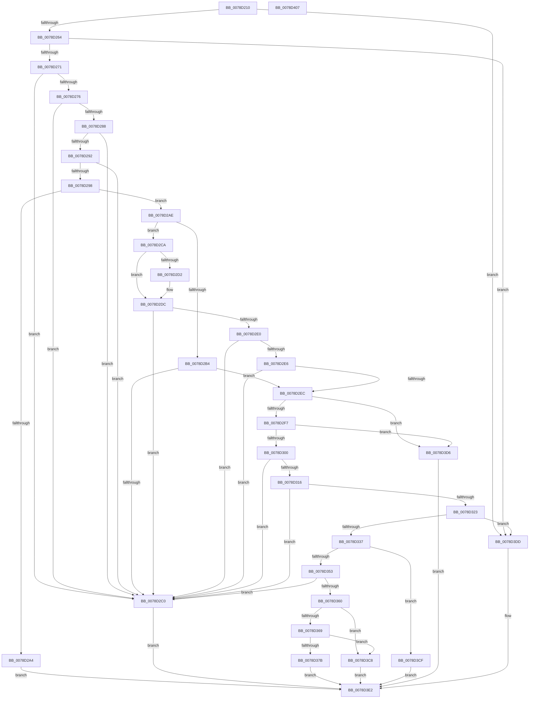

# RtlAddAccessFilterAce

- RVA: `0x0078D210`–`0x0078D408` (길이 `504` bytes)
- VA: `0x000000014078D210`
- 실행 섹션: `PAGE`
- PDB 이름 있음: `예`; PDB Function 태그: `아니요`
- unwind 정보 RVA: `0x000CF900`
- 디코드: `143`개 명령, `504/504` bytes 표시
- 미해석 바이트: `0` (있으면 어셈블리에 `.byte`로 보존)

> 이 문서는 커널 이미지의 기계어와 PDB 기호를 분석해 생성했습니다. 4번과 5번은 함수 원형과 자료형을 바이너리 사용 방식에서 추정한 C 해석이며 원본 소스 복구 결과는 아닙니다.

## 1. Dependencies

- 직접 호출 지점: **7**; 고유 호출 대상: **7**
- 직접 호출자로 확인된 함수: **0**
- RIP 상대 이미지 참조: **1**

### Outgoing calls
- `0x0078D264` → [RtlValidAcl](../92/RtlValidAcl_function_0092A7A0.md) (function, `0x0092A7A0`)
- `0x0078D29B` → [RtlValidSid](../92/RtlValidSid_function_00929710.md) (function, `0x00929710`)
- `0x0078D2B7` → [RtlIsValidProcessTrustLabelSid](../../text/3E/RtlIsValidProcessTrustLabelSid_function_003EE070.md) (function, `0x003EE070`)
- `0x0078D32A` → [RtlFirstFreeAce](../9A/RtlFirstFreeAce_function_009A8FF0.md) (function, `0x009A8FF0`)
- `0x0078D39F` → [RtlCopySid](../9A/RtlCopySid_function_009A9A50.md) (function, `0x009A9A50`)
- `0x0078D3B8` → [memcpy](../../text/6C/memcpy_function_006C6840.md) (function, `0x006C6840`)
- `0x0078D3E9` → [_security_check_cookie](../../text/6A/_security_check_cookie_function_006AC640.md) (function, `0x006AC640`)

### Direct callers
- 이 함수 시작 RVA로 연결되는 직접 call은 확인되지 않았습니다. 간접 호출은 완전히 역산할 수 없습니다.

### Static image references
- `0x0078D229` → RVA `0x00E0A740` (`.data`; read)

## 2. Other-region calls and transfers

- 다른 실행 섹션으로 향하는 call: **3**
  - `0x0078D2B7` → [RtlIsValidProcessTrustLabelSid](../../text/3E/RtlIsValidProcessTrustLabelSid_function_003EE070.md) (`PAGE` → `.text`)
  - `0x0078D3B8` → [memcpy](../../text/6C/memcpy_function_006C6840.md) (`PAGE` → `.text`)
  - `0x0078D3E9` → [_security_check_cookie](../../text/6A/_security_check_cookie_function_006AC640.md) (`PAGE` → `.text`)
- 별도 외부 분기/꼬리 이동을 확인하지 못했습니다.

## 3. Assembly (complete function range)

```asm
0078D210  48 89 5C 24 10                  mov qword ptr [rsp + 0x10], rbx
0078D215  48 89 74 24 18                  mov qword ptr [rsp + 0x18], rsi
0078D21A  55                              push rbp
0078D21B  57                              push rdi
0078D21C  41 54                           push r12
0078D21E  41 56                           push r14
0078D220  41 57                           push r15
0078D222  48 8B EC                        mov rbp, rsp
0078D225  48 83 EC 40                     sub rsp, 0x40
0078D229  48 8B 05 10 D5 67 00            mov rax, qword ptr [rip + 0x67d510]
0078D230  48 33 C4                        xor rax, rsp
0078D233  48 89 45 F8                     mov qword ptr [rbp - 8], rax
0078D237  4C 8B 65 60                     mov r12, qword ptr [rbp + 0x60]
0078D23B  45 33 FF                        xor r15d, r15d
0078D23E  44 89 45 E0                     mov dword ptr [rbp - 0x20], r8d
0078D242  49 8B D9                        mov rbx, r9
0078D245  4C 89 7D E8                     mov qword ptr [rbp - 0x18], r15
0078D249  45 8B F0                        mov r14d, r8d
0078D24C  44 89 7D F0                     mov dword ptr [rbp - 0x10], r15d
0078D250  8B F2                           mov esi, edx
0078D252  66 C7 45 F4 00 01               mov word ptr [rbp - 0xc], 0x100
0078D258  48 8B F9                        mov rdi, rcx
0078D25B  48 85 C9                        test rcx, rcx
0078D25E  0F 84 79 01 00 00               je 0x14078d3dd
0078D264  E8 37 D5 19 00                  call 0x14092a7a0
0078D269  84 C0                           test al, al
0078D26B  0F 84 6C 01 00 00               je 0x14078d3dd
0078D271  4D 85 E4                        test r12, r12
0078D274  74 4A                           je 0x14078d2c0
0078D276  0F B7 45 68                     movzx eax, word ptr [rbp + 0x68]
0078D27A  B9 F8 FF 00 00                  mov ecx, 0xfff8
0078D27F  66 83 E8 06                     sub ax, 6
0078D283  66 3B C1                        cmp ax, cx
0078D286  77 38                           ja 0x14078d2c0
0078D288  41 81 3C 24 61 72 74 78         cmp dword ptr [r12], 0x78747261
0078D290  75 2E                           jne 0x14078d2c0
0078D292  80 7D 50 15                     cmp byte ptr [rbp + 0x50], 0x15
0078D296  75 28                           jne 0x14078d2c0
0078D298  48 8B CB                        mov rcx, rbx
0078D29B  E8 70 C4 19 00                  call 0x140929710
0078D2A0  84 C0                           test al, al
0078D2A2  75 0A                           jne 0x14078d2ae
0078D2A4  B8 78 00 00 C0                  mov eax, 0xc0000078
0078D2A9  E9 34 01 00 00                  jmp 0x14078d3e2
0078D2AE  41 F6 C6 40                     test r14b, 0x40
0078D2B2  74 16                           je 0x14078d2ca
0078D2B4  48 8B CB                        mov rcx, rbx
0078D2B7  E8 B4 0D C6 FF                  call 0x1403ee070
0078D2BC  84 C0                           test al, al
0078D2BE  75 2C                           jne 0x14078d2ec
0078D2C0  B8 0D 00 00 C0                  mov eax, 0xc000000d
0078D2C5  E9 18 01 00 00                  jmp 0x14078d3e2
0078D2CA  8B 4B 02                        mov ecx, dword ptr [rbx + 2]
0078D2CD  2B 4D F0                        sub ecx, dword ptr [rbp - 0x10]
0078D2D0  75 0A                           jne 0x14078d2dc
0078D2D2  0F B7 4B 06                     movzx ecx, word ptr [rbx + 6]
0078D2D6  0F B7 45 F4                     movzx eax, word ptr [rbp - 0xc]
0078D2DA  2B C8                           sub ecx, eax
0078D2DC  85 C9                           test ecx, ecx
0078D2DE  75 E0                           jne 0x14078d2c0
0078D2E0  80 7B 01 01                     cmp byte ptr [rbx + 1], 1
0078D2E4  75 DA                           jne 0x14078d2c0
0078D2E6  44 39 7B 08                     cmp dword ptr [rbx + 8], r15d
0078D2EA  75 D4                           jne 0x14078d2c0
0078D2EC  0F B6 07                        movzx eax, byte ptr [rdi]
0078D2EF  3C 04                           cmp al, 4
0078D2F1  0F 87 DF 00 00 00               ja 0x14078d3d6
0078D2F7  83 FE 04                        cmp esi, 4
0078D2FA  0F 87 D6 00 00 00               ja 0x14078d3d6
0078D300  3B C6                           cmp eax, esi
0078D302  44 8B F8                        mov r15d, eax
0078D305  40 0F B6 C6                     movzx eax, sil
0078D309  44 0F 46 F8                     cmovbe r15d, eax
0078D30D  41 F7 C6 A0 FF FF FF            test r14d, 0xffffffa0
0078D314  75 AA                           jne 0x14078d2c0
0078D316  44 8B 75 58                     mov r14d, dword ptr [rbp + 0x58]
0078D31A  41 F7 C6 00 00 00 FF            test r14d, 0xff000000
0078D321  75 9D                           jne 0x14078d2c0
0078D323  48 8D 55 E8                     lea rdx, [rbp - 0x18]
0078D327  48 8B CF                        mov rcx, rdi
0078D32A  E8 C1 BC 21 00                  call 0x1409a8ff0
0078D32F  84 C0                           test al, al
0078D331  0F 84 A6 00 00 00               je 0x14078d3dd
0078D337  0F B7 4D 68                     movzx ecx, word ptr [rbp + 0x68]
0078D33B  44 0F B6 43 01                  movzx r8d, byte ptr [rbx + 1]
0078D340  83 C1 03                        add ecx, 3
0078D343  83 E1 FC                        and ecx, 0xfffffffc
0078D346  41 83 C0 04                     add r8d, 4
0078D34A  46 8D 04 81                     lea r8d, [rcx + r8*4]
0078D34E  44 3B C1                        cmp r8d, ecx
0078D351  72 7C                           jb 0x14078d3cf
0078D353  41 81 F8 FF FF 00 00            cmp r8d, 0xffff
0078D35A  0F 87 60 FF FF FF               ja 0x14078d2c0
0078D360  48 8B 75 E8                     mov rsi, qword ptr [rbp - 0x18]
0078D364  48 85 F6                        test rsi, rsi
0078D367  74 5F                           je 0x14078d3c8
0078D369  0F B7 4F 02                     movzx ecx, word ptr [rdi + 2]
0078D36D  41 8B C0                        mov eax, r8d
0078D370  48 03 CF                        add rcx, rdi
0078D373  48 03 C6                        add rax, rsi
0078D376  48 3B C1                        cmp rax, rcx
0078D379  77 4D                           ja 0x14078d3c8
0078D37B  8B 45 E0                        mov eax, dword ptr [rbp - 0x20]
0078D37E  48 8D 56 08                     lea rdx, [rsi + 8]
0078D382  66 44 89 46 02                  mov word ptr [rsi + 2], r8w
0078D387  4C 8B C3                        mov r8, rbx
0078D38A  88 46 01                        mov byte ptr [rsi + 1], al
0078D38D  C6 06 15                        mov byte ptr [rsi], 0x15
0078D390  44 89 76 04                     mov dword ptr [rsi + 4], r14d
0078D394  0F B6 4B 01                     movzx ecx, byte ptr [rbx + 1]
0078D398  8D 0C 8D 08 00 00 00            lea ecx, [rcx*4 + 8]
0078D39F  E8 AC C6 21 00                  call 0x1409a9a50
0078D3A4  0F B6 43 01                     movzx eax, byte ptr [rbx + 1]
0078D3A8  49 8B D4                        mov rdx, r12
0078D3AB  44 0F B7 45 68                  movzx r8d, word ptr [rbp + 0x68]
0078D3B0  48 83 C0 04                     add rax, 4
0078D3B4  48 8D 0C 86                     lea rcx, [rsi + rax*4]
0078D3B8  E8 83 94 F3 FF                  call 0x1406c6840
0078D3BD  66 FF 47 04                     inc word ptr [rdi + 4]
0078D3C1  33 C0                           xor eax, eax
0078D3C3  44 88 3F                        mov byte ptr [rdi], r15b
0078D3C6  EB 1A                           jmp 0x14078d3e2
0078D3C8  B8 99 00 00 C0                  mov eax, 0xc0000099
0078D3CD  EB 13                           jmp 0x14078d3e2
0078D3CF  B8 95 00 00 C0                  mov eax, 0xc0000095
0078D3D4  EB 0C                           jmp 0x14078d3e2
0078D3D6  B8 59 00 00 C0                  mov eax, 0xc0000059
0078D3DB  EB 05                           jmp 0x14078d3e2
0078D3DD  B8 77 00 00 C0                  mov eax, 0xc0000077
0078D3E2  48 8B 4D F8                     mov rcx, qword ptr [rbp - 8]
0078D3E6  48 33 CC                        xor rcx, rsp
0078D3E9  E8 52 F2 F1 FF                  call 0x1406ac640
0078D3EE  4C 8D 5C 24 40                  lea r11, [rsp + 0x40]
0078D3F3  49 8B 5B 38                     mov rbx, qword ptr [r11 + 0x38]
0078D3F7  49 8B 73 40                     mov rsi, qword ptr [r11 + 0x40]
0078D3FB  49 8B E3                        mov rsp, r11
0078D3FE  41 5F                           pop r15
0078D400  41 5E                           pop r14
0078D402  41 5C                           pop r12
0078D404  5F                              pop rdi
0078D405  5D                              pop rbp
0078D406  C3                              ret
0078D407  CC                              int3
```

## 4. C-style interpretation (structured pseudocode)

```c
__int64 __fastcall RtlAddAccessFilterAce(__int64 a1, int a2, int a3, __int64 a4, unsigned __int8 a5, unsigned int a6, __int64 a7, unsigned __int16 a8)
{
    __int64 result;
    __int64 v_r15;
    __int64 v_rsp;
    unsigned __int64 v_stack_m28;
    unsigned __int64 v_stack_m30;
    unsigned __int16 v_stack_m34;
    unsigned int v_stack_m38;
    unsigned __int64 v_stack_m40;
    unsigned int v_stack_m48;
    unsigned __int64 v_stack_p10;
    unsigned __int64 v_stack_p18;

    v_stack_p10 = v_rbx;
    v_stack_p18 = v_rsi;
    v_rsp = (v_rsp) - (64);
    result = (*(unsigned __int64 *)(v_rip + 6804752)) ^ (v_rsp);
    v_stack_m30 = result;
    v_r15 = 0;
    v_stack_m48 = a3;
    v_stack_m40 = 0;
    v_stack_m38 = 0;
    v_stack_m34 = 256;
    if (a1 == 0) goto loc_0078D3DD;
    result = RtlValidAcl(a1, a2, a3, a4);
    if ((unsigned __int8)(result) == 0) goto loc_0078D3DD;
    if (a7 == 0) goto loc_0078D2C0;
    result = (unsigned __int16)((a8) - (6));
    if (((unsigned __int16)(result)) > ((unsigned __int16)((unsigned int)(0xFFF8ULL)))) goto loc_0078D2C0;
    if ((*(unsigned int *)(a7)) != 0x78747261ULL) goto loc_0078D2C0;
    if (a5 != 21) goto loc_0078D2C0;
    result = RtlValidSid(a4, a2, a3, a4);
    if ((unsigned __int8)(result) != 0) goto loc_0078D2AE;
    goto loc_0078D3E2;
loc_0078D2AE:
    if ((((unsigned __int8)((unsigned int)(a3))) & (64)) == 0) goto loc_0078D2CA;
    result = RtlIsValidProcessTrustLabelSid(a4, a2, a3, a4);
    if ((unsigned __int8)(result) != 0) goto loc_0078D2EC;
loc_0078D2C0:
    goto loc_0078D3E2;
loc_0078D2CA:
    a1 = (unsigned int)(((unsigned int)(*(unsigned int *)(a4 + 2))) - (v_stack_m38));
    result = (unsigned int)(0xC000000DULL);
    if (!(condition_is_not_equal)) {
        a1 = *(unsigned __int16 *)(a4 + 6);
        result = v_stack_m34;
        a1 = (unsigned int)((a1) - ((unsigned int)(result)));
    }
    if ((unsigned int)(a1) != 0) goto loc_0078D2C0;
    if ((*(unsigned __int8 *)(a4 + 1)) != 1) goto loc_0078D2C0;
    if ((*(unsigned int *)(a4 + 8)) != 0) goto loc_0078D2C0;
loc_0078D2EC:
    if (((unsigned __int8)(*(unsigned __int8 *)(a1))) > 4) goto loc_0078D3D6;
    if (((unsigned int)((unsigned int)(a2))) > 4) goto loc_0078D3D6;
    v_r15 = (unsigned int)((unsigned int)(*(unsigned __int8 *)(a1)));
    if (((unsigned int)(*(unsigned __int8 *)(a1))) <= ((unsigned int)((unsigned int)(a2)))) { v_r15 = (unsigned int)((unsigned __int8)((unsigned int)(a2))); }
    if ((((unsigned int)((unsigned int)(a3))) & (0xFFFFFFA0ULL)) != 0) goto loc_0078D2C0;
    if ((((unsigned int)((unsigned int)(a6))) & (0xFF000000ULL)) != 0) goto loc_0078D2C0;
    result = RtlFirstFreeAce(a1, v_stack_m40, a3, a4);
    if ((unsigned __int8)(result) == 0) goto loc_0078D3DD;
    a1 = (unsigned int)((a8) + (3));
    a1 = (unsigned int)((a1) & (0xFFFFFFFCULL));
    a3 = (unsigned int)((*(unsigned __int8 *)(a4 + 1)) + (4));
    if (((unsigned int)(a1 + a3 * 4)) < ((unsigned int)(a1))) goto loc_0078D3CF;
    if (((unsigned int)(a1 + a3 * 4)) > 0xFFFFULL) goto loc_0078D2C0;
    if (v_stack_m40 == 0) goto loc_0078D3C8;
    a1 = (*(unsigned __int16 *)(a1 + 2)) + (a1);
    result = ((unsigned int)((unsigned int)(a1 + a3 * 4))) + (v_stack_m40);
    if (result > a1) goto loc_0078D3C8;
    *(unsigned __int16 *)(v_stack_m40 + 2) = (unsigned __int16)(a1 + a3 * 4);
    *(unsigned __int8 *)(v_stack_m40 + 1) = (unsigned __int8)((unsigned int)(v_stack_m48));
    *(unsigned __int8 *)(v_stack_m40) = 21;
    *(unsigned int *)(v_stack_m40 + 4) = (unsigned int)((unsigned int)(a6));
    result = RtlCopySid(*(unsigned __int8 *)(a4 + 1) * 4 + 8, v_stack_m40 + 8, a4, a4);
    result = (*(unsigned __int8 *)(a4 + 1)) + (4);
    result = memcpy(v_stack_m40 + result * 4, a7, a8, a4);
    result = 0;
    *(unsigned __int8 *)(a1) = (unsigned __int8)(v_r15);
    goto loc_0078D3E2;
loc_0078D3C8:
    goto loc_0078D3E2;
loc_0078D3CF:
    goto loc_0078D3E2;
loc_0078D3D6:
    goto loc_0078D3E2;
loc_0078D3DD:
loc_0078D3E2:
    a1 = (v_stack_m30) ^ (v_rsp);
    result = _security_check_cookie(a1, a7, a8, a4);
    return result;
}
```

## 5. (Beta) C Style

```c
int64_t RtlAddAccessFilterAce(void *Arg1, int32_t Arg2, int32_t Arg3, void *Arg4, uint8_t Arg5, uint32_t Arg6, int64_t Arg7, void *Arg8)
{
    uint8_t *arg1 = (uint8_t *)Arg1;
    uint8_t *arg4 = (uint8_t *)Arg4;
    uint8_t *arg8 = (uint8_t *)Arg8;

    int64_t result;
    int64_t local_r15;
    int64_t local_rsp;
    uint64_t v_stack_m28;
    uint64_t v_stack_m30;
    uint16_t v_stack_m34;
    uint32_t v_stack_m38;
    uint64_t v_stack_m40;
    uint32_t v_stack_m48;
    uint64_t v_stack_p10;
    uint64_t v_stack_p18;

    v_stack_p10 = local_rbx;
    v_stack_p18 = local_rsi;
    local_rsp = (local_rsp) - (64);
    result = (*(uint64_t *)(v_rip + 0x67D510)) ^ (local_rsp);
    v_stack_m30 = result;
    local_r15 = 0;
    v_stack_m48 = Arg3;
    v_stack_m40 = 0;
    v_stack_m38 = 0;
    v_stack_m34 = 256;
    if (Arg1 == NULL) goto loc_0078D3DD;
    result = RtlValidAcl(Arg1, Arg2, Arg3, Arg4);
    if ((uint8_t)(result) == 0) goto loc_0078D3DD;
    if (Arg7 == 0) goto loc_0078D2C0;
    result = (uint16_t)((Arg8) - (6));
    if (((uint16_t)(result)) > ((uint16_t)((uint32_t)(0xFFF8ULL)))) goto loc_0078D2C0;
    if ((*(uint32_t *)(Arg7)) != 0x78747261ULL) goto loc_0078D2C0;
    if (Arg5 != 21) goto loc_0078D2C0;
    result = RtlValidSid(Arg4, Arg2, Arg3, Arg4);
    if ((uint8_t)(result) != 0) goto loc_0078D2AE;
    goto loc_0078D3E2;
loc_0078D2AE:
    if ((((uint8_t)((uint32_t)(Arg3))) & (64)) == 0) goto loc_0078D2CA;
    result = RtlIsValidProcessTrustLabelSid(Arg4, Arg2, Arg3, Arg4);
    if ((uint8_t)(result) != 0) goto loc_0078D2EC;
loc_0078D2C0:
    goto loc_0078D3E2;
loc_0078D2CA:
    Arg1 = (uint32_t)(((uint32_t)(*(uint32_t *)(arg4 + 0x2))) - (v_stack_m38));
    result = (uint32_t)(0xC000000DULL);
    if (!(condition_is_not_equal)) {
        Arg1 = *(uint16_t *)(arg4 + 0x6);
        result = v_stack_m34;
        Arg1 = (uint32_t)((Arg1) - ((uint32_t)(result)));
    }
    if ((uint32_t)(Arg1) != 0) goto loc_0078D2C0;
    if ((*(uint8_t *)(arg4 + 0x1)) != 1) goto loc_0078D2C0;
    if ((*(uint32_t *)(arg4 + 0x8)) != 0) goto loc_0078D2C0;
loc_0078D2EC:
    if (((uint8_t)(*(uint8_t *)(arg1))) > 4) goto loc_0078D3D6;
    if (((uint32_t)((uint32_t)(Arg2))) > 4) goto loc_0078D3D6;
    local_r15 = (uint32_t)((uint32_t)(*(uint8_t *)(arg1)));
    if (((uint32_t)(*(uint8_t *)(arg1))) <= ((uint32_t)((uint32_t)(Arg2)))) { local_r15 = (uint32_t)((uint8_t)((uint32_t)(Arg2))); }
    if ((((uint32_t)((uint32_t)(Arg3))) & (0xFFFFFFA0ULL)) != 0) goto loc_0078D2C0;
    if ((((uint32_t)((uint32_t)(Arg6))) & (0xFF000000ULL)) != 0) goto loc_0078D2C0;
    result = RtlFirstFreeAce(Arg1, v_stack_m40, Arg3, Arg4);
    if ((uint8_t)(result) == 0) goto loc_0078D3DD;
    Arg1 = (uint32_t)((Arg8) + (3));
    Arg1 = (uint32_t)((Arg1) & (0xFFFFFFFCULL));
    Arg3 = (uint32_t)((*(uint8_t *)(arg4 + 0x1)) + (4));
    if (((uint32_t)(Arg1 + Arg3 * 4)) < ((uint32_t)(Arg1))) goto loc_0078D3CF;
    if (((uint32_t)(Arg1 + Arg3 * 4)) > 0xFFFFULL) goto loc_0078D2C0;
    if (v_stack_m40 == 0) goto loc_0078D3C8;
    Arg1 = (*(uint16_t *)(arg1 + 0x2)) + (Arg1);
    result = ((uint32_t)((uint32_t)(Arg1 + Arg3 * 4))) + (v_stack_m40);
    if (result > Arg1) goto loc_0078D3C8;
    *(uint16_t *)(v_stack_m40 + 0x2) = (uint16_t)(Arg1 + Arg3 * 4);
    *(uint8_t *)(v_stack_m40 + 0x1) = (uint8_t)((uint32_t)(v_stack_m48));
    *(uint8_t *)(v_stack_m40) = 21;
    *(uint32_t *)(v_stack_m40 + 0x4) = (uint32_t)((uint32_t)(Arg6));
    result = RtlCopySid(*(uint8_t *)(arg4 + 0x1) * 4 + 8, v_stack_m40 + 8, Arg4, Arg4);
    result = (*(uint8_t *)(arg4 + 0x1)) + (4);
    result = memcpy(v_stack_m40 + result * 4, Arg7, Arg8, Arg4);
    result = 0;
    *(uint8_t *)(arg1) = (uint8_t)(local_r15);
    goto loc_0078D3E2;
loc_0078D3C8:
    goto loc_0078D3E2;
loc_0078D3CF:
    goto loc_0078D3E2;
loc_0078D3D6:
    goto loc_0078D3E2;
loc_0078D3DD:
loc_0078D3E2:
    Arg1 = (v_stack_m30) ^ (local_rsp);
    result = _security_check_cookie(Arg1, Arg7, Arg8, Arg4);
    return result;
}
```

### 관측된 메모리 오프셋

구조체 형식이 확인되지 않은 접근은 인자 기준의 오프셋으로만 기록했습니다.

| 기준 인자 | 오프셋 표현 | 폭 (bit) | 접근 |
|---|---:|---:|---|
| `Arg1` | `+ 0x0` | `8` | `R` |
| `Arg1` | `+ 0x0` | `8` | `W` |
| `Arg1` | `+ 0x2` | `16` | `R` |
| `Arg1` | `+ 0x4` | `16` | `R/W` |
| `Arg4` | `+ 0x1` | `8` | `R` |
| `Arg4` | `+ 0x2` | `32` | `R` |
| `Arg4` | `+ 0x6` | `16` | `R` |
| `Arg4` | `+ 0x8` | `32` | `R` |
| `Arg8` | `+ 0x0 + r8*4` | `32` | `R` |

## 6. Execution-region graph

[열기: 2D/3D 그래프와 함수 탐색 컨트롤 패널](../../../control-panel.html?section=page&rva=0x0078D210&view=graph)

- 2D 그래프는 위에서 아래로 흐르고, 3D 그래프는 빈 공간을 드래그해 회전합니다. Shift+드래그는 이동, 휠은 확대·축소, 함수 노드 선택은 대상 보고서 이동입니다.

### Static fallback


