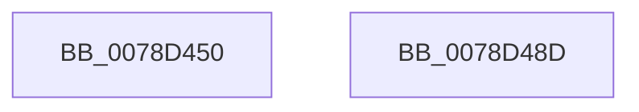

# RtlAddAuditAccessAceEx

- RVA: `0x0078D450`–`0x0078D48E` (길이 `62` bytes)
- VA: `0x000000014078D450`
- 실행 섹션: `PAGE`
- PDB 이름 있음: `예`; PDB Function 태그: `아니요`
- unwind 정보 RVA: `0x0005D2F4`
- 디코드: `16`개 명령, `62/62` bytes 표시
- 미해석 바이트: `0` (있으면 어셈블리에 `.byte`로 보존)

> 이 문서는 커널 이미지의 기계어와 PDB 기호를 분석해 생성했습니다. 4번과 5번은 함수 원형과 자료형을 바이너리 사용 방식에서 추정한 C 해석이며 원본 소스 복구 결과는 아닙니다.

## 1. Dependencies

- 직접 호출 지점: **1**; 고유 호출 대상: **1**
- 직접 호출자로 확인된 함수: **1**
- RIP 상대 이미지 참조: **0**

### Outgoing calls
- `0x0078D483` → [RtlpAddKnownAce](../92/RtlpAddKnownAce_function_00929A20.md) (function, `0x00929A20`)

### Direct callers
- [LocalGetAclForString](../92/LocalGetAclForString_function_00927F30.md) at `0x00928D3F`

### Static image references
- 디코드된 RIP-relative 메모리 참조가 없습니다.

## 2. Other-region calls and transfers

- 다른 실행 섹션으로 향하는 call: **0**
- 별도 외부 분기/꼬리 이동을 확인하지 못했습니다.

## 3. Assembly (complete function range)

```asm
0078D450  48 83 EC 38                     sub rsp, 0x38
0078D454  41 8B C0                        mov eax, r8d
0078D457  C6 44 24 28 02                  mov byte ptr [rsp + 0x28], 2
0078D45C  83 C8 40                        or eax, 0x40
0078D45F  80 7C 24 68 00                  cmp byte ptr [rsp + 0x68], 0
0078D464  41 0F 44 C0                     cmove eax, r8d
0078D468  44 8B C0                        mov r8d, eax
0078D46B  41 0F BA E8 07                  bts r8d, 7
0078D470  80 7C 24 70 00                  cmp byte ptr [rsp + 0x70], 0
0078D475  44 0F 44 C0                     cmove r8d, eax
0078D479  48 8B 44 24 60                  mov rax, qword ptr [rsp + 0x60]
0078D47E  48 89 44 24 20                  mov qword ptr [rsp + 0x20], rax
0078D483  E8 98 C5 19 00                  call 0x140929a20
0078D488  48 83 C4 38                     add rsp, 0x38
0078D48C  C3                              ret
0078D48D  CC                              int3
```

## 4. C-style interpretation (structured pseudocode)

```c
__int64 __fastcall RtlAddAuditAccessAceEx(__int64 a1, __int64 a2, int a3, __int64 a4, __int64 a5, unsigned __int8 a6, unsigned __int8 a7)
{
    __int64 result;
    __int64 v_rsp;
    unsigned __int8 v_stack_m10;
    unsigned __int64 v_stack_m18;

    v_rsp = (v_rsp) - (56);
    v_stack_m10 = 2;
    result = (unsigned int)(((unsigned int)(a3)) | (64));
    if (a6 == 0) { result = a3; }
    a3 = (unsigned int)((unsigned int)(result));
    if (a7 == 0) { a3 = (unsigned int)(result); }
    v_stack_m18 = a5;
    result = RtlpAddKnownAce(a1, a2, a3, a4);
    v_rsp = (v_rsp) + (56);
    return result;
}
```

## 5. (Beta) C Style

```c
int64_t RtlAddAuditAccessAceEx(int64_t Arg1, int64_t Arg2, int32_t Arg3, int64_t Arg4, int64_t Arg5, uint8_t Arg6, uint8_t Arg7)
{
    int64_t result;
    int64_t local_rsp;
    uint8_t v_stack_m10;
    uint64_t v_stack_m18;

    local_rsp = (local_rsp) - (56);
    v_stack_m10 = 2;
    result = (uint32_t)(((uint32_t)(Arg3)) | (64));
    if (Arg6 == 0) { result = Arg3; }
    Arg3 = (uint32_t)((uint32_t)(result));
    if (Arg7 == 0) { Arg3 = (uint32_t)(result); }
    v_stack_m18 = Arg5;
    result = RtlpAddKnownAce(Arg1, Arg2, Arg3, Arg4);
    local_rsp = (local_rsp) + (56);
    return result;
}
```

## 6. Execution-region graph

[열기: 2D/3D 그래프와 함수 탐색 컨트롤 패널](../../../control-panel.html?section=page&rva=0x0078D450&view=graph)

- 2D 그래프는 위에서 아래로 흐르고, 3D 그래프는 빈 공간을 드래그해 회전합니다. Shift+드래그는 이동, 휠은 확대·축소, 함수 노드 선택은 대상 보고서 이동입니다.

### Static fallback


