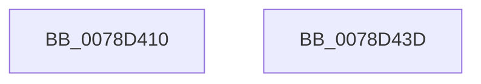

# RtlAddAuditAccessAce

- RVA: `0x0078D410`–`0x0078D43E` (길이 `46` bytes)
- VA: `0x000000014078D410`
- 실행 섹션: `PAGE`
- PDB 이름 있음: `예`; PDB Function 태그: `아니요`
- unwind 정보 RVA: `0x0005D2F4`
- 디코드: `11`개 명령, `46/46` bytes 표시
- 미해석 바이트: `0` (있으면 어셈블리에 `.byte`로 보존)

> 이 문서는 커널 이미지의 기계어와 PDB 기호를 분석해 생성했습니다. 4번과 5번은 함수 원형과 자료형을 바이너리 사용 방식에서 추정한 C 해석이며 원본 소스 복구 결과는 아닙니다.

## 1. Dependencies

- 직접 호출 지점: **1**; 고유 호출 대상: **1**
- 직접 호출자로 확인된 함수: **2**
- RIP 상대 이미지 참조: **1**

### Outgoing calls
- `0x0078D433` → [RtlpAddKnownAce](../92/RtlpAddKnownAce_function_00929A20.md) (function, `0x00929A20`)

### Direct callers
- [SepInitProcessAuditSd](../../text/60/SepInitProcessAuditSd_function_00606230.md) at `0x00606312`
- [ObInitSystem](../../init/C7/ObInitSystem_function_00C71C7C.md) at `0x00C72105`

### Static image references
- `0x0078D414` → RVA `0x00E67D48` (`.data`; read)

## 2. Other-region calls and transfers

- 다른 실행 섹션으로 향하는 call: **0**
- 별도 외부 분기/꼬리 이동을 확인하지 못했습니다.

## 3. Assembly (complete function range)

```asm
0078D410  48 83 EC 38                     sub rsp, 0x38
0078D414  48 8B 05 2D A9 6D 00            mov rax, qword ptr [rip + 0x6da92d]
0078D41B  45 8B C8                        mov r9d, r8d
0078D41E  41 B8 C0 00 00 00               mov r8d, 0xc0
0078D424  C6 44 24 28 02                  mov byte ptr [rsp + 0x28], 2
0078D429  BA 02 00 00 00                  mov edx, 2
0078D42E  48 89 44 24 20                  mov qword ptr [rsp + 0x20], rax
0078D433  E8 E8 C5 19 00                  call 0x140929a20
0078D438  48 83 C4 38                     add rsp, 0x38
0078D43C  C3                              ret
0078D43D  CC                              int3
```

## 4. C-style interpretation (structured pseudocode)

```c
__int64 __fastcall RtlAddAuditAccessAce(__int64 a1, __int64 a2, int a3)
{
    __int64 result;
    __int64 v_rsp;
    unsigned __int8 v_stack_m10;
    unsigned __int64 v_stack_m18;

    v_rsp = (v_rsp) - (56);
    v_stack_m10 = 2;
    v_stack_m18 = *(unsigned __int64 *)(v_rip + 7186733);
    result = RtlpAddKnownAce(a1, 2, 192, (unsigned int)(a3));
    v_rsp = (v_rsp) + (56);
    return result;
}
```

## 5. (Beta) C Style

```c
int64_t RtlAddAuditAccessAce(int64_t Arg1, int64_t Arg2, int32_t Arg3)
{
    int64_t result;
    int64_t local_rsp;
    uint8_t v_stack_m10;
    uint64_t v_stack_m18;

    local_rsp = (local_rsp) - (56);
    v_stack_m10 = 2;
    v_stack_m18 = *(uint64_t *)(v_rip + 0x6DA92D);
    result = RtlpAddKnownAce(Arg1, 2, 192, (uint32_t)(Arg3));
    local_rsp = (local_rsp) + (56);
    return result;
}
```

## 6. Execution-region graph

[열기: 2D/3D 그래프와 함수 탐색 컨트롤 패널](../../../control-panel.html?section=page&rva=0x0078D410&view=graph)

- 2D 그래프는 위에서 아래로 흐르고, 3D 그래프는 빈 공간을 드래그해 회전합니다. Shift+드래그는 이동, 휠은 확대·축소, 함수 노드 선택은 대상 보고서 이동입니다.

### Static fallback


