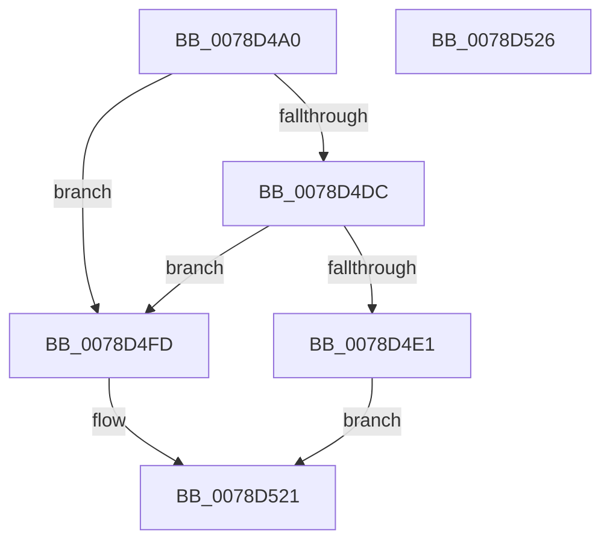

# RtlAddAuditAccessObjectAce

- RVA: `0x0078D4A0`–`0x0078D527` (길이 `135` bytes)
- VA: `0x000000014078D4A0`
- 실행 섹션: `PAGE`
- PDB 이름 있음: `예`; PDB Function 태그: `아니요`
- unwind 정보 RVA: `0x00063458`
- 디코드: `32`개 명령, `135/135` bytes 표시
- 미해석 바이트: `0` (있으면 어셈블리에 `.byte`로 보존)

> 이 문서는 커널 이미지의 기계어와 PDB 기호를 분석해 생성했습니다. 4번과 5번은 함수 원형과 자료형을 바이너리 사용 방식에서 추정한 C 해석이며 원본 소스 복구 결과는 아닙니다.

## 1. Dependencies

- 직접 호출 지점: **2**; 고유 호출 대상: **2**
- 직접 호출자로 확인된 함수: **1**
- RIP 상대 이미지 참조: **0**

### Outgoing calls
- `0x0078D4F6` → [RtlpAddKnownAce](../92/RtlpAddKnownAce_function_00929A20.md) (function, `0x00929A20`)
- `0x0078D51C` → [RtlpAddKnownObjectAce](RtlpAddKnownObjectAce_function_0078DBB4.md) (function, `0x0078DBB4`)

### Direct callers
- [LocalGetAclForString](../92/LocalGetAclForString_function_00927F30.md) at `0x00928E10`

### Static image references
- 디코드된 RIP-relative 메모리 참조가 없습니다.

## 2. Other-region calls and transfers

- 다른 실행 섹션으로 향하는 call: **0**
- 별도 외부 분기/꼬리 이동을 확인하지 못했습니다.

## 3. Assembly (complete function range)

```asm
0078D4A0  48 83 EC 48                     sub rsp, 0x48
0078D4A4  4C 8B 5C 24 70                  mov r11, qword ptr [rsp + 0x70]
0078D4A9  41 8B C0                        mov eax, r8d
0078D4AC  83 C8 40                        or eax, 0x40
0078D4AF  4C 8B D1                        mov r10, rcx
0078D4B2  80 BC 24 88 00 00 00 00         cmp byte ptr [rsp + 0x88], 0
0078D4BA  48 8B 4C 24 78                  mov rcx, qword ptr [rsp + 0x78]
0078D4BF  41 0F 44 C0                     cmove eax, r8d
0078D4C3  44 8B C0                        mov r8d, eax
0078D4C6  41 0F BA E8 07                  bts r8d, 7
0078D4CB  80 BC 24 90 00 00 00 00         cmp byte ptr [rsp + 0x90], 0
0078D4D3  44 0F 44 C0                     cmove r8d, eax
0078D4D7  4D 85 DB                        test r11, r11
0078D4DA  75 21                           jne 0x14078d4fd
0078D4DC  48 85 C9                        test rcx, rcx
0078D4DF  75 1C                           jne 0x14078d4fd
0078D4E1  48 8B 84 24 80 00 00 00         mov rax, qword ptr [rsp + 0x80]
0078D4E9  49 8B CA                        mov rcx, r10
0078D4EC  C6 44 24 28 02                  mov byte ptr [rsp + 0x28], 2
0078D4F1  48 89 44 24 20                  mov qword ptr [rsp + 0x20], rax
0078D4F6  E8 25 C5 19 00                  call 0x140929a20
0078D4FB  EB 24                           jmp 0x14078d521
0078D4FD  48 8B 84 24 80 00 00 00         mov rax, qword ptr [rsp + 0x80]
0078D505  C6 44 24 38 07                  mov byte ptr [rsp + 0x38], 7
0078D50A  48 89 44 24 30                  mov qword ptr [rsp + 0x30], rax
0078D50F  48 89 4C 24 28                  mov qword ptr [rsp + 0x28], rcx
0078D514  49 8B CA                        mov rcx, r10
0078D517  4C 89 5C 24 20                  mov qword ptr [rsp + 0x20], r11
0078D51C  E8 93 06 00 00                  call 0x14078dbb4
0078D521  48 83 C4 48                     add rsp, 0x48
0078D525  C3                              ret
0078D526  CC                              int3
```

## 4. C-style interpretation (structured pseudocode)

```c
__int64 __fastcall RtlAddAuditAccessObjectAce(__int64 a1, __int64 a2, int a3, __int64 a4, __int64 a5, __int64 a6, __int64 a7, unsigned __int8 a8, unsigned __int8 a9)
{
    __int64 result;
    __int64 v_rsp;
    unsigned __int8 v_stack_m10;
    unsigned __int64 v_stack_m18;
    unsigned __int8 v_stack_m20;
    unsigned __int64 v_stack_m28;

    v_rsp = (v_rsp) - (72);
    result = (unsigned int)(((unsigned int)(a3)) | (64));
    if (a8 == 0) { result = a3; }
    a3 = (unsigned int)((unsigned int)(result));
    if (a9 == 0) { a3 = (unsigned int)(result); }
    if (a5 != 0) goto loc_0078D4FD;
    if (a6 != 0) goto loc_0078D4FD;
    v_stack_m20 = 2;
    v_stack_m28 = a7;
    result = RtlpAddKnownAce(a1, a2, a3, a4);
    goto loc_0078D521;
loc_0078D4FD:
    v_stack_m10 = 7;
    v_stack_m18 = a7;
    v_stack_m20 = a1;
    v_stack_m28 = a5;
    result = RtlpAddKnownObjectAce(a1, a2, a3, a4);
loc_0078D521:
    v_rsp = (v_rsp) + (72);
    return result;
}
```

## 5. (Beta) C Style

```c
int64_t RtlAddAuditAccessObjectAce(int64_t Arg1, int64_t Arg2, int32_t Arg3, int64_t Arg4, int64_t Arg5, int64_t Arg6, int64_t Arg7, uint8_t Arg8, uint8_t Arg9)
{
    int64_t result;
    int64_t local_rsp;
    uint8_t v_stack_m10;
    uint64_t v_stack_m18;
    uint8_t v_stack_m20;
    uint64_t v_stack_m28;

    local_rsp = (local_rsp) - (72);
    result = (uint32_t)(((uint32_t)(Arg3)) | (64));
    if (Arg8 == 0) { result = Arg3; }
    Arg3 = (uint32_t)((uint32_t)(result));
    if (Arg9 == 0) { Arg3 = (uint32_t)(result); }
    if (Arg5 != 0) goto loc_0078D4FD;
    if (Arg6 != 0) goto loc_0078D4FD;
    v_stack_m20 = 2;
    v_stack_m28 = Arg7;
    result = RtlpAddKnownAce(Arg1, Arg2, Arg3, Arg4);
    goto loc_0078D521;
loc_0078D4FD:
    v_stack_m10 = 7;
    v_stack_m18 = Arg7;
    v_stack_m20 = Arg1;
    v_stack_m28 = Arg5;
    result = RtlpAddKnownObjectAce(Arg1, Arg2, Arg3, Arg4);
loc_0078D521:
    local_rsp = (local_rsp) + (72);
    return result;
}
```

## 6. Execution-region graph

[열기: 2D/3D 그래프와 함수 탐색 컨트롤 패널](../../../control-panel.html?section=page&rva=0x0078D4A0&view=graph)

- 2D 그래프는 위에서 아래로 흐르고, 3D 그래프는 빈 공간을 드래그해 회전합니다. Shift+드래그는 이동, 휠은 확대·축소, 함수 노드 선택은 대상 보고서 이동입니다.

### Static fallback


