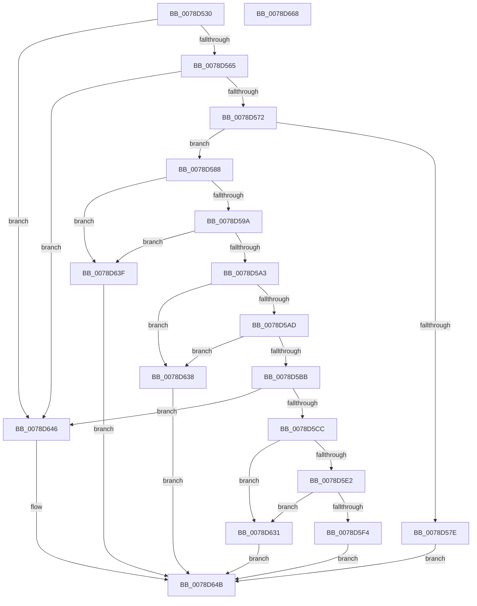

# RtlAddMandatoryAccessAllowedAce

- RVA: `0x0078D530`–`0x0078D669` (길이 `313` bytes)
- VA: `0x000000014078D530`
- 실행 섹션: `PAGE`
- PDB 이름 있음: `예`; PDB Function 태그: `아니요`
- unwind 정보 RVA: `0x0005D79C`
- 디코드: `89`개 명령, `313/313` bytes 표시
- 미해석 바이트: `0` (있으면 어셈블리에 `.byte`로 보존)

> 이 문서는 커널 이미지의 기계어와 PDB 기호를 분석해 생성했습니다. 4번과 5번은 함수 원형과 자료형을 바이너리 사용 방식에서 추정한 C 해석이며 원본 소스 복구 결과는 아닙니다.

## 1. Dependencies

- 직접 호출 지점: **4**; 고유 호출 대상: **4**
- 직접 호출자로 확인된 함수: **1**
- RIP 상대 이미지 참조: **0**

### Outgoing calls
- `0x0078D565` → [RtlValidAcl](../92/RtlValidAcl_function_0092A7A0.md) (function, `0x0092A7A0`)
- `0x0078D575` → [RtlValidSid](../92/RtlValidSid_function_00929710.md) (function, `0x00929710`)
- `0x0078D5C3` → [RtlFirstFreeAce](../9A/RtlFirstFreeAce_function_009A8FF0.md) (function, `0x009A8FF0`)
- `0x0078D617` → [RtlCopySid](../9A/RtlCopySid_function_009A9A50.md) (function, `0x009A9A50`)

### Direct callers
- [SepConstructMandatoryAccessControlList](../79/SepConstructMandatoryAccessControlList_function_0079D3AC.md) at `0x0079D504`

### Static image references
- 디코드된 RIP-relative 메모리 참조가 없습니다.

## 2. Other-region calls and transfers

- 다른 실행 섹션으로 향하는 call: **0**
- 별도 외부 분기/꼬리 이동을 확인하지 못했습니다.

## 3. Assembly (complete function range)

```asm
0078D530  48 8B C4                        mov rax, rsp
0078D533  48 89 58 10                     mov qword ptr [rax + 0x10], rbx
0078D537  48 89 68 18                     mov qword ptr [rax + 0x18], rbp
0078D53B  48 89 70 20                     mov qword ptr [rax + 0x20], rsi
0078D53F  57                              push rdi
0078D540  41 54                           push r12
0078D542  41 55                           push r13
0078D544  41 56                           push r14
0078D546  41 57                           push r15
0078D548  48 83 EC 20                     sub rsp, 0x20
0078D54C  48 83 60 08 00                  and qword ptr [rax + 8], 0
0078D551  49 8B F1                        mov rsi, r9
0078D554  45 8A F8                        mov r15b, r8b
0078D557  8B EA                           mov ebp, edx
0078D559  48 8B D9                        mov rbx, rcx
0078D55C  48 85 C9                        test rcx, rcx
0078D55F  0F 84 E1 00 00 00               je 0x14078d646
0078D565  E8 36 D2 19 00                  call 0x14092a7a0
0078D56A  84 C0                           test al, al
0078D56C  0F 84 D4 00 00 00               je 0x14078d646
0078D572  48 8B CE                        mov rcx, rsi
0078D575  E8 96 C1 19 00                  call 0x140929710
0078D57A  84 C0                           test al, al
0078D57C  75 0A                           jne 0x14078d588
0078D57E  B8 78 00 00 C0                  mov eax, 0xc0000078
0078D583  E9 C3 00 00 00                  jmp 0x14078d64b
0078D588  0F B6 3B                        movzx edi, byte ptr [rbx]
0078D58B  41 BD 04 00 00 00               mov r13d, 4
0078D591  41 3A FD                        cmp dil, r13b
0078D594  0F 87 A5 00 00 00               ja 0x14078d63f
0078D59A  41 3B ED                        cmp ebp, r13d
0078D59D  0F 87 9C 00 00 00               ja 0x14078d63f
0078D5A3  41 F6 C7 E0                     test r15b, 0xe0
0078D5A7  0F 85 8B 00 00 00               jne 0x14078d638
0078D5AD  44 8B 74 24 70                  mov r14d, dword ptr [rsp + 0x70]
0078D5B2  41 F7 C6 00 00 E0 FF            test r14d, 0xffe00000
0078D5B9  75 7D                           jne 0x14078d638
0078D5BB  48 8D 54 24 50                  lea rdx, [rsp + 0x50]
0078D5C0  48 8B CB                        mov rcx, rbx
0078D5C3  E8 28 BA 21 00                  call 0x1409a8ff0
0078D5C8  84 C0                           test al, al
0078D5CA  74 7A                           je 0x14078d646
0078D5CC  0F B6 56 01                     movzx edx, byte ptr [rsi + 1]
0078D5D0  4C 8B 44 24 50                  mov r8, qword ptr [rsp + 0x50]
0078D5D5  66 41 03 D5                     add dx, r13w
0078D5D9  66 C1 E2 02                     shl dx, 2
0078D5DD  4D 85 C0                        test r8, r8
0078D5E0  74 4F                           je 0x14078d631
0078D5E2  0F B7 4B 02                     movzx ecx, word ptr [rbx + 2]
0078D5E6  0F B7 C2                        movzx eax, dx
0078D5E9  48 03 CB                        add rcx, rbx
0078D5EC  49 03 C0                        add rax, r8
0078D5EF  48 3B C1                        cmp rax, rcx
0078D5F2  77 3D                           ja 0x14078d631
0078D5F4  66 41 89 50 02                  mov word ptr [r8 + 2], dx
0078D5F9  49 8D 50 08                     lea rdx, [r8 + 8]
0078D5FD  45 88 78 01                     mov byte ptr [r8 + 1], r15b
0078D601  41 C6 00 17                     mov byte ptr [r8], 0x17
0078D605  45 89 70 04                     mov dword ptr [r8 + 4], r14d
0078D609  4C 8B C6                        mov r8, rsi
0078D60C  0F B6 4E 01                     movzx ecx, byte ptr [rsi + 1]
0078D610  8D 0C 8D 08 00 00 00            lea ecx, [rcx*4 + 8]
0078D617  E8 34 C4 21 00                  call 0x1409a9a50
0078D61C  66 FF 43 04                     inc word ptr [rbx + 4]
0078D620  8B CF                           mov ecx, edi
0078D622  3B FD                           cmp edi, ebp
0078D624  40 0F B6 C5                     movzx eax, bpl
0078D628  0F 46 C8                        cmovbe ecx, eax
0078D62B  33 C0                           xor eax, eax
0078D62D  88 0B                           mov byte ptr [rbx], cl
0078D62F  EB 1A                           jmp 0x14078d64b
0078D631  B8 99 00 00 C0                  mov eax, 0xc0000099
0078D636  EB 13                           jmp 0x14078d64b
0078D638  B8 0D 00 00 C0                  mov eax, 0xc000000d
0078D63D  EB 0C                           jmp 0x14078d64b
0078D63F  B8 59 00 00 C0                  mov eax, 0xc0000059
0078D644  EB 05                           jmp 0x14078d64b
0078D646  B8 77 00 00 C0                  mov eax, 0xc0000077
0078D64B  48 8B 5C 24 58                  mov rbx, qword ptr [rsp + 0x58]
0078D650  48 8B 6C 24 60                  mov rbp, qword ptr [rsp + 0x60]
0078D655  48 8B 74 24 68                  mov rsi, qword ptr [rsp + 0x68]
0078D65A  48 83 C4 20                     add rsp, 0x20
0078D65E  41 5F                           pop r15
0078D660  41 5E                           pop r14
0078D662  41 5D                           pop r13
0078D664  41 5C                           pop r12
0078D666  5F                              pop rdi
0078D667  C3                              ret
0078D668  CC                              int3
```

## 4. C-style interpretation (structured pseudocode)

```c
__int64 __fastcall RtlAddMandatoryAccessAllowedAce(__int64 a1, int a2, unsigned __int8 a3, __int64 a4, unsigned int a5)
{
    __int64 result;
    __int64 v_rsp;
    unsigned __int64 v_stack_p10;
    unsigned __int64 v_stack_p18;
    unsigned __int64 v_stack_p20;
    unsigned __int64 v_stack_p8;

    *(unsigned __int64 *)(v_rsp + 16) = v_rbx;
    *(unsigned __int64 *)(v_rsp + 24) = v_rbp;
    *(unsigned __int64 *)(v_rsp + 32) = v_rsi;
    v_rsp = (v_rsp) - (32);
    if (a1 == 0) goto loc_0078D646;
    result = RtlValidAcl(a1, a2, a3, a4);
    if ((unsigned __int8)(result) == 0) goto loc_0078D646;
    result = RtlValidSid(a4, a2, a3, a4);
    if ((unsigned __int8)(result) != 0) goto loc_0078D588;
    goto loc_0078D64B;
loc_0078D588:
    if (((unsigned __int8)(*(unsigned __int8 *)(a1))) > 4) goto loc_0078D63F;
    if (((unsigned int)((unsigned int)(a2))) > 4) goto loc_0078D63F;
    if (((a3) & (224)) != 0) goto loc_0078D638;
    if ((((unsigned int)((unsigned int)(a5))) & (0xFFE00000ULL)) != 0) goto loc_0078D638;
    result = RtlFirstFreeAce(a1, v_stack_p8, a3, a4);
    if ((unsigned __int8)(result) == 0) goto loc_0078D646;
    a2 = (unsigned __int16)((*(unsigned __int8 *)(a4 + 1)) + (4));
    a2 = (unsigned __int16)((a2) << (2));
    if (v_stack_p8 == 0) goto loc_0078D631;
    a1 = (*(unsigned __int16 *)(a1 + 2)) + (a1);
    result = ((unsigned __int16)(a2)) + (v_stack_p8);
    if (result > a1) goto loc_0078D631;
    *(unsigned __int16 *)(v_stack_p8 + 2) = (unsigned __int16)(a2);
    *(unsigned __int8 *)(v_stack_p8 + 1) = a3;
    *(unsigned __int8 *)(v_stack_p8) = 23;
    *(unsigned int *)(v_stack_p8 + 4) = (unsigned int)((unsigned int)(a5));
    result = RtlCopySid(*(unsigned __int8 *)(a4 + 1) * 4 + 8, v_stack_p8 + 8, a4, a4);
    a1 = (unsigned int)((unsigned int)(*(unsigned __int8 *)(a1)));
    if (((unsigned int)(*(unsigned __int8 *)(a1))) <= ((unsigned int)((unsigned int)(a2)))) { a1 = (unsigned int)((unsigned __int8)((unsigned int)(a2))); }
    result = 0;
    *(unsigned __int8 *)(a1) = (unsigned __int8)(a1);
    goto loc_0078D64B;
loc_0078D631:
    goto loc_0078D64B;
loc_0078D638:
    goto loc_0078D64B;
loc_0078D63F:
    goto loc_0078D64B;
loc_0078D646:
loc_0078D64B:
    v_rsp = (v_rsp) + (32);
    return (unsigned int)(0xC0000077ULL);
}
```

## 5. (Beta) C Style

```c
int64_t RtlAddMandatoryAccessAllowedAce(void *Arg1, int32_t Arg2, uint8_t Arg3, void *Arg4, uint32_t Arg5)
{
    uint8_t *arg1 = (uint8_t *)Arg1;
    uint8_t *arg4 = (uint8_t *)Arg4;

    int64_t result;
    int64_t local_rsp;
    uint64_t v_stack_p10;
    uint64_t v_stack_p18;
    uint64_t v_stack_p20;
    uint64_t v_stack_p8;

    *(uint64_t *)(local_rsp + 0x10) = local_rbx;
    *(uint64_t *)(local_rsp + 0x18) = local_rbp;
    *(uint64_t *)(local_rsp + 0x20) = local_rsi;
    local_rsp = (local_rsp) - (32);
    if (Arg1 == NULL) goto loc_0078D646;
    result = RtlValidAcl(Arg1, Arg2, Arg3, Arg4);
    if ((uint8_t)(result) == 0) goto loc_0078D646;
    result = RtlValidSid(Arg4, Arg2, Arg3, Arg4);
    if ((uint8_t)(result) != 0) goto loc_0078D588;
    goto loc_0078D64B;
loc_0078D588:
    if (((uint8_t)(*(uint8_t *)(arg1))) > 4) goto loc_0078D63F;
    if (((uint32_t)((uint32_t)(Arg2))) > 4) goto loc_0078D63F;
    if (((Arg3) & (224)) != 0) goto loc_0078D638;
    if ((((uint32_t)((uint32_t)(Arg5))) & (0xFFE00000ULL)) != 0) goto loc_0078D638;
    result = RtlFirstFreeAce(Arg1, v_stack_p8, Arg3, Arg4);
    if ((uint8_t)(result) == 0) goto loc_0078D646;
    Arg2 = (uint16_t)((*(uint8_t *)(arg4 + 0x1)) + (4));
    Arg2 = (uint16_t)((Arg2) << (2));
    if (v_stack_p8 == 0) goto loc_0078D631;
    Arg1 = (*(uint16_t *)(arg1 + 0x2)) + (Arg1);
    result = ((uint16_t)(Arg2)) + (v_stack_p8);
    if (result > Arg1) goto loc_0078D631;
    *(uint16_t *)(v_stack_p8 + 0x2) = (uint16_t)(Arg2);
    *(uint8_t *)(v_stack_p8 + 0x1) = Arg3;
    *(uint8_t *)(v_stack_p8) = 23;
    *(uint32_t *)(v_stack_p8 + 0x4) = (uint32_t)((uint32_t)(Arg5));
    result = RtlCopySid(*(uint8_t *)(arg4 + 0x1) * 4 + 8, v_stack_p8 + 8, Arg4, Arg4);
    Arg1 = (uint32_t)((uint32_t)(*(uint8_t *)(arg1)));
    if (((uint32_t)(*(uint8_t *)(arg1))) <= ((uint32_t)((uint32_t)(Arg2)))) { Arg1 = (uint32_t)((uint8_t)((uint32_t)(Arg2))); }
    result = 0;
    *(uint8_t *)(arg1) = (uint8_t)(Arg1);
    goto loc_0078D64B;
loc_0078D631:
    goto loc_0078D64B;
loc_0078D638:
    goto loc_0078D64B;
loc_0078D63F:
    goto loc_0078D64B;
loc_0078D646:
loc_0078D64B:
    local_rsp = (local_rsp) + (32);
    return (uint32_t)(0xC0000077ULL);
}
```

### 관측된 메모리 오프셋

구조체 형식이 확인되지 않은 접근은 인자 기준의 오프셋으로만 기록했습니다.

| 기준 인자 | 오프셋 표현 | 폭 (bit) | 접근 |
|---|---:|---:|---|
| `Arg1` | `+ 0x0` | `8` | `R` |
| `Arg1` | `+ 0x0` | `8` | `W` |
| `Arg1` | `+ 0x2` | `16` | `R` |
| `Arg1` | `+ 0x4` | `16` | `R/W` |
| `Arg4` | `+ 0x1` | `8` | `R` |

## 6. Execution-region graph

[열기: 2D/3D 그래프와 함수 탐색 컨트롤 패널](../../../control-panel.html?section=page&rva=0x0078D530&view=graph)

- 2D 그래프는 위에서 아래로 흐르고, 3D 그래프는 빈 공간을 드래그해 회전합니다. Shift+드래그는 이동, 휠은 확대·축소, 함수 노드 선택은 대상 보고서 이동입니다.

### Static fallback


