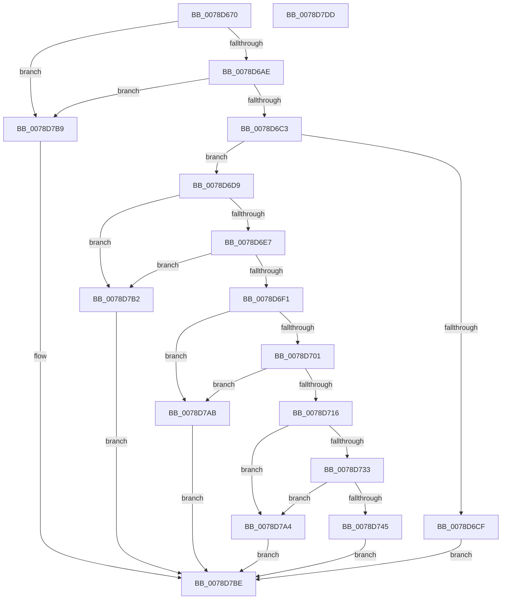

# RtlAddMandatoryAppAccessAllowedAce

- RVA: `0x0078D670`–`0x0078D7DE` (길이 `366` bytes)
- VA: `0x000000014078D670`
- 실행 섹션: `PAGE`
- PDB 이름 있음: `예`; PDB Function 태그: `아니요`
- unwind 정보 RVA: `0x000847EC`
- 디코드: `99`개 명령, `366/366` bytes 표시
- 미해석 바이트: `0` (있으면 어셈블리에 `.byte`로 보존)

> 이 문서는 커널 이미지의 기계어와 PDB 기호를 분석해 생성했습니다. 4번과 5번은 함수 원형과 자료형을 바이너리 사용 방식에서 추정한 C 해석이며 원본 소스 복구 결과는 아닙니다.

## 1. Dependencies

- 직접 호출 지점: **7**; 고유 호출 대상: **5**
- 직접 호출자로 확인된 함수: **1**
- RIP 상대 이미지 참조: **0**

### Outgoing calls
- `0x0078D6A1` → [RtlValidSid](../92/RtlValidSid_function_00929710.md) (function, `0x00929710`)
- `0x0078D6B6` → [RtlValidSid](../92/RtlValidSid_function_00929710.md) (function, `0x00929710`)
- `0x0078D6C6` → [RtlIsValidAntiTamperAppSid](../../text/5E/RtlIsValidAntiTamperAppSid_function_005E7194.md) (function, `0x005E7194`)
- `0x0078D6F4` → [RtlValidAcl](../92/RtlValidAcl_function_0092A7A0.md) (function, `0x0092A7A0`)
- `0x0078D709` → [RtlFirstFreeAce](../9A/RtlFirstFreeAce_function_009A8FF0.md) (function, `0x009A8FF0`)
- `0x0078D769` → [RtlCopySid](../9A/RtlCopySid_function_009A9A50.md) (function, `0x009A9A50`)
- `0x0078D788` → [RtlCopySid](../9A/RtlCopySid_function_009A9A50.md) (function, `0x009A9A50`)

### Direct callers
- [SepConstructMandatoryAccessControlList](../79/SepConstructMandatoryAccessControlList_function_0079D3AC.md) at `0x0079D518`

### Static image references
- 디코드된 RIP-relative 메모리 참조가 없습니다.

## 2. Other-region calls and transfers

- 다른 실행 섹션으로 향하는 call: **1**
  - `0x0078D6C6` → [RtlIsValidAntiTamperAppSid](../../text/5E/RtlIsValidAntiTamperAppSid_function_005E7194.md) (`PAGE` → `.text`)
- 별도 외부 분기/꼬리 이동을 확인하지 못했습니다.

## 3. Assembly (complete function range)

```asm
0078D670  48 8B C4                        mov rax, rsp
0078D673  48 89 58 08                     mov qword ptr [rax + 8], rbx
0078D677  48 89 68 10                     mov qword ptr [rax + 0x10], rbp
0078D67B  48 89 70 18                     mov qword ptr [rax + 0x18], rsi
0078D67F  48 89 78 20                     mov qword ptr [rax + 0x20], rdi
0078D683  41 54                           push r12
0078D685  41 56                           push r14
0078D687  41 57                           push r15
0078D689  48 83 EC 30                     sub rsp, 0x30
0078D68D  48 83 60 D8 00                  and qword ptr [rax - 0x28], 0
0078D692  48 8B D9                        mov rbx, rcx
0078D695  49 8B C9                        mov rcx, r9
0078D698  49 8B E9                        mov rbp, r9
0078D69B  45 8A E0                        mov r12b, r8b
0078D69E  44 8B FA                        mov r15d, edx
0078D6A1  E8 6A C0 19 00                  call 0x140929710
0078D6A6  84 C0                           test al, al
0078D6A8  0F 84 0B 01 00 00               je 0x14078d7b9
0078D6AE  48 8B 7C 24 70                  mov rdi, qword ptr [rsp + 0x70]
0078D6B3  48 8B CF                        mov rcx, rdi
0078D6B6  E8 55 C0 19 00                  call 0x140929710
0078D6BB  84 C0                           test al, al
0078D6BD  0F 84 F6 00 00 00               je 0x14078d7b9
0078D6C3  48 8B CF                        mov rcx, rdi
0078D6C6  E8 C9 9A E5 FF                  call 0x1405e7194
0078D6CB  84 C0                           test al, al
0078D6CD  75 0A                           jne 0x14078d6d9
0078D6CF  B8 F3 00 00 C0                  mov eax, 0xc00000f3
0078D6D4  E9 E5 00 00 00                  jmp 0x14078d7be
0078D6D9  44 0F B6 33                     movzx r14d, byte ptr [rbx]
0078D6DD  41 80 FE 04                     cmp r14b, 4
0078D6E1  0F 87 CB 00 00 00               ja 0x14078d7b2
0078D6E7  41 83 FF 04                     cmp r15d, 4
0078D6EB  0F 87 C1 00 00 00               ja 0x14078d7b2
0078D6F1  48 8B CB                        mov rcx, rbx
0078D6F4  E8 A7 D0 19 00                  call 0x14092a7a0
0078D6F9  84 C0                           test al, al
0078D6FB  0F 84 AA 00 00 00               je 0x14078d7ab
0078D701  48 8D 54 24 20                  lea rdx, [rsp + 0x20]
0078D706  48 8B CB                        mov rcx, rbx
0078D709  E8 E2 B8 21 00                  call 0x1409a8ff0
0078D70E  84 C0                           test al, al
0078D710  0F 84 95 00 00 00               je 0x14078d7ab
0078D716  0F B6 47 01                     movzx eax, byte ptr [rdi + 1]
0078D71A  0F B6 55 01                     movzx edx, byte ptr [rbp + 1]
0078D71E  66 83 C0 06                     add ax, 6
0078D722  48 8B 74 24 20                  mov rsi, qword ptr [rsp + 0x20]
0078D727  66 03 D0                        add dx, ax
0078D72A  66 C1 E2 02                     shl dx, 2
0078D72E  48 85 F6                        test rsi, rsi
0078D731  74 71                           je 0x14078d7a4
0078D733  0F B7 4B 02                     movzx ecx, word ptr [rbx + 2]
0078D737  0F B7 C2                        movzx eax, dx
0078D73A  48 03 CB                        add rcx, rbx
0078D73D  48 03 C6                        add rax, rsi
0078D740  48 3B C1                        cmp rax, rcx
0078D743  77 5F                           ja 0x14078d7a4
0078D745  8B 44 24 78                     mov eax, dword ptr [rsp + 0x78]
0078D749  4C 8B C5                        mov r8, rbp
0078D74C  66 89 56 02                     mov word ptr [rsi + 2], dx
0078D750  48 8D 56 08                     lea rdx, [rsi + 8]
0078D754  89 46 04                        mov dword ptr [rsi + 4], eax
0078D757  44 88 66 01                     mov byte ptr [rsi + 1], r12b
0078D75B  C6 06 16                        mov byte ptr [rsi], 0x16
0078D75E  0F B6 4D 01                     movzx ecx, byte ptr [rbp + 1]
0078D762  8D 0C 8D 08 00 00 00            lea ecx, [rcx*4 + 8]
0078D769  E8 E2 C2 21 00                  call 0x1409a9a50
0078D76E  0F B6 45 01                     movzx eax, byte ptr [rbp + 1]
0078D772  4C 8B C7                        mov r8, rdi
0078D775  0F B6 4F 01                     movzx ecx, byte ptr [rdi + 1]
0078D779  48 83 C0 04                     add rax, 4
0078D77D  48 8D 14 86                     lea rdx, [rsi + rax*4]
0078D781  8D 0C 8D 08 00 00 00            lea ecx, [rcx*4 + 8]
0078D788  E8 C3 C2 21 00                  call 0x1409a9a50
0078D78D  66 FF 43 04                     inc word ptr [rbx + 4]
0078D791  41 8B CE                        mov ecx, r14d
0078D794  45 3A F7                        cmp r14b, r15b
0078D797  41 0F B6 C7                     movzx eax, r15b
0078D79B  0F 46 C8                        cmovbe ecx, eax
0078D79E  33 C0                           xor eax, eax
0078D7A0  88 0B                           mov byte ptr [rbx], cl
0078D7A2  EB 1A                           jmp 0x14078d7be
0078D7A4  B8 99 00 00 C0                  mov eax, 0xc0000099
0078D7A9  EB 13                           jmp 0x14078d7be
0078D7AB  B8 77 00 00 C0                  mov eax, 0xc0000077
0078D7B0  EB 0C                           jmp 0x14078d7be
0078D7B2  B8 59 00 00 C0                  mov eax, 0xc0000059
0078D7B7  EB 05                           jmp 0x14078d7be
0078D7B9  B8 78 00 00 C0                  mov eax, 0xc0000078
0078D7BE  48 8B 5C 24 50                  mov rbx, qword ptr [rsp + 0x50]
0078D7C3  48 8B 6C 24 58                  mov rbp, qword ptr [rsp + 0x58]
0078D7C8  48 8B 74 24 60                  mov rsi, qword ptr [rsp + 0x60]
0078D7CD  48 8B 7C 24 68                  mov rdi, qword ptr [rsp + 0x68]
0078D7D2  48 83 C4 30                     add rsp, 0x30
0078D7D6  41 5F                           pop r15
0078D7D8  41 5E                           pop r14
0078D7DA  41 5C                           pop r12
0078D7DC  C3                              ret
0078D7DD  CC                              int3
```

## 4. C-style interpretation (structured pseudocode)

```c
__int64 __fastcall RtlAddMandatoryAppAccessAllowedAce(__int64 a1, int a2, unsigned __int8 a3, __int64 a4, __int64 a5, unsigned int a6)
{
    __int64 result;
    __int64 v_rsp;
    unsigned __int64 v_stack_m28;
    unsigned __int64 v_stack_p10;
    unsigned __int64 v_stack_p18;
    unsigned __int64 v_stack_p20;
    unsigned __int64 v_stack_p8;

    *(unsigned __int64 *)(v_rsp + 8) = v_rbx;
    *(unsigned __int64 *)(v_rsp + 16) = v_rbp;
    *(unsigned __int64 *)(v_rsp + 24) = v_rsi;
    *(unsigned __int64 *)(v_rsp + 32) = v_rdi;
    v_rsp = (v_rsp) - (48);
    result = RtlValidSid(a4, a2, a3, a4);
    if ((unsigned __int8)(result) == 0) goto loc_0078D7B9;
    result = RtlValidSid(a5, a2, a3, a4);
    if ((unsigned __int8)(result) == 0) goto loc_0078D7B9;
    result = RtlIsValidAntiTamperAppSid(a5, a2, a3, a4);
    if ((unsigned __int8)(result) != 0) goto loc_0078D6D9;
    goto loc_0078D7BE;
loc_0078D6D9:
    if (((unsigned __int8)(*(unsigned __int8 *)(a1))) > 4) goto loc_0078D7B2;
    if (((unsigned int)((unsigned int)(a2))) > 4) goto loc_0078D7B2;
    result = RtlValidAcl(a1, a2, a3, a4);
    if ((unsigned __int8)(result) == 0) goto loc_0078D7AB;
    result = RtlFirstFreeAce(a1, v_stack_m28, a3, a4);
    if ((unsigned __int8)(result) == 0) goto loc_0078D7AB;
    result = (unsigned __int16)((*(unsigned __int8 *)(a5 + 1)) + (6));
    a2 = (unsigned __int16)((*(unsigned __int8 *)(a4 + 1)) + ((unsigned __int16)(result)));
    a2 = (unsigned __int16)((a2) << (2));
    if (v_stack_m28 == 0) goto loc_0078D7A4;
    a1 = (*(unsigned __int16 *)(a1 + 2)) + (a1);
    result = ((unsigned __int16)(a2)) + (v_stack_m28);
    if (result > a1) goto loc_0078D7A4;
    *(unsigned __int16 *)(v_stack_m28 + 2) = (unsigned __int16)(a2);
    *(unsigned int *)(v_stack_m28 + 4) = (unsigned int)((unsigned int)(a6));
    *(unsigned __int8 *)(v_stack_m28 + 1) = a3;
    *(unsigned __int8 *)(v_stack_m28) = 22;
    result = RtlCopySid(*(unsigned __int8 *)(a4 + 1) * 4 + 8, v_stack_m28 + 8, a4, a4);
    result = (*(unsigned __int8 *)(a4 + 1)) + (4);
    result = RtlCopySid(*(unsigned __int8 *)(a5 + 1) * 4 + 8, v_stack_m28 + result * 4, a5, a4);
    a1 = (unsigned int)((unsigned int)(*(unsigned __int8 *)(a1)));
    if (((unsigned __int8)(*(unsigned __int8 *)(a1))) <= ((unsigned __int8)((unsigned int)(a2)))) { a1 = (unsigned int)((unsigned __int8)((unsigned int)(a2))); }
    result = 0;
    *(unsigned __int8 *)(a1) = (unsigned __int8)(a1);
    goto loc_0078D7BE;
loc_0078D7A4:
    goto loc_0078D7BE;
loc_0078D7AB:
    goto loc_0078D7BE;
loc_0078D7B2:
    goto loc_0078D7BE;
loc_0078D7B9:
loc_0078D7BE:
    v_rsp = (v_rsp) + (48);
    return (unsigned int)(0xC0000078ULL);
}
```

## 5. (Beta) C Style

```c
int64_t RtlAddMandatoryAppAccessAllowedAce(void *Arg1, int32_t Arg2, uint8_t Arg3, void *Arg4, void *Arg5, uint32_t Arg6)
{
    uint8_t *arg1 = (uint8_t *)Arg1;
    uint8_t *arg4 = (uint8_t *)Arg4;
    uint8_t *arg5 = (uint8_t *)Arg5;

    int64_t result;
    int64_t local_rsp;
    uint64_t v_stack_m28;
    uint64_t v_stack_p10;
    uint64_t v_stack_p18;
    uint64_t v_stack_p20;
    uint64_t v_stack_p8;

    *(uint64_t *)(local_rsp + 0x8) = local_rbx;
    *(uint64_t *)(local_rsp + 0x10) = local_rbp;
    *(uint64_t *)(local_rsp + 0x18) = local_rsi;
    *(uint64_t *)(local_rsp + 0x20) = local_rdi;
    local_rsp = (local_rsp) - (48);
    result = RtlValidSid(Arg4, Arg2, Arg3, Arg4);
    if ((uint8_t)(result) == 0) goto loc_0078D7B9;
    result = RtlValidSid(Arg5, Arg2, Arg3, Arg4);
    if ((uint8_t)(result) == 0) goto loc_0078D7B9;
    result = RtlIsValidAntiTamperAppSid(Arg5, Arg2, Arg3, Arg4);
    if ((uint8_t)(result) != 0) goto loc_0078D6D9;
    goto loc_0078D7BE;
loc_0078D6D9:
    if (((uint8_t)(*(uint8_t *)(arg1))) > 4) goto loc_0078D7B2;
    if (((uint32_t)((uint32_t)(Arg2))) > 4) goto loc_0078D7B2;
    result = RtlValidAcl(Arg1, Arg2, Arg3, Arg4);
    if ((uint8_t)(result) == 0) goto loc_0078D7AB;
    result = RtlFirstFreeAce(Arg1, v_stack_m28, Arg3, Arg4);
    if ((uint8_t)(result) == 0) goto loc_0078D7AB;
    result = (uint16_t)((*(uint8_t *)(arg5 + 0x1)) + (6));
    Arg2 = (uint16_t)((*(uint8_t *)(arg4 + 0x1)) + ((uint16_t)(result)));
    Arg2 = (uint16_t)((Arg2) << (2));
    if (v_stack_m28 == 0) goto loc_0078D7A4;
    Arg1 = (*(uint16_t *)(arg1 + 0x2)) + (Arg1);
    result = ((uint16_t)(Arg2)) + (v_stack_m28);
    if (result > Arg1) goto loc_0078D7A4;
    *(uint16_t *)(v_stack_m28 + 0x2) = (uint16_t)(Arg2);
    *(uint32_t *)(v_stack_m28 + 0x4) = (uint32_t)((uint32_t)(Arg6));
    *(uint8_t *)(v_stack_m28 + 0x1) = Arg3;
    *(uint8_t *)(v_stack_m28) = 22;
    result = RtlCopySid(*(uint8_t *)(arg4 + 0x1) * 4 + 8, v_stack_m28 + 8, Arg4, Arg4);
    result = (*(uint8_t *)(arg4 + 0x1)) + (4);
    result = RtlCopySid(*(uint8_t *)(arg5 + 0x1) * 4 + 8, v_stack_m28 + result * 4, Arg5, Arg4);
    Arg1 = (uint32_t)((uint32_t)(*(uint8_t *)(arg1)));
    if (((uint8_t)(*(uint8_t *)(arg1))) <= ((uint8_t)((uint32_t)(Arg2)))) { Arg1 = (uint32_t)((uint8_t)((uint32_t)(Arg2))); }
    result = 0;
    *(uint8_t *)(arg1) = (uint8_t)(Arg1);
    goto loc_0078D7BE;
loc_0078D7A4:
    goto loc_0078D7BE;
loc_0078D7AB:
    goto loc_0078D7BE;
loc_0078D7B2:
    goto loc_0078D7BE;
loc_0078D7B9:
loc_0078D7BE:
    local_rsp = (local_rsp) + (48);
    return (uint32_t)(0xC0000078ULL);
}
```

### 관측된 메모리 오프셋

구조체 형식이 확인되지 않은 접근은 인자 기준의 오프셋으로만 기록했습니다.

| 기준 인자 | 오프셋 표현 | 폭 (bit) | 접근 |
|---|---:|---:|---|
| `Arg1` | `+ 0x0` | `8` | `R` |
| `Arg1` | `+ 0x0` | `8` | `W` |
| `Arg1` | `+ 0x2` | `16` | `R` |
| `Arg1` | `+ 0x4` | `16` | `R/W` |
| `Arg4` | `+ 0x1` | `8` | `R` |
| `Arg5` | `+ 0x1` | `8` | `R` |

## 6. Execution-region graph

[열기: 2D/3D 그래프와 함수 탐색 컨트롤 패널](../../../control-panel.html?section=page&rva=0x0078D670&view=graph)

- 2D 그래프는 위에서 아래로 흐르고, 3D 그래프는 빈 공간을 드래그해 회전합니다. Shift+드래그는 이동, 휠은 확대·축소, 함수 노드 선택은 대상 보고서 이동입니다.

### Static fallback


