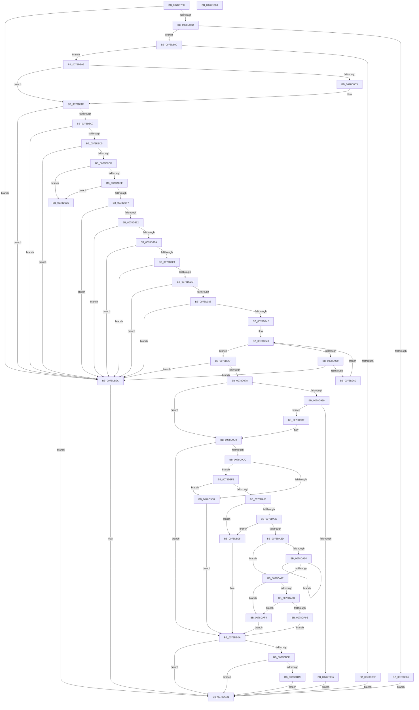

# RtlAddResourceAttributeAce

- RVA: `0x0078D7F0`–`0x0078DB61` (길이 `881` bytes)
- VA: `0x000000014078D7F0`
- 실행 섹션: `PAGE`
- PDB 이름 있음: `예`; PDB Function 태그: `아니요`
- unwind 정보 RVA: `0x000C8360`
- 디코드: `227`개 명령, `881/881` bytes 표시
- 미해석 바이트: `0` (있으면 어셈블리에 `.byte`로 보존)

> 이 문서는 커널 이미지의 기계어와 PDB 기호를 분석해 생성했습니다. 4번과 5번은 함수 원형과 자료형을 바이너리 사용 방식에서 추정한 C 해석이며 원본 소스 복구 결과는 아닙니다.

## 1. Dependencies

- 직접 호출 지점: **13**; 고유 호출 대상: **12**
- 직접 호출자로 확인된 함수: **0**
- RIP 상대 이미지 참조: **1**

### Outgoing calls
- `0x0078D865` → [memset](../../text/6C/memset_function_006C6C40.md) (function, `0x006C6C40`)
- `0x0078D893` → [RtlValidSid](../92/RtlValidSid_function_00929710.md) (function, `0x00929710`)
- `0x0078D953` → [RtlpValidAttribute](RtlpValidAttribute_function_0078E0A4.md) (function, `0x0078E0A4`)
- `0x0078D98B` → [RtlpConvertAbsoluteToRelativeSecurityAttribute](RtlpConvertAbsoluteToRelativeSecurityAttribute_function_0078DD5C.md) (function, `0x0078DD5C`)
- `0x0078D9A8` → [ExAllocatePool2](../../poolcode/B8/ExAllocatePool2_function_00B820F0.md) (function, `0x00B820F0`)
- `0x0078D9CB` → [RtlpConvertAbsoluteToRelativeSecurityAttribute](RtlpConvertAbsoluteToRelativeSecurityAttribute_function_0078DD5C.md) (function, `0x0078DD5C`)
- `0x0078D9DF` → [RtlValidAcl](../92/RtlValidAcl_function_0092A7A0.md) (function, `0x0092A7A0`)
- `0x0078D9FA` → [RtlFirstFreeAce](../9A/RtlFirstFreeAce_function_009A8FF0.md) (function, `0x009A8FF0`)
- `0x0078DA30` → [RtlUShortAdd](../../text/47/RtlUShortAdd_function_00474F70.md) (function, `0x00474F70`)
- `0x0078DAC4` → [RtlCopySid](../9A/RtlCopySid_function_009A9A50.md) (function, `0x009A9A50`)
- `0x0078DADC` → [memcpy](../../text/6C/memcpy_function_006C6840.md) (function, `0x006C6840`)
- `0x0078DB1E` → [ExFreePoolWithTag](../../poolcode/B8/ExFreePoolWithTag_function_00B82870.md) (function, `0x00B82870`)
- `0x0078DB3A` → [_security_check_cookie](../../text/6A/_security_check_cookie_function_006AC640.md) (function, `0x006AC640`)

### Direct callers
- 이 함수 시작 RVA로 연결되는 직접 call은 확인되지 않았습니다. 간접 호출은 완전히 역산할 수 없습니다.

### Static image references
- `0x0078D813` → RVA `0x00E0A740` (`.data`; read)

## 2. Other-region calls and transfers

- 다른 실행 섹션으로 향하는 call: **6**
  - `0x0078D865` → [memset](../../text/6C/memset_function_006C6C40.md) (`PAGE` → `.text`)
  - `0x0078D9A8` → [ExAllocatePool2](../../poolcode/B8/ExAllocatePool2_function_00B820F0.md) (`PAGE` → `POOLCODE`)
  - `0x0078DA30` → [RtlUShortAdd](../../text/47/RtlUShortAdd_function_00474F70.md) (`PAGE` → `.text`)
  - `0x0078DADC` → [memcpy](../../text/6C/memcpy_function_006C6840.md) (`PAGE` → `.text`)
  - `0x0078DB1E` → [ExFreePoolWithTag](../../poolcode/B8/ExFreePoolWithTag_function_00B82870.md) (`PAGE` → `POOLCODE`)
  - `0x0078DB3A` → [_security_check_cookie](../../text/6A/_security_check_cookie_function_006AC640.md) (`PAGE` → `.text`)
- 별도 외부 분기/꼬리 이동을 확인하지 못했습니다.

## 3. Assembly (complete function range)

```asm
0078D7F0  48 8B C4                        mov rax, rsp
0078D7F3  48 89 58 10                     mov qword ptr [rax + 0x10], rbx
0078D7F7  48 89 70 18                     mov qword ptr [rax + 0x18], rsi
0078D7FB  48 89 78 20                     mov qword ptr [rax + 0x20], rdi
0078D7FF  55                              push rbp
0078D800  41 54                           push r12
0078D802  41 55                           push r13
0078D804  41 56                           push r14
0078D806  41 57                           push r15
0078D808  48 8D 68 88                     lea rbp, [rax - 0x78]
0078D80C  48 81 EC 50 01 00 00            sub rsp, 0x150
0078D813  48 8B 05 26 CF 67 00            mov rax, qword ptr [rip + 0x67cf26]
0078D81A  48 33 C4                        xor rax, rsp
0078D81D  48 89 45 40                     mov qword ptr [rbp + 0x40], rax
0078D821  4C 8B BD A0 00 00 00            mov r15, qword ptr [rbp + 0xa0]
0078D828  33 C0                           xor eax, eax
0078D82A  48 8B B5 A8 00 00 00            mov rsi, qword ptr [rbp + 0xa8]
0078D831  45 8B E0                        mov r12d, r8d
0078D834  4C 8B AD B0 00 00 00            mov r13, qword ptr [rbp + 0xb0]
0078D83B  8B DA                           mov ebx, edx
0078D83D  44 89 44 24 28                  mov dword ptr [rsp + 0x28], r8d
0078D842  4C 8B F1                        mov r14, rcx
0078D845  33 D2                           xor edx, edx
0078D847  48 89 44 24 30                  mov qword ptr [rsp + 0x30], rax
0078D84C  41 B8 00 01 00 00               mov r8d, 0x100
0078D852  89 44 24 38                     mov dword ptr [rsp + 0x38], eax
0078D856  48 8D 4C 24 40                  lea rcx, [rsp + 0x40]
0078D85B  66 C7 44 24 3C 00 01            mov word ptr [rsp + 0x3c], 0x100
0078D862  41 8B F9                        mov edi, r9d
0078D865  E8 D6 93 F3 FF                  call 0x1406c6c40
0078D86A  33 C0                           xor eax, eax
0078D86C  C7 44 24 24 00 01 00 00         mov dword ptr [rsp + 0x24], 0x100
0078D874  4D 85 ED                        test r13, r13
0078D877  0F 84 AF 02 00 00               je 0x14078db2c
0078D87D  41 89 45 00                     mov dword ptr [r13], eax
0078D881  4D 85 F6                        test r14, r14
0078D884  75 0A                           jne 0x14078d890
0078D886  BB 77 00 00 C0                  mov ebx, 0xc0000077
0078D88B  E9 A1 02 00 00                  jmp 0x14078db31
0078D890  49 8B CF                        mov rcx, r15
0078D893  E8 78 BE 19 00                  call 0x140929710
0078D898  45 33 C0                        xor r8d, r8d
0078D89B  84 C0                           test al, al
0078D89D  75 0A                           jne 0x14078d8a9
0078D89F  BB 78 00 00 C0                  mov ebx, 0xc0000078
0078D8A4  E9 88 02 00 00                  jmp 0x14078db31
0078D8A9  41 8B 4F 02                     mov ecx, dword ptr [r15 + 2]
0078D8AD  2B 4C 24 38                     sub ecx, dword ptr [rsp + 0x38]
0078D8B1  75 0C                           jne 0x14078d8bf
0078D8B3  41 0F B7 4F 06                  movzx ecx, word ptr [r15 + 6]
0078D8B8  0F B7 44 24 3C                  movzx eax, word ptr [rsp + 0x3c]
0078D8BD  2B C8                           sub ecx, eax
0078D8BF  85 C9                           test ecx, ecx
0078D8C1  0F 85 65 02 00 00               jne 0x14078db2c
0078D8C7  44 8D 49 01                     lea r9d, [rcx + 1]
0078D8CB  45 38 4F 01                     cmp byte ptr [r15 + 1], r9b
0078D8CF  0F 85 57 02 00 00               jne 0x14078db2c
0078D8D5  45 39 47 08                     cmp dword ptr [r15 + 8], r8d
0078D8D9  0F 85 4D 02 00 00               jne 0x14078db2c
0078D8DF  41 0F B6 0E                     movzx ecx, byte ptr [r14]
0078D8E3  41 8D 41 03                     lea eax, [r9 + 3]
0078D8E7  3A C8                           cmp cl, al
0078D8E9  0F 87 36 02 00 00               ja 0x14078db25
0078D8EF  3B D8                           cmp ebx, eax
0078D8F1  0F 87 2E 02 00 00               ja 0x14078db25
0078D8F7  0F B6 C3                        movzx eax, bl
0078D8FA  8B D1                           mov edx, ecx
0078D8FC  3A C8                           cmp cl, al
0078D8FE  0F 46 D0                        cmovbe edx, eax
0078D901  89 54 24 38                     mov dword ptr [rsp + 0x38], edx
0078D905  41 F7 C4 E0 FF FF FF            test r12d, 0xffffffe0
0078D90C  0F 85 1A 02 00 00               jne 0x14078db2c
0078D912  85 FF                           test edi, edi
0078D914  0F 85 12 02 00 00               jne 0x14078db2c
0078D91A  48 85 F6                        test rsi, rsi
0078D91D  0F 84 09 02 00 00               je 0x14078db2c
0078D923  66 44 39 0E                     cmp word ptr [rsi], r9w
0078D927  0F 85 FF 01 00 00               jne 0x14078db2c
0078D92D  66 44 39 46 02                  cmp word ptr [rsi + 2], r8w
0078D932  0F 85 F4 01 00 00               jne 0x14078db2c
0078D938  44 39 46 04                     cmp dword ptr [rsi + 4], r8d
0078D93C  0F 84 EA 01 00 00               je 0x14078db2c
0078D942  48 8B 7E 08                     mov rdi, qword ptr [rsi + 8]
0078D946  41 8B D8                        mov ebx, r8d
0078D949  8B 46 04                        mov eax, dword ptr [rsi + 4]
0078D94C  3B D8                           cmp ebx, eax
0078D94E  73 1F                           jae 0x14078d96f
0078D950  48 8B CF                        mov rcx, rdi
0078D953  E8 4C 07 00 00                  call 0x14078e0a4
0078D958  84 C0                           test al, al
0078D95A  0F 84 CC 01 00 00               je 0x14078db2c
0078D960  41 B9 01 00 00 00               mov r9d, 1
0078D966  41 03 D9                        add ebx, r9d
0078D969  48 83 C7 20                     add rdi, 0x20
0078D96D  EB DA                           jmp 0x14078d949
0078D96F  41 3B C1                        cmp eax, r9d
0078D972  0F 85 B4 01 00 00               jne 0x14078db2c
0078D978  48 8B 4E 08                     mov rcx, qword ptr [rsi + 8]
0078D97C  4C 8D 44 24 24                  lea r8, [rsp + 0x24]
0078D981  48 8D 54 24 40                  lea rdx, [rsp + 0x40]
0078D986  48 8D 7C 24 40                  lea rdi, [rsp + 0x40]
0078D98B  E8 CC 03 00 00                  call 0x14078dd5c
0078D990  8B D8                           mov ebx, eax
0078D992  3D 23 00 00 C0                  cmp eax, 0xc0000023
0078D997  75 39                           jne 0x14078d9d2
0078D999  8B 54 24 24                     mov edx, dword ptr [rsp + 0x24]
0078D99D  B9 41 00 00 00                  mov ecx, 0x41
0078D9A2  41 B8 52 74 50 62               mov r8d, 0x62507452
0078D9A8  E8 43 47 3F 00                  call 0x140b820f0
0078D9AD  48 8B F8                        mov rdi, rax
0078D9B0  48 85 C0                        test rax, rax
0078D9B3  75 0A                           jne 0x14078d9bf
0078D9B5  BB 17 00 00 C0                  mov ebx, 0xc0000017
0078D9BA  E9 72 01 00 00                  jmp 0x14078db31
0078D9BF  48 8B 4E 08                     mov rcx, qword ptr [rsi + 8]
0078D9C3  4C 8D 44 24 24                  lea r8, [rsp + 0x24]
0078D9C8  48 8B D0                        mov rdx, rax
0078D9CB  E8 8C 03 00 00                  call 0x14078dd5c
0078D9D0  8B D8                           mov ebx, eax
0078D9D2  33 F6                           xor esi, esi
0078D9D4  85 DB                           test ebx, ebx
0078D9D6  0F 88 2E 01 00 00               js 0x14078db0a
0078D9DC  49 8B CE                        mov rcx, r14
0078D9DF  E8 BC CD 19 00                  call 0x14092a7a0
0078D9E4  84 C0                           test al, al
0078D9E6  75 0A                           jne 0x14078d9f2
0078D9E8  BB 77 00 00 C0                  mov ebx, 0xc0000077
0078D9ED  E9 18 01 00 00                  jmp 0x14078db0a
0078D9F2  48 8D 54 24 30                  lea rdx, [rsp + 0x30]
0078D9F7  49 8B CE                        mov rcx, r14
0078D9FA  E8 F1 B5 21 00                  call 0x1409a8ff0
0078D9FF  84 C0                           test al, al
0078DA01  74 E5                           je 0x14078d9e8
0078DA03  41 0F B6 4F 01                  movzx ecx, byte ptr [r15 + 1]
0078DA08  44 8B 64 24 24                  mov r12d, dword ptr [rsp + 0x24]
0078DA0D  66 83 C1 04                     add cx, 4
0078DA11  66 C1 E1 02                     shl cx, 2
0078DA15  66 89 4C 24 20                  mov word ptr [rsp + 0x20], cx
0078DA1A  41 81 FC FF FF 00 00            cmp r12d, 0xffff
0078DA21  0F 87 DE 00 00 00               ja 0x14078db05
0078DA27  4C 8D 44 24 20                  lea r8, [rsp + 0x20]
0078DA2C  41 0F B7 D4                     movzx edx, r12w
0078DA30  E8 3B 75 CE FF                  call 0x140474f70
0078DA35  85 C0                           test eax, eax
0078DA37  0F 88 C8 00 00 00               js 0x14078db05
0078DA3D  B9 08 00 00 00                  mov ecx, 8
0078DA42  49 8D 56 08                     lea rdx, [r14 + 8]
0078DA46  41 89 4D 00                     mov dword ptr [r13], ecx
0078DA4A  44 8B C6                        mov r8d, esi
0078DA4D  66 41 3B 76 04                  cmp si, word ptr [r14 + 4]
0078DA52  73 1E                           jae 0x14078da72
0078DA54  0F B7 42 02                     movzx eax, word ptr [rdx + 2]
0078DA58  41 FF C0                        inc r8d
0078DA5B  03 C8                           add ecx, eax
0078DA5D  41 89 4D 00                     mov dword ptr [r13], ecx
0078DA61  0F B7 42 02                     movzx eax, word ptr [rdx + 2]
0078DA65  48 03 D0                        add rdx, rax
0078DA68  41 0F B7 46 04                  movzx eax, word ptr [r14 + 4]
0078DA6D  44 3B C0                        cmp r8d, eax
0078DA70  72 E2                           jb 0x14078da54
0078DA72  44 0F B7 44 24 20               movzx r8d, word ptr [rsp + 0x20]
0078DA78  45 33 C9                        xor r9d, r9d
0078DA7B  48 8B 74 24 30                  mov rsi, qword ptr [rsp + 0x30]
0078DA80  42 8D 14 01                     lea edx, [rcx + r8]
0078DA84  41 89 55 00                     mov dword ptr [r13], edx
0078DA88  48 85 F6                        test rsi, rsi
0078DA8B  74 67                           je 0x14078daf4
0078DA8D  41 0F B7 4E 02                  movzx ecx, word ptr [r14 + 2]
0078DA92  4A 8D 04 06                     lea rax, [rsi + r8]
0078DA96  49 03 CE                        add rcx, r14
0078DA99  48 3B C1                        cmp rax, rcx
0078DA9C  77 56                           ja 0x14078daf4
0078DA9E  8B 44 24 28                     mov eax, dword ptr [rsp + 0x28]
0078DAA2  48 8D 56 08                     lea rdx, [rsi + 8]
0078DAA6  66 44 89 46 02                  mov word ptr [rsi + 2], r8w
0078DAAB  4D 8B C7                        mov r8, r15
0078DAAE  88 46 01                        mov byte ptr [rsi + 1], al
0078DAB1  C6 06 12                        mov byte ptr [rsi], 0x12
0078DAB4  44 89 4E 04                     mov dword ptr [rsi + 4], r9d
0078DAB8  41 0F B6 4F 01                  movzx ecx, byte ptr [r15 + 1]
0078DABD  8D 0C 8D 08 00 00 00            lea ecx, [rcx*4 + 8]
0078DAC4  E8 87 BF 21 00                  call 0x1409a9a50
0078DAC9  41 0F B6 47 01                  movzx eax, byte ptr [r15 + 1]
0078DACE  48 83 C6 10                     add rsi, 0x10
0078DAD2  4D 8B C4                        mov r8, r12
0078DAD5  48 8B D7                        mov rdx, rdi
0078DAD8  48 8D 0C 86                     lea rcx, [rsi + rax*4]
0078DADC  E8 5F 8D F3 FF                  call 0x1406c6840
0078DAE1  B8 01 00 00 00                  mov eax, 1
0078DAE6  66 41 01 46 04                  add word ptr [r14 + 4], ax
0078DAEB  8B 44 24 38                     mov eax, dword ptr [rsp + 0x38]
0078DAEF  41 88 06                        mov byte ptr [r14], al
0078DAF2  EB 16                           jmp 0x14078db0a
0078DAF4  8D 42 03                        lea eax, [rdx + 3]
0078DAF7  BB 99 00 00 C0                  mov ebx, 0xc0000099
0078DAFC  83 E0 FC                        and eax, 0xfffffffc
0078DAFF  41 89 45 00                     mov dword ptr [r13], eax
0078DB03  EB 05                           jmp 0x14078db0a
0078DB05  BB 95 00 00 C0                  mov ebx, 0xc0000095
0078DB0A  48 85 FF                        test rdi, rdi
0078DB0D  74 22                           je 0x14078db31
0078DB0F  48 8D 44 24 40                  lea rax, [rsp + 0x40]
0078DB14  48 3B F8                        cmp rdi, rax
0078DB17  74 18                           je 0x14078db31
0078DB19  33 D2                           xor edx, edx
0078DB1B  48 8B CF                        mov rcx, rdi
0078DB1E  E8 4D 4D 3F 00                  call 0x140b82870
0078DB23  EB 0C                           jmp 0x14078db31
0078DB25  BB 59 00 00 C0                  mov ebx, 0xc0000059
0078DB2A  EB 05                           jmp 0x14078db31
0078DB2C  BB 0D 00 00 C0                  mov ebx, 0xc000000d
0078DB31  8B C3                           mov eax, ebx
0078DB33  48 8B 4D 40                     mov rcx, qword ptr [rbp + 0x40]
0078DB37  48 33 CC                        xor rcx, rsp
0078DB3A  E8 01 EB F1 FF                  call 0x1406ac640
0078DB3F  4C 8D 9C 24 50 01 00 00         lea r11, [rsp + 0x150]
0078DB47  49 8B 5B 38                     mov rbx, qword ptr [r11 + 0x38]
0078DB4B  49 8B 73 40                     mov rsi, qword ptr [r11 + 0x40]
0078DB4F  49 8B 7B 48                     mov rdi, qword ptr [r11 + 0x48]
0078DB53  49 8B E3                        mov rsp, r11
0078DB56  41 5F                           pop r15
0078DB58  41 5E                           pop r14
0078DB5A  41 5D                           pop r13
0078DB5C  41 5C                           pop r12
0078DB5E  5D                              pop rbp
0078DB5F  C3                              ret
0078DB60  CC                              int3
```

## 4. C-style interpretation (structured pseudocode)

```c
__int64 __fastcall RtlAddResourceAttributeAce(__int64 a1, int a2, int a3, int a4)
{
    __int64 result;
    __int64 v_rbx;
    __int64 v_rdi;
    __int64 v_rsi;
    __int64 v_rsp;
    unsigned __int64 v_stack_m138;
    unsigned __int16 v_stack_m13C;
    unsigned int v_stack_m140;
    unsigned __int64 v_stack_m148;
    unsigned int v_stack_m150;
    unsigned int v_stack_m154;
    unsigned __int16 v_stack_m158;
    unsigned __int64 v_stack_m28;

    *(unsigned __int64 *)(v_rsp + 16) = v_rbx;
    *(unsigned __int64 *)(v_rsp + 24) = v_rsi;
    *(unsigned __int64 *)(v_rsp + 32) = v_rdi;
    v_rsp = (v_rsp) - (336);
    result = (*(unsigned __int64 *)(v_rip + 6803238)) ^ (v_rsp);
    *(unsigned __int64 *)(v_rsp - 120 + 64) = result;
    result = 0;
    v_stack_m150 = a3;
    a2 = 0;
    v_stack_m148 = 0;
    v_stack_m140 = 0;
    v_stack_m13C = 256;
    result = memset(v_stack_m138, a2, 256, a4);
    result = 0;
    v_stack_m154 = 256;
    if (*(unsigned __int64 *)(v_rsp - 120 + 176) == 0) goto loc_0078DB2C;
    *(unsigned int *)(*(unsigned __int64 *)(v_rsp - 120 + 176)) = 0;
    if (a1 != 0) goto loc_0078D890;
    goto loc_0078DB31;
loc_0078D890:
    result = RtlValidSid(*(unsigned __int64 *)(v_rsp - 120 + 160), a2, 256, a4);
    a3 = 0;
    if ((unsigned __int8)(result) != 0) goto loc_0078D8A9;
    goto loc_0078DB31;
loc_0078D8A9:
    a1 = (unsigned int)(((unsigned int)(*(unsigned int *)(*(unsigned __int64 *)(v_rsp - 120 + 160) + 2))) - (v_stack_m140));
    if (!(condition_is_not_equal)) {
        a1 = *(unsigned __int16 *)(*(unsigned __int64 *)(v_rsp - 120 + 160) + 6);
        result = v_stack_m13C;
        a1 = (unsigned int)((a1) - ((unsigned int)(result)));
    }
    if ((unsigned int)(a1) != 0) goto loc_0078DB2C;
    if ((*(unsigned __int8 *)(*(unsigned __int64 *)(v_rsp - 120 + 160) + 1)) != ((unsigned __int8)(a1 + 1))) goto loc_0078DB2C;
    if ((*(unsigned int *)(*(unsigned __int64 *)(v_rsp - 120 + 160) + 8)) != 0) goto loc_0078DB2C;
    if (((unsigned __int8)(*(unsigned __int8 *)(a1))) > ((unsigned __int8)(a1 + 1 + 3))) goto loc_0078DB25;
    if (((unsigned int)((unsigned int)(0xC0000078ULL))) > ((unsigned int)(a1 + 1 + 3))) goto loc_0078DB25;
    a2 = (unsigned int)((unsigned int)(*(unsigned __int8 *)(a1)));
    if (((unsigned __int8)(*(unsigned __int8 *)(a1))) <= ((unsigned __int8)((unsigned __int8)((unsigned int)(0xC0000078ULL))))) { a2 = (unsigned int)((unsigned __int8)((unsigned int)(0xC0000078ULL))); }
    v_stack_m140 = a2;
    if ((((unsigned int)((unsigned int)(a3))) & (0xFFFFFFE0ULL)) != 0) goto loc_0078DB2C;
    if ((unsigned int)((unsigned int)(a4)) != 0) goto loc_0078DB2C;
    if (*(unsigned __int64 *)(v_rsp - 120 + 168) == 0) goto loc_0078DB2C;
    if ((*(unsigned __int16 *)(*(unsigned __int64 *)(v_rsp - 120 + 168))) != ((unsigned __int16)(a1 + 1))) goto loc_0078DB2C;
    if ((*(unsigned __int16 *)(*(unsigned __int64 *)(v_rsp - 120 + 168) + 2)) != 0) goto loc_0078DB2C;
    if ((*(unsigned int *)(*(unsigned __int64 *)(v_rsp - 120 + 168) + 4)) == 0) goto loc_0078DB2C;
loc_0078D949:
    if (0 >= ((unsigned int)((unsigned int)(*(unsigned int *)(*(unsigned __int64 *)(v_rsp - 120 + 168) + 4))))) goto loc_0078D96F;
    result = RtlpValidAttribute(*(unsigned __int64 *)(*(unsigned __int64 *)(v_rsp - 120 + 168) + 8), a2, a3, a1 + 1);
    if ((unsigned __int8)(result) == 0) goto loc_0078DB2C;
    v_rbx = (unsigned int)((0) + (1));
    v_rdi = (*(unsigned __int64 *)(*(unsigned __int64 *)(v_rsp - 120 + 168) + 8)) + (32);
    goto loc_0078D949;
loc_0078D96F:
    if (((unsigned int)(result)) != 1) goto loc_0078DB2C;
    result = RtlpConvertAbsoluteToRelativeSecurityAttribute(*(unsigned __int64 *)(*(unsigned __int64 *)(v_rsp - 120 + 168) + 8), v_stack_m138, v_stack_m154, 1);
    if (((unsigned int)(result)) != 0xC0000023ULL) goto loc_0078D9D2;
    result = ExAllocatePool2(65, (unsigned int)(v_stack_m154), (unsigned int)(0x62507452ULL), 1);
    if (result != 0) goto loc_0078D9BF;
    goto loc_0078DB31;
loc_0078D9BF:
    result = RtlpConvertAbsoluteToRelativeSecurityAttribute(*(unsigned __int64 *)(*(unsigned __int64 *)(v_rsp - 120 + 168) + 8), result, v_stack_m154, 1);
loc_0078D9D2:
    v_rsi = 0;
    if (sign_flag) goto loc_0078DB0A;
    result = RtlValidAcl(a1, result, v_stack_m154, 1);
    if ((unsigned __int8)(result) != 0) goto loc_0078D9F2;
loc_0078D9E8:
    goto loc_0078DB0A;
loc_0078D9F2:
    result = RtlFirstFreeAce(a1, v_stack_m148, v_stack_m154, 1);
    if ((unsigned __int8)(result) == 0) goto loc_0078D9E8;
    a1 = (unsigned __int16)((*(unsigned __int8 *)(*(unsigned __int64 *)(v_rsp - 120 + 160) + 1)) + (4));
    a1 = (unsigned __int16)((a1) << (2));
    v_stack_m158 = (unsigned __int16)(a1);
    if (((unsigned int)((unsigned int)(v_stack_m154))) > 0xFFFFULL) goto loc_0078DB05;
    result = RtlUShortAdd(a1, (unsigned __int16)((unsigned int)(v_stack_m154)), v_stack_m158, 1);
    if (sign_flag) goto loc_0078DB05;
    *(unsigned int *)(*(unsigned __int64 *)(v_rsp - 120 + 176)) = 8;
    if (0 >= (*(unsigned __int16 *)(a1 + 4))) goto loc_0078DA72;
loc_0078DA54:
    a3 = (unsigned int)((0) + 1);
    a1 = (unsigned int)((8) + ((unsigned int)(*(unsigned __int16 *)(a1 + 8 + 2))));
    *(unsigned int *)(*(unsigned __int64 *)(v_rsp - 120 + 176)) = (unsigned int)(a1);
    a2 = (a1 + 8) + (*(unsigned __int16 *)(a1 + 8 + 2));
    if (a3 < ((unsigned int)(*(unsigned __int16 *)(a1 + 4)))) goto loc_0078DA54;
loc_0078DA72:
    a4 = 0;
    *(unsigned int *)(*(unsigned __int64 *)(v_rsp - 120 + 176)) = (unsigned int)(a1 + v_stack_m158 * 1);
    if (v_stack_m148 == 0) goto loc_0078DAF4;
    a1 = (*(unsigned __int16 *)(a1 + 2)) + (a1);
    if ((v_stack_m148 + v_stack_m158 * 1) > a1) goto loc_0078DAF4;
    *(unsigned __int16 *)(v_stack_m148 + 2) = (unsigned __int16)(v_stack_m158);
    *(unsigned __int8 *)(v_stack_m148 + 1) = (unsigned __int8)((unsigned int)(v_stack_m150));
    *(unsigned __int8 *)(v_stack_m148) = 18;
    *(unsigned int *)(v_stack_m148 + 4) = 0;
    result = RtlCopySid(*(unsigned __int8 *)(*(unsigned __int64 *)(v_rsp - 120 + 160) + 1) * 4 + 8, v_stack_m148 + 8, *(unsigned __int64 *)(v_rsp - 120 + 160), a4);
    v_rsi = (v_stack_m148) + (16);
    result = memcpy(v_rsi + *(unsigned __int8 *)(*(unsigned __int64 *)(v_rsp - 120 + 160) + 1) * 4, result, (unsigned int)(v_stack_m154), a4);
    *(unsigned __int8 *)(a1) = (unsigned __int8)((unsigned int)(v_stack_m140));
    goto loc_0078DB0A;
loc_0078DAF4:
    result = (unsigned int)((result + 3) & (0xFFFFFFFCULL));
    *(unsigned int *)(*(unsigned __int64 *)(v_rsp - 120 + 176)) = (unsigned int)(result);
    goto loc_0078DB0A;
loc_0078DB05:
loc_0078DB0A:
    if (result == 0) goto loc_0078DB31;
    if (result == v_stack_m138) goto loc_0078DB31;
    a2 = 0;
    result = ExFreePoolWithTag(result, a2, (unsigned int)(v_stack_m154), a4);
    goto loc_0078DB31;
loc_0078DB25:
    goto loc_0078DB31;
loc_0078DB2C:
loc_0078DB31:
    a1 = (*(unsigned __int64 *)(v_rsp - 120 + 64)) ^ (v_rsp);
    result = _security_check_cookie(a1, a2, (unsigned int)(v_stack_m154), a4);
    return result;
}
```

## 5. (Beta) C Style

```c
int64_t RtlAddResourceAttributeAce(int64_t Arg1, int32_t Arg2, int32_t Arg3, int32_t Arg4)
{
    int64_t result;
    int64_t local_rbx;
    int64_t local_rdi;
    int64_t local_rsi;
    int64_t local_rsp;
    uint64_t v_stack_m138;
    uint16_t v_stack_m13C;
    uint32_t v_stack_m140;
    uint64_t v_stack_m148;
    uint32_t v_stack_m150;
    uint32_t v_stack_m154;
    uint16_t v_stack_m158;
    uint64_t v_stack_m28;

    *(uint64_t *)(local_rsp + 0x10) = local_rbx;
    *(uint64_t *)(local_rsp + 0x18) = local_rsi;
    *(uint64_t *)(local_rsp + 0x20) = local_rdi;
    local_rsp = (local_rsp) - (336);
    result = (*(uint64_t *)(v_rip + 0x67CF26)) ^ (local_rsp);
    *(uint64_t *)(local_rsp - 0x78 + 0x40) = result;
    result = 0;
    v_stack_m150 = Arg3;
    Arg2 = 0;
    v_stack_m148 = 0;
    v_stack_m140 = 0;
    v_stack_m13C = 256;
    result = memset(v_stack_m138, Arg2, 256, Arg4);
    result = 0;
    v_stack_m154 = 256;
    if (*(uint64_t *)(local_rsp - 0x78 + 0xB0) == 0) goto loc_0078DB2C;
    *(uint32_t *)(*(uint64_t *)(local_rsp - 0x78 + 0xB0)) = 0;
    if (Arg1 != 0) goto loc_0078D890;
    goto loc_0078DB31;
loc_0078D890:
    result = RtlValidSid(*(uint64_t *)(local_rsp - 0x78 + 0xA0), Arg2, 256, Arg4);
    Arg3 = 0;
    if ((uint8_t)(result) != 0) goto loc_0078D8A9;
    goto loc_0078DB31;
loc_0078D8A9:
    Arg1 = (uint32_t)(((uint32_t)(*(uint32_t *)(*(uint64_t *)(local_rsp - 0x78 + 0xA0) + 0x2))) - (v_stack_m140));
    if (!(condition_is_not_equal)) {
        Arg1 = *(uint16_t *)(*(uint64_t *)(local_rsp - 0x78 + 0xA0) + 0x6);
        result = v_stack_m13C;
        Arg1 = (uint32_t)((Arg1) - ((uint32_t)(result)));
    }
    if ((uint32_t)(Arg1) != 0) goto loc_0078DB2C;
    if ((*(uint8_t *)(*(uint64_t *)(local_rsp - 0x78 + 0xA0) + 0x1)) != ((uint8_t)(Arg1 + 1))) goto loc_0078DB2C;
    if ((*(uint32_t *)(*(uint64_t *)(local_rsp - 0x78 + 0xA0) + 0x8)) != 0) goto loc_0078DB2C;
    if (((uint8_t)(*(uint8_t *)(Arg1))) > ((uint8_t)(Arg1 + 1 + 3))) goto loc_0078DB25;
    if (((uint32_t)((uint32_t)(0xC0000078ULL))) > ((uint32_t)(Arg1 + 1 + 3))) goto loc_0078DB25;
    Arg2 = (uint32_t)((uint32_t)(*(uint8_t *)(Arg1)));
    if (((uint8_t)(*(uint8_t *)(Arg1))) <= ((uint8_t)((uint8_t)((uint32_t)(0xC0000078ULL))))) { Arg2 = (uint32_t)((uint8_t)((uint32_t)(0xC0000078ULL))); }
    v_stack_m140 = Arg2;
    if ((((uint32_t)((uint32_t)(Arg3))) & (0xFFFFFFE0ULL)) != 0) goto loc_0078DB2C;
    if ((uint32_t)((uint32_t)(Arg4)) != 0) goto loc_0078DB2C;
    if (*(uint64_t *)(local_rsp - 0x78 + 0xA8) == 0) goto loc_0078DB2C;
    if ((*(uint16_t *)(*(uint64_t *)(local_rsp - 0x78 + 0xA8))) != ((uint16_t)(Arg1 + 1))) goto loc_0078DB2C;
    if ((*(uint16_t *)(*(uint64_t *)(local_rsp - 0x78 + 0xA8) + 0x2)) != 0) goto loc_0078DB2C;
    if ((*(uint32_t *)(*(uint64_t *)(local_rsp - 0x78 + 0xA8) + 0x4)) == 0) goto loc_0078DB2C;
loc_0078D949:
    if (0 >= ((uint32_t)((uint32_t)(*(uint32_t *)(*(uint64_t *)(local_rsp - 0x78 + 0xA8) + 0x4))))) goto loc_0078D96F;
    result = RtlpValidAttribute(*(uint64_t *)(*(uint64_t *)(local_rsp - 0x78 + 0xA8) + 0x8), Arg2, Arg3, Arg1 + 1);
    if ((uint8_t)(result) == 0) goto loc_0078DB2C;
    local_rbx = (uint32_t)((0) + (1));
    local_rdi = (*(uint64_t *)(*(uint64_t *)(local_rsp - 0x78 + 0xA8) + 0x8)) + (32);
    goto loc_0078D949;
loc_0078D96F:
    if (((uint32_t)(result)) != 1) goto loc_0078DB2C;
    result = RtlpConvertAbsoluteToRelativeSecurityAttribute(*(uint64_t *)(*(uint64_t *)(local_rsp - 0x78 + 0xA8) + 0x8), v_stack_m138, v_stack_m154, 1);
    if (((uint32_t)(result)) != 0xC0000023ULL) goto loc_0078D9D2;
    result = ExAllocatePool2(65, (uint32_t)(v_stack_m154), (uint32_t)(0x62507452ULL), 1);
    if (result != 0) goto loc_0078D9BF;
    goto loc_0078DB31;
loc_0078D9BF:
    result = RtlpConvertAbsoluteToRelativeSecurityAttribute(*(uint64_t *)(*(uint64_t *)(local_rsp - 0x78 + 0xA8) + 0x8), result, v_stack_m154, 1);
loc_0078D9D2:
    local_rsi = 0;
    if (sign_flag) goto loc_0078DB0A;
    result = RtlValidAcl(Arg1, result, v_stack_m154, 1);
    if ((uint8_t)(result) != 0) goto loc_0078D9F2;
loc_0078D9E8:
    goto loc_0078DB0A;
loc_0078D9F2:
    result = RtlFirstFreeAce(Arg1, v_stack_m148, v_stack_m154, 1);
    if ((uint8_t)(result) == 0) goto loc_0078D9E8;
    Arg1 = (uint16_t)((*(uint8_t *)(*(uint64_t *)(local_rsp - 0x78 + 0xA0) + 0x1)) + (4));
    Arg1 = (uint16_t)((Arg1) << (2));
    v_stack_m158 = (uint16_t)(Arg1);
    if (((uint32_t)((uint32_t)(v_stack_m154))) > 0xFFFFULL) goto loc_0078DB05;
    result = RtlUShortAdd(Arg1, (uint16_t)((uint32_t)(v_stack_m154)), v_stack_m158, 1);
    if (sign_flag) goto loc_0078DB05;
    *(uint32_t *)(*(uint64_t *)(local_rsp - 0x78 + 0xB0)) = 8;
    if (0 >= (*(uint16_t *)(Arg1 + 0x4))) goto loc_0078DA72;
loc_0078DA54:
    Arg3 = (uint32_t)((0) + 1);
    Arg1 = (uint32_t)((8) + ((uint32_t)(*(uint16_t *)(Arg1 + 0x8 + 0x2))));
    *(uint32_t *)(*(uint64_t *)(local_rsp - 0x78 + 0xB0)) = (uint32_t)(Arg1);
    Arg2 = (Arg1 + 8) + (*(uint16_t *)(Arg1 + 0x8 + 0x2));
    if (Arg3 < ((uint32_t)(*(uint16_t *)(Arg1 + 0x4)))) goto loc_0078DA54;
loc_0078DA72:
    Arg4 = 0;
    *(uint32_t *)(*(uint64_t *)(local_rsp - 0x78 + 0xB0)) = (uint32_t)(Arg1 + v_stack_m158 * 1);
    if (v_stack_m148 == 0) goto loc_0078DAF4;
    Arg1 = (*(uint16_t *)(Arg1 + 0x2)) + (Arg1);
    if ((v_stack_m148 + v_stack_m158 * 1) > Arg1) goto loc_0078DAF4;
    *(uint16_t *)(v_stack_m148 + 0x2) = (uint16_t)(v_stack_m158);
    *(uint8_t *)(v_stack_m148 + 0x1) = (uint8_t)((uint32_t)(v_stack_m150));
    *(uint8_t *)(v_stack_m148) = 18;
    *(uint32_t *)(v_stack_m148 + 0x4) = 0;
    result = RtlCopySid(*(uint8_t *)(*(uint64_t *)(local_rsp - 0x78 + 0xA0) + 0x1) * 4 + 8, v_stack_m148 + 8, *(uint64_t *)(local_rsp - 0x78 + 0xA0), Arg4);
    local_rsi = (v_stack_m148) + (16);
    result = memcpy(local_rsi + *(uint8_t *)(*(uint64_t *)(local_rsp - 0x78 + 0xA0) + 0x1) * 4, result, (uint32_t)(v_stack_m154), Arg4);
    *(uint8_t *)(Arg1) = (uint8_t)((uint32_t)(v_stack_m140));
    goto loc_0078DB0A;
loc_0078DAF4:
    result = (uint32_t)((result + 3) & (0xFFFFFFFCULL));
    *(uint32_t *)(*(uint64_t *)(local_rsp - 0x78 + 0xB0)) = (uint32_t)(result);
    goto loc_0078DB0A;
loc_0078DB05:
loc_0078DB0A:
    if (result == 0) goto loc_0078DB31;
    if (result == v_stack_m138) goto loc_0078DB31;
    Arg2 = 0;
    result = ExFreePoolWithTag(result, Arg2, (uint32_t)(v_stack_m154), Arg4);
    goto loc_0078DB31;
loc_0078DB25:
    goto loc_0078DB31;
loc_0078DB2C:
loc_0078DB31:
    Arg1 = (*(uint64_t *)(local_rsp - 0x78 + 0x40)) ^ (local_rsp);
    result = _security_check_cookie(Arg1, Arg2, (uint32_t)(v_stack_m154), Arg4);
    return result;
}
```

## 6. Execution-region graph

[열기: 2D/3D 그래프와 함수 탐색 컨트롤 패널](../../../control-panel.html?section=page&rva=0x0078D7F0&view=graph)

- 2D 그래프는 위에서 아래로 흐르고, 3D 그래프는 빈 공간을 드래그해 회전합니다. Shift+드래그는 이동, 휠은 확대·축소, 함수 노드 선택은 대상 보고서 이동입니다.

### Static fallback


