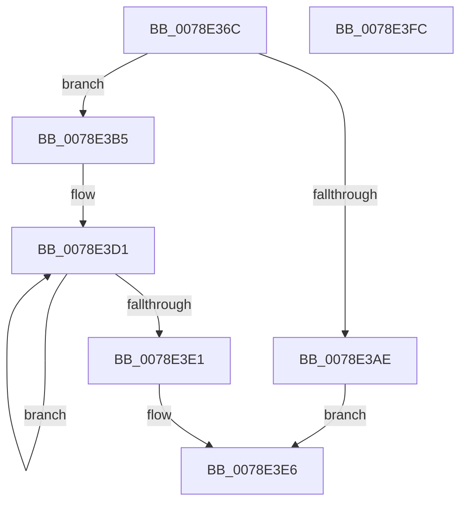

# RtlAllocateAndInitializeSidEx

- RVA: `0x0078E36C`–`0x0078E3FD` (길이 `145` bytes)
- VA: `0x000000014078E36C`
- 실행 섹션: `PAGE`
- PDB 이름 있음: `예`; PDB Function 태그: `아니요`
- unwind 정보 RVA: `0x0006F978`
- 디코드: `42`개 명령, `145/145` bytes 표시
- 미해석 바이트: `0` (있으면 어셈블리에 `.byte`로 보존)

> 이 문서는 커널 이미지의 기계어와 PDB 기호를 분석해 생성했습니다. 4번과 5번은 함수 원형과 자료형을 바이너리 사용 방식에서 추정한 C 해석이며 원본 소스 복구 결과는 아닙니다.

## 1. Dependencies

- 직접 호출 지점: **2**; 고유 호출 대상: **2**
- 직접 호출자로 확인된 함수: **1**
- RIP 상대 이미지 참조: **0**

### Outgoing calls
- `0x0078E391` → [RtlLengthRequiredSid](../9C/RtlLengthRequiredSid_function_009CA4D0.md) (function, `0x009CA4D0`)
- `0x0078E3A1` → [ExAllocatePool2](../../poolcode/B8/ExAllocatePool2_function_00B820F0.md) (function, `0x00B820F0`)

### Direct callers
- [EtwpUserInAdminOrLogUsersGroup](../7B/EtwpUserInAdminOrLogUsersGroup_function_007B7D50.md) at `0x007B7DA7`

### Static image references
- 디코드된 RIP-relative 메모리 참조가 없습니다.

## 2. Other-region calls and transfers

- 다른 실행 섹션으로 향하는 call: **1**
  - `0x0078E3A1` → [ExAllocatePool2](../../poolcode/B8/ExAllocatePool2_function_00B820F0.md) (`PAGE` → `POOLCODE`)
- 별도 외부 분기/꼬리 이동을 확인하지 못했습니다.

## 3. Assembly (complete function range)

```asm
0078E36C  48 89 5C 24 08                  mov qword ptr [rsp + 8], rbx
0078E371  48 89 74 24 10                  mov qword ptr [rsp + 0x10], rsi
0078E376  48 89 7C 24 18                  mov qword ptr [rsp + 0x18], rdi
0078E37B  41 56                           push r14
0078E37D  48 83 EC 20                     sub rsp, 0x20
0078E381  4C 8B F1                        mov r14, rcx
0078E384  BF 02 00 00 00                  mov edi, 2
0078E389  8B CF                           mov ecx, edi
0078E38B  49 8B F1                        mov rsi, r9
0078E38E  49 8B D8                        mov rbx, r8
0078E391  E8 3A C1 23 00                  call 0x1409ca4d0
0078E396  8B D0                           mov edx, eax
0078E398  8D 4F 3F                        lea ecx, [rdi + 0x3f]
0078E39B  41 B8 52 74 50 62               mov r8d, 0x62507452
0078E3A1  E8 4A 3D 3F 00                  call 0x140b820f0
0078E3A6  48 8B D0                        mov rdx, rax
0078E3A9  48 85 C0                        test rax, rax
0078E3AC  75 07                           jne 0x14078e3b5
0078E3AE  B8 17 00 00 C0                  mov eax, 0xc0000017
0078E3B3  EB 31                           jmp 0x14078e3e6
0078E3B5  C6 00 01                        mov byte ptr [rax], 1
0078E3B8  48 8B CA                        mov rcx, rdx
0078E3BB  41 8B 06                        mov eax, dword ptr [r14]
0078E3BE  48 2B CB                        sub rcx, rbx
0078E3C1  89 42 02                        mov dword ptr [rdx + 2], eax
0078E3C4  41 0F B7 46 04                  movzx eax, word ptr [r14 + 4]
0078E3C9  66 89 42 06                     mov word ptr [rdx + 6], ax
0078E3CD  40 88 7A 01                     mov byte ptr [rdx + 1], dil
0078E3D1  8B 03                           mov eax, dword ptr [rbx]
0078E3D3  89 44 19 08                     mov dword ptr [rcx + rbx + 8], eax
0078E3D7  48 8D 5B 04                     lea rbx, [rbx + 4]
0078E3DB  48 83 EF 01                     sub rdi, 1
0078E3DF  75 F0                           jne 0x14078e3d1
0078E3E1  48 89 16                        mov qword ptr [rsi], rdx
0078E3E4  33 C0                           xor eax, eax
0078E3E6  48 8B 5C 24 30                  mov rbx, qword ptr [rsp + 0x30]
0078E3EB  48 8B 74 24 38                  mov rsi, qword ptr [rsp + 0x38]
0078E3F0  48 8B 7C 24 40                  mov rdi, qword ptr [rsp + 0x40]
0078E3F5  48 83 C4 20                     add rsp, 0x20
0078E3F9  41 5E                           pop r14
0078E3FB  C3                              ret
0078E3FC  CC                              int3
```

## 4. C-style interpretation (structured pseudocode)

```c
__int64 __fastcall RtlAllocateAndInitializeSidEx(__int64 a1, __int64 a2, __int64 a3, __int64 a4)
{
    __int64 result;
    __int64 v_rdi;
    __int64 v_rsp;
    unsigned __int64 v_stack_p10;
    unsigned __int64 v_stack_p18;
    unsigned __int64 v_stack_p8;

    v_stack_p8 = v_rbx;
    v_stack_p10 = v_rsi;
    v_stack_p18 = v_rdi;
    v_rsp = (v_rsp) - (32);
    result = RtlLengthRequiredSid(2, a2, a3, a4);
    result = ExAllocatePool2(2 + 63, (unsigned int)((unsigned int)(result)), (unsigned int)(0x62507452ULL), a4);
    if (result != 0) goto loc_0078E3B5;
    goto loc_0078E3E6;
loc_0078E3B5:
    *(unsigned __int8 *)((unsigned int)(0xC0000017ULL)) = 1;
    a1 = (result) - (a3);
    *(unsigned int *)(result + 2) = (unsigned int)((unsigned int)(*(unsigned int *)(a1)));
    *(unsigned __int16 *)(result + 6) = (unsigned __int16)(*(unsigned __int16 *)(a1 + 4));
    *(unsigned __int8 *)(result + 1) = 2;
loc_0078E3D1:
    *(unsigned int *)(a1 + a3 * 1 + 8) = (unsigned int)((unsigned int)(*(unsigned int *)(a3)));
    v_rdi = (2) - (1);
    if (condition_is_not_equal) goto loc_0078E3D1;
    *(unsigned __int64 *)(a4) = result;
    result = 0;
loc_0078E3E6:
    v_rsp = (v_rsp) + (32);
    return result;
}
```

## 5. (Beta) C Style

```c
int64_t RtlAllocateAndInitializeSidEx(void *Arg1, int64_t Arg2, void *Arg3, void *Arg4)
{
    uint8_t *arg1 = (uint8_t *)Arg1;
    uint8_t *arg3 = (uint8_t *)Arg3;
    uint8_t *arg4 = (uint8_t *)Arg4;

    int64_t result;
    int64_t local_rdi;
    int64_t local_rsp;
    uint64_t v_stack_p10;
    uint64_t v_stack_p18;
    uint64_t v_stack_p8;

    v_stack_p8 = local_rbx;
    v_stack_p10 = local_rsi;
    v_stack_p18 = local_rdi;
    local_rsp = (local_rsp) - (32);
    result = RtlLengthRequiredSid(2, Arg2, Arg3, Arg4);
    result = ExAllocatePool2(2 + 63, (uint32_t)((uint32_t)(result)), (uint32_t)(0x62507452ULL), Arg4);
    if (result != 0) goto loc_0078E3B5;
    goto loc_0078E3E6;
loc_0078E3B5:
    *(uint8_t *)((uint32_t)(0xC0000017ULL)) = 1;
    Arg1 = (result) - (Arg3);
    *(uint32_t *)(result + 0x2) = (uint32_t)((uint32_t)(*(uint32_t *)(arg1)));
    *(uint16_t *)(result + 0x6) = (uint16_t)(*(uint16_t *)(arg1 + 0x4));
    *(uint8_t *)(result + 0x1) = 2;
loc_0078E3D1:
    *(uint32_t *)(arg1 + arg3 * 1 + 0x8) = (uint32_t)((uint32_t)(*(uint32_t *)(arg3)));
    local_rdi = (2) - (1);
    if (condition_is_not_equal) goto loc_0078E3D1;
    *(uint64_t *)(arg4) = result;
    result = 0;
loc_0078E3E6:
    local_rsp = (local_rsp) + (32);
    return result;
}
```

### 관측된 메모리 오프셋

구조체 형식이 확인되지 않은 접근은 인자 기준의 오프셋으로만 기록했습니다.

| 기준 인자 | 오프셋 표현 | 폭 (bit) | 접근 |
|---|---:|---:|---|
| `Arg1` | `+ 0x0` | `32` | `R` |
| `Arg1` | `+ 0x4` | `16` | `R` |
| `Arg3` | `+ 0x0` | `32` | `R` |
| `Arg3` | `+ 0x4` | `64` | `R` |
| `Arg4` | `+ 0x0` | `64` | `W` |

## 6. Execution-region graph

[열기: 2D/3D 그래프와 함수 탐색 컨트롤 패널](../../../control-panel.html?section=page&rva=0x0078E36C&view=graph)

- 2D 그래프는 위에서 아래로 흐르고, 3D 그래프는 빈 공간을 드래그해 회전합니다. Shift+드래그는 이동, 휠은 확대·축소, 함수 노드 선택은 대상 보고서 이동입니다.

### Static fallback


