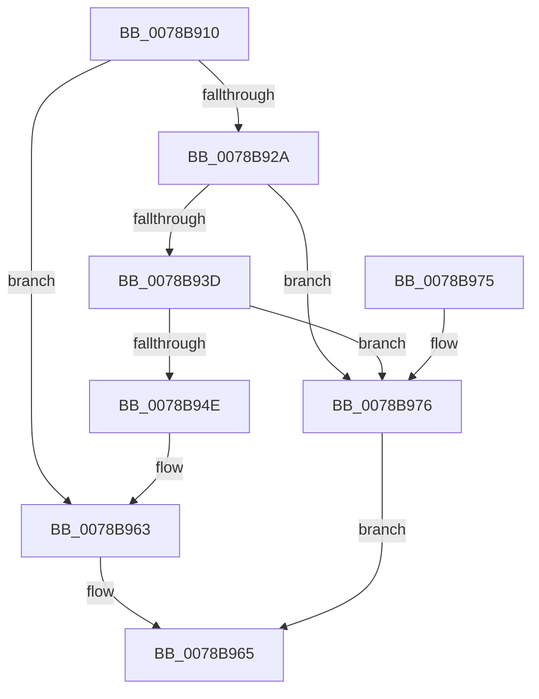

# RtlAppendAsciizToString

- RVA: `0x0078B910`–`0x0078B97D` (길이 `109` bytes)
- VA: `0x000000014078B910`
- 실행 섹션: `PAGE`
- PDB 이름 있음: `예`; PDB Function 태그: `아니요`
- unwind 정보 RVA: `0x0006383C`
- 디코드: `33`개 명령, `109/109` bytes 표시
- 미해석 바이트: `0` (있으면 어셈블리에 `.byte`로 보존)

> 이 문서는 커널 이미지의 기계어와 PDB 기호를 분석해 생성했습니다. 4번과 5번은 함수 원형과 자료형을 바이너리 사용 방식에서 추정한 C 해석이며 원본 소스 복구 결과는 아닙니다.

## 1. Dependencies

- 직접 호출 지점: **2**; 고유 호출 대상: **2**
- 직접 호출자로 확인된 함수: **0**
- RIP 상대 이미지 참조: **0**

### Outgoing calls
- `0x0078B92D` → [strlen](../../text/6C/strlen_function_006C70D0.md) (function, `0x006C70D0`)
- `0x0078B95B` → [memcpy](../../text/6C/memcpy_function_006C6840.md) (function, `0x006C6840`)

### Direct callers
- 이 함수 시작 RVA로 연결되는 직접 call은 확인되지 않았습니다. 간접 호출은 완전히 역산할 수 없습니다.

### Static image references
- 디코드된 RIP-relative 메모리 참조가 없습니다.

## 2. Other-region calls and transfers

- 다른 실행 섹션으로 향하는 call: **2**
  - `0x0078B92D` → [strlen](../../text/6C/strlen_function_006C70D0.md) (`PAGE` → `.text`)
  - `0x0078B95B` → [memcpy](../../text/6C/memcpy_function_006C6840.md) (`PAGE` → `.text`)
- 별도 외부 분기/꼬리 이동을 확인하지 못했습니다.

## 3. Assembly (complete function range)

```asm
0078B910  48 89 5C 24 08                  mov qword ptr [rsp + 8], rbx
0078B915  48 89 74 24 10                  mov qword ptr [rsp + 0x10], rsi
0078B91A  57                              push rdi
0078B91B  48 83 EC 20                     sub rsp, 0x20
0078B91F  48 8B F2                        mov rsi, rdx
0078B922  48 8B D9                        mov rbx, rcx
0078B925  48 85 D2                        test rdx, rdx
0078B928  74 39                           je 0x14078b963
0078B92A  48 8B CA                        mov rcx, rdx
0078B92D  E8 9E B7 F3 FF                  call 0x1406c70d0
0078B932  48 8B F8                        mov rdi, rax
0078B935  48 3D FF FF 00 00               cmp rax, 0xffff
0078B93B  77 39                           ja 0x14078b976
0078B93D  0F B7 03                        movzx eax, word ptr [rbx]
0078B940  44 0F B7 43 02                  movzx r8d, word ptr [rbx + 2]
0078B945  4C 8D 0C 38                     lea r9, [rax + rdi]
0078B949  4D 3B C8                        cmp r9, r8
0078B94C  77 28                           ja 0x14078b976
0078B94E  48 8B 4B 08                     mov rcx, qword ptr [rbx + 8]
0078B952  4C 8B C7                        mov r8, rdi
0078B955  48 03 C8                        add rcx, rax
0078B958  48 8B D6                        mov rdx, rsi
0078B95B  E8 E0 AE F3 FF                  call 0x1406c6840
0078B960  66 01 3B                        add word ptr [rbx], di
0078B963  33 C0                           xor eax, eax
0078B965  48 8B 5C 24 30                  mov rbx, qword ptr [rsp + 0x30]
0078B96A  48 8B 74 24 38                  mov rsi, qword ptr [rsp + 0x38]
0078B96F  48 83 C4 20                     add rsp, 0x20
0078B973  5F                              pop rdi
0078B974  C3                              ret
0078B975  CC                              int3
0078B976  B8 23 00 00 C0                  mov eax, 0xc0000023
0078B97B  EB E8                           jmp 0x14078b965
```

## 4. C-style interpretation (structured pseudocode)

```c
__int64 __fastcall RtlAppendAsciizToString(__int64 a1, __int64 a2)
{
    __int64 result;
    __int64 v_rsp;
    unsigned __int64 v_stack_p10;
    unsigned __int64 v_stack_p8;

    v_stack_p8 = v_rbx;
    v_stack_p10 = v_rsi;
    v_rsp = (v_rsp) - (32);
    if (a2 == 0) goto loc_0078B963;
    result = strlen(a2, a2, a3, a4);
    if (result > 0xFFFFULL) goto loc_0078B976;
    if ((*(unsigned __int16 *)(a1) + result * 1) > (*(unsigned __int16 *)(a1 + 2))) goto loc_0078B976;
    a1 = (*(unsigned __int64 *)(a1 + 8)) + (*(unsigned __int16 *)(a1));
    result = memcpy(a1, a2, result, *(unsigned __int16 *)(a1) + result * 1);
loc_0078B963:
    result = 0;
loc_0078B965:
    v_rsp = (v_rsp) + (32);
    return result;
loc_0078B976:
    goto loc_0078B965;
}
```

## 5. (Beta) C Style

```c
int64_t RtlAppendAsciizToString(void *Arg1, int64_t Arg2)
{
    uint8_t *arg1 = (uint8_t *)Arg1;

    int64_t result;
    int64_t local_rsp;
    uint64_t v_stack_p10;
    uint64_t v_stack_p8;

    v_stack_p8 = local_rbx;
    v_stack_p10 = local_rsi;
    local_rsp = (local_rsp) - (32);
    if (Arg2 == 0) goto loc_0078B963;
    result = strlen(Arg2, Arg2, a3, a4);
    if (result > 0xFFFFULL) goto loc_0078B976;
    if ((*(uint16_t *)(arg1) + result * 1) > (*(uint16_t *)(arg1 + 0x2))) goto loc_0078B976;
    Arg1 = (*(uint64_t *)(arg1 + 0x8)) + (*(uint16_t *)(arg1));
    result = memcpy(Arg1, Arg2, result, *(uint16_t *)(arg1) + result * 1);
loc_0078B963:
    result = 0;
loc_0078B965:
    local_rsp = (local_rsp) + (32);
    return result;
loc_0078B976:
    goto loc_0078B965;
}
```

### 관측된 메모리 오프셋

구조체 형식이 확인되지 않은 접근은 인자 기준의 오프셋으로만 기록했습니다.

| 기준 인자 | 오프셋 표현 | 폭 (bit) | 접근 |
|---|---:|---:|---|
| `Arg1` | `+ 0x0` | `16` | `R` |
| `Arg1` | `+ 0x0` | `16` | `R/W` |
| `Arg1` | `+ 0x2` | `16` | `R` |
| `Arg1` | `+ 0x8` | `64` | `R` |

## 6. Execution-region graph

[열기: 2D/3D 그래프와 함수 탐색 컨트롤 패널](../../../control-panel.html?section=page&rva=0x0078B910&view=graph)

- 2D 그래프는 위에서 아래로 흐르고, 3D 그래프는 빈 공간을 드래그해 회전합니다. Shift+드래그는 이동, 휠은 확대·축소, 함수 노드 선택은 대상 보고서 이동입니다.

### Static fallback


