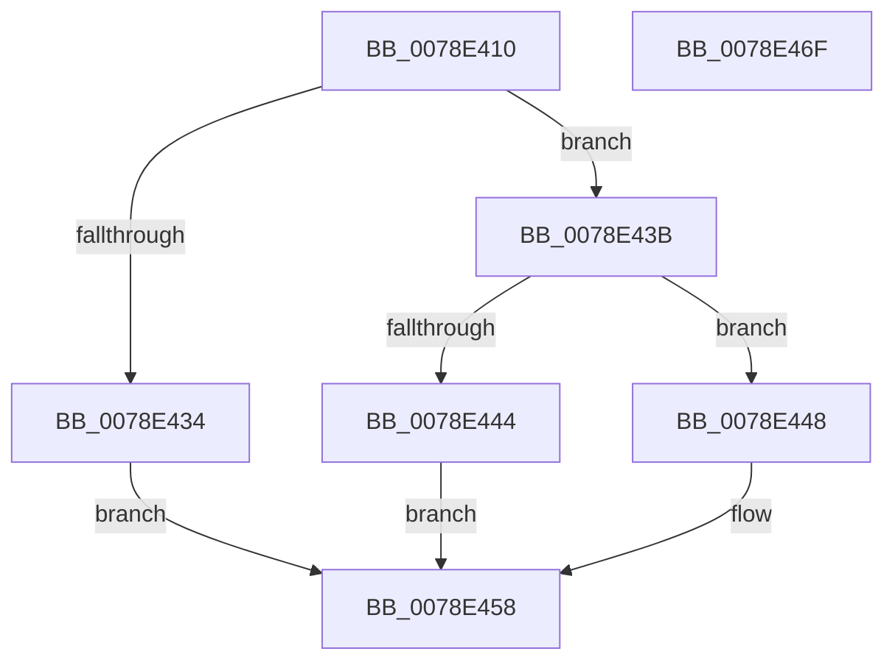

# RtlCapabilityCheckForSingleSessionSku

- RVA: `0x0078E410`–`0x0078E470` (길이 `96` bytes)
- VA: `0x000000014078E410`
- 실행 섹션: `PAGE`
- PDB 이름 있음: `예`; PDB Function 태그: `아니요`
- unwind 정보 RVA: `0x0005C954`
- 디코드: `31`개 명령, `96/96` bytes 표시
- 미해석 바이트: `0` (있으면 어셈블리에 `.byte`로 보존)

> 이 문서는 커널 이미지의 기계어와 PDB 기호를 분석해 생성했습니다. 4번과 5번은 함수 원형과 자료형을 바이너리 사용 방식에서 추정한 C 해석이며 원본 소스 복구 결과는 아닙니다.

## 1. Dependencies

- 직접 호출 지점: **2**; 고유 호출 대상: **2**
- 직접 호출자로 확인된 함수: **1**
- RIP 상대 이미지 참조: **0**

### Outgoing calls
- `0x0078E43B` → [RtlIsMultiSessionSku](../A2/RtlIsMultiSessionSku_function_00A20730.md) (function, `0x00A20730`)
- `0x0078E451` → [RtlCapabilityCheck](../A2/RtlCapabilityCheck_function_00A20340.md) (function, `0x00A20340`)

### Direct callers
- [PopPowerInformationInternal](../A8/PopPowerInformationInternal_function_00A8B7C0.md) at `0x00A8BA19`

### Static image references
- 디코드된 RIP-relative 메모리 참조가 없습니다.

## 2. Other-region calls and transfers

- 다른 실행 섹션으로 향하는 call: **0**
- 별도 외부 분기/꼬리 이동을 확인하지 못했습니다.

## 3. Assembly (complete function range)

```asm
0078E410  48 89 5C 24 08                  mov qword ptr [rsp + 8], rbx
0078E415  48 89 6C 24 10                  mov qword ptr [rsp + 0x10], rbp
0078E41A  48 89 74 24 18                  mov qword ptr [rsp + 0x18], rsi
0078E41F  57                              push rdi
0078E420  48 83 EC 20                     sub rsp, 0x20
0078E424  33 DB                           xor ebx, ebx
0078E426  49 8B F8                        mov rdi, r8
0078E429  48 8B F2                        mov rsi, rdx
0078E42C  48 8B E9                        mov rbp, rcx
0078E42F  4D 85 C0                        test r8, r8
0078E432  75 07                           jne 0x14078e43b
0078E434  BB 0D 00 00 C0                  mov ebx, 0xc000000d
0078E439  EB 1D                           jmp 0x14078e458
0078E43B  E8 F0 22 29 00                  call 0x140a20730
0078E440  84 C0                           test al, al
0078E442  74 04                           je 0x14078e448
0078E444  88 1F                           mov byte ptr [rdi], bl
0078E446  EB 10                           jmp 0x14078e458
0078E448  4C 8B C7                        mov r8, rdi
0078E44B  48 8B D6                        mov rdx, rsi
0078E44E  48 8B CD                        mov rcx, rbp
0078E451  E8 EA 1E 29 00                  call 0x140a20340
0078E456  8B D8                           mov ebx, eax
0078E458  48 8B 6C 24 38                  mov rbp, qword ptr [rsp + 0x38]
0078E45D  8B C3                           mov eax, ebx
0078E45F  48 8B 5C 24 30                  mov rbx, qword ptr [rsp + 0x30]
0078E464  48 8B 74 24 40                  mov rsi, qword ptr [rsp + 0x40]
0078E469  48 83 C4 20                     add rsp, 0x20
0078E46D  5F                              pop rdi
0078E46E  C3                              ret
0078E46F  CC                              int3
```

## 4. C-style interpretation (structured pseudocode)

```c
__int64 __fastcall RtlCapabilityCheckForSingleSessionSku(__int64 a1, __int64 a2, __int64 a3)
{
    __int64 result;
    __int64 v_rbx;
    __int64 v_rsp;
    unsigned __int64 v_stack_p10;
    unsigned __int64 v_stack_p18;
    unsigned __int64 v_stack_p8;

    v_stack_p8 = v_rbx;
    v_stack_p10 = v_rbp;
    v_stack_p18 = v_rsi;
    v_rsp = (v_rsp) - (32);
    v_rbx = 0;
    if (a3 != 0) goto loc_0078E43B;
    goto loc_0078E458;
loc_0078E43B:
    result = RtlIsMultiSessionSku(a1, a2, a3, a4);
    if ((unsigned __int8)(result) == 0) goto loc_0078E448;
    *(unsigned __int8 *)(a3) = (unsigned __int8)((unsigned int)(0xC000000DULL));
    goto loc_0078E458;
loc_0078E448:
    result = RtlCapabilityCheck(a1, a2, a3, a4);
loc_0078E458:
    v_rsp = (v_rsp) + (32);
    return (unsigned int)((unsigned int)((unsigned int)((unsigned int)(result))));
}
```

## 5. (Beta) C Style

```c
int64_t RtlCapabilityCheckForSingleSessionSku(int64_t Arg1, int64_t Arg2, void *Arg3)
{
    uint8_t *arg3 = (uint8_t *)Arg3;

    int64_t result;
    int64_t local_rbx;
    int64_t local_rsp;
    uint64_t v_stack_p10;
    uint64_t v_stack_p18;
    uint64_t v_stack_p8;

    v_stack_p8 = local_rbx;
    v_stack_p10 = local_rbp;
    v_stack_p18 = local_rsi;
    local_rsp = (local_rsp) - (32);
    local_rbx = 0;
    if (Arg3 != NULL) goto loc_0078E43B;
    goto loc_0078E458;
loc_0078E43B:
    result = RtlIsMultiSessionSku(Arg1, Arg2, Arg3, a4);
    if ((uint8_t)(result) == 0) goto loc_0078E448;
    *(uint8_t *)(arg3) = (uint8_t)((uint32_t)(0xC000000DULL));
    goto loc_0078E458;
loc_0078E448:
    result = RtlCapabilityCheck(Arg1, Arg2, Arg3, a4);
loc_0078E458:
    local_rsp = (local_rsp) + (32);
    return (uint32_t)((uint32_t)((uint32_t)((uint32_t)(result))));
}
```

### 관측된 메모리 오프셋

구조체 형식이 확인되지 않은 접근은 인자 기준의 오프셋으로만 기록했습니다.

| 기준 인자 | 오프셋 표현 | 폭 (bit) | 접근 |
|---|---:|---:|---|
| `Arg3` | `+ 0x0` | `8` | `W` |

## 6. Execution-region graph

[열기: 2D/3D 그래프와 함수 탐색 컨트롤 패널](../../../control-panel.html?section=page&rva=0x0078E410&view=graph)

- 2D 그래프는 위에서 아래로 흐르고, 3D 그래프는 빈 공간을 드래그해 회전합니다. Shift+드래그는 이동, 휠은 확대·축소, 함수 노드 선택은 대상 보고서 이동입니다.

### Static fallback


