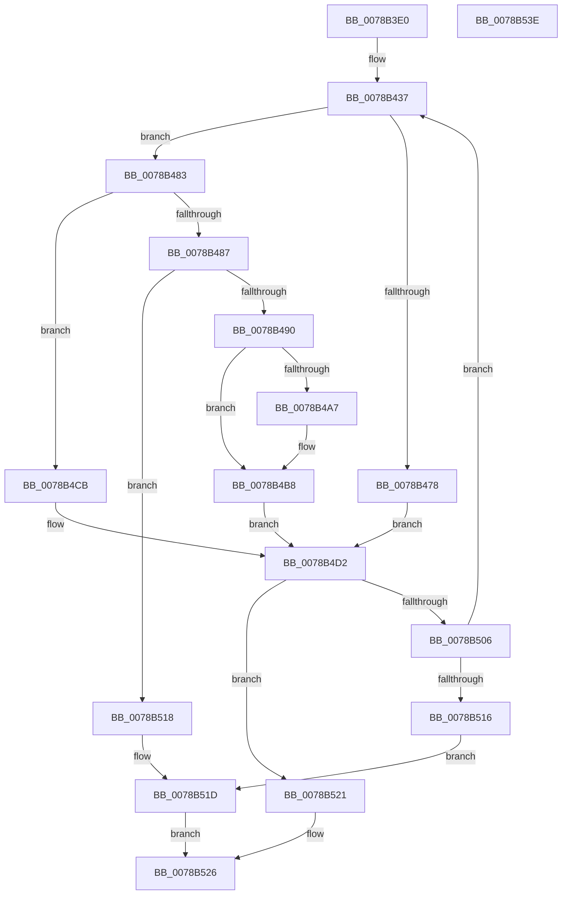

# RtlCompressChunks

- RVA: `0x0078B3E0`–`0x0078B53F` (길이 `351` bytes)
- VA: `0x000000014078B3E0`
- 실행 섹션: `PAGE`
- PDB 이름 있음: `예`; PDB Function 태그: `아니요`
- unwind 정보 RVA: `0x000A7408`
- 디코드: `97`개 명령, `351/351` bytes 표시
- 미해석 바이트: `0` (있으면 어셈블리에 `.byte`로 보존)

> 이 문서는 커널 이미지의 기계어와 PDB 기호를 분석해 생성했습니다. 4번과 5번은 함수 원형과 자료형을 바이너리 사용 방식에서 추정한 C 해석이며 원본 소스 복구 결과는 아닙니다.

## 1. Dependencies

- 직접 호출 지점: **3**; 고유 호출 대상: **3**
- 직접 호출자로 확인된 함수: **0**
- RIP 상대 이미지 참조: **0**

### Outgoing calls
- `0x0078B46C` → [RtlCompressBuffer](../../text/26/RtlCompressBuffer_function_0026A220.md) (function, `0x0026A220`)
- `0x0078B49E` → [memcpy](../../text/6C/memcpy_function_006C6840.md) (function, `0x006C6840`)
- `0x0078B4B3` → [memset](../../text/6C/memset_function_006C6C40.md) (function, `0x006C6C40`)

### Direct callers
- 이 함수 시작 RVA로 연결되는 직접 call은 확인되지 않았습니다. 간접 호출은 완전히 역산할 수 없습니다.

### Static image references
- 디코드된 RIP-relative 메모리 참조가 없습니다.

## 2. Other-region calls and transfers

- 다른 실행 섹션으로 향하는 call: **3**
  - `0x0078B46C` → [RtlCompressBuffer](../../text/26/RtlCompressBuffer_function_0026A220.md) (`PAGE` → `.text`)
  - `0x0078B49E` → [memcpy](../../text/6C/memcpy_function_006C6840.md) (`PAGE` → `.text`)
  - `0x0078B4B3` → [memset](../../text/6C/memset_function_006C6C40.md) (`PAGE` → `.text`)
- 별도 외부 분기/꼬리 이동을 확인하지 못했습니다.

## 3. Assembly (complete function range)

```asm
0078B3E0  48 8B C4                        mov rax, rsp
0078B3E3  48 89 58 18                     mov qword ptr [rax + 0x18], rbx
0078B3E7  48 89 48 08                     mov qword ptr [rax + 8], rcx
0078B3EB  55                              push rbp
0078B3EC  56                              push rsi
0078B3ED  57                              push rdi
0078B3EE  41 54                           push r12
0078B3F0  41 55                           push r13
0078B3F2  41 56                           push r14
0078B3F4  41 57                           push r15
0078B3F6  48 83 EC 40                     sub rsp, 0x40
0078B3FA  4C 8B A4 24 A0 00 00 00         mov r12, qword ptr [rsp + 0xa0]
0078B402  33 DB                           xor ebx, ebx
0078B404  8B EA                           mov ebp, edx
0078B406  89 58 10                        mov dword ptr [rax + 0x10], ebx
0078B409  48 8B D1                        mov rdx, rcx
0078B40C  8B C5                           mov eax, ebp
0078B40E  C1 E8 04                        shr eax, 4
0078B411  44 8B F5                        mov r14d, ebp
0078B414  41 8A 4C 24 03                  mov cl, byte ptr [r12 + 3]
0078B419  8D 73 01                        lea esi, [rbx + 1]
0078B41C  D3 E6                           shl esi, cl
0078B41E  4D 8D 6C 24 08                  lea r13, [r12 + 8]
0078B423  44 2B F0                        sub r14d, eax
0078B426  66 41 89 5C 24 06               mov word ptr [r12 + 6], bx
0078B42C  4D 8B F8                        mov r15, r8
0078B42F  4C 89 AC 24 A0 00 00 00         mov qword ptr [rsp + 0xa0], r13
0078B437  48 8B 84 24 B0 00 00 00         mov rax, qword ptr [rsp + 0xb0]
0078B43F  3B EE                           cmp ebp, esi
0078B441  41 0F B7 0C 24                  movzx ecx, word ptr [r12]
0078B446  8B FD                           mov edi, ebp
0078B448  48 89 44 24 38                  mov qword ptr [rsp + 0x38], rax
0078B44D  0F 43 FE                        cmovae edi, esi
0078B450  48 8D 84 24 88 00 00 00         lea rax, [rsp + 0x88]
0078B458  4D 8B CF                        mov r9, r15
0078B45B  48 89 44 24 30                  mov qword ptr [rsp + 0x30], rax
0078B460  44 8B C7                        mov r8d, edi
0078B463  89 74 24 28                     mov dword ptr [rsp + 0x28], esi
0078B467  44 89 74 24 20                  mov dword ptr [rsp + 0x20], r14d
0078B46C  E8 AF ED AD FF                  call 0x14026a220
0078B471  3D 17 01 00 00                  cmp eax, 0x117
0078B476  75 0B                           jne 0x14078b483
0078B478  8B CB                           mov ecx, ebx
0078B47A  89 9C 24 88 00 00 00            mov dword ptr [rsp + 0x88], ebx
0078B481  EB 4F                           jmp 0x14078b4d2
0078B483  85 C0                           test eax, eax
0078B485  79 44                           jns 0x14078b4cb
0078B487  44 3B F6                        cmp r14d, esi
0078B48A  0F 82 88 00 00 00               jb 0x14078b518
0078B490  48 8B 94 24 80 00 00 00         mov rdx, qword ptr [rsp + 0x80]
0078B498  49 8B CF                        mov rcx, r15
0078B49B  44 8B C7                        mov r8d, edi
0078B49E  E8 9D B3 F3 FF                  call 0x1406c6840
0078B4A3  3B F7                           cmp esi, edi
0078B4A5  76 11                           jbe 0x14078b4b8
0078B4A7  44 8B C6                        mov r8d, esi
0078B4AA  49 8D 0C 3F                     lea rcx, [r15 + rdi]
0078B4AE  44 2B C7                        sub r8d, edi
0078B4B1  33 D2                           xor edx, edx
0078B4B3  E8 88 B7 F3 FF                  call 0x1406c6c40
0078B4B8  4C 8B AC 24 A0 00 00 00         mov r13, qword ptr [rsp + 0xa0]
0078B4C0  8B CE                           mov ecx, esi
0078B4C2  89 8C 24 88 00 00 00            mov dword ptr [rsp + 0x88], ecx
0078B4C9  EB 07                           jmp 0x14078b4d2
0078B4CB  8B 8C 24 88 00 00 00            mov ecx, dword ptr [rsp + 0x88]
0078B4D2  48 8B 94 24 80 00 00 00         mov rdx, qword ptr [rsp + 0x80]
0078B4DA  B8 01 00 00 00                  mov eax, 1
0078B4DF  41 89 4D 00                     mov dword ptr [r13], ecx
0078B4E3  49 83 C5 04                     add r13, 4
0078B4E7  66 41 01 44 24 06               add word ptr [r12 + 6], ax
0078B4ED  8B C7                           mov eax, edi
0078B4EF  48 03 D0                        add rdx, rax
0078B4F2  4C 89 AC 24 A0 00 00 00         mov qword ptr [rsp + 0xa0], r13
0078B4FA  48 89 94 24 80 00 00 00         mov qword ptr [rsp + 0x80], rdx
0078B502  3B FD                           cmp edi, ebp
0078B504  77 1B                           ja 0x14078b521
0078B506  8B C1                           mov eax, ecx
0078B508  44 2B F1                        sub r14d, ecx
0078B50B  4C 03 F8                        add r15, rax
0078B50E  2B EF                           sub ebp, edi
0078B510  0F 85 21 FF FF FF               jne 0x14078b437
0078B516  EB 05                           jmp 0x14078b51d
0078B518  BB 23 00 00 C0                  mov ebx, 0xc0000023
0078B51D  8B C3                           mov eax, ebx
0078B51F  EB 05                           jmp 0x14078b526
0078B521  B8 42 02 00 C0                  mov eax, 0xc0000242
0078B526  48 8B 9C 24 90 00 00 00         mov rbx, qword ptr [rsp + 0x90]
0078B52E  48 83 C4 40                     add rsp, 0x40
0078B532  41 5F                           pop r15
0078B534  41 5E                           pop r14
0078B536  41 5D                           pop r13
0078B538  41 5C                           pop r12
0078B53A  5F                              pop rdi
0078B53B  5E                              pop rsi
0078B53C  5D                              pop rbp
0078B53D  C3                              ret
0078B53E  CC                              int3
```

## 4. C-style interpretation (structured pseudocode)

```c
__int64 __fastcall RtlCompressChunks(__int64 a1, int a2, __int64 a3, __int64 a4, __int64 a5, __int64 a6, __int64 a7)
{
    __int64 result;
    __int64 v_r13;
    __int64 v_r14;
    __int64 v_r15;
    __int64 v_rbp;
    __int64 v_rbx;
    __int64 v_rdi;
    __int64 v_rsi;
    __int64 v_rsp;
    unsigned __int64 v_stack_m40;
    unsigned __int64 v_stack_m48;
    unsigned int v_stack_m50;
    unsigned int v_stack_m58;
    unsigned __int64 v_stack_p10;
    unsigned __int64 v_stack_p18;
    unsigned __int64 v_stack_p28;
    unsigned __int64 v_stack_p8;

    *(unsigned __int64 *)(v_rsp + 24) = v_rbx;
    *(unsigned __int64 *)(v_rsp + 8) = a1;
    v_rsp = (v_rsp) - (64);
    v_rbx = 0;
    *(unsigned int *)(v_rsp + 16) = 0;
    result = (unsigned int)(((unsigned int)((unsigned int)((unsigned int)(a2)))) >> (4));
    v_rsi = (unsigned int)((v_rbx + 1) << ((unsigned __int8)(*(unsigned __int8 *)(a5 + 3))));
    v_r14 = (unsigned int)(((unsigned int)((unsigned int)((unsigned int)(a2)))) - ((unsigned int)(result)));
    *(unsigned __int16 *)(a5 + 6) = 0;
    v_stack_p28 = a5 + 8;
loc_0078B437:
    v_stack_m40 = a7;
    v_rdi = (unsigned int)((unsigned int)((unsigned int)(a2)));
    if (((unsigned int)((unsigned int)(a2))) >= ((unsigned int)(v_rsi))) { v_rdi = (unsigned int)(v_rsi); }
    v_stack_m48 = v_stack_p10;
    v_stack_m50 = (unsigned int)(v_rsi);
    v_stack_m58 = (unsigned int)(v_r14);
    result = RtlCompressBuffer(*(unsigned __int16 *)(a5), a1, (unsigned int)((unsigned int)(v_rdi)), a3);
    if (((unsigned int)(result)) != 279) goto loc_0078B483;
    v_stack_p10 = 0;
    goto loc_0078B4D2;
loc_0078B483:
    if (!sign_flag) goto loc_0078B4CB;
    if (((unsigned int)(v_r14)) < ((unsigned int)(v_rsi))) goto loc_0078B518;
    result = memcpy(a3, v_stack_p8, (unsigned int)((unsigned int)(v_rdi)), a3);
    if (((unsigned int)(v_rsi)) >= = ((unsigned int)(v_rdi))) {
        a3 = (unsigned int)(v_rsi);
        a1 = a3 + v_rdi * 1;
        a3 = (unsigned int)((a3) - ((unsigned int)(v_rdi)));
        a2 = 0;
        result = memset(a1, a2, a3, a3);
    }
    v_stack_p10 = (unsigned int)((unsigned int)((unsigned int)(v_rsi)));
    goto loc_0078B4D2;
loc_0078B4CB:
loc_0078B4D2:
    *(unsigned int *)(a5) = (unsigned int)((unsigned int)(v_stack_p10));
    v_r13 = (a5) + (4);
    a2 = (v_stack_p8) + ((unsigned int)((unsigned int)(v_rdi)));
    v_stack_p28 = v_r13;
    v_stack_p8 = a2;
    if (((unsigned int)(v_rdi)) > ((unsigned int)((unsigned int)(a2)))) goto loc_0078B521;
    v_r14 = (unsigned int)((v_r14) - ((unsigned int)((unsigned int)(v_stack_p10))));
    v_r15 = (a3) + ((unsigned int)((unsigned int)((unsigned int)(v_stack_p10))));
    v_rbp = (unsigned int)(((unsigned int)(a2)) - ((unsigned int)(v_rdi)));
    if (condition_is_not_equal) goto loc_0078B437;
    goto loc_0078B51D;
loc_0078B518:
loc_0078B51D:
    goto loc_0078B526;
loc_0078B521:
loc_0078B526:
    v_rsp = (v_rsp) + (64);
    return (unsigned int)(0xC0000242ULL);
}
```

## 5. (Beta) C Style

```c
int64_t RtlCompressChunks(int64_t Arg1, int32_t Arg2, void *Arg3, int64_t Arg4, void *Arg5, uint64_t Arg6, int64_t Arg7)
{
    uint8_t *arg3 = (uint8_t *)Arg3;
    uint8_t *arg5 = (uint8_t *)Arg5;

    int64_t result;
    int64_t local_r13;
    int64_t local_r14;
    int64_t local_r15;
    int64_t local_rbp;
    int64_t local_rbx;
    int64_t local_rdi;
    int64_t local_rsi;
    int64_t local_rsp;
    uint64_t v_stack_m40;
    uint64_t v_stack_m48;
    uint32_t v_stack_m50;
    uint32_t v_stack_m58;
    uint64_t v_stack_p10;
    uint64_t v_stack_p18;
    uint64_t v_stack_p28;
    uint64_t v_stack_p8;

    *(uint64_t *)(local_rsp + 0x18) = local_rbx;
    *(uint64_t *)(local_rsp + 0x8) = Arg1;
    local_rsp = (local_rsp) - (64);
    local_rbx = 0;
    *(uint32_t *)(local_rsp + 0x10) = 0;
    result = (uint32_t)(((uint32_t)((uint32_t)((uint32_t)(Arg2)))) >> (4));
    local_rsi = (uint32_t)((local_rbx + 1) << ((uint8_t)(*(uint8_t *)(arg5 + 0x3))));
    local_r14 = (uint32_t)(((uint32_t)((uint32_t)((uint32_t)(Arg2)))) - ((uint32_t)(result)));
    *(uint16_t *)(arg5 + 0x6) = 0;
    v_stack_p28 = Arg5 + 8;
loc_0078B437:
    v_stack_m40 = Arg7;
    local_rdi = (uint32_t)((uint32_t)((uint32_t)(Arg2)));
    if (((uint32_t)((uint32_t)(Arg2))) >= ((uint32_t)(local_rsi))) { local_rdi = (uint32_t)(local_rsi); }
    v_stack_m48 = v_stack_p10;
    v_stack_m50 = (uint32_t)(local_rsi);
    v_stack_m58 = (uint32_t)(local_r14);
    result = RtlCompressBuffer(*(uint16_t *)(arg5), Arg1, (uint32_t)((uint32_t)(local_rdi)), Arg3);
    if (((uint32_t)(result)) != 279) goto loc_0078B483;
    v_stack_p10 = 0;
    goto loc_0078B4D2;
loc_0078B483:
    if (!sign_flag) goto loc_0078B4CB;
    if (((uint32_t)(local_r14)) < ((uint32_t)(local_rsi))) goto loc_0078B518;
    result = memcpy(Arg3, v_stack_p8, (uint32_t)((uint32_t)(local_rdi)), Arg3);
    if (((uint32_t)(local_rsi)) >= = ((uint32_t)(local_rdi))) {
        Arg3 = (uint32_t)(local_rsi);
        Arg1 = Arg3 + local_rdi * 1;
        Arg3 = (uint32_t)((Arg3) - ((uint32_t)(local_rdi)));
        Arg2 = 0;
        result = memset(Arg1, Arg2, Arg3, Arg3);
    }
    v_stack_p10 = (uint32_t)((uint32_t)((uint32_t)(local_rsi)));
    goto loc_0078B4D2;
loc_0078B4CB:
loc_0078B4D2:
    *(uint32_t *)(arg5) = (uint32_t)((uint32_t)(v_stack_p10));
    local_r13 = (Arg5) + (4);
    Arg2 = (v_stack_p8) + ((uint32_t)((uint32_t)(local_rdi)));
    v_stack_p28 = local_r13;
    v_stack_p8 = Arg2;
    if (((uint32_t)(local_rdi)) > ((uint32_t)((uint32_t)(Arg2)))) goto loc_0078B521;
    local_r14 = (uint32_t)((local_r14) - ((uint32_t)((uint32_t)(v_stack_p10))));
    local_r15 = (Arg3) + ((uint32_t)((uint32_t)((uint32_t)(v_stack_p10))));
    local_rbp = (uint32_t)(((uint32_t)(Arg2)) - ((uint32_t)(local_rdi)));
    if (condition_is_not_equal) goto loc_0078B437;
    goto loc_0078B51D;
loc_0078B518:
loc_0078B51D:
    goto loc_0078B526;
loc_0078B521:
loc_0078B526:
    local_rsp = (local_rsp) + (64);
    return (uint32_t)(0xC0000242ULL);
}
```

### 관측된 메모리 오프셋

구조체 형식이 확인되지 않은 접근은 인자 기준의 오프셋으로만 기록했습니다.

| 기준 인자 | 오프셋 표현 | 폭 (bit) | 접근 |
|---|---:|---:|---|
| `Arg3` | `+ 0x0 + rdi*1` | `64` | `R` |
| `Arg5` | `+ 0x0` | `16` | `R` |
| `Arg5` | `+ 0x0` | `32` | `W` |
| `Arg5` | `+ 0x3` | `8` | `R` |
| `Arg5` | `+ 0x6` | `16` | `R/W` |
| `Arg5` | `+ 0x6` | `16` | `W` |
| `Arg5` | `+ 0x8` | `64` | `R` |

## 6. Execution-region graph

[열기: 2D/3D 그래프와 함수 탐색 컨트롤 패널](../../../control-panel.html?section=page&rva=0x0078B3E0&view=graph)

- 2D 그래프는 위에서 아래로 흐르고, 3D 그래프는 빈 공간을 드래그해 회전합니다. Shift+드래그는 이동, 휠은 확대·축소, 함수 노드 선택은 대상 보고서 이동입니다.

### Static fallback


