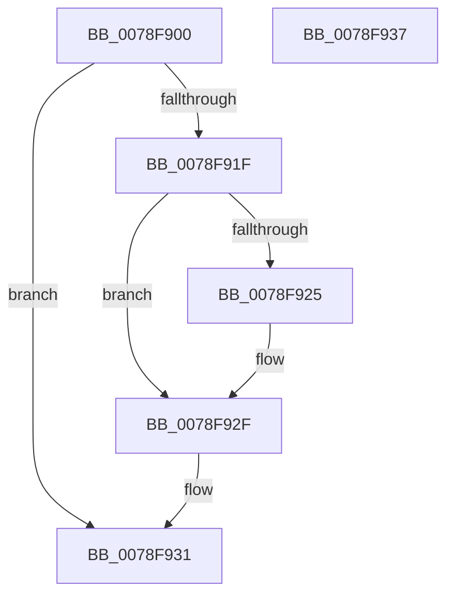

# RtlCreateRegistryKey

- RVA: `0x0078F900`–`0x0078F938` (길이 `56` bytes)
- VA: `0x000000014078F900`
- 실행 섹션: `PAGE`
- PDB 이름 있음: `예`; PDB Function 태그: `아니요`
- unwind 정보 RVA: `0x0005CF00`
- 디코드: `18`개 명령, `56/56` bytes 표시
- 미해석 바이트: `0` (있으면 어셈블리에 `.byte`로 보존)

> 이 문서는 커널 이미지의 기계어와 PDB 기호를 분석해 생성했습니다. 4번과 5번은 함수 원형과 자료형을 바이너리 사용 방식에서 추정한 C 해석이며 원본 소스 복구 결과는 아닙니다.

## 1. Dependencies

- 직접 호출 지점: **2**; 고유 호출 대상: **2**
- 직접 호출자로 확인된 함수: **2**
- RIP 상대 이미지 참조: **0**

### Outgoing calls
- `0x0078F916` → [RtlpGetRegistryHandle](../8C/RtlpGetRegistryHandle_function_008C955C.md) (function, `0x008C955C`)
- `0x0078F92A` → [ZwClose](../../text/6A/ZwClose_function_006AD2B0.md) (function, `0x006AD2B0`)

### Direct callers
- [DifRtlCreateRegistryKeyWrapper](../../text/63/DifRtlCreateRegistryKeyWrapper_function_0063B4F0.md) at `0x0063B5C7`
- [WheapOpenPolicyRegistryKey](../../init/C5/WheapOpenPolicyRegistryKey_function_00C55840.md) at `0x00C558A0`
- [WheapOpenPolicyRegistryKey](../../init/C5/WheapOpenPolicyRegistryKey_function_00C55840.md) at `0x00C558B9`

### Static image references
- 디코드된 RIP-relative 메모리 참조가 없습니다.

## 2. Other-region calls and transfers

- 다른 실행 섹션으로 향하는 call: **1**
  - `0x0078F92A` → [ZwClose](../../text/6A/ZwClose_function_006AD2B0.md) (`PAGE` → `.text`)
- 별도 외부 분기/꼬리 이동을 확인하지 못했습니다.

## 3. Assembly (complete function range)

```asm
0078F900  40 53                           push rbx
0078F902  48 83 EC 20                     sub rsp, 0x20
0078F906  48 83 64 24 40 00               and qword ptr [rsp + 0x40], 0
0078F90C  4C 8D 4C 24 40                  lea r9, [rsp + 0x40]
0078F911  41 B0 01                        mov r8b, 1
0078F914  8B D9                           mov ebx, ecx
0078F916  E8 41 9C 13 00                  call 0x1408c955c
0078F91B  85 C0                           test eax, eax
0078F91D  78 12                           js 0x14078f931
0078F91F  0F BA E3 1E                     bt ebx, 0x1e
0078F923  72 0A                           jb 0x14078f92f
0078F925  48 8B 4C 24 40                  mov rcx, qword ptr [rsp + 0x40]
0078F92A  E8 81 D9 F1 FF                  call 0x1406ad2b0
0078F92F  33 C0                           xor eax, eax
0078F931  48 83 C4 20                     add rsp, 0x20
0078F935  5B                              pop rbx
0078F936  C3                              ret
0078F937  CC                              int3
```

## 4. C-style interpretation (structured pseudocode)

```c
__int64 __fastcall RtlCreateRegistryKey(int a1)
{
    __int64 result;
    __int64 v_rsp;
    unsigned __int64 v_stack_p18;

    v_rsp = (v_rsp) - (32);
    result = RtlpGetRegistryHandle(a1, a2, 1, v_stack_p18);
    if (sign_flag) goto loc_0078F931;
    if (!(condition_is_below)) {
        a1 = v_stack_p18;
        result = ZwClose(a1, a2, 1, v_stack_p18);
    }
    result = 0;
loc_0078F931:
    v_rsp = (v_rsp) + (32);
    return result;
}
```

## 5. (Beta) C Style

```c
int64_t RtlCreateRegistryKey(int32_t Arg1)
{
    int64_t result;
    int64_t local_rsp;
    uint64_t v_stack_p18;

    local_rsp = (local_rsp) - (32);
    result = RtlpGetRegistryHandle(Arg1, a2, 1, v_stack_p18);
    if (sign_flag) goto loc_0078F931;
    if (!(condition_is_below)) {
        Arg1 = v_stack_p18;
        result = ZwClose(Arg1, a2, 1, v_stack_p18);
    }
    result = 0;
loc_0078F931:
    local_rsp = (local_rsp) + (32);
    return result;
}
```

## 6. Execution-region graph

[열기: 2D/3D 그래프와 함수 탐색 컨트롤 패널](../../../control-panel.html?section=page&rva=0x0078F900&view=graph)

- 2D 그래프는 위에서 아래로 흐르고, 3D 그래프는 빈 공간을 드래그해 회전합니다. Shift+드래그는 이동, 휠은 확대·축소, 함수 노드 선택은 대상 보고서 이동입니다.

### Static fallback


