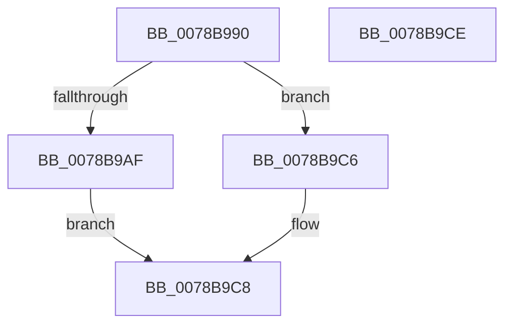

# RtlCreateUnicodeStringFromAsciiz

- RVA: `0x0078B990`–`0x0078B9CF` (길이 `63` bytes)
- VA: `0x000000014078B990`
- 실행 섹션: `PAGE`
- PDB 이름 있음: `예`; PDB Function 태그: `아니요`
- unwind 정보 RVA: `0x00064C80`
- 디코드: `21`개 명령, `63/63` bytes 표시
- 미해석 바이트: `0` (있으면 어셈블리에 `.byte`로 보존)

> 이 문서는 커널 이미지의 기계어와 PDB 기호를 분석해 생성했습니다. 4번과 5번은 함수 원형과 자료형을 바이너리 사용 방식에서 추정한 C 해석이며 원본 소스 복구 결과는 아닙니다.

## 1. Dependencies

- 직접 호출 지점: **2**; 고유 호출 대상: **2**
- 직접 호출자로 확인된 함수: **5**
- RIP 상대 이미지 참조: **0**

### Outgoing calls
- `0x0078B9A6` → [RtlInitAnsiStringEx](../../text/4B/RtlInitAnsiStringEx_function_004B3220.md) (function, `0x004B3220`)
- `0x0078B9BA` → [RtlAnsiStringToUnicodeString](../90/RtlAnsiStringToUnicodeString_function_0090BEA0.md) (function, `0x0090BEA0`)

### Direct callers
- [CmpSetSystemRegistryString](../../text/66/CmpSetSystemRegistryString_function_0066A2F0.md) at `0x0066A31D`
- [IopInitializeBootLogging](../71/IopInitializeBootLogging_function_0071B748.md) at `0x0071B8D7`
- [InitBootProcessor](../../init/C1/InitBootProcessor_function_00C1B1C8.md) at `0x00C1BC5D`
- [VhdiInitializeBootDisk](../../init/C6/VhdiInitializeBootDisk_function_00C6E190.md) at `0x00C6E230`
- [CimfsInitializeBootDisk](../../init/C6/CimfsInitializeBootDisk_function_00C6E9D0.md) at `0x00C6EA5E`

### Static image references
- 디코드된 RIP-relative 메모리 참조가 없습니다.

## 2. Other-region calls and transfers

- 다른 실행 섹션으로 향하는 call: **1**
  - `0x0078B9A6` → [RtlInitAnsiStringEx](../../text/4B/RtlInitAnsiStringEx_function_004B3220.md) (`PAGE` → `.text`)
- 별도 외부 분기/꼬리 이동을 확인하지 못했습니다.

## 3. Assembly (complete function range)

```asm
0078B990  40 53                           push rbx
0078B992  48 83 EC 30                     sub rsp, 0x30
0078B996  48 8B D9                        mov rbx, rcx
0078B999  0F 57 C0                        xorps xmm0, xmm0
0078B99C  48 8D 4C 24 20                  lea rcx, [rsp + 0x20]
0078B9A1  0F 11 44 24 20                  movups xmmword ptr [rsp + 0x20], xmm0
0078B9A6  E8 75 78 D2 FF                  call 0x1404b3220
0078B9AB  85 C0                           test eax, eax
0078B9AD  78 17                           js 0x14078b9c6
0078B9AF  41 B0 01                        mov r8b, 1
0078B9B2  48 8D 54 24 20                  lea rdx, [rsp + 0x20]
0078B9B7  48 8B CB                        mov rcx, rbx
0078B9BA  E8 E1 04 18 00                  call 0x14090bea0
0078B9BF  85 C0                           test eax, eax
0078B9C1  0F 99 C0                        setns al
0078B9C4  EB 02                           jmp 0x14078b9c8
0078B9C6  32 C0                           xor al, al
0078B9C8  48 83 C4 30                     add rsp, 0x30
0078B9CC  5B                              pop rbx
0078B9CD  C3                              ret
0078B9CE  CC                              int3
```

## 4. C-style interpretation (structured pseudocode)

```c
__int64 __fastcall RtlCreateUnicodeStringFromAsciiz(__int64 a1)
{
    __int64 result;
    __int64 v_rsp;
    unsigned __int64 v_stack_m18;

    v_rsp = (v_rsp) - (48);
    v_stack_m18 = v_xmm0;
    result = RtlInitAnsiStringEx(v_stack_m18, a2, a3, a4);
    if (sign_flag) goto loc_0078B9C6;
    result = RtlAnsiStringToUnicodeString(a1, v_stack_m18, 1, a4);
    result = (!sign_flag) ? 1 : 0;
    goto loc_0078B9C8;
loc_0078B9C6:
    result = 0;
loc_0078B9C8:
    v_rsp = (v_rsp) + (48);
    return result;
}
```

## 5. (Beta) C Style

```c
int64_t RtlCreateUnicodeStringFromAsciiz(int64_t Arg1)
{
    int64_t result;
    int64_t local_rsp;
    uint64_t v_stack_m18;

    local_rsp = (local_rsp) - (48);
    v_stack_m18 = v_xmm0;
    result = RtlInitAnsiStringEx(v_stack_m18, a2, a3, a4);
    if (sign_flag) goto loc_0078B9C6;
    result = RtlAnsiStringToUnicodeString(Arg1, v_stack_m18, 1, a4);
    result = (!sign_flag) ? 1 : 0;
    goto loc_0078B9C8;
loc_0078B9C6:
    result = 0;
loc_0078B9C8:
    local_rsp = (local_rsp) + (48);
    return result;
}
```

## 6. Execution-region graph

[열기: 2D/3D 그래프와 함수 탐색 컨트롤 패널](../../../control-panel.html?section=page&rva=0x0078B990&view=graph)

- 2D 그래프는 위에서 아래로 흐르고, 3D 그래프는 빈 공간을 드래그해 회전합니다. Shift+드래그는 이동, 휠은 확대·축소, 함수 노드 선택은 대상 보고서 이동입니다.

### Static fallback


